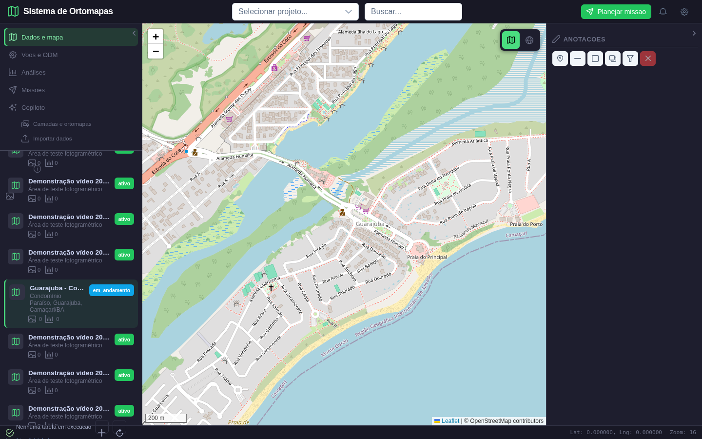
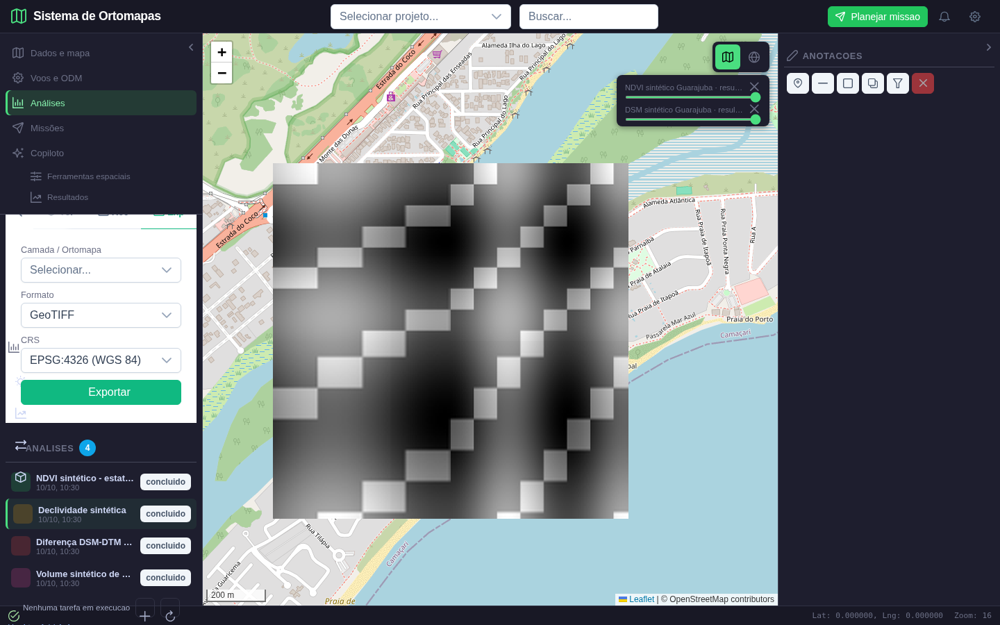
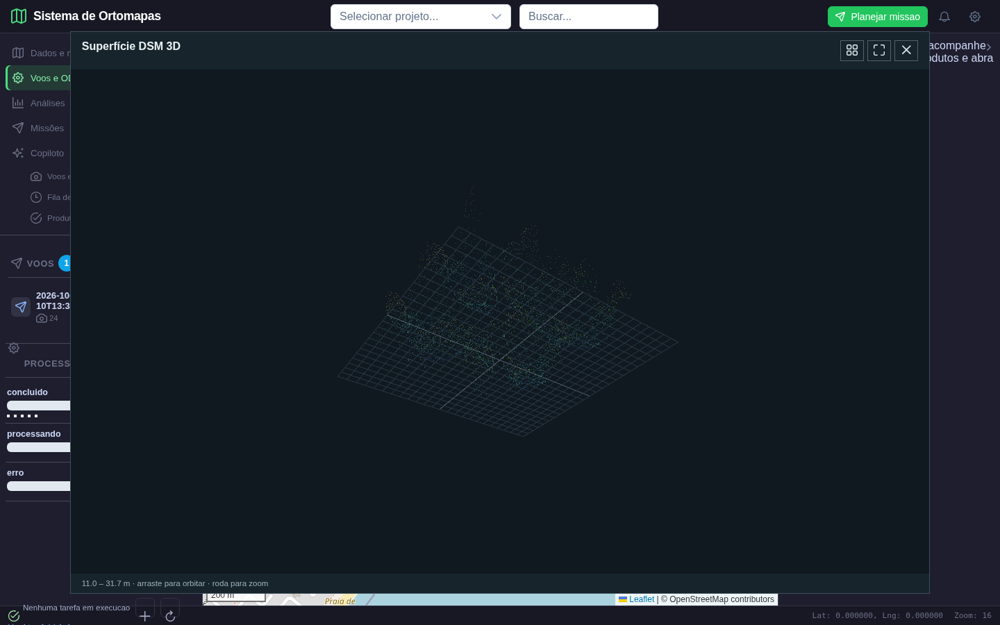
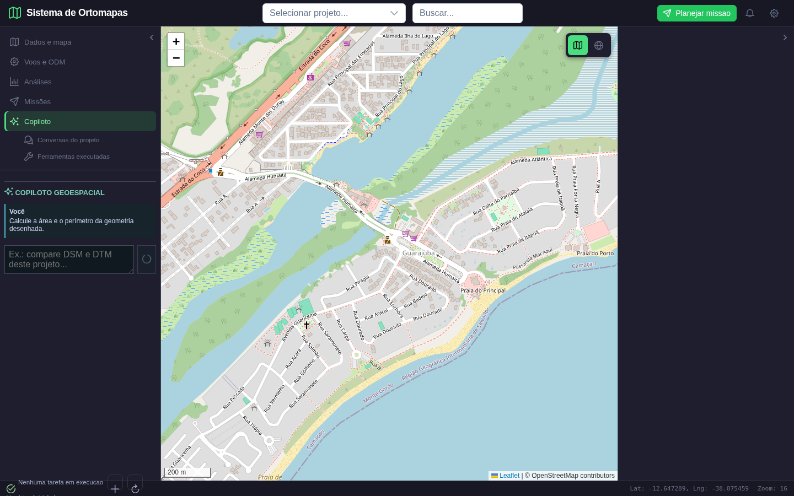

# Ortomapas: revisão técnica e plano de melhorias

**Data:** 10/10/2026 | **Versão:** 1.0 | **Situação:** plano para implementação e validação

## 1. Parecer e alcance

O sistema contém componentes e ferramentas reais, mas a demonstração disponível não comprova que todos os casos de uso funcionem corretamente. Há defeitos de renderização, integração, precisão geográfica e navegação que afetam o resultado entregue ao usuário. Corrigir esses defeitos deve preceder a produção de um novo manual ou vídeo.

Esta revisão combina leitura do código atual, documentos de requisitos, inspeção de capturas existentes e cálculos locais de diagnóstico. Não houve nova execução completa da aplicação nesta revisão. As capturas ilustram problemas observados, não certificam os fluxos. Os itens propostos neste documento ainda precisam ser implementados e testados.

As alterações anteriores continuam no diretório de trabalho. Este documento não as considera aprovadas apenas por terem sido aplicadas. Em particular, ampliar a tolerância de uma AOI em graus, ocultar todas as camadas ao entrar no Copiloto ou normalizar altura independentemente de largura não resolve a consistência técnica do produto.

### Objetivos

1. Exibir o produto geográfico correto, com localização, escala, unidades e legenda confiáveis.
2. Oferecer navegação lateral organizada e acesso direto a todas as funções operacionais.
3. Executar análises pela interface e persistir seus resultados e sua origem.
4. Integrar projetos, fotos, tarefas ODM, produtos 2D/3D, missões e conversas por usuário.
5. Validar com dados apropriados e registrar entradas, ações, respostas e resultados.

### Referências internas

- `docs/analise/casos_de_uso_v2.md`: 20 casos de uso do núcleo.
- `docs/analise/requisitos_planejamento_missoes_litchi.md`: requisitos de captura e exportação.
- `docs/analise/plano_implementacao_agentes.md`: contexto e funções do Copiloto.
- `docs/analise/plano_reestruturacao_interface_seed.md`: intenção de navegação e demonstração.
- `docs/validacao/plano_de_testes_casos_de_uso_v1.md`: testes previstos.
- `frontend/src/App.vue`, componentes, stores e cliente REST.
- `backend/routers/ortomapas.py`, `tools.py`, `agents.py`, `missoes_captura.py` e ferramentas raster.
- `scripts/seed_demo_guarajuba.py` e `tests/e2e/playwright/test_roteiro_video_completo.py`.

**Base de dados da arquitetura:** PostgreSQL/PostGIS. Não propor migração para MySQL ou uma segunda instância PostgreSQL como requisito deste trabalho. Ortomapas e WebODM podem ter bancos e papéis distintos na mesma instância, com integração por API e IDs externos.

## 2. Evidências visuais e sua interpretação

### E-01. Projeto aberto, catálogo e mapa

O projeto Guarajuba está selecionado na lista, mas o seletor superior continua mostrando “Selecionar projeto...”. A lista acumulou projetos de demonstração com nomes truncados e contadores zero. Ela ocupa a área que deveria dar acesso aos produtos do projeto. A barra direita reserva espaço quase vazio. A imagem comprova navegação e mapa base, sem comprovar visualização de uma ortofoto.

**Correção prevista:** uma única seleção de projeto, catálogo separado do espaço de trabalho, contadores derivados da mesma fonte e painel de propriedades contextual que recolhe quando está vazio.

### E-02. “Declividade” mostrando a entrada DSM

O item selecionado chama-se “Declividade sintética”, mas a camada ativada chama-se “DSM sintético”. O centro contém um quadrado em tons de cinza, sem legenda de declividade ou unidades. O formulário visível é de exportação. A tela não demonstra cálculo ou resultado de declividade.

**Causas confirmadas no código:** `AnalysisResults.vue` ativa o raster de origem quando não há resultado próprio; `get_tile()` recorta a interseção com o raster e a estica para todo o tile. A exibição pode deslocar ou deformar o conteúdo na borda. Normalização por tile também pode produzir diferenças de brilho entre tiles.

**Correção prevista:** resultado associado a um produto de saída próprio; tile calculado no retângulo XYZ completo, com transparência fora da cobertura; legenda e escala de cores estáveis para o produto.

### E-03. DSM que não forma uma superfície

O DSM aparece como traços dispersos sobre uma grade. Não é uma superfície contínua de terreno. A ausência de massa visual não se explica apenas pela escolha de dados sintéticos.

**Causa confirmada:** em `DsmSurfaceViewer.vue`, os seis vértices de cada célula recebem o mesmo `px` e `py`, calculados com `x` e `y` da célula. Só a altura muda. Os vértices ficam colineares; o diagnóstico numérico reproduziu área de triângulo igual a zero. O comando wireframe referencia `updateMaterial` sem chamá-la.

**Correção prevista:** calcular posição horizontal de cada vértice pelo seu índice de coluna e linha; excluir triângulos sem dados; construir normais; corrigir wireframe e enquadrar a cena com proporções geográficas preservadas.

### E-04. Copiloto fotografado antes da resposta

A captura contém a pergunta do usuário e o botão em estado de carregamento. Não contém resposta, ferramentas executadas, área ou perímetro. O polígono solicitado também não aparece identificado. Ela não comprova o funcionamento do Copiloto.

**Causa confirmada no roteiro:** a captura ocorre após uma espera fixa curta, sem aguardar conclusão nem verificar conteúdo da resposta. O script marca a cena como aprovada mesmo nesse estado.

**Correção prevista:** aguardar a resposta terminal com prazo explícito; exigir resultado numérico, ferramenta e unidade; associar o ID da geometria ao pedido; capturar solicitação, execução e resposta em cenas distintas.

## 3. Achados técnicos prioritários

P0 = impede confiar em um resultado ou ameaça isolamento de dados. P1 = impede o fluxo operacional completo. P2 = melhora produtividade após os bloqueios.

| ID | Prioridade | Achado confirmado na revisão | Consequência | Correção e aceite |
|---|---|---|---|---|
| M-01 | P0 | Tile usa janela recortada e redimensiona para 256 x 256 | Cobertura deslocada/esticada na borda | Grade XYZ completa, máscara alfa e teste de georreferenciamento |
| M-02 | P0 | Malha DSM com vértices colineares | Cena não contém superfície válida | Triângulos com área positiva e terreno contínuo |
| M-03 | P0 | Medição 3D usa distância no espaço normalizado e rotula em metros | Número sem unidade física válida | Calcular no CRS métrico original, separado da transformação visual |
| M-04 | P0 | Tools geométricas do agente usam `area`, `length` e `buffer` sem CRS | Graus interpretados como área/distância útil | Contrato CRS obrigatório, projeção local ou cálculo geodésico |
| M-05 | P0 | Volume do agente usa área de pixel diretamente; slope usa espaçamento original após reamostragem | Resultados variam incorretamente com CRS ou amostragem | Motor compartilhado com unidades e transformada de saída corretas |
| M-06 | P0 | Fonte DSM pode ser exibida como resultado de declividade/volume/mudança | Usuário vê entrada e acredita ver saída | Proibir substituição semântica; resultado próprio ou mensagem de indisponibilidade |
| M-07 | P0 | Rotas `/tools`, tiles e montagem `/data` não mostram autorização por projeto no código revisado | Possível acesso a arquivo/produto de outro usuário | Validar acesso de cada recurso; substituir caminhos livres por IDs autorizados |
| M-08 | P1 | Frontend chama `vegetacao`, `classificacao` e `exportar`; backend declara outras rotas | Requisição pode falhar antes de produzir resultado | Tabela única de operações e teste HTTP por comando |
| M-09 | P1 | Ferramentas retornam `output_path`/`statistics`; UI espera `tile_url`/`layer_id`/`stats` | Saída gerada não chega ao mapa/catálogo | Contrato persistido e uniforme, com produto, tarefa e estatísticas |
| M-10 | P1 | Subitens de menu sem `action`; busca global sem ligação | Menu aparenta função, clique não executa | Todos os comandos navegam ou executam ação observável |
| M-11 | P1 | Seleção de projeto superior independente do store; respostas assíncronas sem guarda de projeto | Contexto divergente ou dado atrasado no projeto errado | Fonte única de seleção, cancelamento e chave de projeto na resposta |
| M-12 | P1 | Troca para Copiloto oculta todas as camadas | Perda de contexto de análise | Preservar visibilidade, tornar o chat contextual e permitir recolher painéis |
| M-13 | P1 | Hidrologia escolhe primeiro DSM/DTM e pode selecionar DSM no campo DTM | Bacia calculada sobre superfície inadequada | Restringir por tipo e declarar o uso excepcional de DSM |
| M-14 | P1 | Mudanças pode pré-selecionar o mesmo RGB nas duas entradas | Comparação sem mudança por construção | Exigir produtos distintos, datas e área comum |
| M-15 | P1 | Missão existente salva apenas waypoints pelo ramo atual da UI | Parâmetros, AOI ou nome editados podem não persistir | Atualização completa e recarregamento para comparação |
| M-16 | P1 | Validação de missão considera overlap informado e autonomia global, sem demonstrar cobertura efetiva | Grid legível pode não cobrir com overlap real | Perfil de câmera, footprints e cobertura; autonomia por bloco |
| M-17 | P1 | Tolerância AOI em graus; exportação disponível após bloqueio no fluxo observado | Critério espacial variável e exportação ambígua | Tolerância em metros e política explícita de exportação |
| M-18 | P1 | Histórico persistido não é enviado como conversa em `/agents/ask`; chave local usa somente projeto | Memória visível não garante contexto do modelo | Thread autorizada por usuário/projeto e contexto recuperado no servidor |
| M-19 | P1 | Roteiro apenas abre abas, seleciona seed e captura; aprovação sem assert de saída | “Passed” não significa caso de uso cumprido | Asserts de execução, resultado, persistência e apresentação |
| M-20 | P1 | Seed insere tarefas concluídas, stats fixas e falso NDVI derivado de RGB | Demonstração confunde simulação com processamento real | Fixtures rotuladas e resultados calculados; NDVI exige NIR |

M-07 descreve ausência de proteção identificada na composição da aplicação e nas rotas. A exploração externa e a configuração de proxy não foram testadas nesta revisão; o teste de isolamento integra a fase inicial.

### Precisão do 3D

Normalizar a largura para 10 e a altura para 5 torna a nuvem visível, mas altera sua proporção. A escala vertical precisa ser um controle explícito de exagero, com valor padrão 1. Distâncias devem usar coordenadas de origem, independentemente desse controle. A seleção após recorte deve manter o vínculo entre índice renderizado e índice original.

O visualizador atual também rotula X/Y em metros para dados geográficos e perde casas decimais ao usar `toFixed(2)`. O retorno de pontos deve incluir CRS e unidade; coordenadas geográficas devem aparecer como longitude/latitude. PNG, mudança de produto, tela cheia, recorte e limites vazios precisam de testes próprios.

### Precisão das análises e do Copiloto

Declividade em metros de altitude sobre espaçamento em graus não produz um ângulo físico correto. Ao reamostrar uma grade, a resolução usada no gradiente precisa corresponder à grade reamostrada. Volume deve respeitar CRS, máscara de dados, polígono solicitado e datum vertical. O agente atual pode pedir análise de uma geometria e executar cálculo sobre todo o raster.

`perfil_altimetrico` atualmente tira a média das colunas do raster; isso não equivale a amostrar uma linha desenhada. O perfil operacional deve receber uma linha, amostrar distâncias acumuladas em metros e retornar altitudes e gráfico, com localização da linha no mapa.

## 4. Experiência de uso proposta

### Público e fluxo principal

O operador de campo desenha a área, configura a missão e exporta. O analista GIS importa e inspeciona produtos, executa análises e interpreta resultados. O responsável por processamento envia fotos, acompanha tarefas e publica produtos. O cliente visualiza produtos e relatórios com acesso de leitura.

Fluxo integrado: **login > projeto > dados ou missão > captura/upload > processamento ODM > produtos > análise > resultado > exportação/relatório**. O usuário também pode importar produtos existentes e começar pela inspeção.

### Navegação lateral

| Menu principal | Subitens | Conteúdo principal e ação |
|---|---|---|
| Projetos | Meus projetos, compartilhados, novo projeto | Catálogo pesquisável com seleção e situação |
| Visão geral | Resumo, atividades, disponibilidade | Produtos existentes, tarefas e próximas ações do projeto |
| Dados e mapa | Produtos, camadas, importar, metadados | Ortofoto, DSM/DTM, vetores e ferramentas do mapa |
| Voos e ODM | Voos, fotos, nova tarefa, fila, produtos, qualidade | Upload, processamento e publicação de resultado |
| Análises | Vegetação, terreno, classificação, hidrologia, mudanças, volume, resultados | Entrada e parâmetros; resultado ocupa mapa e painel |
| Missões | Lista, nova missão, área, câmera, rota, validação, exportações | Criar ou reabrir missão persistida |
| Visualização 3D | Terreno, nuvem, perfil, diferença | Cena central com produto e controles próprios |
| Copiloto | Conversas, nova conversa, contexto, execuções | Chat vinculado ao projeto e às seleções do mapa |
| Relatórios | Análises, qualidade, missão, demonstrações | Evidências e documentos gerados |

A barra recolhe para uma coluna de ícones com tooltip e indicador de seleção. Expandida, exibe nomes completos e subitens. “Projetos” abre o catálogo; uma lista extensa não fica empilhada acima dos produtos no painel de trabalho.

### Composição das telas

- Barra superior compacta: projeto atual, produto selecionado, tarefa e conta. Busca só aparece quando tiver ação implementada.
- Barra lateral principal: navegação. Painel contextual separado: catálogo de produtos/resultados ou formulário da operação.
- Centro: mapa 2D ou cena 3D, com a maior área útil. Nenhum painel vazio ocupa largura fixa.
- Painel direito: propriedades do item selecionado, legenda, estatísticas e origem. Pode ser recolhido pelo usuário.
- Barra de ferramentas do mapa: zoom, enquadrar, ponto, linha, polígono, editar, excluir, medir e comparar; ícones identificáveis e tooltips.
- Rodapé: CRS, coordenadas e unidade, escala, carregamento e erros recuperáveis.

O planejamento de missão preserva a área central e troca seu painel conforme a etapa. A validação deve aparecer automaticamente após executada, sem exigir que o usuário descubra um relatório abaixo de uma longa lista de waypoints.

### Linguagem visual e interação

Adotar superfícies neutras consistentes com acentos verdes para ações, azuis para seleção e amarelo/vermelho para avisos/erros. Eliminar a mistura de formulários brancos isolados com painéis escuros sem hierarquia. Usar nomes completos das análises; abreviações “Veg”, “Ter” e “Cls” não são suficientes como navegação principal.

Campos numéricos exibem unidade e validação próxima ao campo. Erros HTTP devem ser traduzidos em mensagem acionável. Estados vazios oferecem uma ação apropriada. Produtos indisponíveis mostram a causa. Botões sem implementação não devem parecer operacionais.

Layout de validação: desktop 1440 x 900 e 1920 x 1080; tablet 1024 x 768 e 768 x 1024; móvel 390 x 844. Em tablet/móvel, os painéis abrem como gavetas e mantêm ações essenciais acessíveis. Tipografia deve ter tamanho estável, contraste legível e controles acionáveis por teclado e toque.

## 5. Melhorias funcionais por módulo

### Projetos e dados

Manter seleção única e carregar produtos com identificação de projeto. Mostrar nome, localização, origem, quantidade de produtos, CRS e data. Permitir novo projeto, edição, arquivamento e acesso compartilhado conforme os requisitos. Importação deve aceitar apenas os formatos realmente suportados, listar problemas de CRS/arquivo e publicar o produto no mapa após conclusão.

Separar compatibilidade de formato de arquivo e compatibilidade de projeto: KML/KMZ são dados geográficos; um `.qgz` é projeto QGIS e exige escopo próprio de interpretação das fontes e estilos. Não declarar importação universal de QGIS/ArcGIS sem teste específico. Implementar formatos adicionais conforme o documento de agentes e catálogo de ferramentas.

### Visualização 2D e 3D

Ortofoto RGB com enquadramento por bounds e transparência correta. Elevação com legenda em metros e inspeção de pixel. Índice de vegetação com escala contínua e classes justificadas. Mudanças com escala divergente, datas e identificação de cobertura comum. Classificação com cores categóricas, rótulos e área por classe.

DSM/DTM devem compartilhar um visualizador de superfície correto, identificado pelo produto selecionado. Disponibilizar textura ortofoto opcional, iluminação, wireframe, exagero vertical, plano de corte e enquadramento. Nuvem oferece RGB quando o arquivo tiver cor, intensidade e elevação; amostragem sempre identificada. Perfil altimétrico mostra linha no mapa e gráfico com distância e altitude.

### Execução e persistência de análises

Cada operação recebe IDs de produtos autorizados, geometria e parâmetros. O serviço calcula, valida arquivo/metadados, persiste análise e saída e responde com IDs, status e URLs autorizadas. Operações demoradas entram em fila com progresso, cancelamento e recuperação. Abrir análise concluída deve mostrar sua saída, sem depender de estado temporário da sessão.

Contrato recomendado: `analysis_id`, `project_id`, `operation`, `status`, `input_product_ids`, `parameters`, `geometry_id`, `result_product_ids`, `statistics`, `units`, `warnings`, `error`, `created_at`, `completed_at`. A forma de exibição vem do tipo do produto registrado. Falha de persistência não deve retornar uma tarefa “concluída”.

### ODM

Validar fotos, quantidade, nomes, EXIF, geolocalização e duplicações. Oferecer presets com parâmetros explicitados e estimativa de recursos. Acompanhar task UUID e ID local, falhas, tentativas e logs. Importação deve ser idempotente, verificar arquivos e publicar ortofoto, DSM, DTM, LAZ e relatório com relações entre eles.

Preservar WebODM em 8020 e NodeODM em 8021 conforme configuração acordada. A aplicação acessa APIs pelo backend. O usuário deve iniciar e acompanhar processamento pela interface do Ortomapas. Estados de seed não comprovam que uma tarefa foi executada pelo NodeODM.

### Missões de captura

Definir sensor e tamanho de imagem, distância focal/FOV ou parâmetros equivalentes, altitude e referência vertical, GSD, sobreposições, rumo, gimbal, velocidade, intervalo de captura, reserva de bateria e perfis de compatibilidade. Calcular footprint e espaçamentos com base no perfil. Mudança em altitude/câmera/overlap recalcula ou invalida a rota.

Desenho, seleção, edição e arraste precisam atualizar geometria, cobertura e resumo. Exclusões devem considerar a trajetória entre pontos, não apenas os pontos. Persistir nome, AOI, exclusões, takeoff, captura e waypoints. Validar autonomia por bloco incluindo deslocamentos e reserva. Exportar blocos separadamente quando necessário.

Aumentar a velocidade para aprovar autonomia não resolve cobertura ou nitidez: 180 m entre fotos a 50 m de altitude não deve ser apresentado como cobertura de 80% sem calcular footprint. Avaliar intervalo de captura e borramento. A exportação CSV não prova compatibilidade física com DJI Mini 3; perfil de aplicativo, controle, firmware e importação precisam ser verificados antes de declarar uma missão executável no drone.

### Copiloto

Implementar lista e recuperação de conversas por usuário e projeto, incluindo contexto relevante enviado ao modelo no servidor. Mostrar quais produtos e geometria estão ativos. Antes de executar, verificar entrada, permissão, CRS e unidade; quando houver ambiguidade, solicitar o parâmetro faltante.

Resposta deve ter conclusão, valores, unidades, origem, limitações e ferramentas executadas. A saída deve entrar no catálogo de resultados e no mapa quando espacial. Falhas aparecem como falhas, não como “Análise concluída”. Preservar camadas e seleção ao entrar no chat. Uma alteração destrutiva exige confirmação dentro da aplicação.

Manter LM Studio como provedor definido pelo projeto e verificar o modelo ativo/configuração em execução. Memória persistida e contexto operacional são prioridades. RAG permanece para o final, conforme decisão do usuário. Uma eventual adoção de LangGraph deve resolver execução retomável e estados de tarefa; este plano não considera uma biblioteca instalada ou integrada apenas por ter sido citada.

## 6. Dados de validação

### D-01. Guarajuba: localização e planejamento

Usar `data/guarajuba_condominio_paraiso_aoi.geojson` e `data/guarajuba_osm_referencia.geojson`. A AOI existente é aproximada, não um limite cadastral. Confirmar a área visualmente e permitir edição. Mapa OSM comprova localização; não é uma ortofoto de drone nem fonte de altitude de edifícios.

Os produtos de `data/demo_guarajuba/` têm 256 x 256 pixels e CRS EPSG:4326. A largura cobre aproximadamente 0,85 km; a resolução horizontal é da ordem de metros, não os 2,5 cm registrados pelo seed. Corrigir os metadados com a resolução efetiva. A nuvem deve carregar CRS no cabeçalho LAS, não apenas no registro de banco.

O arquivo denominado NDVI é calculado de verde e vermelho, sem NIR. Renomeá-lo e substituí-lo por índice RGB suportado, ou fornecer raster multiespectral apropriado para teste de NDVI. Estatísticas devem ser calculadas do raster, nunca fixadas para aparentar um resultado.

### D-02. Produtos fotogramétricos locais

| Arquivo existente | Metadados lidos nesta revisão | Uso |
|---|---|---|
| `data/ortomapas/odm_2_ortomosaico.tif` | 7449 x 5906, 4 bandas, EPSG:32617, cerca de 0,05 m/pixel | Tiles, ortofoto, enquadramento, inspeção e alpha |
| `data/ortomapas/odm_2_dsm.tif` | 7448 x 5907, 1 banda, EPSG:32617, cerca de 0,05 m/pixel | Terreno 3D, declividade, hillshade e volume |
| `data/ortomapas/odm_2_dtm.tif` | 7448 x 5906, 1 banda, EPSG:32617, cerca de 0,05 m/pixel | Terreno, drenagem e diferença DSM-DTM |
| `data/odm_uploads/import_2_ff63f7cb/odm_georeferencing/odm_georeferenced_model.laz` | Arquivo localizado; cabeçalho e qualidade ainda precisam ser inventariados | Nuvem 3D, recorte, cores e exportação |
| `data/odm_test/odm_data_aukerman-master/images/` | Fotos JPG existentes | Novo voo e tarefa NodeODM real |

Esses produtos não estão localizados em Guarajuba. Cadastro, procedência, licença e vínculo com as fotos devem ser conferidos no manifesto antes do uso público. DSM e DTM possuem grades e bounds diferentes: reprojetar/alinha-las antes de subtrair. Não aceitar igual tamanho de amostra como prova de alinhamento geográfico.

### D-03. Fixtures analíticas determinísticas

Criar arquivos pequenos no CRS métrico do teste, com manifesto e resultado conhecido: plano com gradientes 0,1 e 0,2; polígono retangular 100 x 200 m; linha 3-4-5; prisma de 2 m sobre 20.000 m²; dois rasters iguais e depois um com mudança localizada; raster com nodata; AOI/exclusão com tolerância conhecida.

Resultados de referência: área 20.000 m²; perímetro 600 m; distância 5 m; declividade do plano aproximadamente 12,604 graus; volume 40.000 m³. Definir erro tolerável por resolução e algoritmo. Fixtures verificam matemática e precisão, enquanto os dados fotogramétricos verificam interpretação e usabilidade.

## 7. Matriz dos casos de uso

Esta matriz indica o trabalho necessário após inspeção; não representa execução nova de todos os UCs.

| UC | Função | Pendência principal | Fase |
|---|---|---|---|
| 001 | Criar projeto | Seleção, feedback, erro e persistência visível | 4 |
| 002 | Buscar e filtrar | Busca global e catálogo coerente | 4 |
| 003 | Selecionar e visualizar | Contexto único, produtos e tile correto | 1, 4 |
| 004 | Upload GeoTIFF | Comando alcançável, metadados e resultado no mapa | 4 |
| 005 | VARI | Rota, cálculo, saída registrada e legenda | 3, 5 |
| 006 | Declividade | CRS/resolução e resultado próprio | 2, 3, 5 |
| 007 | Curvas de nível | Vetor de saída publicado e unidade métrica | 3, 5 |
| 008 | Hillshade | Saída renderizada e iluminação parametrizada | 3, 5 |
| 009 | Mudanças | Produtos distintos, alinhamento e mapa derivado | 3, 5 |
| 010 | Classificação | Rota, classes, legenda e avaliação | 3, 5 |
| 011 | Drenagem | DTM, exutório e rede vetorial verificável | 3, 5 |
| 012 | Volume | Polígono, datum, unidade e resultado correto | 2, 3, 5 |
| 013 | Anotação polígono | Desenhar, editar, persistir e reabrir | 4, 9 |
| 014 | Anotação ponto | Entrada e metadados consistentes | 4, 9 |
| 015 | Medir distância | Comando e distância física testada | 2, 4 |
| 016 | Medir área | Geodésia/projeção, unidade e perímetro | 2, 4 |
| 017 | Comparar swipe | Entrada de menu e estado com duas camadas | 4, 5 |
| 018 | Exportar | Rota, arquivo válido e download verificado | 3, 5 |
| 019 | Registrar voo | Fotos, persistência e vínculo com task ODM | 6 |
| 020 | Agente IA | Contexto, execução real, memória e resposta terminal | 8 |

Adicionar casos específicos para abrir DSM/DTM 3D, nuvem, perfil altimétrico, tarefa ODM completa, edição/reabertura de missão, cobertura fotogramétrica e exportação por bloco. Definir IDs novos após conferência do catálogo completo de documentos, sem sobrescrever os UCs existentes.

## 8. Plano de implementação e dependências

### Fase 1. Integridade de produtos, acesso e tiles

**Entregas:** catálogo/manifesto dos dados, proteção de recursos por projeto, tiles georreferenciados com alpha e estilo estável, teste com ortofoto real. Resolver M-01/M-07. Inspecionar rotas estáticas e caminhos de arquivos. Preservar arquivos existentes e limitar limpeza ao conjunto de teste identificado.

**Aceite:** arquivo parcial ocupa posição correta no tile; conteúdo fora dos bounds é transparente; zoom/pan não deslocam feições; usuário sem acesso recebe rejeição; produto real pode ser inspecionado no mapa.

### Fase 2. Precisão espacial e 3D

**Entregas:** superfície válida, transformação métrica, medição por coordenadas originais, controle de exagero vertical, perfil por linha, ajuste de resampling, nodata e unidades. Resolver M-02 a M-05.

**Aceite:** superfície contínua e câmera acima do terreno; wireframe funciona; triângulos válidos; distância 3-4-5 e área/volume de referência; mesma medição com exagero 1 e 3; origem CRS preservada nas exportações.

### Fase 3. Contrato unificado de análise e resultados

**Entregas:** operações e rotas compatíveis, entradas por IDs, registro de saída, estados de tarefa, estatísticas/unidades e erro visível. Resolver M-06/M-08/M-09. Reaproveitar motores existentes em vez de manter algoritmos divergentes para UI e agente.

**Aceite:** comando UI executa endpoint correto, produto derivado tem ID distinto e pode ser reaberto após reload; nenhum resultado é substituído pela origem sem identificação explícita.

### Fase 4. Navegação e espaço de trabalho

**Entregas:** barra lateral recolhível, submenus funcionais, catálogo organizado, contexto sincronizado, painel de propriedades, upload e toolbar do mapa; estados de erro e vazio. Resolver M-10/M-11 e componentes de acesso dos UCs.

**Aceite:** localizar todas as funções pelo menu; seleção única; projeto criado aparece e pode ser aberto; tablet e desktop sem conteúdo cortado; controles por teclado; mapa aproveita o espaço sem painéis vazios.

### Fase 5. Análises operacionais completas

**Entregas:** executar vegetação, terreno, curvas, hillshade, classificação, hidrologia, mudanças, volume, recorte, comparação e exportação com dados apropriados. Resolver M-13/M-14.

**Aceite:** cada ferramenta demonstra entrada preenchida, submissão, resultado novo, mapa/gráfico, estatísticas e arquivo exportável; erros de banda/CRS/entrada são visíveis; tolerâncias numéricas aprovadas.

**Progresso em 13/10/2026:** vegetacao RGB (VARI/TGI/ExG/GLI) e agrupamento espectral KMeans foram integrados ao contrato por ID/projeto/AOI, publicados no catalogo e validados sobre a ortofoto Aukerman. O teste recalculou VARI independentemente, conferiu contagens/areas dos grupos e comparou tiles RGBA pixel a pixel. Evidencias: `docs/validacao/vegetacao_classificacao_fase3_2026-10-13.md`. Classificacao supervisionada continua fora do aceite operacional ate haver amostras rotuladas e avaliacao de acuracia.

**Progresso em 15/10/2026:** hidrologia sobre DTM real importado do WebODM: bacia por exutorio no mapa, rede potencial por area contribuinte em m2 e TWI. Resultados raster/vetor publicados, reabertos e verificados por Playwright, comparacao de tiles, areas e comprimento reprojetado. Evidencias: `docs/validacao/hidrologia_fase5_2026-10-15.md`. Ainda faltam os lotes de recorte/exportacao e aceitacao integrada da fase; drenagem e TWI exigem interpretacao especializada e verificacao de campo.

### Fase 6. ODM pela aplicação

**Entregas:** novo voo, upload real, tarefa NodeODM, acompanhamento, importação idempotente, visualização dos produtos e qualidade. Reaproveitar serviços instalados e investigar estados reais, sem substituir por tasks seed.

**Aceite:** nova task UUID registrada; logs/status obtidos do serviço; pelo menos ortofoto, DSM/DTM disponíveis conforme parâmetros efetivamente enviados; produtos ligados ao projeto; reinício não duplica importação.

### Fase 7. Missões e cobertura

**Entregas:** perfil de câmera, footprint/overlap, blocos de autonomia, seleção/arraste, atualização completa, tolerância métrica, reabertura, relatório e exportações verificadas. Resolver M-15 a M-17.

**Aceite:** AOI reconhecida no mapa; cobertura medida compatível com parâmetros; exclusões respeitadas por trajetória; mudança de parâmetro persiste e invalida validação antiga; CSV/KML/GeoJSON correspondem à rota final.

### Fase 8. Copiloto com contexto e evidências

**Entregas:** conversas e memória por usuário/projeto, produtos e geometria contextualizados, motores de análise compartilhados, resposta terminal e execução auditável. Resolver M-12/M-18. RAG fica fora desta fase.

**Aceite:** duas contas não compartilham conversa privada; retomada preserva contexto no modelo; resposta contém resultado calculado e origem; geometria solicitada delimita o cálculo; timeout é erro demonstrável.

### Fase 9. Aceitação integrada e documentação final

**Entregas:** suíte revisada, matriz UC/requisito/teste, seed reprodutível, relatório de falhas, evidências e storyboard completo. Resolver M-19/M-20 e atualizar documentos que ainda citam SQLite/portas antigas.

**Aceite:** todos os casos obrigatórios com dados, execução e saída verificados; pendências declaradas; MD/PDF com imagens distintas e leitura conferida; manual e roteiro de vídeo derivados da mesma execução aceita.

**Ordem:** 1 > 2 > 3 > 4 > 5 > 6 > 7 > 8 > 9. Correções de UI dependentes do contrato não devem antecipar o registro de resultados. Nenhuma fase avança com bloqueio P0 no seu escopo. Estimativas de prazo devem ser feitas após a fase 1, considerando duração real de processamento e disponibilidade de dados.

## 9. Plano de validação com resultados esperados

| Teste | Entrada e ação | Resultado obrigatório |
|---|---|---|
| T-01 | Raster parcial em tile e feição geográfica conhecida | Bounds/alpha corretos e feição alinhada em vários zooms |
| T-02 | Plano DSM e DSM fotogramétrico | Malha de área positiva, superfície visível, órbita e wireframe alteram cena |
| T-03 | Pontos separados por 3 m e 4 m | Distância 5 m dentro da tolerância e independente do exagero |
| T-04 | Polígono 100 x 200 m; repetir em WGS84 | 20.000 m², perímetro 600 m e mesma geometria localizada |
| T-05 | Plano com gradientes 0,1 e 0,2 | Declividade aproximadamente 12,604 graus na região válida |
| T-06 | Prisma 2 m e área 20.000 m² | Volume 40.000 m³; fora do polígono não participa |
| T-07 | RGB para VARI; RGB para pedido NDVI | VARI calculado e publicado; NDVI recusado sem banda NIR |
| T-08 | Dois produtos iguais e mudança localizada | Diferença zero primeiro; mudança na localização exata depois |
| T-09 | Análise UI e reload da página | ID e arquivo derivados persistidos e mapa de saída reaberto |
| T-10 | Duas contas e dois projetos | Rejeição no acesso indevido, conversas e dados isolados |
| T-11 | Fotos Aukerman em projeto novo | Task ODM real, importação, produtos, qualidade e visualização |
| T-12 | Missão Guarajuba com AOI e exclusão | Seleção, arraste, cobertura, regras, blocos e exportação coerentes |
| T-13 | Editar missão e recarregar | Nome, captura, AOI, exclusões e waypoints iguais aos salvos |
| T-14 | Prompt sobre polígono e pergunta de continuação | Tool executada, unidade, origem, resposta e memória comprovadas |
| T-15 | Falha HTTP, timeout, raster sem CRS, sem acesso | Estado explícito, recuperação e nenhuma falsa conclusão |
| T-16 | Desktop/tablet/móvel | Menu e subitens alcançáveis, mapa visível, sem sobreposição ou corte |

Asserts devem usar estado, IDs e resultados. Espera fixa de 400 ou 1.200 ms não substitui esperar task/LLM concluído. Uma cena “carregando” é válida como demonstração desse estado, mas não como aprovação do resultado.

Para 3D, verificar pixels do canvas, bounds do objeto, faces válidas, controles e mudança entre duas capturas após órbita. Pixels não pretos sozinhos não comprovam terreno. Para mapas, validar rede de tiles, posição e máscara. Para downloads, salvar o arquivo e ler coordenadas, campos, CRS e quantidade de registros.

## 10. Evidências e roteiro de demonstração

Cada caso terá cenas próprias: contexto do menu, dados de entrada, ação executada, progresso quando relevante, resultado final, interpretação e exportação/reabertura. Captura inicial deve ter o nome do projeto e do produto; resultado deve conter legenda e valores. Diálogos, dropdowns, edição, erros e permissões também integram o inventário de estados.

Organização proposta: `docs/validacao/<execucao>/manifesto.json`, `resultados.json`, `telas/`, `downloads/`, `relatorio.md`, `relatorio.pdf`. Registrar UC, teste, usuário de teste, projeto, IDs, dados/hash, parâmetros, resposta HTTP, saída esperada/obtida e conclusão. Logs e documentos não contêm senhas, JWT ou chaves.

O storyboard final usa somente cenas aprovadas e coloca abaixo de cada imagem: ação, dados usados, resultado observado, interpretação e narração exata. Uma aba aberta não substitui a execução de uma análise. Um projeto real de fotogrametria não recebe o nome de Guarajuba. Capturas repetidas devem justificar a diferença de estado, e não servir para preencher várias funções.

## 11. Critério de conclusão operacional

O trabalho estará concluído quando os defeitos P0 estiverem resolvidos, os 20 UCs do núcleo e os casos adicionais tiverem fluxo acessível e saída verificável, o processamento ODM tiver sido executado com fotos, as medições estiverem corretas, as missões e conversas forem persistidas por contexto, e a validação tiver sido revisada visualmente com resultados e arquivos.

Documentação antiga que declara tudo aprovado deve ser substituída ou marcada como histórica. A evolução será registrada por fase, com implementação, validação, evidências, commit e push quando autorizados. Não usar quantidade de screenshots, build aprovado ou existência de endpoint como medida de conclusão funcional.

## 12. Próxima execução concreta

Começar pela fase 1: inventariar dados fotogramétricos, escolher um projeto de validação real separado de Guarajuba, corrigir a geração de tiles e confirmar acesso autorizado. Em seguida, corrigir a malha DSM e as unidades espaciais. Essa sequência permite mostrar primeiro uma ortofoto corretamente localizada e um terreno contínuo, que são as demonstrações principais solicitadas pelo usuário.

## 13. Registro do primeiro lote da fase 1

Em 10/10/2026 foram corrigidos posicionamento/transparencia dos tiles, enquadramento da ortofoto, preservacao do centro ao recolher as barras e retorno do ID PostgreSQL na criacao de metadados. A validacao usou o ortomosaico real Aukerman, projeto separado, comparacao independente de pixels e cinco capturas finais de interacoes. Os 13 testes de regressao passaram.

Relatorio com tela esperada versus obtida, dados, metricas e limites: [MD](../validacao/relatorio_correcao_mapa_fase1_2026-10-10.md) e [PDF](../validacao/relatorio_correcao_mapa_fase1_2026-10-10.pdf).

**Fase 1 permanece em andamento:** falta isolamento dos arquivos/ferramentas por projeto, validacao do contrato voo/produto e auditoria de importacao/upload. As outras oito fases nao receberam aprovacao neste lote.

## 14. Revisao seguinte e inicio da fase 2

O status acima registra o primeiro lote. Na revisao seguinte foram fechados os acessos autenticados e por projeto de ortomapas, tiles, arquivos e ferramentas; corrigidos contrato voo/produto e retorno do upload no PostgreSQL; e repetida a validacao visual do mapa. A fase 1 foi aprovada nesse escopo, sem certificar seguranca global das rotas legadas.

A fase 2 teve primeiro lote implementado e validado: grade metrica, malha DSM nao degenerada, nodata sem piso ficticio, escala XYZ uniforme, botoes DSM/DTM, orbita e wireframe. Usou DSM e DTM reais Aukerman, nao superficies sinteticas de Guarajuba. Ainda faltam provas interativas de medidas da nuvem e correcoes das ferramentas espaciais/altimetricas do agente; fase 2 continua em andamento.

Novo relatorio com esperado/obtido e capturas finais: [MD](../validacao/revisao_fase1_inicio_fase2_2026-10-10.md) e [PDF](../validacao/revisao_fase1_inicio_fase2_2026-10-10.pdf).

## 15. Segundo lote da fase 2: medidas verificadas

O lote seguinte corrigiu calculos de geometria em graus, resolucao de declividade apos reamostragem, area metrica de pixel/volume e selecao/medicao da nuvem nas coordenadas originais. O teste HTTP conferiu referencias conhecidas e DSM real; o Playwright mediu 82,31 m entre dois pontos LAZ reais, conferiu coordenadas, exportacoes PNG/CSV, recorte e tablet. Foram 28 testes Python aprovados, testes Node e build aprovado. A inspecao visual encontrou e corrigiu cores do recorte divergentes da legenda.

Nao encerrar a fase 2 ainda: perfil por linha, exagero vertical explicito com comparacao 1/3, alinhamento DSM/DTM e abrangencia dos demais motores continuam pendentes. Declividade/volume neste lote abrangem todo o raster, nao uma AOI. A integracao completa de resultados e respostas do chat sera validada separadamente.

Evidencias e limites: [MD](../validacao/medidas_espaciais_fase2_2026-10-10.md) e [PDF](../validacao/medidas_espaciais_fase2_2026-10-10.pdf).

## 16. Terceiro lote da fase 2 e usabilidade GIS

Checkpoint `662437d` enviado antes das alteracoes. Em 11/10/2026 foram implementados perfil por linha desenhada com CSV, exagero vertical explicito nos dois visualizadores, medidas preservadas no fator 3x e alinhamento DSM/DTM com mascara. O painel de perfil segue o fluxo GIS de selecionar produto, desenhar, concluir, inspecionar resultado e exportar; o painel direito recolhe em tablet e no Copiloto. A navegacao pode ser recolhida por teclado sem ocultar a ortofoto.

Validacao: 34 testes Python, testes Node, build e dois roteiros Playwright reais, sem erros JavaScript na rodada final. Perfil de 224,48 m/200 amostras; DSM e DTM conferidos contra os arquivos; medicao LAZ de 82,31 m inalterada em 1x/3x. Diferenca real mostra valores negativos, alerta de qualidade dos dados e nao erro a esconder na visualizacao. QGIS Server confirmado instalado, nao iniciado porque nao era necessario ao lote.

Fase 2 ainda tem revisao dos demais motores de aspecto/hillshade/corte-aterro. Recorte AOI, resultado persistido e catalogo/menus completos continuam pendentes dos lotes correspondentes. Relatorio com analise de usabilidade, telas e esperado/obtido: [MD](../validacao/usabilidade_gis_fase2_2026-10-11.md) e [PDF](../validacao/usabilidade_gis_fase2_2026-10-11.pdf).

## 17. Quarto lote da fase 2: motores de terreno

Em 11/10/2026 foram corrigidos aspecto por vetor de descida, nodata em terrenos planos, iluminacao por gradiente metrico e diferenca/corte-aterro com reprojecao e area de pixel por determinante metrico. Os motores rejeitam unidades geograficas para calculos metricos. O painel mostra estatisticas da banda correta e nao adiciona camadas sem conteudo renderizavel. Sao 43 testes Python, build e execucao visual/API com DSM real Aukerman. As capturas mostram resultados numericos, nao mapas tematicos publicados; esta limitacao permanece explicita.

Ainda faltam resultados persistentes com tiles, legendas e reabertura, recorte AOI e revisao dos demais motores legados. Nao declarar a fase inteira concluida. Evidencias e limites: [MD](../validacao/derivadas_terreno_fase2_2026-10-11.md) e [PDF](../validacao/derivadas_terreno_fase2_2026-10-11.pdf).

## 18. Primeiro lote da fase 3: mapas de terreno publicados

Checkpoint anterior `674dc48` enviado antes das alteracoes. Em 11/10/2026, aspecto, hillshade e declividade passaram a publicar arquivos derivados, estatisticas, estilo e proveniencia na tabela PostgreSQL `analises`. Tiles e downloads autenticados usam a analise, nunca a ortofoto de origem como substituta. Foram corrigidos reabertura, sidebar/rodape, pintura dos icones e limites separados de tiles/API para evitar HTTP 429 no download.

Validacao final real: analises #37/#38/#39 do DSM Aukerman #34 no projeto #62; seis capturas inspecionadas; tile de borda de cada operacao com igualdade integral a referencia independente; reabertura sem origem; opacidade 35%; GeoTIFF de 118.191.032 bytes com SHA-256 identico. Doze verificacoes HTTP passaram. Regressao de perfil/3D/tablet repetida sem erros JavaScript; 52 testes Python, tres suites Node e build aprovados.

Somente este lote foi aprovado. Recorte AOI, demais motores, fila, catalogo completo e validacao integrada continuam pendentes. O DSM contem copas e artefatos fotogrametricos; a publicacao correta nao certifica declividade do solo. O endpoint legado de criacao registra pedidos pendentes e recusa `queue_task=true`; excluir registro preserva arquivo. Proximo lote: recorte AOI com referencias conhecidas e dados reais.

Relatorio com cenas, esperado/obtido, provas, limites e reproducao: [MD](../validacao/publicacao_terreno_fase3_2026-10-11.md) e [PDF](../validacao/publicacao_terreno_fase3_2026-10-11.pdf).

## 19. Segundo lote da fase 3: analise por area desenhada

Checkpoint `5162a35` enviado antes das alteracoes. Declividade, aspecto e sombreamento agora aceitam AOI GeoJSON WGS84; a interface desenha poligono com Leaflet Draw e limita a geracao a selecao concluida. Gradientes usam a vizinhanca original; saida e estatisticas sao mascaradas pelo poligono verdadeiro. Geometria, area, regra de inclusao e contexto ficam persistidos no PostgreSQL, com reabertura do contorno e GeoTIFF.

Validacao: 61 testes Python; area conhecida de 600 m², gradiente esperado e poligono com furo; tres derivadas do DSM real Aukerman com mascara integralmente igual a referencia independente e erros inferiores a 0,0001. Area desenhada de 8.697,90 m²; declividade media 7,32 graus versus 26,35 no raster completo. Seis capturas inspecionadas, reabertura sem ortofoto, download com hash identico, limpeza bloqueando geracao e pedido fora do raster recusado. Regressao do fluxo sem recorte executada separadamente.

Lote aprovado nesse escopo, nao fase inteira. AOI nao foi aplicada a volume, vegetacao, hidrologia, curvas de nivel ou todos os tools do Copiloto. Gradiente ainda percorre raster inteiro; otimizacao, fila e limpeza seguem pendentes. Proximo lote: curvas de nivel persistidas e visualizadas com exportacao/reabertura verificadas. Evidencias: [MD](../validacao/aoi_terreno_fase3_2026-10-11.md) e [PDF](../validacao/aoi_terreno_fase3_2026-10-11.pdf).

## 20. Terceiro lote da fase 3: curvas de nivel publicadas

Checkpoint `6d8bdc8` enviado antes das alteracoes. Curvas de nivel agora usam GDAL real, janela com margem de um pixel quando ha AOI, intersecao vetorial com o poligono e transformacao da saida para WGS84. O resultado proprio, parametros, origem e area sao publicados no PostgreSQL. A interface mostra curvas comuns/mestras, cota no hover, estatisticas legiveis, exportacao GeoJSON/KML e reabertura sem carregar a ortofoto de origem.

Validacao: 68 testes Python, tres arquivos de testes Node e build aprovados. Plano conhecido confere cotas e igualdade entre janela/recorte do raster completo; DSM real Aukerman gerou 146 segmentos no intervalo de 2 m e 198 no de 1 m. Todas as linhas dentro da area de 8.697,90 m2; 250 vertices amostrados por resultado, erro de interpolacao abaixo de 0,000002 m. Exportacoes conferidas integralmente, download original com hash identico, recusa de intervalo sem curvas (422), outro usuario bloqueado (403) e vetor recusado como raster (404). Regressao de declividade/aspecto/hillshade por AOI passou novamente, com mascaras exatas.

Foram corrigidos tooltip que nao aparecia, resumo antigo apos mudar intervalo e captura durante animacao. Instancia local do backend precisou ser reiniciada apos deixar de responder; o fluxo foi repetido, sem trocar nem reiniciar o PostgreSQL. Seis cenas finais inspecionadas. DSM nao e terreno nu certificado; cotas verticais assumidas em metros, KML 2D com elevacao em atributos. Fila, limites operacionais de processamento, limpeza e catalogo completo continuam pendentes.

Lote aprovado apenas para curvas por AOI, nao fase inteira. Proximo lote: volume/corte-aterro por area, com unidades, resultado persistido e mapa proprio. Demais motores e validacao integrada seguem pendentes. Evidencias: [MD](../validacao/curvas_nivel_fase3_2026-10-11.md) e [PDF](../validacao/curvas_nivel_fase3_2026-10-11.pdf).

## 21. Quarto lote da fase 3: volume por cota e area

Checkpoint `cfa63c0` confirmado no GitHub antes das alteracoes. Em 12/10/2026 foi corrigido o contrato do formulario/API de volume, integrado recorte por centro do pixel, publicado GeoTIFF de modelo menos cota e persistidos resultado, origem, area e estilo no PostgreSQL. A interface exige cota explicita, bloqueia area incompleta, mostra corte/aterro/saldo/area, invalida resumo ao alterar parametros e reabre/baixa a saida propria. Tiles usam escala divergente fixa por analise, com zero e extremos numericos; opacidade nao muda o calculo.

Validacao: 80 testes Python, tres arquivos de testes Node e build aprovados. Prisma conhecido resultou em 40.000 m3; testes de furo/nodata, pixels rotacionados, unidades em pes, referencias nao finitas e permissoes. DSM real Aukerman: area de pixels 8.697,905 m2, corte/aterro 1.457,40/6.817,21 m3 em 241 m e 1.274,36/15.332,07 m3 em 242 m. Analises finais #69/#70 no projeto #62; mascara e banda integralmente iguais a referencia independente, erro de banda zero. Tile de cada resultado com igualdade integral RGBA; download com hash identico, reabertura sem origem, area limpa bloqueando calculo, AOI externa recusada (422) e visualizador impedido de publicar (403).

Seis capturas finais inspecionadas, com correcoes de contraste, espera do estado concluido, precisao de area de pixel e leitura da escala. Lote aprovado apenas para comparacao com plano de cota constante. DSM inclui copas e objetos; nao certifica volumes de solo nem datum vertical. Processamento continua sincrono, sem fila, e catalogo completo/retencao permanecem pendentes.

Proximo lote: comparacao entre dois modelos/campanhas por area, com alinhamento, sinal explicito, mapa e resultado persistidos, provas de referencia e demonstracao real. Nao declarar fase 3 ou todos os casos de uso concluidos. Evidencias: [MD](../validacao/volume_aoi_fase3_2026-10-12.md) e [PDF](../validacao/volume_aoi_fase3_2026-10-12.pdf).

## 22. Quinto lote da fase 3: mudanca de elevacao entre campanhas

Em 13/10/2026, a comparacao de dois DSM/DTM passou a aceitar uma ordem temporal explicita, limiar de estabilidade e AOI desenhada. O raster posterior e alinhado na grade do anterior, a saida representa `depois - antes`, e volumes/areas de remocao, deposicao e estabilidade sao calculados em unidades metricas. O GeoTIFF, estilo, proveniencia e estatisticas ficam em `analises`; a relacao entre as duas fontes tambem fica em `comparacoes_temporais`. Pixels estaveis sao transparentes para preservar a ortofoto sob o mapa vermelho/azul.

A prova usou o DSM ODM real Aukerman #34 e uma campanha posterior controlada #35, com alteracoes conhecidas de -1,20 m e +1,50 m. Na AOI, a referencia independente encontrou 4.851,37 m3 removidos, 9.536,87 m3 depositados e saldo +4.685,50 m3; erro maximo da banda foi zero e o tile RGBA foi integralmente igual. Inverter a ordem inverteu volumes e saldo. Download teve hash identico, reabertura funcionou, registro PostgreSQL #5 foi conferido, fonte repetida retornou 422 e usuario externo recebeu 403. Foram 89 testes Python na suíte completa, build aprovado e quatro capturas finais inspecionadas sem erros JavaScript.

Lote aprovado para diferenca altimetrica por AOI, nao para co-registro fino nem certificacao de terraplenagem. DSM pode refletir vegetacao e objetos; datum vertical e compatibilidade entre levantamentos continuam responsabilidade do operador. Processamento permanece sincrono, e retencao/limpeza, fila, catalogo completo e os demais motores da fase 3 continuam pendentes.

Proximo lote: revisar vegetacao e classificacao para remover contratos simulados/legados, publicar resultados proprios por AOI e validar banda por banda. Evidencias: [MD](../validacao/mudanca_elevacao_fase3_2026-10-13.md) e [PDF](../validacao/mudanca_elevacao_fase3_2026-10-13.pdf).
