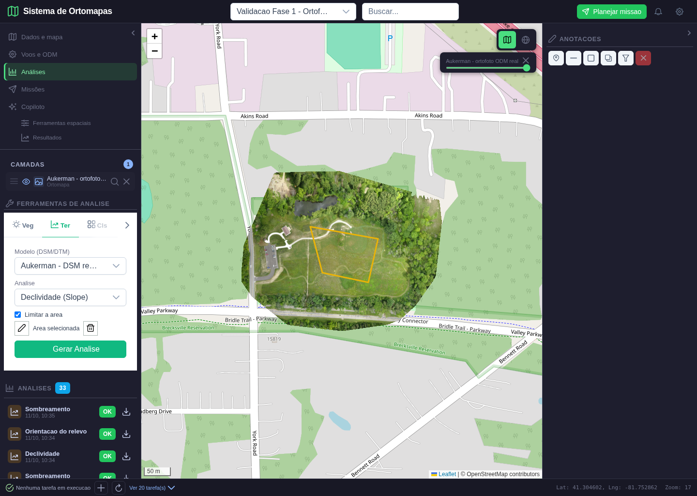
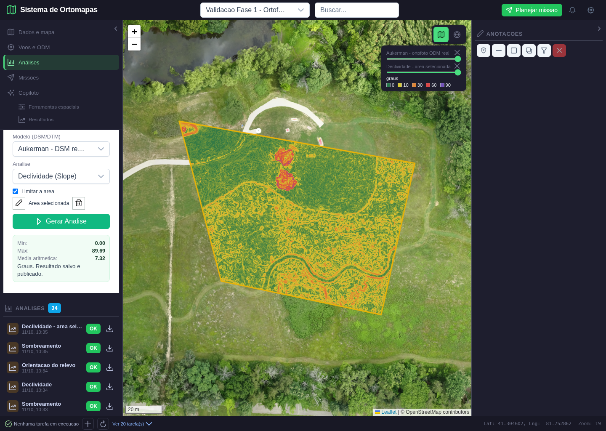
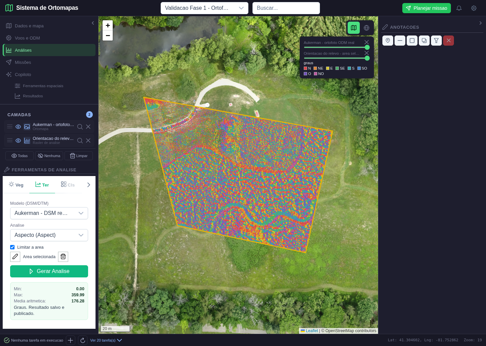
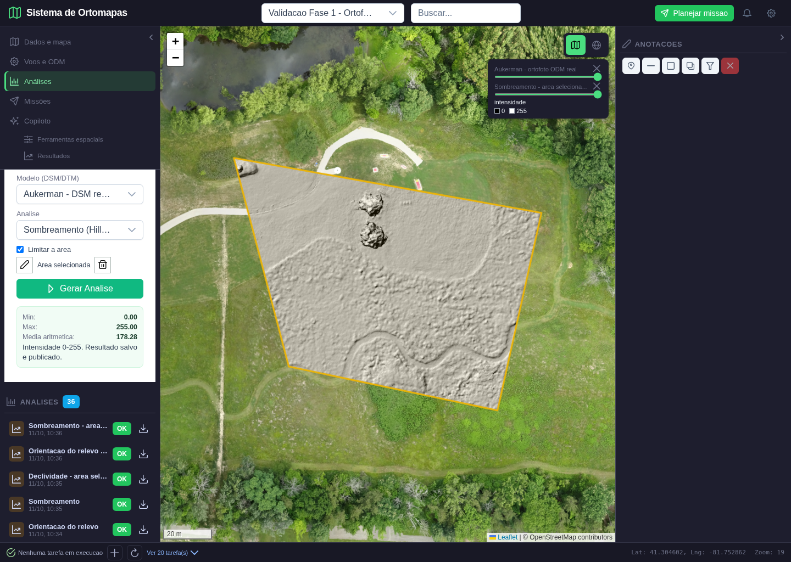
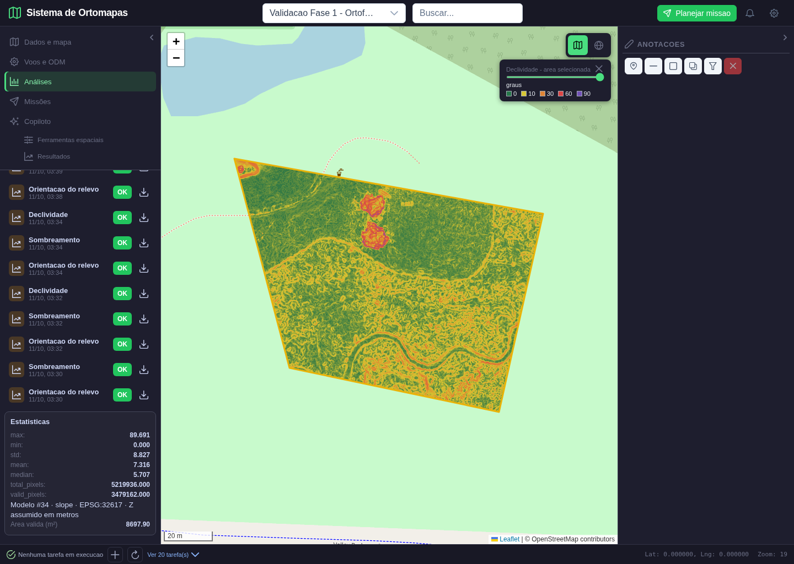
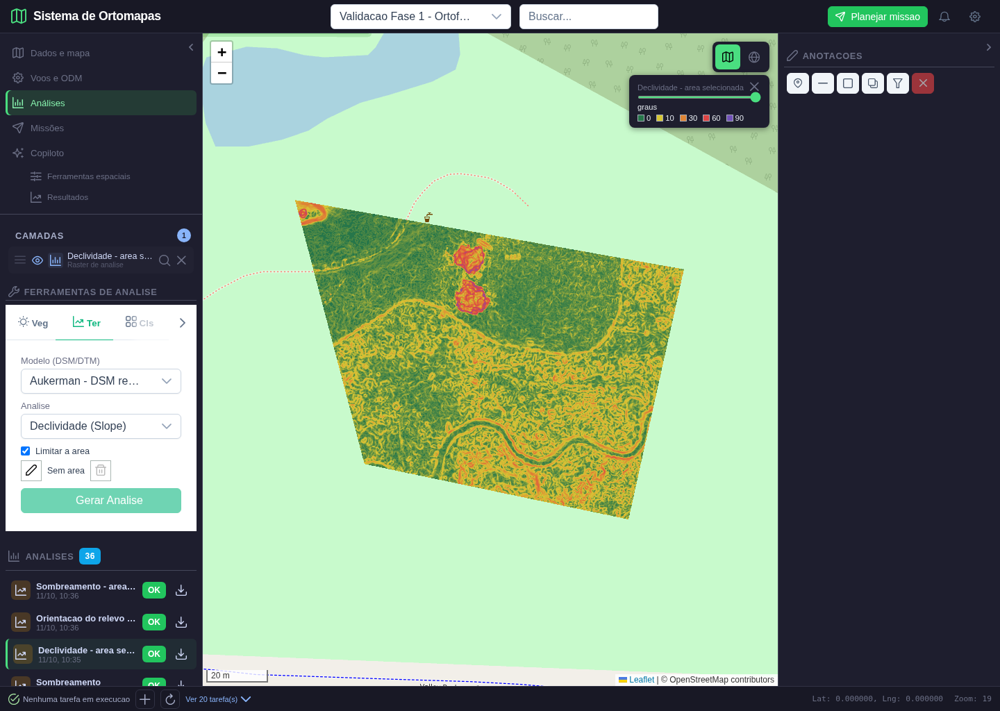

# Analises de terreno limitadas a area desenhada

Data: 11/10/2026. Fase 3, segundo lote. Checkpoint anterior `5162a35`, enviado antes das alteracoes.

## 1. O que foi implementado

O usuario pode selecionar um DSM/DTM, marcar **Limitar a area**, desenhar um poligono no mapa e gerar declividade, orientacao ou sombreamento somente nessa extensao. O resultado e um GeoTIFF recortado e mascarado: pixels fora do poligono nao participam das estatisticas nem aparecem como dados validos no mapa. A geometria, a regra de mascara, as areas e o contexto do calculo ficam salvos junto da analise no PostgreSQL.

A selecao desta area nao altera anotacoes nem o recorte 3D. Trocar de projeto limpa a selecao de trabalho pelo fluxo existente de limpeza das camadas. Reabrir uma analise recortada recupera sua geometria salva e o arquivo derivado. Uma area desenhada e ainda nao utilizada numa analise nao e um projeto salvo nem uma anotacao persistida.

Este aceite abrange essas tres operacoes e os dados descritos abaixo. Nao abrange AOI para volume, hidrologia, vegetacao, curvas de nivel ou todas as ferramentas do Copiloto. Nao encerra a fase 3 inteira.

## 2. Ambiente e dados

| Item | Valor |
|---|---|
| Aplicacao | http://localhost:5302 |
| API | http://127.0.0.1:5018/api |
| Banco | PostgreSQL/PostGIS existente; tabela `analises` |
| Projeto | #62, Validacao Fase 1 - Ortofoto real Aukerman |
| Modelo | DSM #34, `data/ortomapas/odm_2_dsm.tif` |
| Ortofoto de contexto | #30, `data/ortomapas/odm_2_ortomosaico.tif` |
| CRS horizontal | EPSG:32617; pixel de 0,05 m |
| Entrada de area | Polygon GeoJSON WGS84, desenhado com Leaflet Draw |
| Capturas | Chromium/Playwright, 1.440 x 1.024 |
| Resultados finais por area | #46 declividade; #47 orientacao; #48 sombreamento |

As imagens e o DSM de Aukerman sao reais. A area de teste foi desenhada sobre o campo aberto do parque; nao e uma fotogrametria de Guarajuba. O DSM inclui objetos e vegetacao. Elevacoes sao assumidas em metros; nao houve certificacao de datum vertical nem novo processamento WebODM neste lote.

## 3. Regra de calculo e verificacao independente

O motor calcula os gradientes no raster original e depois mascara o resultado pelo poligono reprojectado para o CRS do modelo. Isso preserva a vizinhanca dos pixels na borda, evitando tratar o corte como uma parede artificial. **A saida e as estatisticas sao limitadas a area; o custo computacional do gradiente ainda abrange o raster original.** Nao houve otimizacao por janela neste lote.

A inclusao segue o centro de cada pixel, nao `all_touched`. O GeoTIFF conserva resolucao, CRS e alinhamento da grade original. O retangulo externo da imagem apenas delimita o arquivo; a mascara conserva o poligono verdadeiro, incluindo furos quando fornecidos pela API. A interface deste lote desenha um poligono simples, sem editor de furos ou multipoligonos.

O teste independente leu uma janela do DSM com uma borda de um pixel, recalculou os gradientes e os valores esperados sem chamar os motores de producao, e avaliou a inclusao dos centros de pixels com Shapely. Comparou a mascara inteira e todos os pixels validos das tres saidas, nao apenas um ponto ou uma captura. A tolerancia numerica foi 0,0001; as diferencas observadas sao compativeis com armazenamento float32.

| Resultado | Pixels validos | Pixels geometricamente fora da area, na janela | Maior erro absoluto | Media |
|---|---|---|---|---|
| Declividade #46 | 3.479.162 | 1.740.774 | 0,00000382 grau | 7,31613 graus |
| Orientacao #47 | 2.902.949 | 1.740.774 | 0,00001526 grau | 176,28091 graus |
| Sombreamento #48 | 3.479.162 | 1.740.774 | 0,00000763 de intensidade | 178,28483 |

As tres mascaras coincidiram integralmente com a referencia independente. A orientacao exclui tambem superficies planas sem direcao de descida, por isso possui menos pixels validos.

A janela tem 2.512 x 2.078 pixels, contra 7.448 x 5.907 no raster completo. Area geometrica projetada: 8.697,90294 m². Area valida de declividade/sombreamento por contagem de pixels: 8.697,90500 m²; a pequena diferenca vem da discretizacao pelo centro do pixel, nao deve ser interpretada como erro de 0,05 m de alinhamento. Area com orientacao valida: 7.257,37250 m².

## 4. Execucao visual e resultados

### Cena 1 - Desenhar a area sobre a ortofoto



**Passos:** entrar no projeto, ligar a ortofoto, abrir Analises, selecionar terreno, marcar Limitar a area, clicar no lapis, marcar quatro vertices e clicar no primeiro vertice para concluir.

**Esperado:** contorno reconhecivel sobre a ortofoto; estado Area selecionada; botao de gerar habilitado somente apos concluir uma geometria. **Obtido:** poligono amarelo sobre parte do campo, DSM selecionado e geracao disponivel. Antes do desenho, o botao estava desabilitado. O roteiro conferiu a existencia de cada um dos quatro vertices, sem injetar geometria no estado Vue.

**Analise da tela:** a imagem sob o poligono e a ortofoto real, nao um resultado sintetico. O painel direito de anotacoes esta vazio porque esta selecao nao cria uma anotacao. **Resultado: aprovado.**

### Cena 2 - Declividade restrita ao poligono



**Passos:** escolher Declividade e gerar; aguardar resposta HTTP e carregamento dos tiles. **Esperado:** somente a area recebe cores de declividade, com legenda fixa em graus, estatisticas do recorte e origem rastreavel.

**Obtido:** analise #46, nome Declividade - area selecionada. Fora do poligono permanece a ortofoto; dentro, cores crescentes de verde a roxo. A media foi 7,32 graus, enquanto o raster completo da regressao possui media 26,35 graus. Essa mudanca e esperada: a selecao excluiu grande parte das bordas arborizadas. O maximo de 89,69 graus permanece por objetos e descontinuidades do DSM, nao prova de declividade do solo.

**Analise da tela:** o mapa foi ampliado para o resultado; o limite amarelo corresponde ao desenho. As pequenas manchas altas no campo tambem aparecem como objetos no sombreamento, e os valores foram conferidos pixel a pixel no arquivo. **Resultado: aprovado.**

### Cena 3 - Orientacao restrita ao poligono



**Passos:** selecionar Aspecto e gerar na mesma area. **Esperado:** paleta de oito setores, nodata fora da area e nos locais sem orientacao valida.

**Obtido:** analise #47; legenda N, NE, E, SE, S, SO, O, NO; 2.902.949 pixels validos. Regioes planas podem deixar a ortofoto de contexto aparente por transparencia.

**Analise da tela:** variacoes locais do DSM geram textura direcional densa; nao sao preenchimento aleatorio. A prova independente confirmou valores e mascara. Media aritmetica de 176,28 graus nao significa direcao dominante; a estatistica circular continua fora deste lote. Referencia direcional: norte da grade, sem correcao para norte verdadeiro. **Resultado: aprovado nesse escopo.**

### Cena 4 - Sombreamento restrito ao poligono



**Passos:** selecionar Sombreamento e gerar. Parametros padrao: azimute 315 graus, altitude solar 45 graus, preservados no registro.

**Esperado:** iluminacao em escala fixa 0 a 255, conservando o contexto externo da ortofoto. **Obtido:** analise #48, media 178,28; area cinza exatamente no poligono, exterior colorido pela ortofoto. Objetos elevados e linhas da superficie ficam legiveis.

**Analise da tela:** o cinza mostra iluminacao, nao altitude. A borda do poligono nao produziu uma parede no gradiente, pois a vizinhanca veio do DSM original. Ruido e marcas fotogrametricas continuam presentes; nao foram escondidos para melhorar a demonstracao. **Resultado: aprovado.**

### Cena 5 - Reabrir a area e baixar o resultado



**Passos:** recarregar a pagina, selecionar o projeto e abrir #46 pelo catalogo. Rolar ate as estatisticas e baixar o GeoTIFF pelo icone do registro.

**Esperado:** recuperar resultado e contorno do banco; nao exigir a ortofoto de origem ativa. **Obtido:** declividade sobre OpenStreetMap, sem tiles de ortomapas carregados. O contorno foi restaurado dos metadados da analise. O painel apresenta media 7,316 e area valida 8.697,90 m².

**Download:** 8.442.322 bytes, SHA-256 identico ao arquivo de saida: `6c8038936fd669308d83c3f61008b34d15d880bd5a94ac41f4a12b3ec77b7158`. O arquivo conserva a mascara, CRS e transformacao verificados, nao e uma captura PNG.

**Analise da tela:** mapa tematico e contorno aparecem juntos e correspondem ao mesmo registro. A lista longa ainda exige rolagem, e nomes tecnicos das estatisticas/formatacao de contagens precisam de refinamento. A captura inicial rejeitada ficou sem mapa porque a transicao visual dos tiles nao tinha terminado; a captura final esperou todos os tiles carregados e opacos. **Resultado: aprovado na rodada final.**

### Cena 6 - Limpar a selecao e bloquear geracao indevida



**Passos:** voltar ao painel de terreno, marcar Limitar a area e clicar na lixeira da selecao. **Esperado:** estado Sem area e botao Gerar Analise desabilitado, sem excluir produtos anteriores.

**Obtido:** contorno de trabalho removido, geracao bloqueada e declividade anterior ainda visivel. Limpar a selecao nao apaga o GeoTIFF nem o registro salvo. Uma nova area pode ser desenhada; desmarcar Limitar a area volta ao modo de raster inteiro.

**Analise da tela:** o mapa exibido e o resultado anterior, identificado pelo nome da camada; nao foi apresentado como uma nova analise. **Resultado: aprovado.**

## 5. Testes, falhas corrigidas e limites

**Testes locais:** 61 testes Python aprovados, incluindo nove novos casos de AOI. Plano metrico sintetico com area de 600 m²: 600 pixels de 1 m² e declividade esperada de aproximadamente 12,604 graus, inclusive nas bordas. Poligono com furo: 800 pixels validos, nao os 900 do retangulo externo. Geometrias degeneradas, auto-intersectadas, tipo incorreto, fora de WGS84 ou fora do raster foram recusadas. Resultado sem pixels validos foi recusado. Modo sem AOI permanece compativel.

**Teste real:** seis capturas, tres analises, comparacao de todas as mascaras e valores, reabertura, download e limpeza. Nenhum erro JavaScript. Pedido HTTP com poligono sem intersecao retornou 422, sem criar uma analise concluida.

**Regressao:** o roteiro do lote anterior foi executado novamente sem recorte e com evidencias em subpasta separada, conferindo publicacao das tres operacoes, reabertura, opacidade, download e isolamento entre usuarios. O manifesto separado registra o aceite, IDs e verificacoes HTTP.

**Build frontend:** aprovado, 418 modulos. Suite Node de produtos de analise aprovada. Avisos conhecidos de deprecacao Python, tipo de modulo Node e tamanho do bundle permanecem; nao impedem este aceite, mas nao foram eliminados.

Correcoes do roteiro: Leaflet Draw possui debounce de 50 ms apos soltar o mouse; cliques artificiais instantaneos descartavam vertices. O roteiro agora simula cliques humanos, respeita o debounce e confere cada vertice. Esperas de resultados dependem de estado/respostas/tiles, nao de um tempo fixo arbitrario. A reabertura tambem espera a transicao de opacidade terminar antes da captura.

Correcoes de interface: resultados do painel sao limpos ao mudar produto, operacao ou area, para nao apresentar estatisticas antigas para entradas novas. Os nomes publicados incluem area selecionada para distinguir os recortes do raster completo. O contorno salva a geometria verdadeira, nao apenas seu bounding box.

Limites explicitamente abertos:

- API aceita Polygon/MultiPolygon com ate 2.000 vertices em WGS84; areas cruzando o antimeridiano nao sao suportadas. A UI cria poligono simples e permite limpar/redesenhar, sem edicao de vertices apos concluir.
- Geometria salva tem area projetada solicitada; area valida por pixels pode ser menor quando ha nodata ou falta de orientacao. A ferramenta nao calcula area geodesica certificada.
- Gradiente ainda e calculado no raster completo. Processamento sincrono e memoria de grandes rasters seguem pendentes de otimizacao/fila.
- Falhas apos gerar arquivo e antes de publicar ainda podem deixar arquivo orfao. Retencao e limpeza segura permanecem pendentes.
- Regressoes e seguranca do lote nao certificam toda a aplicacao, uso mobile, multiusuario em carga ou qualidade cientifica do DSM.

## 6. Rastreabilidade e reproducao

O lote atende ao aceite do plano para resultado persistido/reaberto (T-09), amplia o recorte da analise e exercita entradas invalidas (T-15). A prova de area conhecida relaciona-se a T-04 e a declividade de plano conhecido a T-05. Nao afirmar que T-06 de volume por AOI foi fechado: volume ainda nao recebeu esta integracao.

Roteiro: `scripts/validar_aoi_terreno_fase3.py`. Executar na raiz com servicos, contas de teste, projeto #62 e produtos #30/#34 existentes:

```bash
python -m scripts.validar_aoi_terreno_fase3
python -m pytest tests/test_terrain_aoi.py tests/test_analysis_products.py tests/test_gis_rate_limit.py tests/test_terrain_tools.py tests/test_elevation_analysis.py tests/test_metric_analysis.py tests/test_surface_grid.py tests/test_resource_access.py tests/test_raster_tiles.py tests/test_ortomapas_postgres.py -q
```

Cada rodada cria tres resultados reais e atualiza suas evidencias. Nao e seed de banco vazio. Imagens de diagnostico rejeitadas nao sao cenas aprovadas. Arquivos raster grandes permanecem no ambiente, fora do Git.

Manifestos: [AOI](aoi_terreno_fase3_2026-10-11/resultado.json) e [regressao sem recorte](aoi_terreno_fase3_2026-10-11/regressao_inteiro/resultado.json).

**Proximo lote:** curvas de nivel com camada vetorial real, persistencia, origem, exportacao e reabertura verificadas. AOI para os demais motores sera aplicada por operacao, com provas proprias, sem assumir que este recorte ja atende todas as analises.
