# Validação parcial do Copiloto: Fase 8

**Data:** 16/10/2026
**Atualizado:** 21/10/2026
**Estado:** validação integrada aprovada; Fase 8 ainda em andamento
**Escopo desta execução:** continuidade da conversa, isolamento da thread, contexto espacial, recorte por AOI, tratamento de timeout e exposição das evidências no chat.

## O que mudou

- A interface envia o identificador da conversa junto da pergunta.
- O backend confere que a thread pertence ao usuário autenticado e ao projeto informado. Thread de outro usuário responde `404`; troca de projeto responde `409`.
- O backend recupera as 25 mensagens mais recentes, em ordem cronológica, sem duplicar a mensagem atual que a interface já salvou antes de enviar a pergunta ao modelo.
- O estado da thread guarda contexto espacial usado na análise. Uma geometria selecionada no mapa passa a ser contexto confiável, além do projeto, produtos e voos autorizados já carregados no backend.
- Perguntas de área/perímetro sobre a geometria selecionada executam o motor determinístico `geometry_metrics`; o resultado inclui CRS de cálculo, área em m², perímetro em m e a origem da geometria.
- Declividade, aspecto, hillshade e volume aceitam AOI GeoJSON. A janela do raster é recortada pela geometria reprojetada para o CRS do produto e pixels fora da AOI são mascarados antes das estatísticas. Raster sem CRS, geometria inadequada ou AOI sem pixels suficientes é rejeitada.
- O chat mostra ferramentas executadas e oferece uma seção expansível com resultado, origem e erro. O histórico restaura as evidências armazenadas em `copilot_messages.ferramentas`.
- O chat lista conversas do usuário para o projeto ativo, permite iniciar uma conversa independente e trocar de thread; o histórico de cada seleção é carregado da API. Mensagens atualizam `atualizado_em`, mantendo a lista ordenada por atividade recente.
- O painel permite salvar, listar e excluir memórias pessoais explícitas por projeto. Cada anotação é limitada a 4 KB; o contexto enviado ao modelo inclui no máximo 50 memórias e 16 KB, filtradas pelo usuário autenticado. O prompt instrui o modelo a tratar essas anotações como dados não confiáveis, não como instruções ou fatos medidos.
- Resultados espaciais passam a ser prévias locais no mapa. A gravação permanente em `camadas_copiloto` só ocorre após o usuário acionar **Salvar camada no projeto**; a interface mostra progresso, sucesso ou erro. Ao reabrir a conversa, geometrias já persistidas são reconhecidas para evitar duplicação pelo mesmo resultado.
- O modo `Poligono` do painel de desenho agora está ligado ao handler `L.Draw.Polygon`; antes os cliques não produziam uma geometria selecionável. O botão enviar do chat também ganhou nome acessível para automação e tecnologia assistiva.

## Execução integrada real

Em 16/10/2026, às 17:05 BRT, executei o roteiro Playwright contra o frontend `127.0.0.1:18762`, API `127.0.0.1:18761`, PostgreSQL local e LM Studio local. `/health/ready` confirmou `database=true` e `lm_studio=true`; o modelo `qwen2.5-coder-32b-instruct` estava listado em `/v1/models`.

O teste autenticou a conta E2E existente, abriu o projeto **Guarajuba - Condomínio Paraíso (Demonstração)**, desenhou um polígono no mapa e enviou duas perguntas relacionadas. A primeira executou `medir_geometria`: **39.599,67 m²**, perímetro **796,66 m**, CRS de cálculo **EPSG:32724**. A resposta do Qwen apresentou aproximadamente esses valores. A segunda perguntou a unidade da medição anterior; após a correção do contexto histórico, o modelo respondeu **metros quadrados (m²)**. A API autenticada confirmou a thread `102` com quatro mensagens e a evidência `medir_geometria` persistida.

O polígono é uma área de demonstração aproximada sobre o mapa OSM; não é limite cadastral do condomínio, não foi validado em campo e não deve ser usado para decisão fundiária ou voo.

### Capturas

1. Login: 
2. Projeto selecionado e mapa: 
3. Geometria desenhada e reconhecida pelo copiloto: 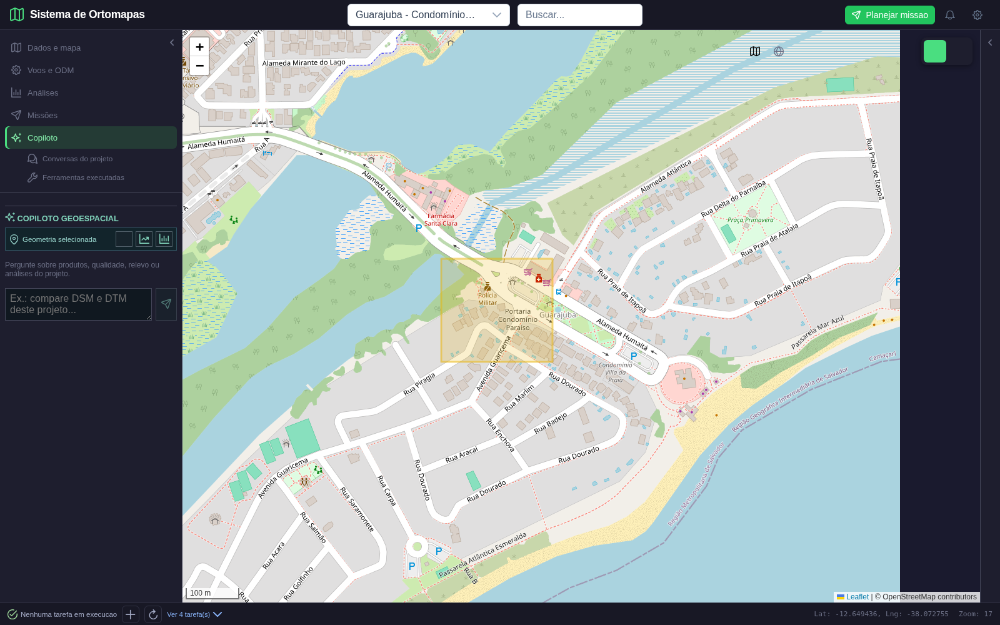
4. Resultado calculado e evidências expandidas: 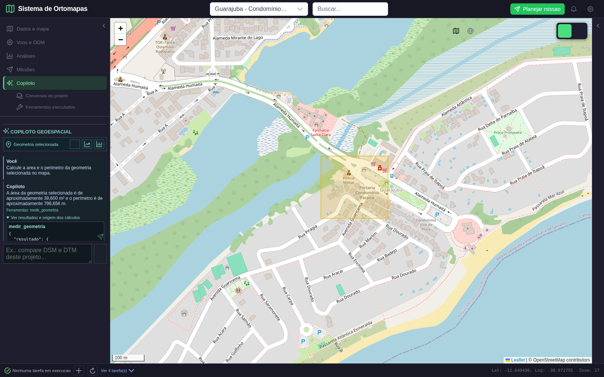
5. Continuação usando a conversa anterior: 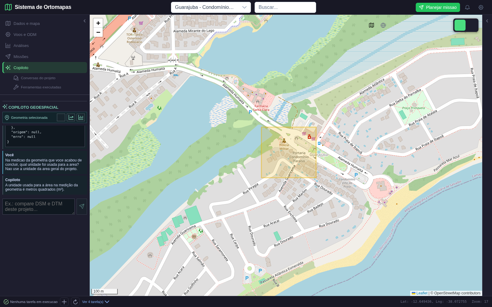

Resultado estruturado: [`live_result.json`](copiloto_fase8_2026-10-16/live_result.json). Script reproduzível: [`test_copilot_fase8_live.py`](../../tests/e2e/playwright/test_copilot_fase8_live.py).

## Roteiro de verificação executado

1. Retomada isolada: thread de usuário/projeto simulado, com histórico anterior e pergunta atual já persistida; o adaptador recebeu as mensagens anteriores e não duplicou a atual.
2. Medição isolada: Polygon GeoJSON de teste; `12.333,224 m²` e `444,223 m`, calculados em EPSG:32631.
3. Privacidade isolada: usuário 99 não acessou a thread do usuário 5; resposta `404` antes de qualquer chamada ao LM Studio.
4. Recorte raster: raster sintético 10 x 10 em EPSG:32623; AOI cobre 4 x 4 células. Resultado: 16 pixels válidos, média esperada, resolução de 10 m; 84 pixels externos mascarados.
5. Timeout controlado: três timeouts simulados no cliente LM Studio; o cliente terminou com erro após três tentativas, sem deixar a chamada pendurada.
6. Fluxo integrado: login, desenho de polígono, medição real, pergunta de continuação e leitura autenticada da thread persistida. Nenhum erro JavaScript foi observado.

## Resultado dos testes

- `PYTHONPATH=. pytest -q tests/test_copilot_context.py`: **4 passed**.
- `PYTHONPATH=. pytest -q tests/test_metric_analysis.py`: **9 passed**.
- `PYTHONPATH=. pytest -q tests/test_copilot_context.py tests/test_metric_analysis.py`: **13 passed**, incluindo timeout controlado.
- `PYTHONPATH=. pytest -q tests/test_copilot_threads.py tests/test_copilot_context.py tests/test_metric_analysis.py`: **14 passed**; inclui verificação do escopo por projeto/usuário na listagem de conversas.
- `PYTHONPATH=. pytest -q tests/test_copilot_memories.py tests/test_copilot_context.py tests/test_copilot_threads.py tests/test_metric_analysis.py`: **18 passed**; cobre filtragem por proprietário/projeto, upsert, auditoria sem conteúdo da memória, exclusão, limite de 4 KB e injeção de contexto pessoal.
- `FRONTEND_URL=http://127.0.0.1:18762 API_URL=http://127.0.0.1:18761/api python tests/e2e/playwright/test_copilot_fase8_live.py`: **passed**, seis verificações aprovadas e uma verificação de segunda conta ignorada porque a conta não existe; thread 102, quatro mensagens persistidas e nenhuma exceção JavaScript.
- Execução integrada de 20/10: `/health/ready` respondeu `ready` com PostgreSQL e LM Studio em `true`. O LM Studio carregava `qwen/qwen3.8-27b`; uma inferência mínima funcionou. `backend/config.py` foi atualizado para esse identificador. A primeira chamada estruturada com ferramentas revelou incompatibilidade do LM Studio ao combinar `response_format=json_schema` e `tools`; o cliente foi corrigido para usar tool calls nativas quando há ferramentas e JSON Schema somente para respostas finais.
- O roteiro E2E de 20/10 passou com Chrome instalado, conversa isolada de teste e Qwen 3.8 27B. Mediu a geometria do mapa, retomou contexto, gerou buffer de 20 m, confirmou que a prévia não tinha persistido, gravou uma única camada após o clique e verificou API, troca de conversa, memória pessoal e ausência de erros JS. Resultado completo: [`live_result.json`](copiloto_fase8_2026-10-20/attempt_04/live_result.json). Foi criada a camada `7` no projeto 51 e a thread de teste 107; a memória temporária foi removida. A criação de conversa 108 também foi exercitada.
- A interface de timeout foi verificada visualmente em 21/10 com uma resposta HTTP 504 interceptada pelo Playwright. O chat apresentou o erro, manteve a pergunta e voltou a habilitar o campo para nova tentativa; o teste não enviou requisição ao backend de análise nem ao LM Studio. A execução aprovada usou a conversa de demonstração `113`. Evidências e resultado: [`timeout_ui_result.json`](copiloto_fase8_2026-10-21/timeout/timeout_ui_result.json) e [tela do erro com nova tentativa disponível](copiloto_fase8_2026-10-21/timeout/02_timeout_exibido.png). Roteiro reproduzível: [`test_copilot_timeout_ui.py`](../../tests/e2e/playwright/test_copilot_timeout_ui.py).
- O isolamento integrado entre usuários passou em 21/10: o proprietário da thread `113` recebeu HTTP 200 e uma segunda conta autenticada recebeu HTTP 404. A conta descartável foi removida ao final e o banco confirmou zero contas temporárias restantes. Evidência: [`privacy_two_users_result.json`](copiloto_fase8_2026-10-21/privacidade/privacy_two_users_result.json); roteiro: [`test_copilot_privacidade_2usuarios.py`](../../tests/e2e/playwright/test_copilot_privacidade_2usuarios.py). O teste não fez chamadas ao modelo.
- Capturas Playwright da execução de 20/10:
  1. Login: 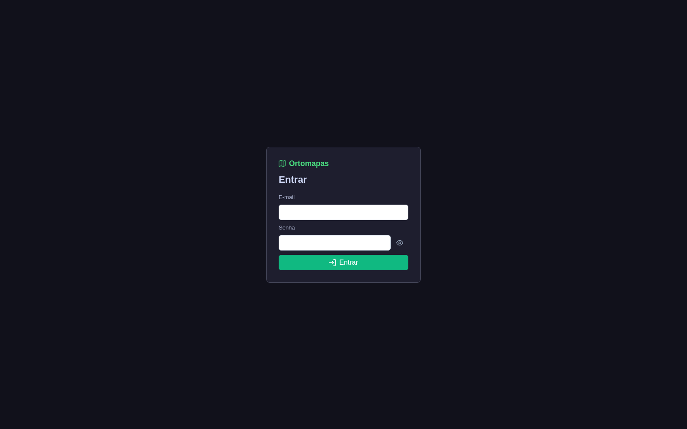
  2. Projeto e mapa: 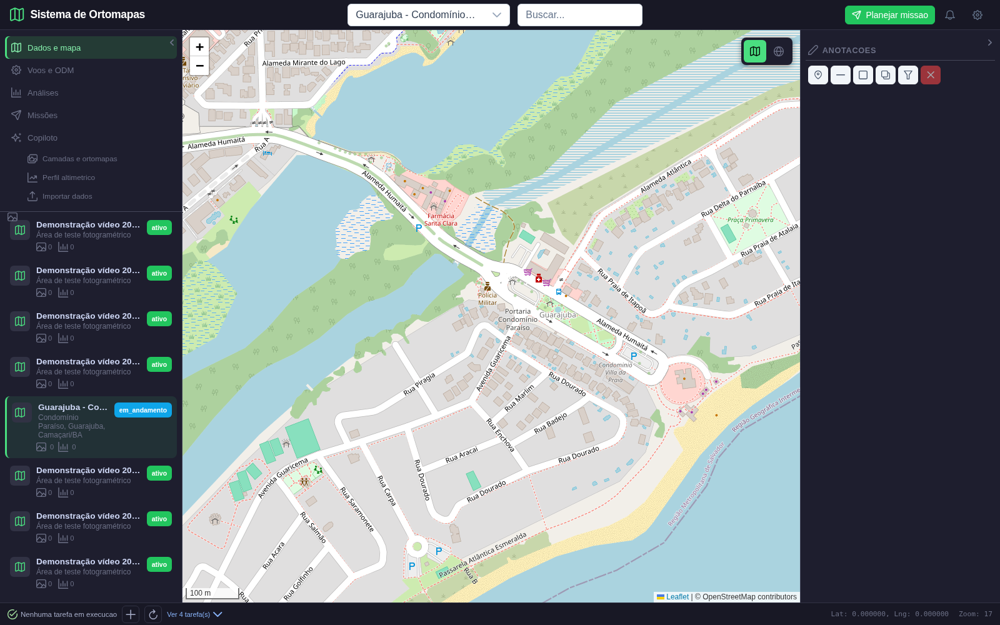
  3. Polígono selecionado: 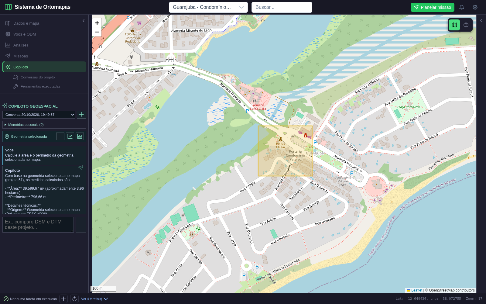
  4. Medição com evidência: 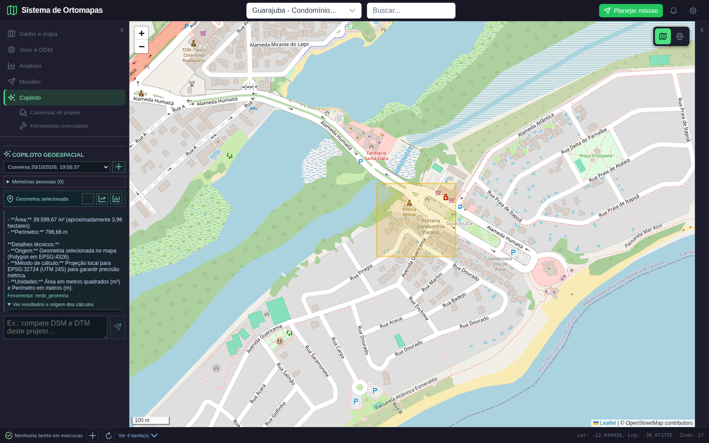
  5. Retomada contextual: 
  6. Buffer aguardando aprovação: 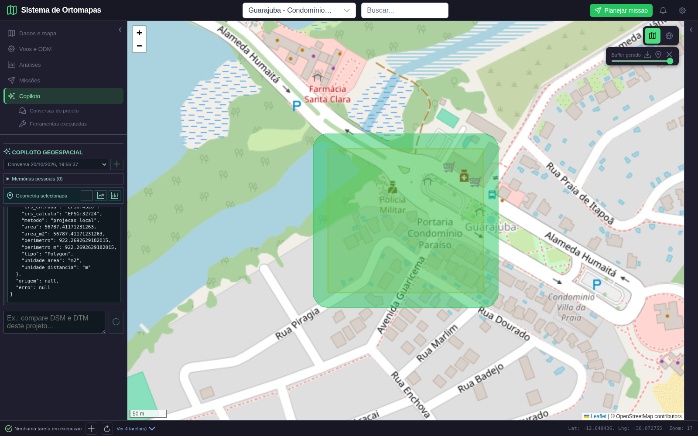
  7. Camada salva: 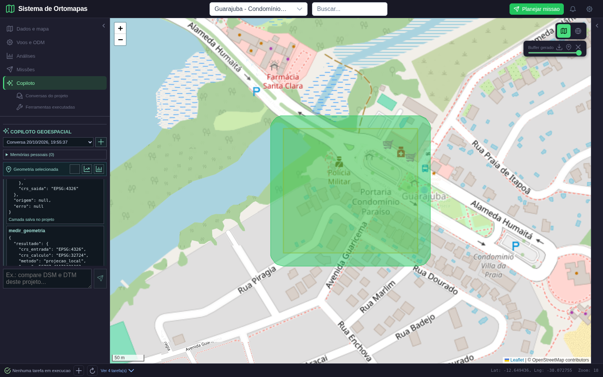
  8. Conversa nova: 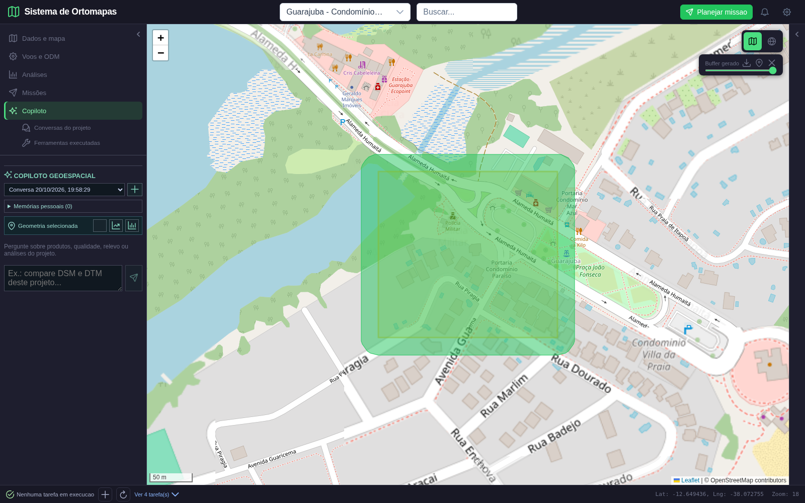
  9. Histórico restaurado: 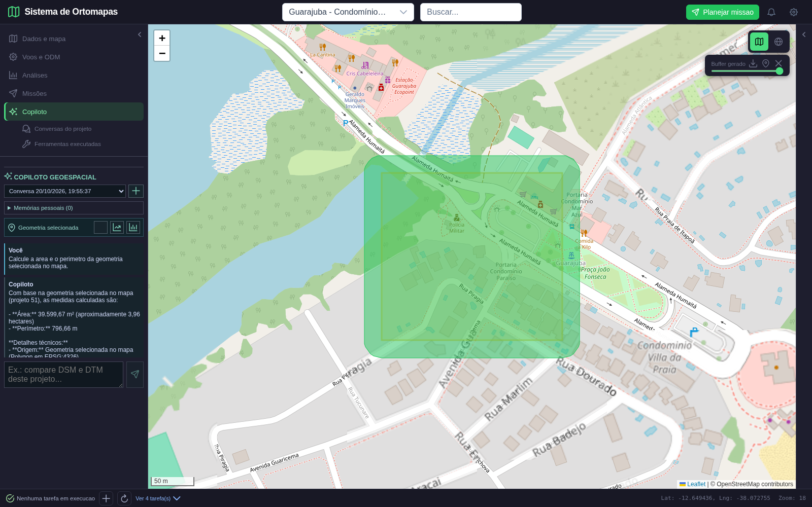
  10. Memória criada: 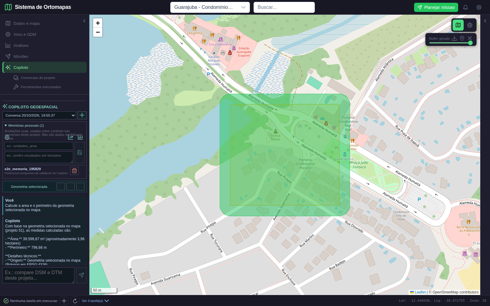
  11. Memória removida: 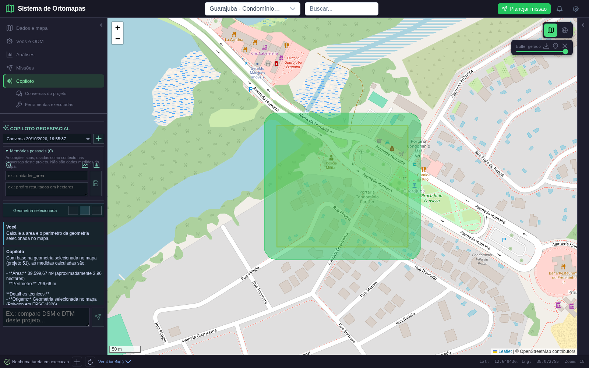
- `npm run build`: **aprovado**. O Vite repetiu o aviso já conhecido de chunk JS principal acima de 500 kB.
- Alteração de 20/10: `cd frontend && npm run build`: **aprovado** após transformar a gravação automática de camadas em ação explícita do usuário. O aviso existente de chunk principal acima de 500 kB permaneceu.
- `PYTHONPATH=. pytest -q tests/test_copilot_context.py tests/test_copilot_threads.py tests/test_copilot_memories.py tests/test_metric_analysis.py`: **21 passed** após adicionar compatibilidade para tool calls nativas do Qwen, deduplicação de chamadas idênticas e regressão para respostas JSON finais.
- `python -m compileall -q backend/routers/agents.py backend/agents/llm_client.py tests/test_copilot_context.py`: **aprovado**; `git diff --check`: **aprovado**.
- `python -m compileall -q backend/routers/agents.py backend/agents/schemas.py`: **aprovado**.
- PostgreSQL e LM Studio locais: `/health/ready` respondeu `ready`, ambos os checks `true`; Qwen configurado presente em `/v1/models`.
- Validação de timeout de 21/10 foi isolada do modelo: `llm_calls=0`, uma chamada ao endpoint `/api/agents/ask` interceptada no navegador com HTTP 504, três verificações visuais passaram e `page_errors=[]`. O resultado demonstra tratamento visual do erro, não mede o timeout real do backend/LM Studio.
- Validação integrada de propriedade da thread também passou sem modelo: proprietário `200`, segunda conta `404`, cadastro temporário removido e nenhum registro temporário residual.
- Uma execução ampla que incluía outros testes de integração ficou sem progresso após os testes iniciais; foi interrompida e não é contada como aprovada.

## Limites e pendências

- O fluxo principal foi validado com PostgreSQL e LM Studio reais. O timeout foi testado por simulação do transporte, não por atraso forçado do serviço real.
- No roteiro E2E de 16/10, a segunda conta ainda não existia e aquele passo foi ignorado; a pendência foi fechada em 21/10 com uma conta descartável autenticada, removida após o teste.
- O recorte de derivadas limita estatísticas aos pixels internos da AOI, mas gradientes nas bordas dependem dos vizinhos válidos remanescentes. A resolução de derivadas é amostrada até 512 px no maior lado; volume por AOI é amostrado até 2048 px. Isso é adequado para consulta exploratória e deve ser identificado como amostragem, não levantamento topográfico de precisão.
- **Pendente por indisponibilidade temporária do modelo:** repetir a validação integrada com Qwen real quando o LM Studio estiver liberado. Nenhuma chamada ao modelo foi feita nesta execução.
- Ainda faltam sumarização de conversas e relatório consolidado PDF. O timeout visual está coberto por Playwright e a privacidade por teste integrado com duas contas; o timeout de backend segue coberto por simulação de transporte em teste automatizado, sem indução no serviço real.
- Memórias, troca de conversas e consentimento para persistir camada passaram no roteiro Playwright com PostgreSQL real. A tela de salvar foi comprovada antes/depois e a API confirmou exatamente uma camada persistida pelo clique.
- RAG continua deliberadamente fora da Fase 8.

## Conclusão

Além das correções anteriores no desenho do polígono e no contexto histórico, esta execução identificou e corrigiu a incompatibilidade do Qwen 3.8 com `response_format` combinado a ferramentas, além de impedir execução repetida da mesma chamada de ferramenta e limpar mensagens ao trocar de conversa. O roteiro visual passou para medição, contexto, buffer, aprovação explícita de persistência, conversa nova/troca, memória e apresentação de erro/timeout; a propriedade da thread passou também em integração com duas contas. A Fase 8 **ainda não está concluída**: faltam sumarização e relatório PDF consolidado. A repetição de inferência com Qwen real permanece explicitamente pendente até o modelo ser liberado.
