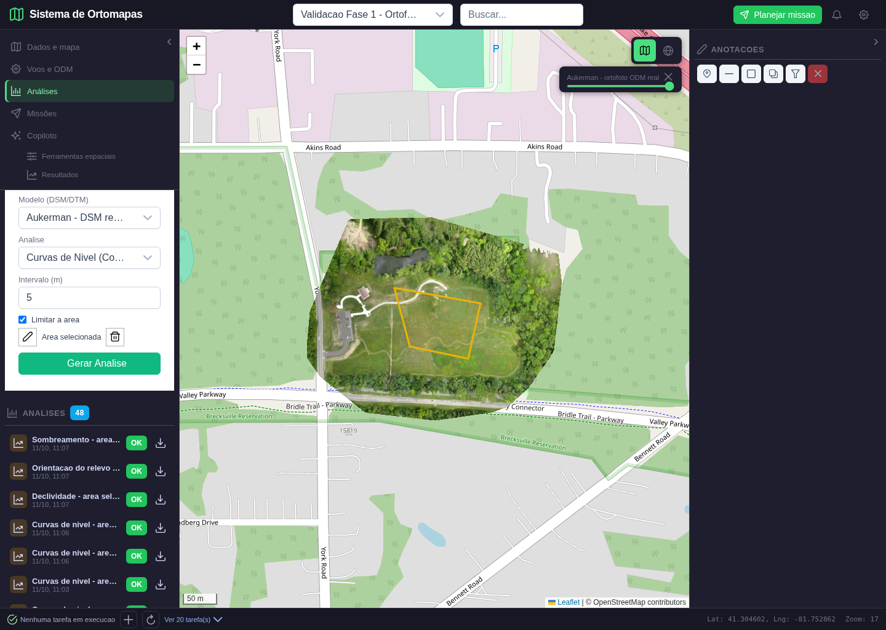
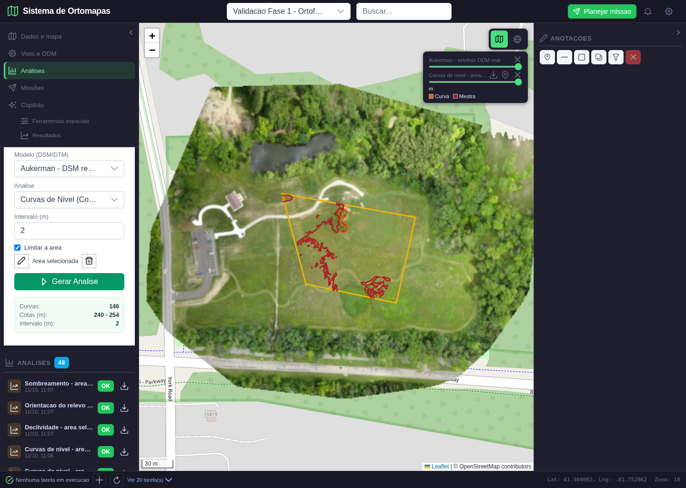
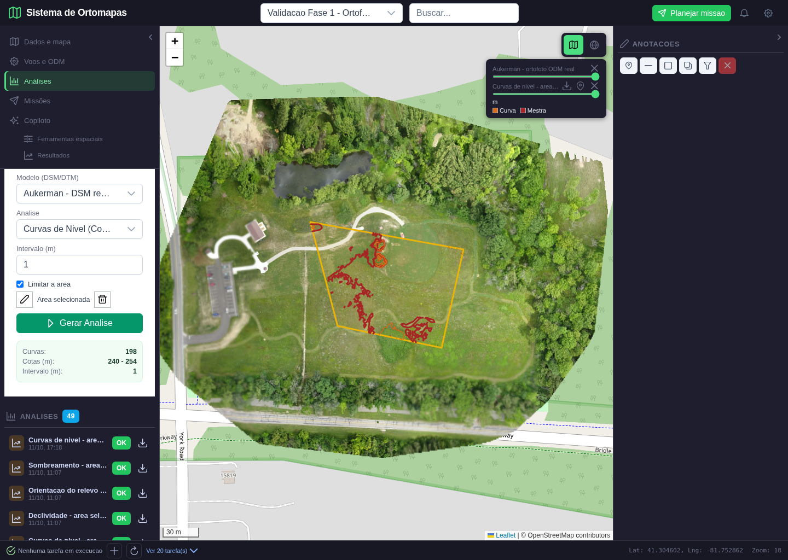
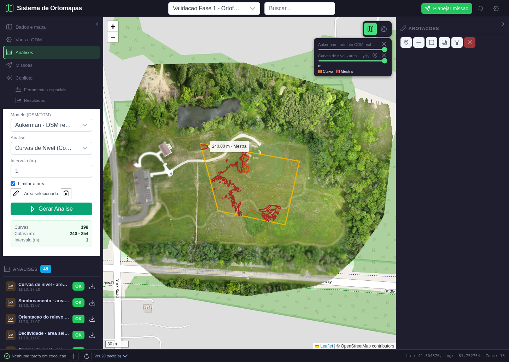
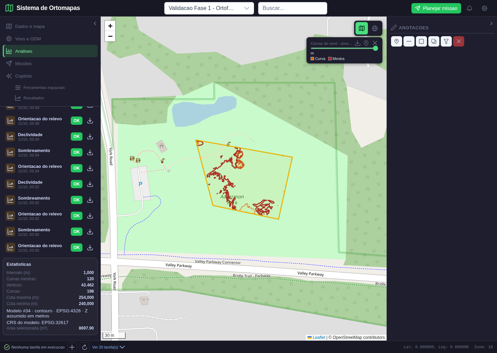
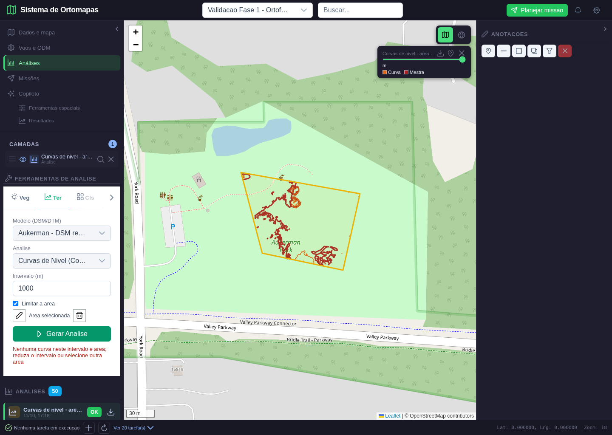

# Validacao de curvas de nivel: mapa real, cotas e exportacoes

**Data:** 11/10/2026. **Escopo:** terceiro lote da fase 3, curvas de nivel derivadas de um DSM real. Este documento nao aprova todas as funcionalidades da aplicacao.

## 1. O que foi implementado

O usuario seleciona um DSM/DTM em **Analises > ferramentas > Ter**, escolhe **Curvas de Nivel**, informa o intervalo e, opcionalmente, desenha uma area. A geracao executa `gdal_contour`, transforma as linhas para WGS84 e publica um resultado proprio na tabela PostgreSQL `analises`, vinculado ao projeto e modelo de origem.

O resultado aparece como camada vetorial, com curvas comuns laranja, mestras vermelhas, legenda, cotas ao passar o mouse, estatisticas, exportacao GeoJSON/KML e reabertura pelo catalogo. Nao e a ortofoto nem o DSM exibidos como se fossem uma analise pronta. O contorno amarelo e a area selecionada pelo usuario, nao uma curva de nivel.

Curvas mestras sao as cotas multiplas de cinco vezes o intervalo: por exemplo, 240/250 m para intervalo de 2 m e 240/245/250 m para intervalo de 1 m. A contagem corresponde a segmentos vetoriais, nao ao numero de cotas distintas.

## 2. Dados e ambiente de demonstracao

| Item | Dado efetivamente usado |
|---|---|
| Projeto | #62, Validacao Fase 1 - Ortofoto real Aukerman |
| Ortofoto de contextualizacao | Produto #30, `data/ortomapas/odm_2_ortomosaico.tif` |
| Modelo de calculo | Produto #34, `data/ortomapas/odm_2_dsm.tif` |
| Grade do DSM | 7448 x 5907 pixels, resolucao aproximada de 0,05 m |
| CRS do modelo | EPSG:32617, coordenadas projetadas |
| CRS da camada exportada | EPSG:4326, longitude/latitude |
| Area desenhada | 8.697,90 m2; poligono de quatro vertices |
| Analises da rodada final | #61 (2 m) e #62 (1 m), distintas do ID #62 do projeto |
| Interface | `http://localhost:5302`, viewport 1440 x 1024 |
| Backend de validacao | Porta 5018; PostgreSQL existente da aplicacao |

As imagens e elevacoes da demonstracao sao fotogrametricas reais de Aukerman, nao de Guarajuba. Um plano sintetico conhecido foi usado apenas nos testes matematicos independentes. Nenhuma implementacao foi substituida por resposta simulada nesta validacao.

**Interpretacao GIS:** DSM representa superficie, inclusive vegetacao e outros objetos. As linhas sinuosas perto das arvores podem ser copas ou artefatos do modelo. Sua correta localizacao nao certifica qualidade topografica do terreno nu. Altitudes foram assumidas em metros; o datum vertical nao foi certificado. A cota 240 m nao e altura de voo de drone.

## 3. Cenas executadas e inspecionadas

### Cena 1. Selecionar modelo e desenhar a area



**Acao:** login, selecao do projeto, abertura da ortofoto real, navegacao para Analises/Ter, escolha de Curvas de Nivel e marcacao de Limitar a area. Quatro cliques reais no mapa e clique no primeiro vertice concluem o desenho.

**Esperado:** modelo DSM selecionado, poligono amarelo sobre a ortofoto, estado Area selecionada e comando Gerar Analise disponivel. **Obtido:** estes elementos aparecem sem modal ou camada sintetica encobrindo o mapa. Nesta primeira cena o campo ainda mostra o intervalo inicial de 5 m; ele e alterado nas cenas seguintes.

### Cena 2. Gerar curvas com intervalo de 2 m



**Acao:** preencher 2 no intervalo e executar Gerar Analise; aguardar o POST real, a publicacao no PostgreSQL e os caminhos SVG da camada no mapa.

**Esperado:** curvas sobre o DSM, somente dentro da area, legenda e estatisticas da saida. **Obtido:** 146 segmentos, 29.503 vertices, cotas de 240 a 254 m e 113 segmentos mestres. A area selecionada e o limite amarelo; linhas vermelhas/laranja sao o resultado calculado.

**Analise:** predominam segmentos em determinadas regioes porque o DSM real nao e um plano uniforme. Nao foram desenhadas linhas decorativas para preencher toda a area. Todas as linhas foram verificadas geometricamente no CRS projetado contra o poligono.

### Cena 3. Comparar com intervalo de 1 m



**Acao:** remover a camada anterior, alterar o intervalo para 1 m e gerar novamente. A troca do parametro limpa o resumo anterior para nao apresentar estatisticas antigas como resultado do novo pedido.

**Esperado:** novo resultado persistido, mais detalhamento, sem duplicacao visual da camada de 2 m. **Obtido:** 198 segmentos, 43.462 vertices, cotas de 240 a 254 m e 120 segmentos mestres. O teste conferiu que a quantidade de segmentos aumentou e que a camada anterior foi removida.

### Cena 4. Consultar a cota de uma curva



**Acao:** posicionar o ponteiro sobre uma linha mestra, utilizando a posicao real do caminho SVG renderizado, sem disparar artificialmente eventos internos do Leaflet.

**Esperado:** tooltip com a cota e identificacao da mestra. **Obtido:** `240.00 m · Mestra`. O texto corresponde ao atributo da feicao gerada. O tooltip e construido com `textContent`, sem inserir atributos de usuario como HTML.

**Correcao encontrada:** a primeira execucao mostrou linhas mas nao cotas. `onEachFeature` estava sendo passado como atributo nao suportado pelo componente; foi corrigido para `options.onEachFeature` e o teste de hover passou na repeticao.

### Cena 5. Reabrir o resultado salvo, sem ortofoto de origem



**Acao:** recarregar o navegador, selecionar o projeto e clicar na analise pelo seu ID no catalogo. Rolar o painel ate as estatisticas e aguardar o enquadramento e a pintura dos tiles terminarem.

**Esperado:** mesmas linhas, intervalo, cotas e poligono, obtidos da analise persistida. **Obtido:** 198 segmentos e suas estatisticas foram restaurados. O fundo desta cena e OpenStreetMap; a ortofoto #30 nao foi carregada. O teste conferiu ausencia de tiles de ortomapas, comprovando que a visualizacao nao depende de substituir a saida pelo produto de origem.

**Usabilidade revisada:** rotulos de curvas, vertices, intervalo e cotas substituem nomes internos nessas estatisticas. A proveniencia identifica modelo #34, CRS da camada e CRS do modelo. O catalogo ainda exige rolagem quando ha muitos resultados; agrupamento e busca continuam fora do aceite deste lote.

### Cena 6. Pedido sem curvas nao vira resultado aprovado



**Acao:** manter a mesma area e informar intervalo de 1000 m, muito maior que a faixa altimetrica do modelo, e solicitar nova geracao.

**Esperado:** erro claro, sem analise concluida ficticia nem estatisticas antigas no formulario. **Obtido:** HTTP 422 e mensagem para reduzir o intervalo ou escolher outra area. O mapa mantem a camada anteriormente publicada de 1 m; ela nao representa sucesso do pedido de 1000 m. O resumo verde anterior nao permanece no formulario.

## 4. Comparacao objetiva: esperado versus obtido

| Verificacao | Referencia esperada | Resultado observado |
|---|---|---|
| Geracao real | GDAL, nao geometria manual/mock | Duas saidas calculadas do DSM e persistidas |
| Localizacao | WGS84 no mapa, calculo no CRS do DSM | EPSG:4326 na saida; EPSG:32617 na origem |
| Recorte | Intersecao com poligono, nao apenas bbox | Todas as linhas dentro da AOI; teste adicional com furo |
| Intervalo | Cotas multiplas do intervalo | Conferido para todas as feicoes de 1 m e 2 m |
| Cota/interpolacao | Valor interpolado do DSM no vertice | 250 vertices por resultado; erro maximo 0,000001001 m |
| Referencia matematica | Plano z = 200 + 0,1 coluna + 0,2 linha | GDAL real conferido, tolerancia inferior a 0,001 m |
| Janela com margem | Mesmo resultado que raster completo recortado | Hausdorff inferior a 1e-9 graus no plano conhecido |
| Reabertura | Mesma saida persistida, nao imagem de origem | 198 linhas restauradas; sem tiles de ortomapa |
| GeoJSON da camada | Feicoes, coordenadas e propriedades preservadas | Igualdade estrutural integral com resultado salvo |
| KML da camada | Um Placemark por segmento, cota preservada | 198 Placemarks; coordenadas conferidas; elevation_m preservado |
| Download original | Bytes iguais ao arquivo publicado | SHA-256 identico entre servidor e download |
| Intervalo vazio | Falha explicita, sem sucesso falso | HTTP 422 |
| Outro usuario | Resultado inacessivel | HTTP 403 |
| Tile raster de vetor | Nao tratar GeoJSON como GeoTIFF | HTTP 404 em tile-access |
| JavaScript | Sem excecoes no fluxo | Nenhum pageerror na rodada aprovada |

As cotas de todos os vertices nao foram certificadas numericamente: a prova real amostra 250 por resultado, enquanto a geometria, intervalo, contagem e exportacoes sao conferidos integralmente. A precisao numerica da interpolacao nao equivale a acuracia fisica de um levantamento.

## 5. Exportacoes realmente executadas

Os icones da camada foram acionados para baixar GeoJSON e KML. O catalogo tambem baixou o GeoJSON original publicado. Os arquivos foram abertos e analisados automaticamente, nao apenas verificados pela existencia do botao.

| Arquivo | Tamanho observado | Verificacao |
|---|---|---|
| GeoJSON exportado no navegador | 3.833.805 bytes | 198 feicoes, igualdade estrutural com a camada |
| KML exportado no navegador | 1.749.782 bytes | 198 Placemarks, coordenadas e cotas preservadas |
| GeoJSON original do servidor | 1.815.535 bytes | Hash identico ao arquivo persistido |

Formatacao JSON e representacao numerica do navegador podem alterar o tamanho dos bytes; a igualdade estrutural comprova que os dados sao os mesmos. Para o arquivo original, foi exigida igualdade de bytes pelo hash, registrado no manifesto.

O KML e vetorial 2D: longitude/latitude, com cota no nome e em `ExtendedData`. Ele nao promete um modelo 3D nem configura altitude de voo. Nao houve abertura no Google Earth ou importacao no Litchi nesta rodada. Exportacoes genericas passam a preservar propriedades e geometrias multipartes por serializacao XML nativa; o aceite visual deste lote e especificamente de linhas de curvas.

## 6. Defeitos encontrados e corrigidos durante a validacao

1. Seletor de teste encontrava seis campos numericos, inclusive abas ocultas: restringido ao campo visivel. Era falha do roteiro, nao prova de falha no calculo.
2. Tooltip de cota nao era ligado ao Leaflet: configuracao corrigida e hover real repetido.
3. Captura da reabertura foi tomada durante animacao/transparencia dos tiles: rejeitada e substituida por imagem com enquadramento estabilizado.
4. Estatisticas apresentavam nomes internos e contagens com casas decimais: novos rotulos e formatacao para os valores de curvas.
5. Alterar intervalo podia manter resumo antigo: a mudanca passou a invalidar o resultado do formulario.
6. Backend de desenvolvimento deixou de responder, inclusive em chamada de saude: somente a instancia da porta 5018 foi reiniciada e a rodada integral refeita. Nao foi necessario reiniciar nem trocar o PostgreSQL. Isso nao demonstra que toda causa de indisponibilidade foi resolvida permanentemente.

## 7. Limites e pendencias mantidos explicitamente

- O processamento e sincrono, sem fila/cancelamento. Com AOI, o GDAL recebe janela do DSM com um pixel de margem; as linhas sao recortadas vetorialmente depois. Sem AOI, processa o raster inteiro; esse fluxo completo nao recebeu demonstracao visual real nesta rodada.
- Limites: arquivo bruto de ate 64 MiB, ate 20.000 segmentos e ate 1.000.000 de vertices; ultrapassagem e recusada, nao simplificada silenciosamente. O arquivo bruto e gerado antes da verificacao do limite; isso nao limita todo consumo temporario de disco/CPU.
- Intervalos nao positivos ou maiores que 10.000 m sao recusados; resultados vazios nao recebem publicacao concluida.
- Unidades verticais sao assumidas em metros. Requisitos de datum vertical, filtragem de ruido, suavizacao e topografia certificada permanecem pendentes.
- Persistencia reutiliza a tabela PostgreSQL `analises`; nao foi criado banco MySQL nem duplicado PostgreSQL. Arquivos ficam sob o diretorio do projeto.
- Exclusao/retencao de arquivos, fila, catalogo completo e todos os outros motores nao foram aprovados por este lote. Saidas rejeitadas podem deixar arquivo sem registro de analise.
- AOI em volume/corte-aterro, vegetacao, hidrologia e demais ferramentas do Copiloto exige integracao e provas proprias.

## 8. Reproducao e rastreabilidade

O roteiro e `scripts/validar_curvas_nivel_fase3.py`; requer projeto #62, produtos #30/#34, contas de teste e servicos locais existentes. Cada execucao cria duas analises novas e substitui suas seis capturas finais. Nao e um seed para banco vazio.

```bash
python -m scripts.validar_curvas_nivel_fase3
python -m pytest tests/test_contour_products.py tests/test_terrain_aoi.py tests/test_analysis_products.py tests/test_gis_rate_limit.py tests/test_terrain_tools.py tests/test_elevation_analysis.py tests/test_metric_analysis.py tests/test_surface_grid.py tests/test_resource_access.py tests/test_raster_tiles.py tests/test_ortomapas_postgres.py -q
node --test frontend/tests/analysisProducts.test.js frontend/tests/cloudGeometry.test.js frontend/tests/terrainGeometry.test.js
```

Resultado dos testes focados: **68 testes Python aprovados**, tres arquivos de testes Node aprovados e build de producao aprovado. Permanecem avisos preexistentes de depreciacao FastAPI/datetime e tamanho do bundle. A suite focada nao certifica todo o repositorio.

A regressao real das camadas raster gerou analises #58/#59/#60: declividade, aspecto e hillshade. Mascaras integralmente iguais a referencia independente, erros maximos respectivos de 0,000003814, 0,000015259 e 0,000007630. Reabertura, hash do GeoTIFF, bloqueio apos limpar area e recusa de AOI fora do raster passaram. Nenhum erro JavaScript nessa rodada adicional.

Relacionamento com plano: T-09 (resultado persistido/reaberto), T-10 (acesso indevido) e T-15 (entrada/falha explicita). Nao declarar T-06 de volume por area nem todos os casos de uso concluidos.

Manifesto com IDs, geometrias, metricas, downloads e hash: [resultado da rodada](curvas_nivel_fase3_2026-10-11/resultado.json). Regressao adicional de raster por area: [manifesto](curvas_nivel_fase3_2026-10-11/regressao_raster/resultado.json).

**Conclusao:** curvas de nivel por area estao implementadas e verificadas neste escopo. **Proximo lote:** integrar volume/corte-aterro por area com unidades, resultado persistido, mapa proprio e referencias conhecidas.
