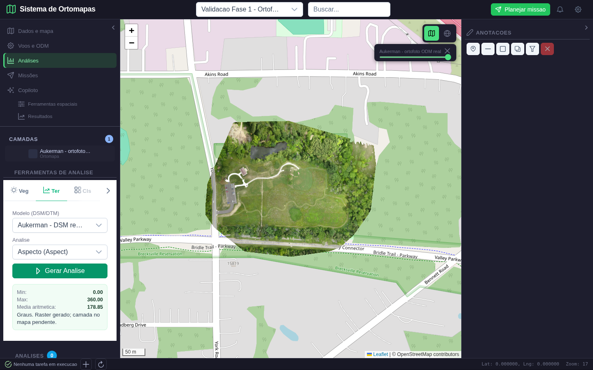

# Fase 2: correcao dos motores de terreno

Data: 11/10/2026. Escopo: orientacao do relevo, sombreamento e corte/aterro, com verificacao numerica e interacao real pela interface. O checkpoint anterior `d6c8172` ja estava enviado ao GitHub antes deste lote.

## Conclusao e limites

Os motores corrigidos passaram nas referencias analiticas e na verificacao dos arquivos reais. A interface agora mostra os numeros retornados e nao adiciona entradas vazias na lista de camadas. **Isso nao aprova a publicacao de resultados no mapa:** ela ainda nao existe nesse fluxo de ferramentas. Nas duas cenas abaixo, o mapa central e a ortofoto de contexto, nao o raster tematico calculado. Nao apresentar essas cenas como mapas de aspecto ou de sombreamento renderizados.

A fase 2 segue em revisao: este lote nao verifica todos os motores legados, recorte por AOI, hidrologia, vegetacao, persistencia de analises ou chat com o modelo. Tampouco certifica precisao topografica, datum vertical ou equivalencia pixel a pixel com algoritmos do QGIS/GDAL.

## Dados e preparacao

- Produto real existente: `data/ortomapas/odm_2_dsm.tif`, Aukerman, EPSG:32617, elevacoes assumidas em metros.
- Ortofoto de contexto: `data/ortomapas/odm_2_ortomosaico.tif`.
- Projeto de validacao existente: `Validacao Fase 1 - Ortofoto real Aukerman`, ID 62.
- Foi cadastrado o DSM real nesse projeto como ortomapa ID 34, reutilizando o voo da ortofoto. Sem fotos novas, processamento ODM novo ou alteracao de permissoes do projeto original.
- O usuario de teste e visualizador no projeto 2 e proprietario no projeto 62. Gerar arquivo explicitamente no projeto 2 foi recusado com HTTP 403; os testes positivos ocorreram no 62.
- Nao foram usados rasters sinteticos nas capturas. Fixtures pequenas sinteticas foram usadas apenas nos testes de referencia matematica.

## Erros encontrados e correcoes

| Problema | Correcao | Prova |
|---|---|---|
| Orientacao calculada com sinais/eixos inconsistentes | Vetor de descida, azimute horario a partir do norte da grade; plano sem orientacao vira nodata | Quatro direcoes cardeais e grade rotacionada em pes |
| Sombreamento dependente de unidades implicitas | Gradiente metrico compartilhado e iluminacao Lambertiana, parametros limitados | Plano iluminado, plano oposto, pixels reais |
| Subtracao de superfices sem alinhar grades | Reprojecao bilinear do raster posterior para a grade original anterior | Deslocamento de um pixel, nodata, sem sobreposicao, identidade |
| Area de pixel desconsiderava rotacao/pes | Determinante do Jacobiano metrico | Grade rotacionada em pes com volume conhecido |
| Lista de camadas recebia itens sem raster/vetor | Nao adicionar entrada sem GeoJSON ou URL de tiles | Contagem da lista inalterada apos os calculos |
| Resultado mostrava campos vazios | Ler `statistics.band_1`; conferir texto contra a API | Capturas finais e asserts dos tres numeros |
| Numeros pouco contrastantes no painel claro | Cor escura especifica para as estatisticas | Inspecao das capturas finais |

Orientacao refere-se ao **norte da grade projetada**, nao ao norte verdadeiro corrigido pela convergencia meridiana. A media aritmetica dos angulos e exibida com esse nome; nao representa direcao predominante. Elevacao Z e assumida em metros: nao ha conversao automatica de datum vertical.

### Cena 1: executar orientacao do relevo



**Passos:** login, selecionar projeto de validacao, ativar ortofoto, entrar em Analises, abrir Ter, selecionar Aspecto e clicar Gerar Analise. O DSM real e selecionado pelo painel.

**Esperado:** arquivo GeoTIFF com azimutes de descida em graus, valores do arquivo apresentados, nenhuma camada ficticia adicionada. Ortofoto continua como contexto.

**Obtido:** 32.678.891 pixels de orientacao definidos, minimo 0, maximo 359,999695 e media aritmetica 178,852185 graus. Cada pixel valido foi comparado com `atan2` aplicado ao vetor de descida calculado independentemente para o raster norte-acima. Mascara conferida exatamente; tolerancia numerica de 0,00002 graus para armazenamento float32. Planos/ausencia de vizinhanca nao recebem orientacao arbitraria.

**Inspecao:** valores visiveis no painel esquerdo; nao ha mapa colorido de orientacao no centro. A publicacao georreferenciada desse novo produto e a pendencia seguinte, nao uma funcao aprovada nesta captura.

### Cena 2: executar sombreamento


**Passos:** no mesmo painel, selecionar Sombreamento e executar. Nesta interface sao usados azimute 315 graus e altitude solar 45 graus; a API aceita parametros validados, mas seus controles ainda nao estao expostos neste painel.

**Esperado:** raster de intensidade 0 a 255, mascara preservada, estatisticas coerentes, sem entrada vazia na lista de camadas.

**Obtido:** 35.587.230 pixels validos, minimo 0, maximo 255 e media 154,385388. Todos os pixels validos foram comparados com produto escalar independente entre a normal metrica da superficie e o vetor de iluminacao; tolerancia 0,00002 para float32. Valores apresentados na tela conferidos contra a resposta HTTP.

**Inspecao:** resultado numerico legivel e mapa de contexto preservado. Nao ha publicacao de uma camada hillshade nessa cena. O motor usa diferencas finitas NumPy, nao o algoritmo Horn do `gdaldem`; nao alegar equivalencia exata com ele.

## Corte/aterro e testes negativos

O raster posterior e reamostrado bilinearmente sobre a grade completa do anterior. Diferenca = posterior - anterior. Apenas a area comum com valores finitos participa. Pixels com variacao menor ou igual a 0,10 m em modulo nao entram nas quantidades de corte/aterro. Essa tolerancia fixa e uma regra do calculo, nao precisao certificada.

| Teste | Esperado | Obtido |
|---|---|---|
| DSM real comparado consigo mesmo por HTTP | Diferenca e volumes zero | Zero; 35.606.349 pixels comuns; area de pixel 0,0025 m2 |
| Raster posterior deslocado, com nodata | Somente 11 pixels comuns, aterro 88 m3 | Conferido pelo teste automatizado |
| Grade rotacionada em pes | Area `7 * (1200/3937)^2` m2 por pixel | Conferida, volume de corte correspondente |
| Superficies sem sobreposicao | Recusa, nao volume zero inventado | ValueError; rota converte erros de validacao em 422 |
| Grade anterior geografica | Solicitar reprojecao antes de volume metrico | Recusada |
| Altitude solar 100 graus por HTTP | 422 | 422 |
| Visualizador tentando gerar no projeto 2 | 403 | 403 |

Nao houve tela de corte/aterro neste roteiro: esse caminho foi validado via API e arquivo. Nao foi simulada uma obra real ou comparacao de dois levantamentos temporais.

## Evidencias e reproducao

43 testes Python aprovados; build frontend aprovado. Playwright: duas capturas finais, zero erros JavaScript, selecao e execucao reais, sem mocks de rede ou injecao de resultados. O roteiro tambem verifica os numeros na interface, a mascara raster, o conteudo dos arquivos e a ausencia de camadas vazias.

```bash
python -m pytest tests/test_terrain_tools.py tests/test_elevation_analysis.py tests/test_metric_analysis.py tests/test_surface_grid.py tests/test_resource_access.py tests/test_raster_tiles.py tests/test_ortomapas_postgres.py -q
python scripts/validar_derivadas_terreno_fase2.py
cd frontend
npm run build
```

Resultados completos: `derivadas_terreno_fase2_2026-10-11/resultado.json`. Arquivos gerados ficam em `data/analises/projetos/62/`, com nomes unicos por execucao. As imagens `diagnostico_*` sao intermediarias, nao cenas aprovadas.

As primeiras tentativas do roteiro precisaram corrigir seletores do menu/tab/Select e resolver caminhos relativos de arquivos. A primeira tentativa de geracao confirmou a recusa por permissao no projeto 2. A inspecao identificou campos vazios e baixo contraste; as duas capturas finais foram regeradas apos as correcoes.

## Proximo lote

Persistir resultados com identificacao, proveniencia e vinculo ao projeto; publicar tiles autenticados dos produtos calculados; adicionar as camadas reais com legenda/unidade; reabrir apos recarregar a pagina e repetir a comparacao visual. Depois revisar os demais motores e a aplicacao da AOI. O painel ainda mistura superficies claras/escuras e usa abreviacoes de ferramentas: sua reorganizacao completa segue pendente.
