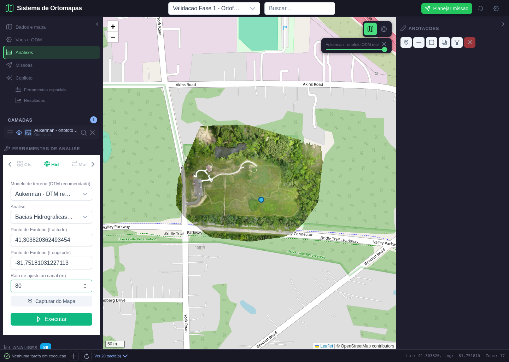
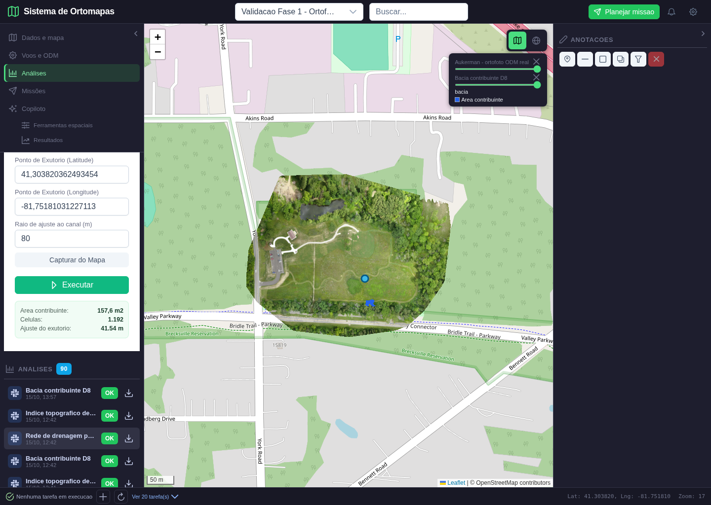
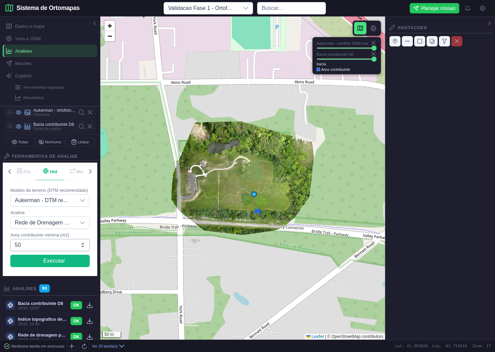
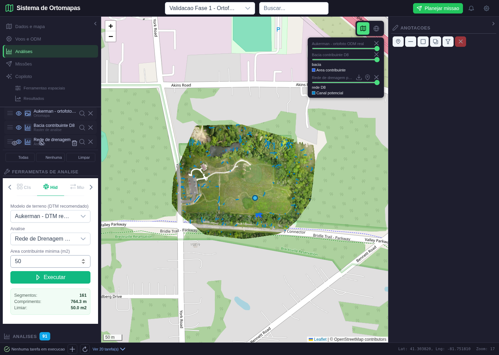
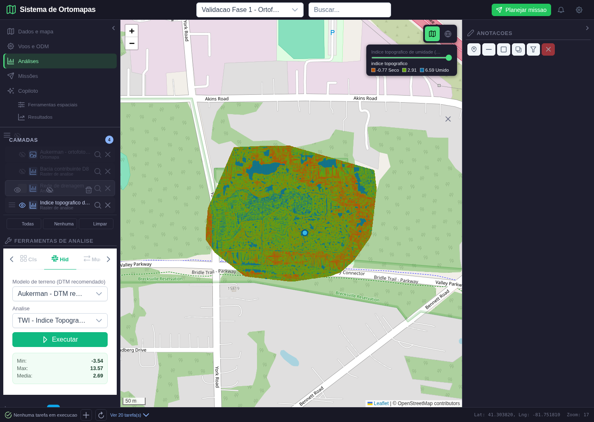
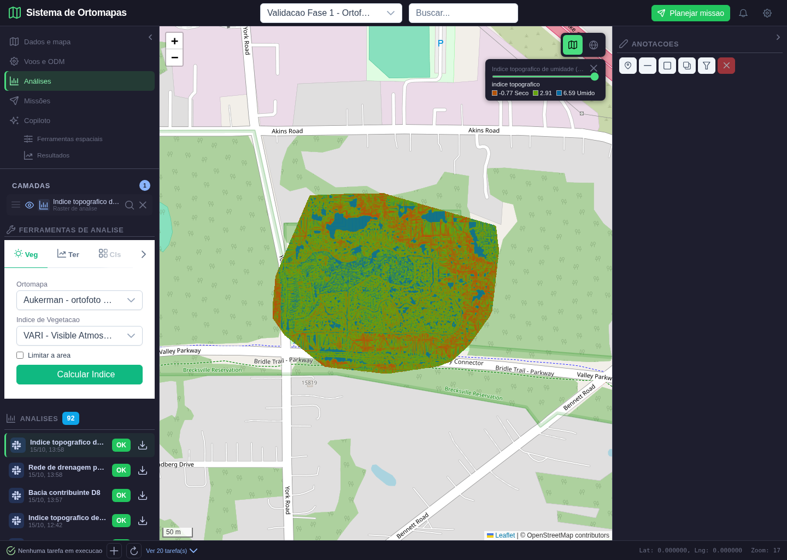

# Validacao operacional: hidrologia sobre DTM WebODM

- **Data:** 15/10/2026
- **Projeto:** Validacao Fase 1 - Ortofoto real Aukerman (ID 62)
- **Fonte:** Aukerman - DTM real para hidrologia (ID 36), importado do WebODM; ortofoto RGB real usada como referencia visual
- **Caso de uso:** UC-011 e fluxos de bacia/TWI da aba Hid
- **Parecer:** APROVADO no escopo de execucao, publicacao e visualizacao; sem certificacao hidrologica de campo

## O que foi executado

O roteiro automatizado abriu o projeto pelo login de seu proprietario, mostrou a ortofoto, selecionou o DTM, capturou um exutorio no mapa e calculou uma bacia. Depois gerou uma rede potencial com limiar de 50 m2, calculou o indice topografico de umidade (TWI), recarregou a pagina e reabriu o TWI pelo catalogo. As tres analises foram gravadas no PostgreSQL e apontam para arquivos derivados separados da fonte.

O pipeline cria uma grade de trabalho limitada a 1024 pixels na maior dimensao, conserva a extensao e o CRS projetado, aplica suavizacao gaussiana de uma celula, preenche depressoes por priority-flood, calcula fluxo D8 e acumulacao. A bacia usa o caminho reverso do fluxo a partir do exutorio ajustado. A rede e composta por LineStrings onde a area contribuinte ultrapassa o limiar. O TWI combina acumulacao e declividade.

## Resultados e verificacoes

| Verificacao | Resultado |
|---|---:|
| Bacia, celulas | 1.192 |
| Bacia, area recalculada do GeoTIFF | 157,6498 m2 |
| Ajuste do exutorio ao canal potencial | 41,54 m, dentro do raio informado de 80 m |
| Tile da bacia | RGBA identico ao esperado; 785 pixels opacos |
| Rede, limiar de area contribuinte | 50 m2 |
| Rede, LineStrings | 161 |
| Rede, comprimento publicado | 764,273 m |
| Rede, comprimento recalculado em CRS projetado | 764,284 m |
| TWI, minimo / media / maximo | -3,535 / 2,691 / 13,571 |
| TWI, pixels validos | 673.015 |
| Tile TWI | RGBA identico ao esperado; 65.536 pixels opacos |
| Acesso de usuario externo | HTTP 403 |
| Latitude invalida do exutorio | HTTP 422 |
| Erros JavaScript durante o fluxo | 0 |

O resultado estruturado, com IDs e coordenadas dos tiles, esta em [resultado.json](hidrologia_fase5_2026-10-15/resultado.json). O roteiro reproduzivel esta em `scripts/validar_hidrologia_fase5.py`; os testes numericos unitarios estao em `tests/test_hydrology_products.py`.

## Telas executadas

### 1. Captura do exutorio

O ponto azul foi clicado sobre a ortofoto. O formulario recebeu latitude e longitude WGS84 do mapa e raio de ajuste de 80 m. O DTM esta selecionado como fonte da analise. O raio elevado foi usado porque o exutorio demonstrativo nao havia sido posicionado sobre um canal conhecido; a distancia efetiva de ajuste ficou registrada no resultado.

### 2. Bacia publicada

A area azul pequena, junto a borda sul da ortofoto, e a bacia contribuinte para o exutorio ajustado, nao a area inteira da imagem. O teste contou os 1.192 pixels classificados no GeoTIFF e multiplicou pela area projetada de cada celula; o valor coincide com 157,6 m2 apresentado na interface. O tile da bacia foi reconstruido de forma independente e comparado pixel a pixel.

### 3. Limiar da rede

O limiar e informado em m2 e convertido pela area da celula da grade de trabalho. No DTM Aukerman, a calibracao mostrou 1.821 segmentos a 10 m2, 510 a 25 m2, 161 a 50 m2 e 35 a 100 m2. O valor de 50 m2 permite inspecionar os canais principais sem esconder a ortofoto; nao e um parametro universal.

### 4. Rede publicada

As linhas azuis sao feicoes GeoJSON, desenhadas sobre a ortofoto. O painel informa 161 segmentos e 764,3 m. O teste leu cada geometria, a reprojetou para o CRS do DTM e somou seus comprimentos: 764,284 m, diferenca de cerca de 1 cm em relacao ao valor publicado, explicada pelo arredondamento das coordenadas WGS84. Sao canais potenciais derivados do terreno, nao cursos d'agua observados em campo.

### 5. TWI isolado

As camadas da ortofoto, bacia e rede foram ocultadas nessa captura para deixar visivel somente o raster TWI. Tons frios representam valores relativos mais altos na legenda. A interface apresenta minimo, maximo e media; o teste abriu o GeoTIFF, conferiu os pixels validos e comparou o tile exibido com uma renderizacao independente. TWI nao mede umidade real.

### 6. Reabertura apos recarregar

A pagina foi recarregada e a analise TWI foi selecionada pelo ID no catalogo. O mapa recebeu novamente os tiles corretos, demonstrando persistencia do registro, arquivo e estilo. A aba de ferramentas voltou ao estado inicial; isso nao alterou o produto reaberto.

## Limites do aceite

- Este ensaio comprova o funcionamento do fluxo e a consistencia interna dos produtos sobre um DTM real do WebODM. Nao compara a rede com hidrografia levantada em campo nem valida cotas altimetricas absolutas.
- Depressoes, ruido do DTM, resolucao da grade, limiar e local do exutorio afetam a rede e a bacia. O operador deve revisar cada resultado antes de tomar decisoes de engenharia ou ambientais.
- O processamento ainda e sincrono na API. Fila, cancelamento, limpeza automatica de derivados e avaliacao hidrologica com dados externos pertencem a lotes posteriores.
- O mapa de base e a ortofoto mostram a regiao Aukerman; Guarajuba nao e a area deste ensaio.
