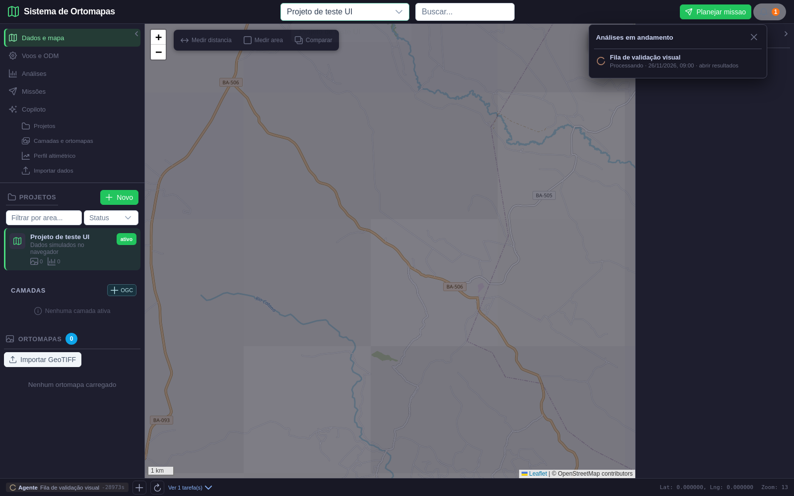
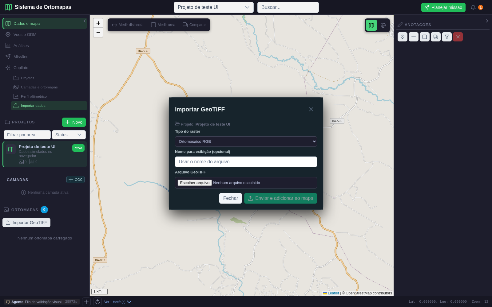
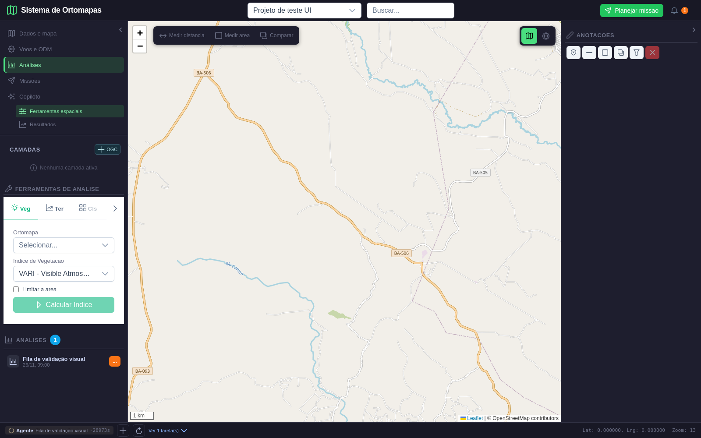
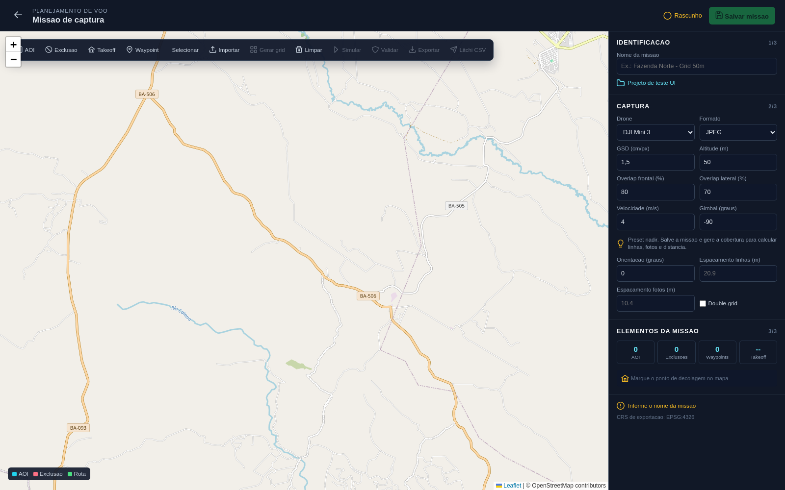
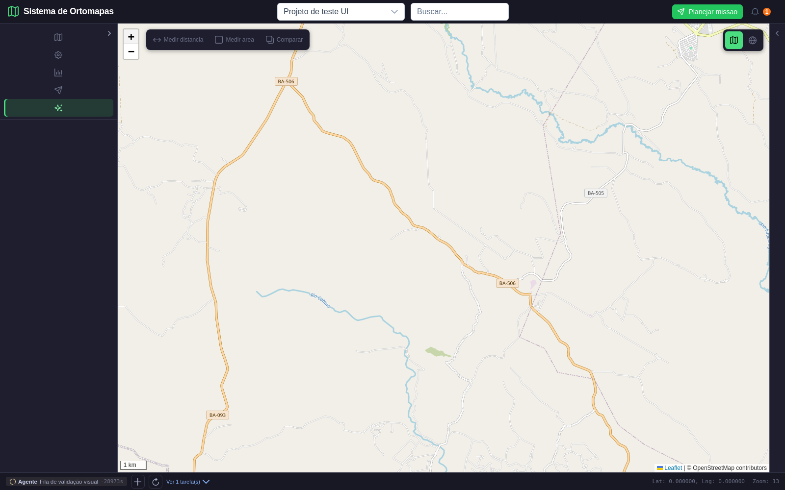
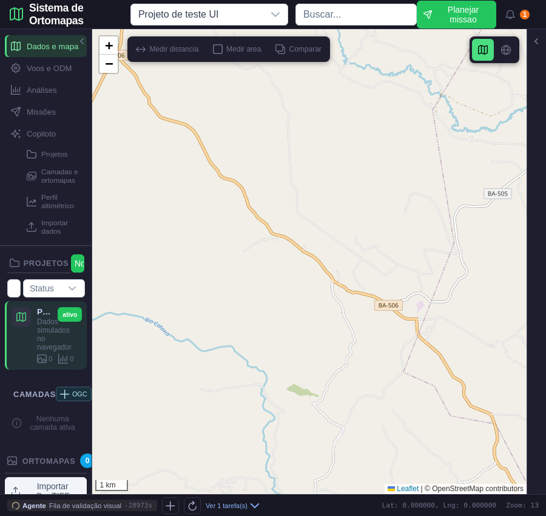

# Etapa 1 de 6 — Navegação lateral e cabeçalho

- **Data da execução:** 26/11/2026
- **Resultado:** aprovada para navegação/interface.
- **Build:** `npm run build` — sucesso.
- **Execução visual:** Playwright Chromium, 1600×1000 e 900×850.
- **Dados:** fixtures de API configuradas somente no contexto do navegador; nenhuma escrita em banco, nenhuma chamada ao LLM e nenhum upload. O projeto e a análise exibidos nas capturas são dados de demonstração da fixture, não registros reais. As capturas de mapa usam tiles públicos reais do OpenStreetMap.

## Verificação das capturas que pareciam em branco

Na inspeção das oito imagens, identifiquei dois problemas de evidência, com causas diferentes:

1. **Planejador (`05_planejador_aberto_pelo_submenu.png`):** a captura original foi feita logo após abrir o Leaflet. Só três tiles tinham sido pintados; a área restante era o fundo do mapa enquanto os pedidos ainda estavam em andamento. Repeti a navegação pelo Playwright, esperei 10 segundos e medi **30 tiles carregados, 0 tiles com imagem inválida**. A nova captura mostra a cartografia contínua. O roteiro agora espera pelo menos 12 tiles decodificados antes de salvar a tela e falha se eles não carregarem.
2. **Perfil (`02_perfil_aberto_pelo_submenu.png`):** o projeto de demonstração não tem DSM/DTM, portanto não há gráfico de elevação a desenhar. Além disso, a fixture não respondia ao endpoint `/api/odm/produtos`, e a tela apresentava falsamente “Falha ao listar produtos”. Corrigi a fixture para responder `{ "total": 0, "produtos": [] }` e recapturei a tela. Ela agora informa “Nenhum DSM / DTM disponível”; isso é um estado vazio esperado para este projeto sem dados de elevação, não um perfil calculado nem uma falha do serviço.

As duas imagens foram recapturadas no Chromium/Playwright em 26/11/2026. A repetição foi direcionada a essas telas; o roteiro Python completo não pôde ser reexecutado neste ambiente porque o módulo `playwright` não está instalado no interpretador Python disponível. A suíte anterior continua registrada em `resultado.json`; esta observação impede interpretar a recaptura parcial como nova execução integral da suíte.

## O que foi corrigido

1. Os subitens da barra lateral agora levam a um painel real: Projetos, Camadas, Perfil, Importação, Voos, fila/produtos ODM, ferramentas, resultados, conversas/histórico e Planejador.
2. O sino do cabeçalho abre análises em fila/processamento e leva ao respectivo resultado. O número do badge corresponde ao número de análises pendentes do projeto ativo.
3. A engrenagem foi removida porque o produto ainda não tem uma tela de preferências. O botão inerte não aparece mais.
4. O clique no item principal Missões agora seleciona a área de trabalho. O subitem abre o Planejador. A validação revelou que antes o clique principal abria uma modal cobrindo os subitens; esse fluxo foi corrigido.
5. A navegação recolhida preserva nomes acessíveis, responde a teclado e é visível no viewport compacto.

## Comparação esperado × obtido

| Verificação | Esperado | Obtido | Resultado |
|---|---|---|---|
| Projeto e sessão de interface | Abrir a aplicação autenticada com projeto selecionável | Fixture selecionada pela interface; nenhuma persistência | Aprovado para roteiro visual |
| Sino | Abrir lista de análises ativas; selecionar item leva à área de resultados | Painel abriu e clique trocou para Análises | Aprovado para interface; dados da notificação são fixture |
| Subitens Dados | Abrir projetos/camadas, abrir perfil e chegar à importação | Os destinos responderam; Perfil abriu; o subitem Importar levou ao controle e o botão abriu o diálogo GeoTIFF | Aprovado para navegação |
| Estado sem DSM/DTM | Informar quando não existe produto de elevação | Fixture corrigida para `{ "total": 0, "produtos": [] }`; Perfil mostra “Nenhum DSM / DTM disponível” sem erro de API | Aprovado para estado vazio; cálculo de perfil não executado |
| Subitens Voos/ODM | Levar à lista de voos e ao painel da fila/produtos | Ambos os painéis foram localizados após clique | Aprovado para navegação |
| Subitens Análises | Levar às ferramentas e aos resultados | Ambos os painéis foram localizados | Aprovado para navegação; cálculos não executados nesta etapa |
| Missões | Área de trabalho não deve bloquear seus próprios subitens; o subitem abre o Planejador | Reproduziu-se o bloqueio original, corrigiu-se a navegação e confirmou-se abertura do Planejador | Aprovado após correção |
| Copiloto | Navegar para conversas e histórico de respostas/ferramentas | Os destinos internos foram localizados; API de conversa respondeu por fixture, sem gravação real | Aprovado para navegação |
| Configurações | Não exibir controle sem ação | Engrenagem ausente no cabeçalho | Aprovado |
| Teclado e viewport | Barra recolhida operável por teclado; layout visível em janela estreita | Tab/Enter selecionaram Dados; a barra permaneceu visível em 900×850 | Aprovado no escopo exercitado |
| Erros | Sem erros JavaScript nem falha de requisição no roteiro | `page_errors=[]`, `failed_requests=[]` na execução completa original; recapturas pontuais não chamaram API real | Aprovado no escopo registrado |

## Evidências Playwright

As demais imagens mostram o Perfil altimétrico e o Histórico do Copiloto: `02_perfil_aberto_pelo_submenu.png` e `06_copiloto_historico_pelo_submenu.png`. O perfil não foi calculado porque o projeto fixture não tem DSM/DTM. O mapa base é cartografia pública do OpenStreetMap; não há ortomosaico nem raster de elevação neste projeto fictício. Esta etapa valida roteamento e abertura dos painéis, não o processamento geoespacial, a importação real de raster, ou a execução do Copiloto.

O roteiro reproduzível está em [`validar_etapa1.py`](validar_etapa1.py), e os resultados estruturados em [`resultado.json`](resultado.json). O build produziu alertas não bloqueantes já conhecidos: aviso de API CommonJS do Vite e bundle JavaScript acima de 500 kB; a compilação terminou com sucesso.

## Pendências mantidas para as próximas etapas

- Exclusão de ortomapa não foi alterada nesta etapa; continua na Etapa 2.
- Extent/contexto incorreto do Planejador continua na Etapa 3.
- Os algoritmos e seus resultados ainda precisam de execução individual com dados de validação na Etapa 4.
- A resposta real, persistência e isolamento do Copiloto serão validados na Etapa 5.
- A regressão completa e comparação final permanecem na Etapa 6.

**Decisão:** I-01 e I-02 foram fechados para o comportamento verificado; I-07 passou no escopo de teclado e viewport exercitado. A Etapa 1 está concluída. O resultado não promove análises, dados fixture ou respostas simuladas a aceite operacional.
