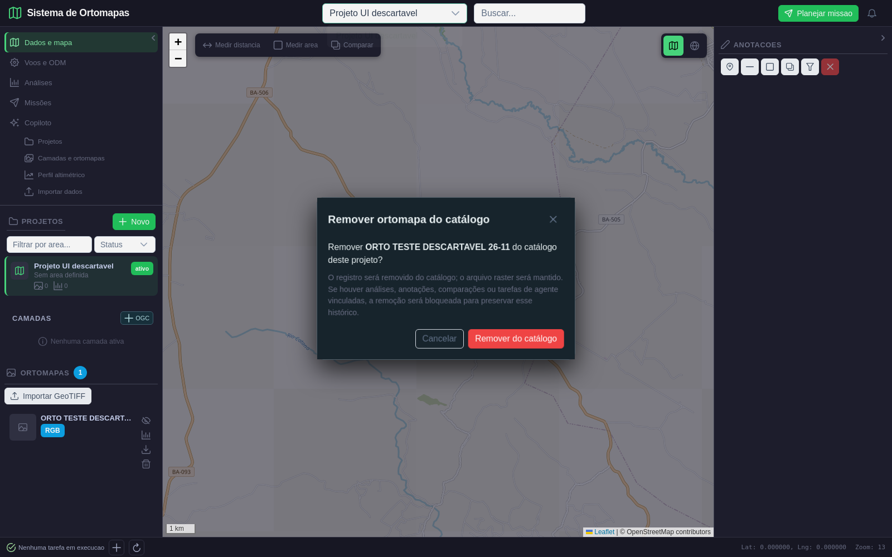
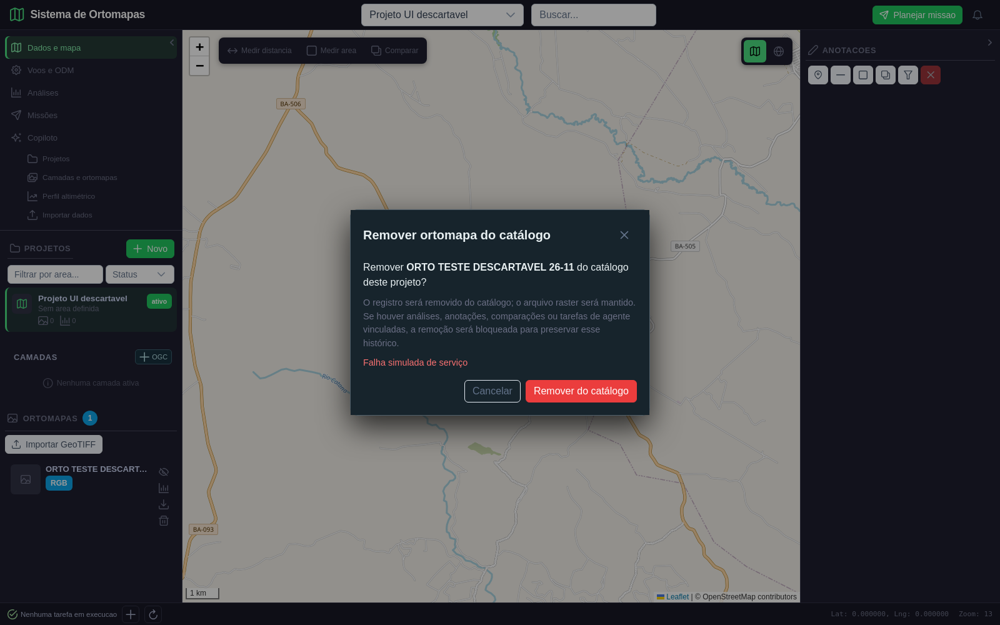
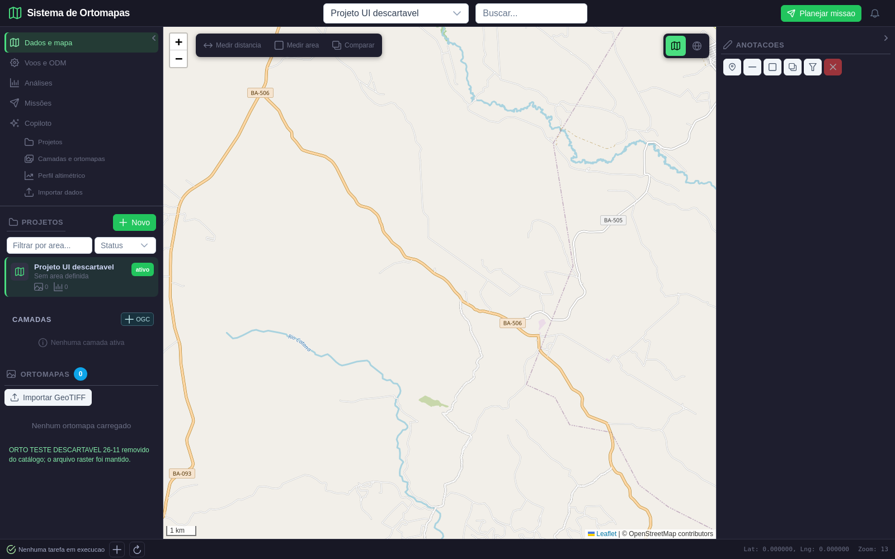
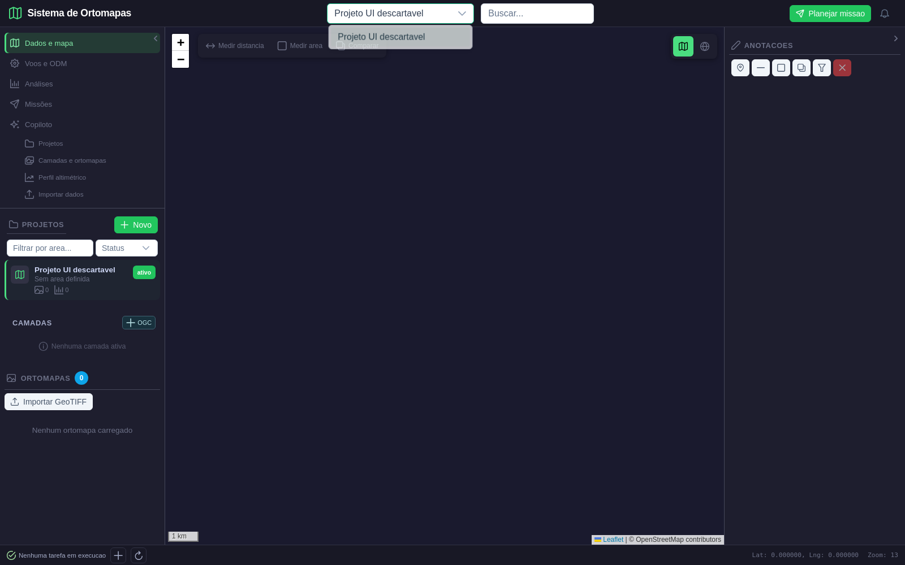
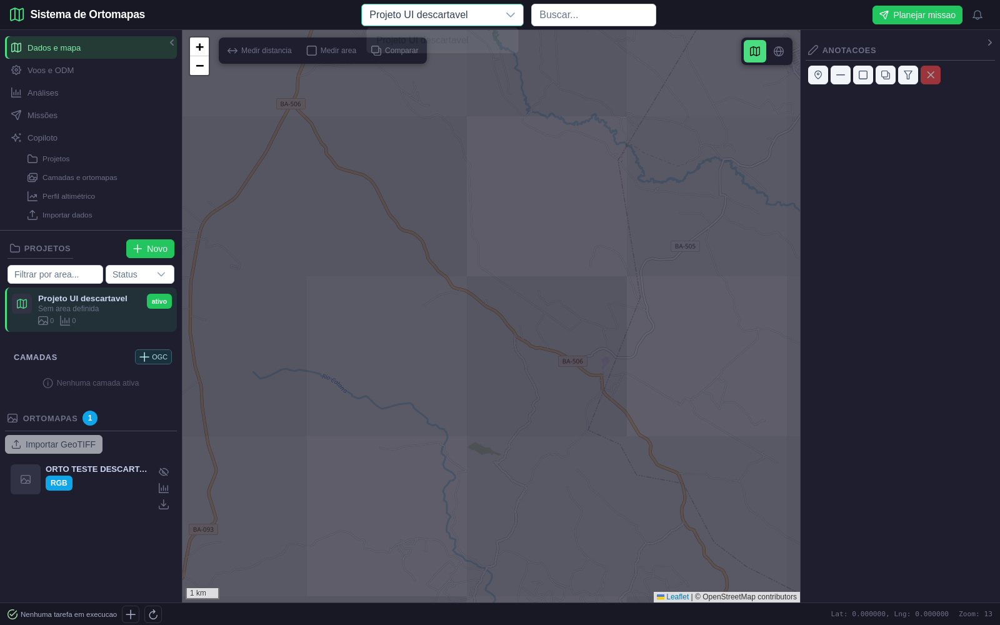

# Etapa 2 de 6 — Remoção segura de ortomapa

- **Data:** 26/11/2026
- **Resultado:** aprovada para UI e guarda contra exclusão em cascata; não é aceite de autorização no banco operacional.
- **Build:** `npm run build` — sucesso; avisos não bloqueantes já conhecidos do Vite e do tamanho do bundle.
- **Playwright:** Chromium, viewport 1600×1000; roteiro versionado `validar_etapa2.cjs`.
- **Dados:** ortomapa ID 955 e projeto de teste são fixtures do navegador. As chamadas `/api/**` são interceptadas; não houve chamadas ao backend, escrita no banco ou remoção de arquivo real.

## O que foi implementado

- O botão de lixeira do card abre confirmação com o nome do ortomapa.
- A confirmação informa que a operação remove o registro do catálogo e mantém o arquivo raster, que pode ser compartilhado.
- Se houver análises, anotações, comparações temporais ou tarefas de agente vinculadas, o diálogo avisa que a operação será bloqueada.
- Ao cancelar, nenhuma requisição DELETE é enviada.
- Ao ocorrer erro HTTP, o diálogo exibe o erro e o produto permanece na lista.
- Ao concluir, o card e eventual camada local são removidos da interface; uma mensagem confirma a remoção do catálogo e retenção do raster.
- O controle não aparece para usuário sem permissão de edição. O backend continua validando os papéis `proprietario` e `editor`.
- A rota bloqueia a linha do ortomapa na transação, verifica vínculos que o schema PostgreSQL marca com `ON DELETE CASCADE` e responde HTTP 409 em vez de apagar histórico relacionado silenciosamente.

## Esperado × obtido

| Caso | Esperado | Obtido | Resultado |
|---|---|---|---|
| Confirmação | Mostrar qual ortomapa será removido e explicar o destino do arquivo | Diálogo identifica `ORTO TESTE DESCARTAVEL 26-11`; diz que o arquivo raster fica e que vínculos podem bloquear | PASS |
| Cancelamento | Manter catálogo e não chamar API | Card continua; contador DELETE permanece 0 | PASS |
| Erro HTTP | Manter card e explicar erro | `Falha simulada de serviço`; card continua visível | PASS |
| Remoção permitida | Remover metadata do catálogo, manter arquivo e camada fora da vista | Fixture de sucesso remove card, estado da camada e mostra confirmação | PASS |
| Recarga | Item removido não reaparece no catálogo | A fixture passa a retornar lista vazia; estado vazio após reload | PASS |
| Sem permissão | Esconder o controle | Card de usuário sem edição não contém botão de remoção | PASS |
| Dependências backend | Não deixar FK apagar análises/anotações/comparações/tarefas associadas | Teste unitário recebe 409, confirma que não houve `DELETE` nem `commit` | PASS |
| Sem dependências backend | Permitir apagar apenas o registro do catálogo | Teste unitário confirma DELETE e commit; rota não remove arquivo | PASS |

## Limites desta validação

Os seis passos Playwright usam uma API simulada no próprio navegador. Os dois testes backend usam conexão/cursor falsos para provar a lógica de contagem e bloqueio, não se conectam ao PostgreSQL. A autorização por projeto foi conferida por inspeção da rota (`require_project_role`) e pela ausência do controle na UI para papel sem edição; uma tentativa HTTP real com usuário leitor/editor no banco de teste fica pendente para a regressão final.

Esta rota remove metadata. Ela não apaga arquivos. Se houver histórico dependente, o backend bloqueia a remoção até o usuário resolver os vínculos por fluxos próprios. Assim, uma remoção de ortomapa em uso não deve apagar análises ou registros relacionados em cascata.

Arquivos reproduzíveis: [`validar_etapa2.cjs`](validar_etapa2.cjs), [`resultado.json`](resultado.json), [teste unitário do guard](../../../../tests/test_ortomapa_delete_guard.py). O plano cumulativo está em [plano de correção](../../../analise/plano_correcao_lacunas_inventario_interface_2026-11-24.md).

**Próxima etapa: Etapa 3 de 6 — corrigir o enquadramento geográfico do Planejador de Missão.**
