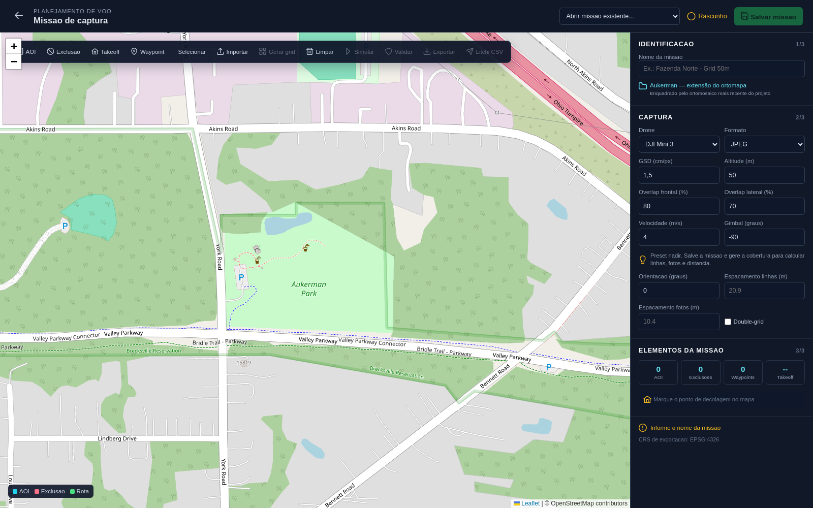
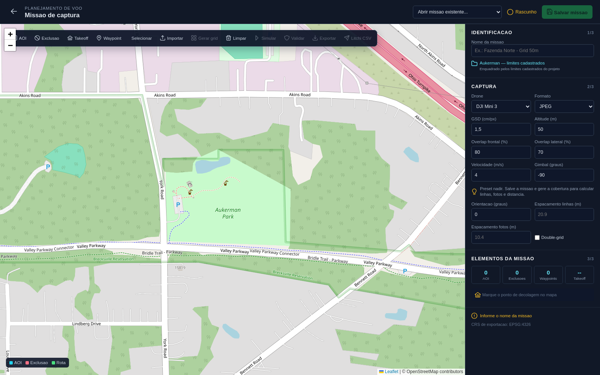
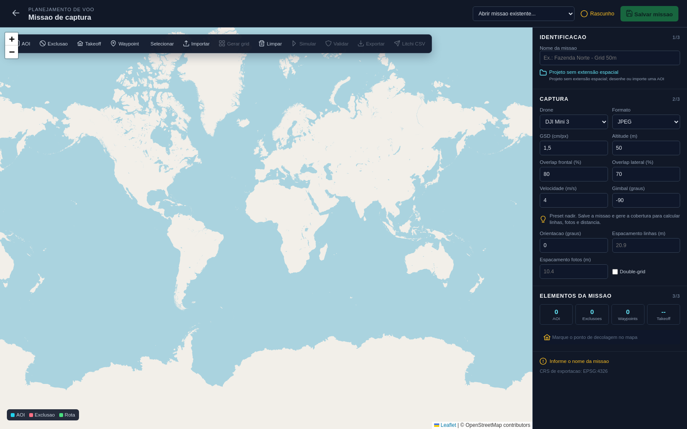
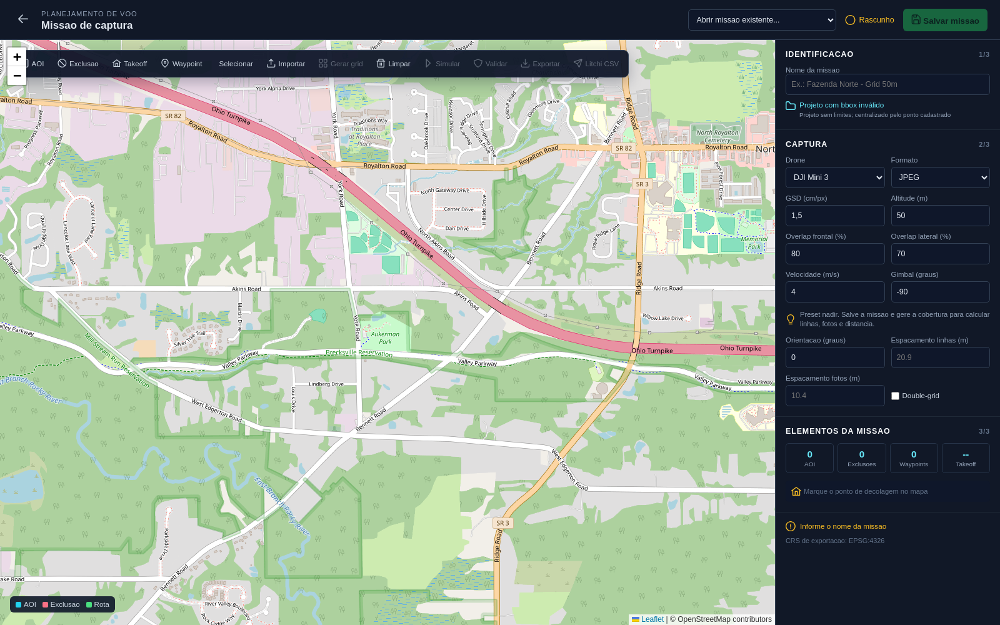
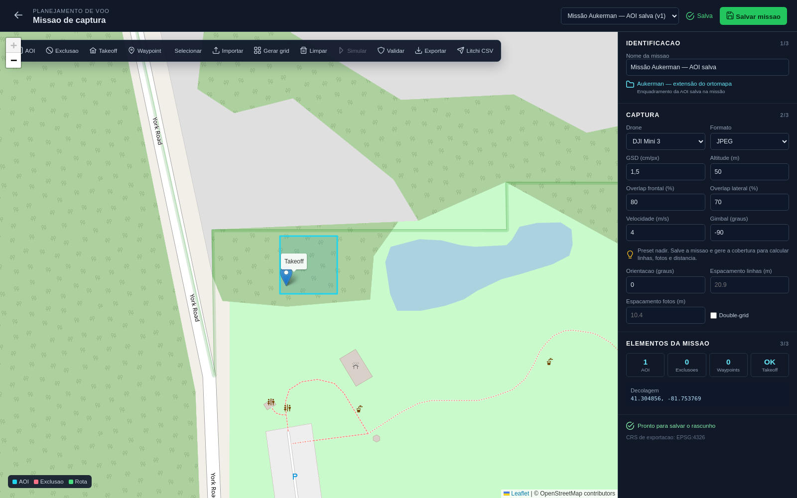

# Etapa 3/6 — Contexto geográfico do Planejador de Missão

**Data:** 26/11/2026
**Escopo:** abrir o planejador a partir de projetos com/sem extensão, abrir missão salva e confirmar visualmente o contexto espacial.
**Resultado:** 6/6 cenários aprovados; 0 reprovados.

## O que foi corrigido

O planejador usava Brasília como centro inicial fixo. Se o projeto não tinha bbox, o mapa permanecia em localização sem relação com os dados. Também não havia indicação visível da origem do enquadramento. Agora o enquadramento usa, nesta ordem:

1. limites válidos do projeto;
2. extensão de um ortomapa do projeto;
3. centro válido do projeto;
4. visão global acompanhada da instrução para desenhar/importar AOI.

Ao abrir missão salva, a AOI dela é enquadrada. Importar ou desenhar AOI identifica no painel que o mapa mostra a área atual. O painel valida coordenadas ausentes, fora de faixa ou limites degenerados.

## Dados e método

O arquivo local `data/ortomapas/aukerman_dsm_campanha_posterior_1845e1ad.tif` foi lido sem alteração: 7.448 × 5.907 pixels, EPSG:32617, coordenadas UTM 17N de canto x=436847,28–437219,68 m e y=4572651,715–4572947,065 m. Para reproduzir o extent WGS84, os quatro lados do retângulo UTM foram amostrados em 101 posições cada e transformados com `gdaltransform -s_srs EPSG:32617 -t_srs EPSG:4326`; o envelope resultante é W=-81.75440181730262, S=41.302851160113434, E=-81.74992313476743, N=41.30554043878053. Esses valores foram a referência numérica do caso Aukerman.

Playwright abriu a aplicação com Chrome. As respostas das rotas de API foram fixtures isoladas em memória do navegador, sem chamadas de gravação, sem banco de dados e sem alterar projetos reais. Os mapas base são tiles OpenStreetMap carregados no navegador. Bounds projetados foram comparados numericamente com o extent do DSM ou AOI correspondente. As capturas foram inspecionadas visualmente para verificar mapa carregado e legibilidade do estado/contexto.

## Comparação esperado × obtido

| Cenário | Esperado | Obtido | Resultado |
|---|---|---|---|
| Extensão do DSM Aukerman | enquadramento contém o extent e identifica a origem | Contexto `project-ortomapa`; `[S 41.30042713, W -81.75881624, N 41.30797098, E -81.74551249]`; extent do DSM contido | Aprovado |
| Projeto com bbox cadastrado | usar bbox do projeto com precedência | Contexto `project-bounds`; bounds contêm o bbox configurado | Aprovado |
| Sem bounds, produto ou centro | visão neutra e mensagem, sem localização presumida | Contexto `world`; centro próximo de (0,0); mensagem “Projeto sem extensão espacial; desenhe ou importe uma AOI” | Aprovado |
| Apenas centro cadastrado | centralizar no ponto médio do DSM Aukerman | Contexto `project-center`; centro observado em (41.30419580, -81.75216248) | Aprovado |
| Bbox fora da faixa WGS84 | rejeitar bbox e tentar centro válido | Contexto `project-center`; bounds inválidos não deslocam o mapa | Aprovado |
| Reabrir missão com AOI | preservar geometria e enquadrá-la | Contexto `mission-aoi`; bounds contêm a AOI salva | Aprovado |

## Evidências de tela

### 1. Extensão do produto Aukerman

O painel identifica a origem do enquadramento e o mapa apresenta tiles carregados em Aukerman Park, Ohio. A região do produto aparece dentro da extensão enquadrada.



### 2. Bbox cadastrado no projeto

Foi configurado o mesmo extent geográfico como bbox do projeto. A prioridade `project-bounds` foi observada e verificada numericamente.



### 3. Projeto sem localização

O mapa abre em visão global com a orientação para desenhar ou importar a área. Nenhuma localidade padrão é selecionada.



### 4. Projeto com centro cadastrado

Sem bbox nem ortomapa, o mapa usa o centro do extent do DSM Aukerman: (41.30419580, -81.75216248). A tela mostra a cartografia local, e os bounds confirmam o centro.


### 5. Limites inválidos

O fixture contém latitude norte 95°, fora da faixa válida. O planejador descarta esse bbox e usa o centro válido do projeto.



### 6. Reabrir missão salva

A missão de Aukerman foi escolhida no seletor “Abrir missão existente”. A AOI salva reaparece e o mapa amplia para a área; o painel mostra o contexto “Enquadramento da AOI salva na missão”.



## Reexecução

Com o servidor Vite na porta 5176 e Playwright disponível:

```bash
PLAYWRIGHT_MODULE=/home/pasteurjr/progreact_100/langnet-interface/node_modules/playwright \
  node docs/validacao/inventario_interface_2026-11-24/etapa-03/validar_etapa3.cjs
```

O script grava `resultado.json` e atualiza as capturas nesta pasta. O build de produção foi executado com `npm run build` e terminou com sucesso; Vite manteve apenas o aviso sobre o bundle JavaScript maior que 500 kB.

## Limites desta validação

O teste comprova o comportamento visual com respostas simuladas no navegador e dados espaciais reais do raster local. Não comprova que a API/banco de produção retornem esses mesmos bounds para cada projeto; essa integração será coberta na regressão final (etapa 6). Os tiles OSM são cartografia base e não são o ortomosaico do drone.
