# Etapa 4/6 — Revisão das ferramentas de análise

**Revisão:** 26/11/2026
**Resultado da revisão:** 8 grupos de ferramentas conferidos; 55 testes unitários passaram.
**Limite de execução nesta sessão:** backend e PostgreSQL não estavam ativos. Não criei registros nem alego uma nova execução integrada hoje. As telas de resultado abaixo são evidências de execuções reais anteriores registradas nos relatórios citados; também foram abertas e inspecionadas visualmente nesta revisão.

## Esclarecimento sobre as telas que pareciam vazias

As capturas `04_aba_vegetacao.png` a `11_aba_exportacao.png` do inventário de 24/11 mostram o mapa-base e o formulário de cada ferramenta. Não mostram o produto de análise porque foram capturadas antes de executar os formulários. Portanto, não são telas de resultado e não provam que o resultado estivesse vazio ou pronto. Nesta revisão, comparei-as com as capturas de execuções reais abaixo: elas mostram a camada calculada, a legenda e os valores onde aplicável.

## Resultado por ferramenta

| Ferramenta | Entrada e resultado observado | Verificação e interpretação | Parecer |
|---|---|---|---|
| Vegetação RGB | Ortofoto real Aukerman; VARI em AOI; 8.098.509 pixels válidos; média 0,0827; tile do resultado comparado pixel a pixel com coloração independente | Erro máximo da fórmula recalculada `1,02e-7`. RGB visível, sem banda NIR; não chamar de NDVI. Extremos ±26,5 vêm de denominador próximo de zero; legenda usa percentis robustos | Funcional, dentro do escopo RGB declarado |
| Terreno | DSM real; declividade, aspecto, hillshade e curvas; curvas a 2 m: 146 segmentos, cotas 240–254 m; a 1 m: 198 segmentos | Aspecto 0–360°; hillshade 0–255; curvas verificadas contra cotas e AOI. O DSM inclui vegetação/objetos; datum vertical não certificado | Funcional; interpretação das cotas limitada pela qualidade/datum do DSM |
| Classificação | Ortofoto real; K-Means RGB, 5 grupos, mesma AOI; percentuais 44,06%, 2,64%, 5,14%, 34,44%, 13,71% | Todos os 8.098.509 pixels válidos têm rótulo; soma 100,0001%; tile conferido pixel a pixel. Grupos não são rótulos semânticos como água/vegetação/solo | Agrupamento funcional; classificação semântica não implementada/validada |
| Hidrologia | DTM real; bacia (1.192 células; 157,65 m²; ajuste 41,54 m), rede (161 segmentos; 764,3 m) e TWI (média 2,69) | A interface e a geração foram demonstradas. Porém, o benchmark independente UC-020 não concede aceite operacional: sem condicionamento, IoU com a bacia USGS 3DHP foi 0,256%; com connector opcional, 71,34%. O D8 acompanha GRASS em 98,66% IoU, o que confirma consistência entre implementações, não verdade de campo | Executa e mostra produtos; reprovada para aceite hidrológico operacional amplo |
| Mudanças | Dois fluxos: elevação e RGB temporal. Elevação: 19.569.623 pixels válidos, 21,26% acima do limiar, corte 4.851,37 m³ e aterro 9.536,87 m³. RGB: campanhas independentes Aklavik 2022/2024, limiar 0,15, 77,96% dos pixels acima do limiar | Comparação RGB foi executada em dados reais e aparece no mapa; diferença de estação/iluminação é forte, sem verdade de campo, então 77,96% não significa área de mudança física. Elevação compara DSMs e exige atenção à convenção de sinal e registro geométrico | Fluxos funcionais; sem aceite semântico de mudança física |
| Volume | DSM Aukerman e cota de referência 242 m; área válida 8.697,905 m²; resultado reaberto e tile conferido | Raster conferido exatamente contra `DSM − referência`. Resultado: corte 1.274,36 m³, aterro 15.332,07 m³, saldo corte−aterro −14.057,71 m³. Depende de cota de referência e unidade vertical assumida em metros | Cálculo funcional; volume não é levantamento de campo certificado |
| Recorte | Ortofoto RGB real e polígono desenhado na UI; resultado com 3.485.778 pixels válidos | Máscara, CRS, dimensões e georreferência conferidos; original ocultado para inspecionar o recorte; resultado persiste como produto próprio | Funcional e demonstrado |
| Exportação | Recorte exportado pelo navegador para GeoTIFF em EPSG:4326 | Download lido de volta: 4 bandas uint8, 2.799 × 2.578 pixels, máscara válida. Testes também cobrem GeoJSON/KML/Shapefile vetorial e rejeição de formato/CRS incompatível | Funcional para os formatos testados |

## Evidências visuais das saídas

Estas capturas vieram das validações end-to-end anteriores com dados reais; não são telas de formulário vazias.

### Vegetação — VARI RGB

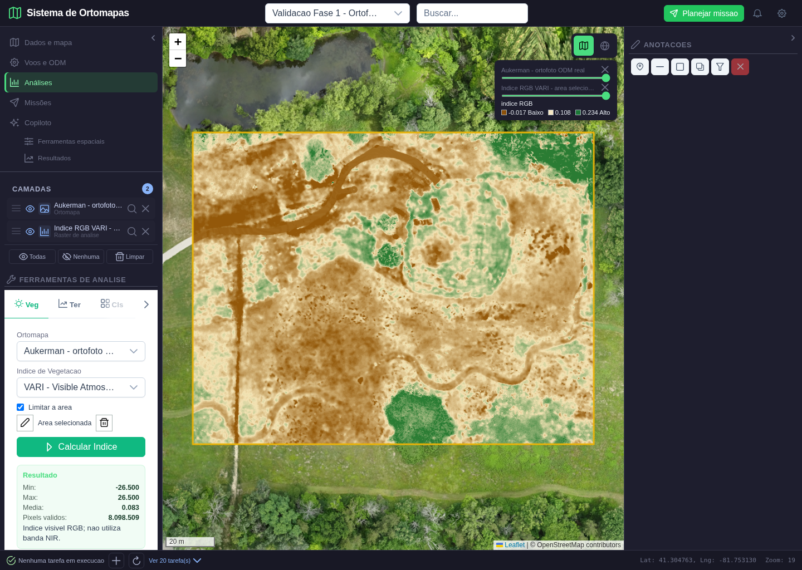

### Terreno — curvas de nível

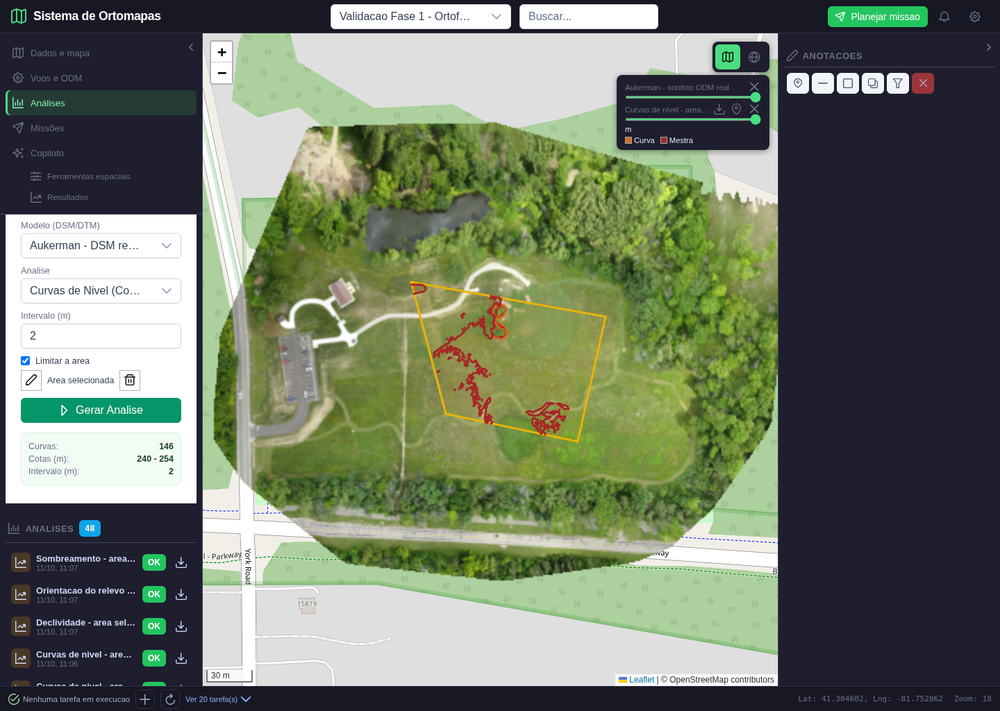

Outros dois produtos de terreno gerados sobre modelo real:

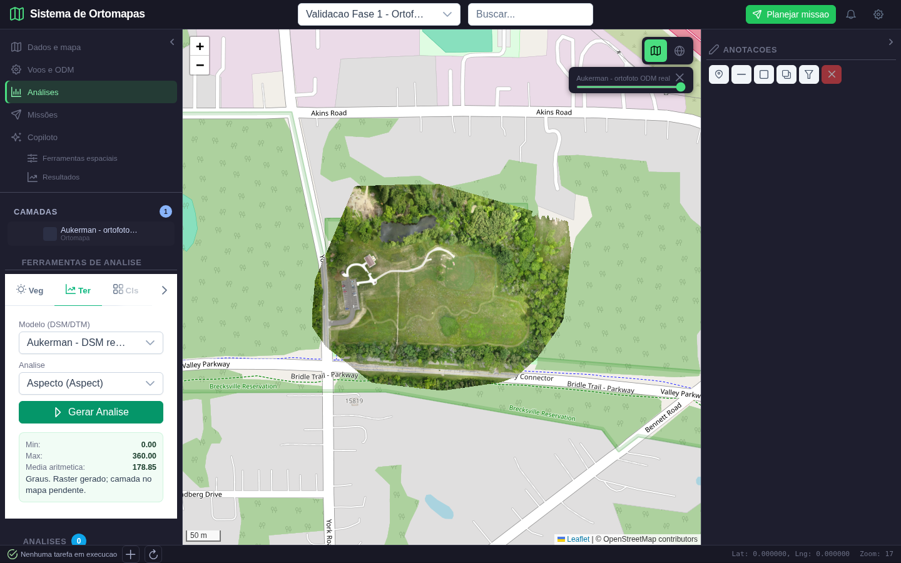


### Classificação — agrupamento não supervisionado

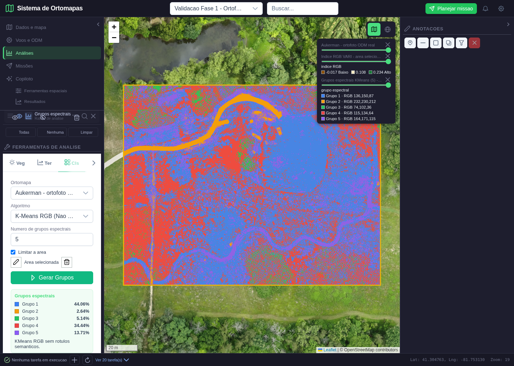

### Hidrologia — bacia, rede e TWI

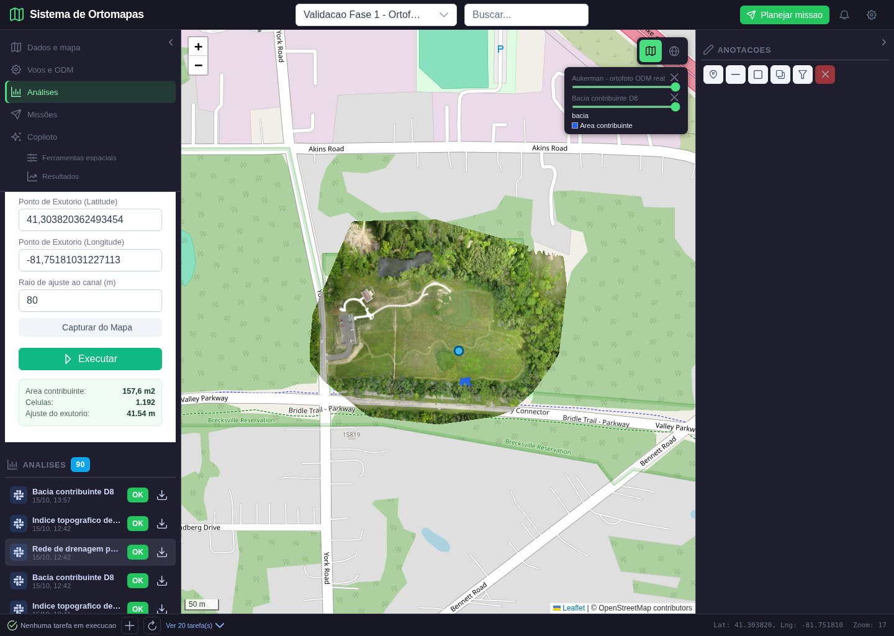

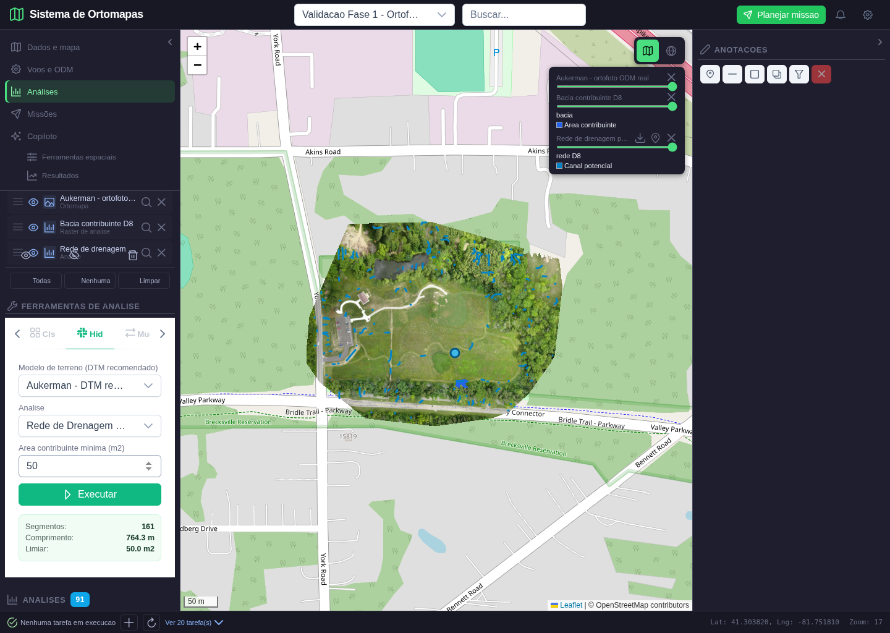

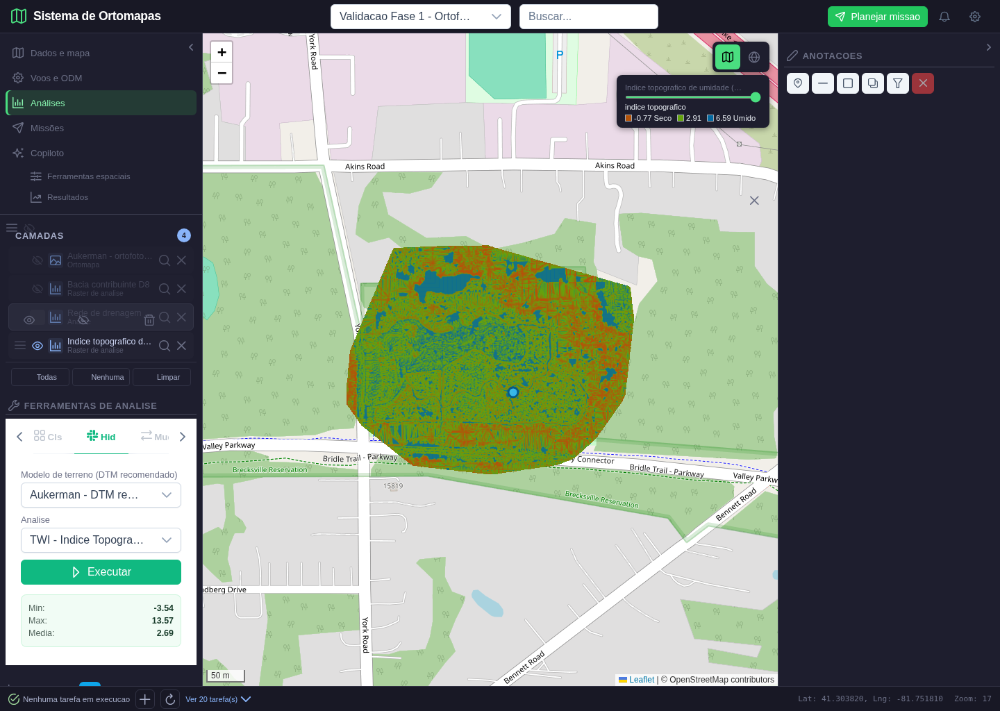

### Mudanças — diferença de elevação

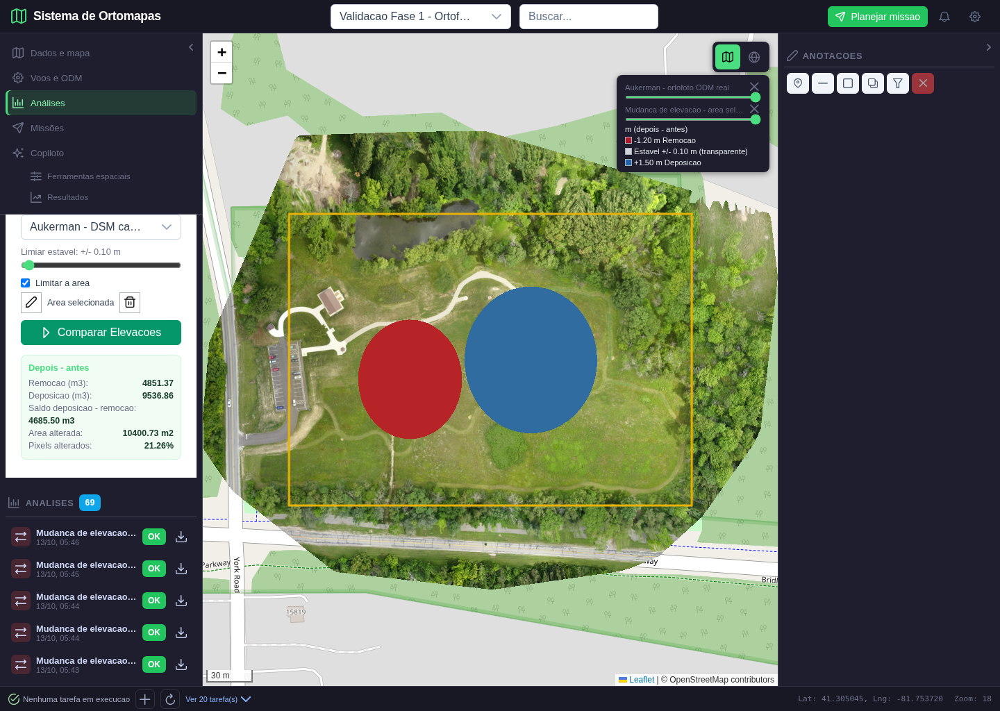

### Mudanças RGB — campanhas independentes

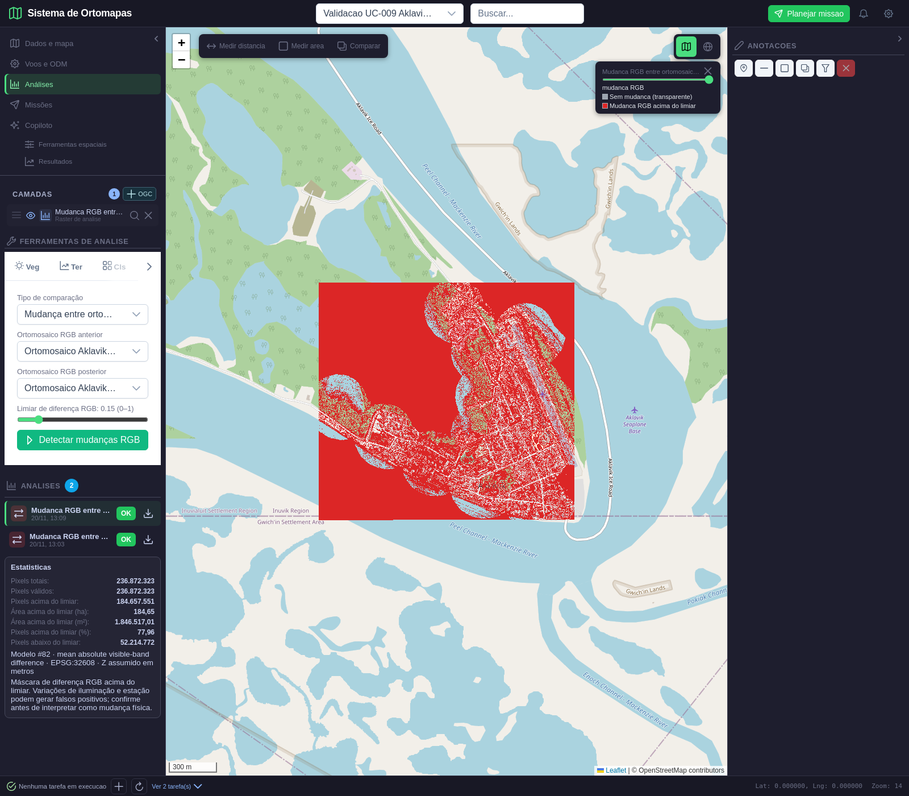

### Volume

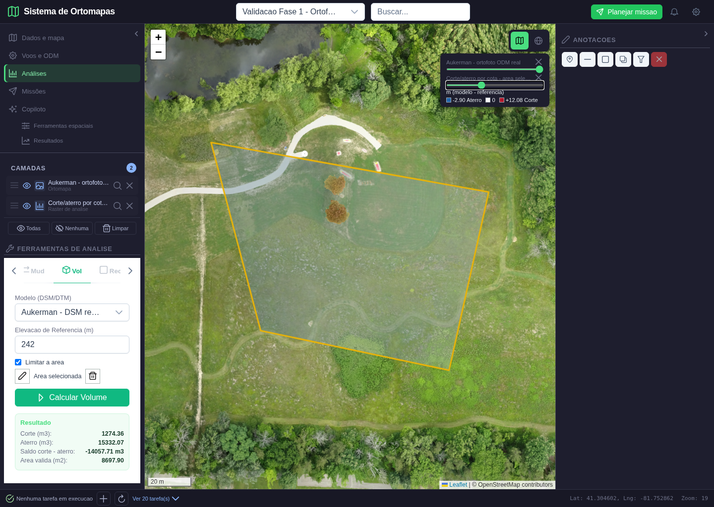

### Recorte e exportação

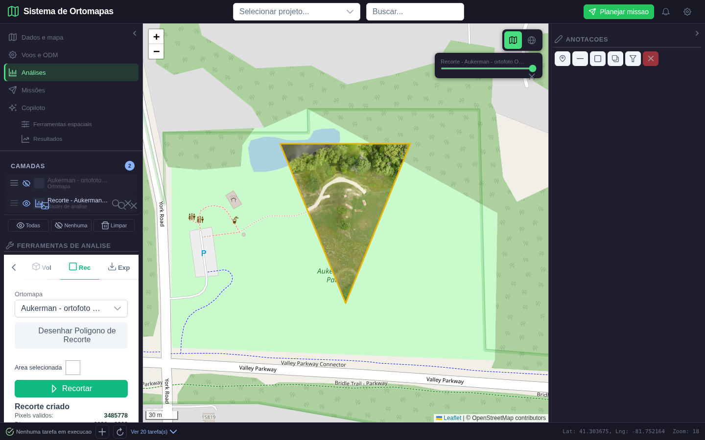

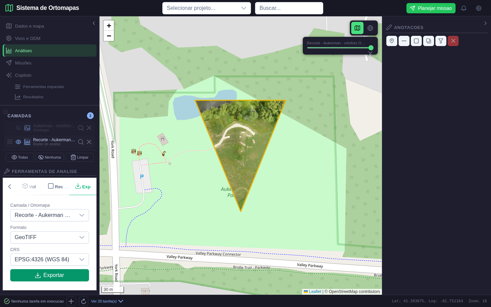

O relatório anterior registra o download conferido: [roteiro e validação do recorte/exportação](../../recorte_exportacao_fase5_2026-10-15.md).

## Testes executados nesta revisão

```bash
./.conda-env/bin/python -m pytest -q \
  tests/test_vegetation_classification.py \
  tests/test_terrain_tools.py \
  tests/test_hydrology_products.py \
  tests/test_change_detection.py \
  tests/test_elevation_change.py \
  tests/test_volume_aoi.py \
  tests/test_clip_export.py
```

**Obtido:** 55 passaram, 0 falharam (1,99 s). Houve 131 avisos de depreciação de Rasterio/Shapely; não alteraram os resultados. Esses testes exercitam os algoritmos, máscaras/AOI, unidades e exportação, mas não substituem API, fila, banco ou navegador.

## Conclusão da etapa

A inspeção confirma que as telas de 24/11 eram estados de entrada; as evidências de resultado estão nos fluxos end-to-end acima. Os grupos de ferramentas têm prova de saída visível e resultados numéricos. O hidrológico segue sem aceite operacional amplo; a comparação RGB não prova mudança física; K-Means não identifica classes semânticas; volume depende da cota e do datum vertical. Esses limites ficam explícitos e serão carregados para a regressão final.

Não houve nova execução HTTP/DB nesta sessão: `ss -ltnp` não mostrou serviços escutando, e nenhuma conexão ao PostgreSQL foi iniciada. A validação visual mais recente do conjunto de análises continua sendo as capturas citadas. A reexecução integrada contra API/DB ativos permanece como verificação da etapa 6.
