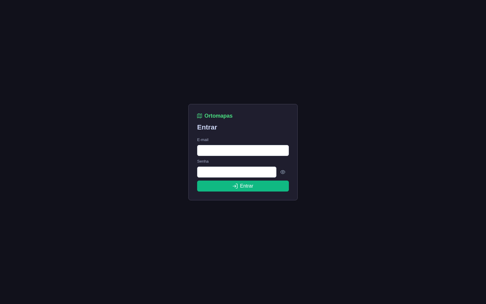
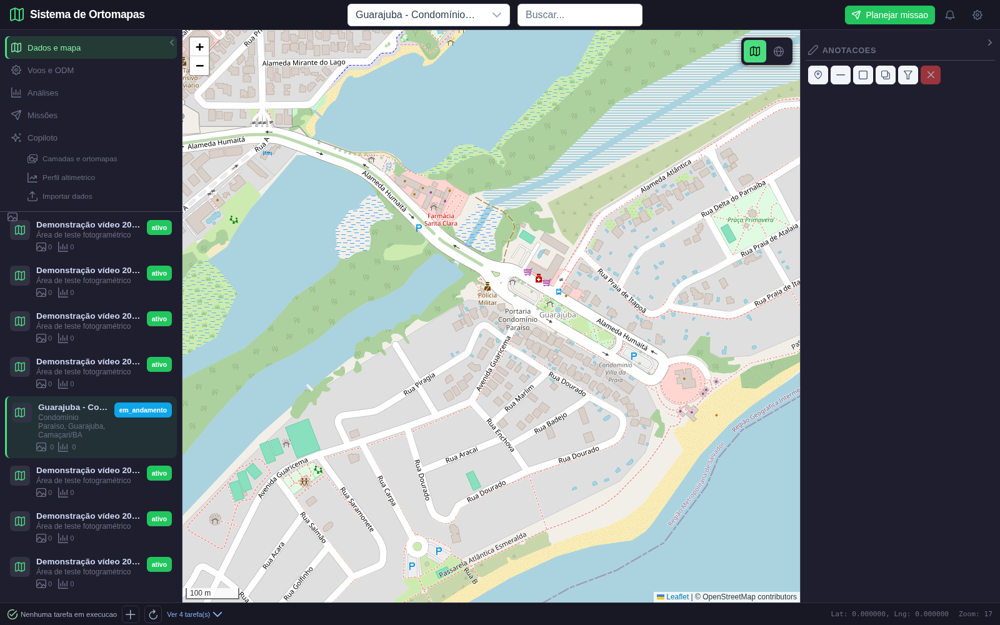
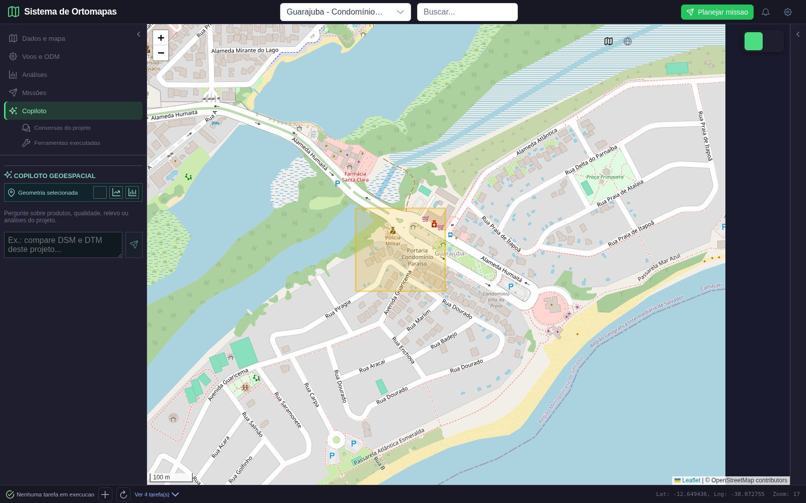
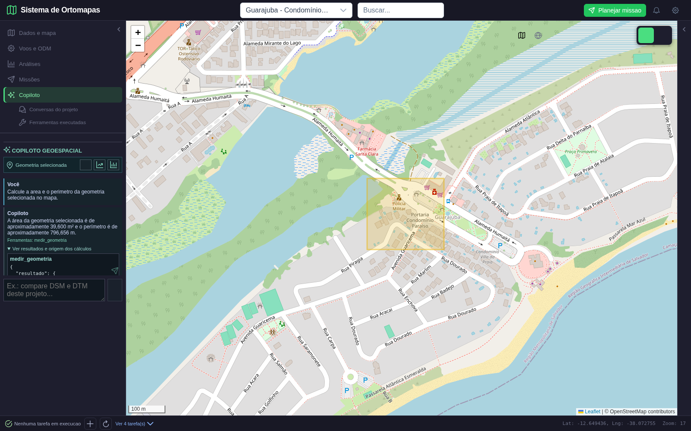
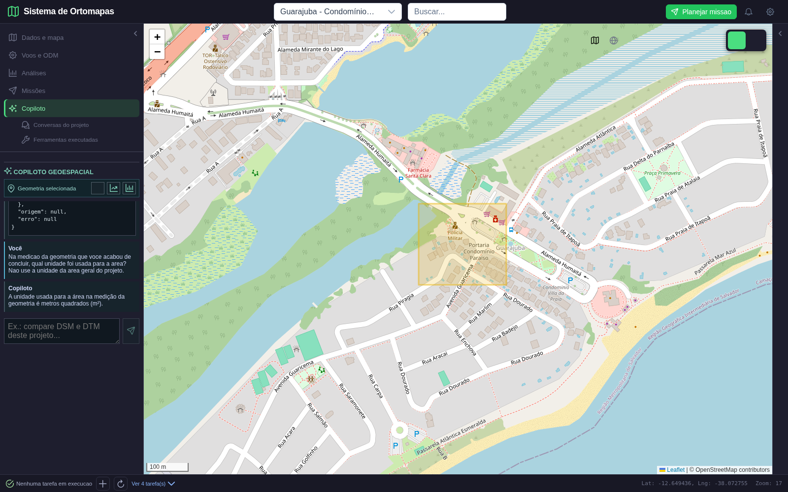

# Etapa 5/6 — Copiloto: contexto, persistência e isolamento

**Revisão:** 26/11/2026
**Resultado:** comportamento coberto por execução Playwright/PostgreSQL real previamente registrada e por 24 testes unitários atuais.
**Execução integrada nesta sessão:** não realizada: PostgreSQL local não responde em `localhost:5432` (`pg_isready: no response`) e não há backend/frontend escutando. Não foram feitas chamadas a LLM nem gravações nesta sessão.

## O que foi verificado

| Requisito | Esperado | Obtido nas evidências | Parecer |
|---|---|---|---|
| Conversa ligada ao usuário e projeto | Projeto ativo aparece no chat; a conversa e mensagens pertencem ao seu usuário e projeto | No E2E real, o projeto de demonstração foi selecionado e uma conversa temporária foi criada. A medição de geometria foi gravada e recuperada pela API autenticada; o registro continha 4 mensagens e evidência da ferramenta | Aprovado em execução real anterior |
| Contexto entre mensagens | Pergunta de seguimento usa o resultado da medição anterior sem pedir os dados novamente | Depois de medir a AOI, foi perguntado qual unidade a área usou. O Copiloto respondeu “metros quadrados (m²)”; a medição reportada foi 39.599,6719835 m² e 796,6560166 m, calculada em EPSG:32724 | Aprovado em execução real anterior |
| Persistência e retomada | Histórico sobrevive à requisição e pode ser recuperado depois | GET autenticado da thread retornou as 4 mensagens e a evidência `medir_geometria`; a verificação foi registrada no Playwright real | Aprovado em execução real anterior; recarga atual não repetida |
| Isolamento entre usuários | Proprietário lê a thread; outra conta autenticada não recebe o conteúdo | Teste de duas contas: proprietário HTTP 200; conta externa HTTP 404. Conta temporária removida; 0 chamadas LLM | Aprovado em execução real anterior |
| Resumo/memória | Resumo solicitado é persistido; memória é pessoal e vinculada ao usuário/projeto | Aceite operacional de 29/10 registra resumo real do Sonnet persistido e incluído no contexto; testes de unidade cobrem memória e sumarização. Os fluxos visuais reais também estão documentados na pasta de validação Fase 8 | Aprovado nas provas anteriores, não reexecutado hoje |
| Limites de erro | Falha de provedor permanece visível e não deixa interface presa | Playwright de timeout com resposta de erro simulada confirmou mensagem visível e possibilidade de continuar | Aprovado para comportamento UI; não prova disponibilidade do provedor |

## Capturas da execução real do chat

O Playwright foi executado em 16/10/2026 contra o projeto de demonstração, API, PostgreSQL e modelo LM Studio. As imagens abaixo são daquela execução identificada no manifesto; não são novas capturas desta sessão.

### Login, projeto e seleção espacial







### Medição e pergunta de continuidade





Manifesto com a resposta, métricas, contagem de mensagens e ausência de erros de página: [resultado Playwright ao vivo](../../copiloto_fase8_2026-10-16/live_result.json).

### Prova de privacidade com duas contas

O teste integrado separado validou que a conta proprietária recupera a conversa com HTTP 200 e uma segunda conta autenticada recebe HTTP 404. Foi feito sem LLM e a conta temporária foi removida ao fim do teste. [Resultado da privacidade](../../copiloto_fase8_2026-10-21/privacidade/privacy_two_users_result.json).

## Testes unitários executados nesta revisão

```bash
./.conda-env/bin/python -m pytest -q \
  tests/test_copilot_threads.py \
  tests/test_copilot_summary.py \
  tests/test_copilot_memories.py \
  tests/test_copilot_context.py \
  tests/test_anthropic_copilot_client.py
```

**Obtido:** 24 passaram, 0 falharam (0,49 s); 6 avisos de depreciação de Shapely/Rasterio. Os testes usam conexões/clientes controlados; não são substitutos da regressão integrada.

## Limites desta etapa

- As provas integradas e capturas são de outubro de 2026, anteriores à revisão de hoje. Servem como evidência rastreável de que o fluxo foi executado naquela versão/ambiente; não certificam que as alterações locais ainda não commitadas preservam o mesmo comportamento integrado.
- PostgreSQL não responde nesta sessão e não há serviço HTTP escutando. Não foi possível repetir login, nova conversa, envio ao LLM, recarga de página ou consulta autenticada ao banco hoje.
- O Playwright de 16/10 marcou a tentativa de isolamento como `skipped` porque ainda não havia segunda conta cadastrada; a validação real de duas contas foi feita separadamente em 21/10 e passou.
- A avaliação de 29/10 não deu aceite operacional pleno ao Copiloto: UC-020, plano/aprovação de operações, relatório integrado, avaliação de qualidade por IA, observabilidade persistente e política de custos permanecem pendentes ou parciais. Esta etapa valida contexto/persistência/privacidade, não fecha esses itens.
- Não houve chamada ao LM Studio, Anthropic ou outro modelo nesta sessão; custo inferencial desta revisão: US$ 0.

## Conclusão

As evidências disponíveis sustentam o fluxo de conversa por usuário/projeto, uso do resultado anterior como contexto, persistência do histórico/evidência da ferramenta e bloqueio de leitura por outra conta. Os testes atuais dos módulos relacionados também passaram. Como os serviços estão fora do ar, a confirmação contra o checkout/ambiente de hoje fica para a regressão integrada da etapa 6; portanto, não declaro aceite operacional pleno do Copiloto.
