# Etapa 6/6 — Regressão integrada e fechamento do inventário

**Execução:** 26/11/2026 13:16–13:37 (America/Sao_Paulo)
**Serviços durante a execução:** PostgreSQL `127.0.0.1:5433` aceitou conexões; backend `127.0.0.1:8888/health` saudável; frontend `127.0.0.1:5176`.
**Conclusão:** regressão de interface e integração aprovada com ressalvas operacionais explicitadas neste relatório. A chamada ao modelo externo não foi executada, e o aceite operacional do Copiloto continua pendente.

**Nota de disponibilidade:** uma checagem intermediária de `pg_isready` falhou, então inspecionei os processos sem reiniciar o serviço. A porta `5433` é encaminhada pelo `docker-proxy` para o PostgreSQL no container (`172.22.0.4:5432`); o processo servidor e conexões de WebODM, GeoServer e da aplicação estavam ativos. Uma nova checagem local e outra diretamente ao endereço interno responderam `accepting connections`. O systemd `postgresql` aparece `active (exited)` porque não é o proprietário deste banco Docker; `pg_lsclusters` não lista clusters locais e não se aplica. O usuário da sessão não tem permissão ao socket Docker, portanto não usei comandos de gestão do container. Não houve necessidade de reiniciar nem tocar no volume.

## Escopo e dados

A verificação combinou duas jornadas Playwright:

1. Navegação automatizada em navegador com respostas de API simuladas, sem gravação no banco. Cobriu os submenus, notificações, navegação recolhida, teclado e viewport compacto.
2. Jornada integrada contra a aplicação local, backend e PostgreSQL reais. Usou a conta de teste já disponível e o projeto existente **Guarajuba - Condomínio Paraíso (Demonstração)**, ID `51`. A jornada criou uma conversa vazia temporária para validar persistência e recarga e a removeu ao final. Não enviou prompt ao LLM e não alterou produtos, voos, análises nem ortomapas existentes.

O mapa base OSM exibido sobre Guarajuba é conteúdo cartográfico real carregado pela interface. Os registros de análise nesse projeto estão rotulados como **sintéticos**; eles demonstram telas/integração, não resultados científicos derivados de um novo processamento de fotos de drone. Esta regressão também não gerou ortomosaico, DSM/DTM ou nuvem de pontos.

## Serviços e regressão técnica

| Verificação | Esperado | Obtido | Resultado |
|---|---|---|---|
| PostgreSQL configurado | Aceitar conexões na porta `5433` | `pg_isready` respondeu `accepting connections`; banco `ortomapas`, PostgreSQL 16.15 | Aprovado |
| Backend | Endpoint de saúde HTTP 200 | `/health` respondeu `200`, `status=healthy` | Aprovado |
| Frontend | Interface servida localmente | Vite acessível em `127.0.0.1:5176` | Aprovado |
| Build frontend | Build de produção completa | 427 módulos transformados; build concluído | Aprovado, com avisos conhecidos de bundle >500 kB e API CJS depreciada |
| Testes direcionados | Sem falhas nas áreas cobertas | 81 passaram, 0 falharam; 137 avisos de depreciação Rasterio/Shapely | Aprovado |
| Navegação Playwright | Destinos e controles funcionam; sem falhas de browser/rede | 9/9 verificações; 25/25 tiles do mapa principal e 30/30 do planejador carregados; sem erros de página ou requests falhos | Aprovado |
| Jornada integrada | Login, dados, navegação, conversa persistida após recarga | 8/8 passos aprovados; endpoints observados retornaram sucesso; sem HTTP 5xx, erros de página ou requests falhos | Aprovado |
| Privacidade entre usuários | Proprietário acessa conversa; outro usuário não | Proprietário HTTP 200; outra conta HTTP 404; conta temporária removida | Aprovado |

O conjunto unitário foi executado com:

```bash
./.conda-env/bin/python -m pytest -q \
  tests/test_ortomapa_delete_guard.py \
  tests/test_copilot_threads.py tests/test_copilot_summary.py \
  tests/test_copilot_memories.py tests/test_copilot_context.py \
  tests/test_anthropic_copilot_client.py \
  tests/test_vegetation_classification.py tests/test_terrain_tools.py \
  tests/test_hydrology_products.py tests/test_change_detection.py \
  tests/test_elevation_change.py tests/test_volume_aoi.py tests/test_clip_export.py
```

## Jornada visual integrada

### Login e projeto

**Esperado:** autenticar, selecionar o projeto e mostrar o mapa/estado correspondente.
**Obtido:** login real concluído; projeto 51 selecionado; mapa OSM de Guarajuba carregado.
**Resultado:** aprovado.

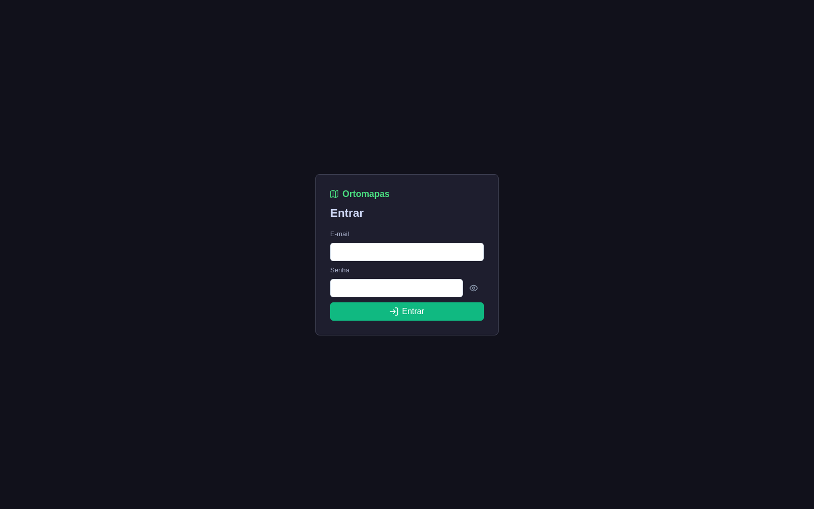

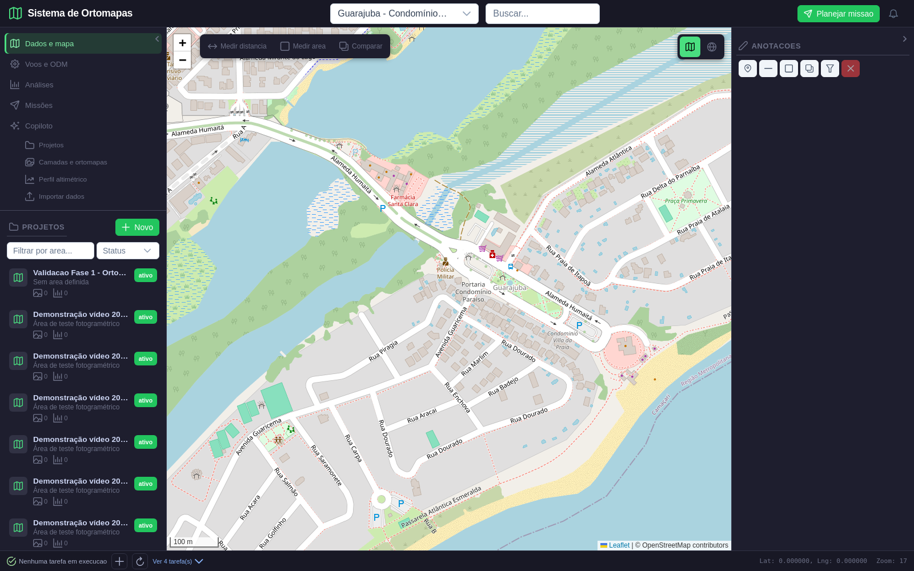

### Voos e processamento ODM

**Esperado:** apresentar voos e histórico ODM associados ao projeto, distinguindo estados concluídos e erros.
**Obtido na base:** 1 voo, importado de Litchi, associado a 24 fotos; 3 registros de processamento: ID 9 concluído, ID 10 com erro “Tarefa ausente no NodeODM” e ID 11 com erro. A interface avisa que faltam tarefas no NodeODM para registros com erro.
**Resultado:** tela e leitura dos registros aprovadas; fluxo de processamento ODM não aprovado operacionalmente por esses dois registros de erro. Não foi enviado novo processamento nesta regressão.

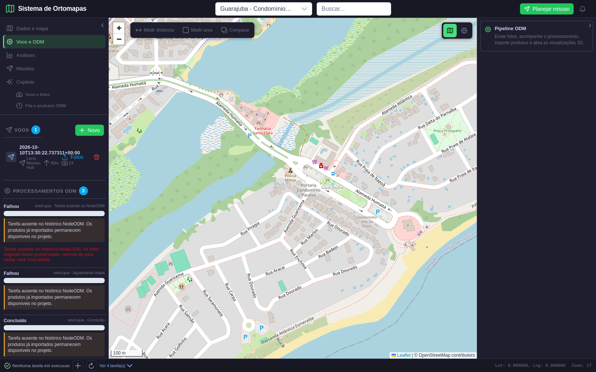

### Análises e produtos

**Esperado:** listar produtos persistidos e indicar claramente a natureza dos dados.
**Obtido:** 4 ortomapas cadastrados; 4 registros de análise concluídos, identificados como sintéticos: estatísticas NDVI sintéticas, declividade sintética, diferença DSM-DTM sintética e volume sintético de corte/aterro.
**Resultado:** renderização e integração aprovadas. Esses registros não provam que as análises foram calculadas sobre imagens reais do voo, nem conferem aceite científico/operacional aos algoritmos.

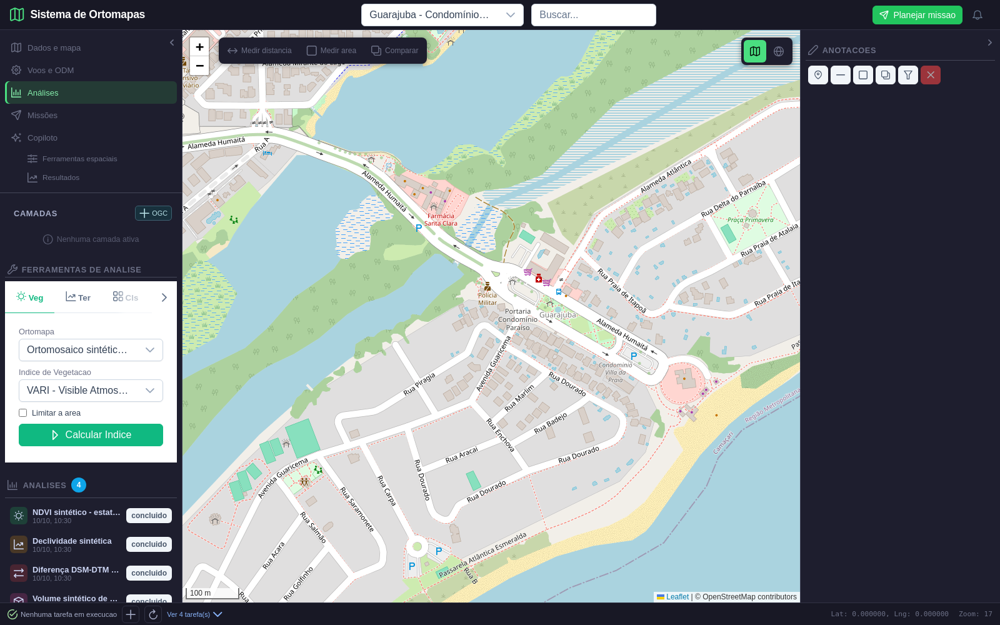

### Planejador de missão

**Esperado:** abrir o planejador dentro do contexto do projeto e mostrar a área geográfica correta.
**Obtido:** planejador aberto pelo projeto; mapa e tiles carregados, sem erro de browser/rede. O cenário integrado verificou navegação e contexto visual, não comandou drone nem exportou missão para aplicativo de voo.
**Resultado:** interface/regressão aprovadas; execução física de missão fora do escopo.

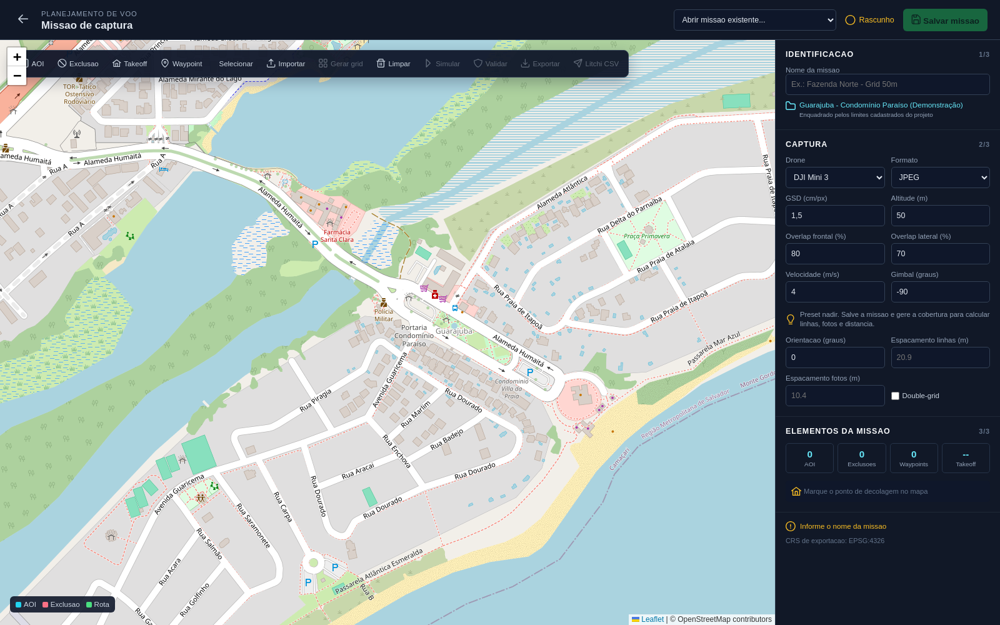

### Copiloto, persistência e privacidade

**Esperado:** abrir conversa, persistir uma conversa de teste vazia, recarregar e recuperar apenas para o usuário proprietário.
**Obtido:** uma conversa temporária vinculada ao projeto 51 foi criada na UI, persistiu após recarga e foi recuperada pela API autenticada; depois foi removida. A checagem independente entre duas contas retornou HTTP 200 para o proprietário e HTTP 404 para a segunda conta; o usuário temporário da prova foi removido. Nenhuma chamada LLM ocorreu durante esses testes.

Na conversa histórica que já existia no projeto, a tela mostra a mensagem anterior “Tempo limite ao consultar o copiloto. Tente novamente.” Isso é estado histórico preexistente, não resposta gerada durante esta regressão. A validação de persistência/isolamento passou; disponibilidade e qualidade de uma resposta nova do modelo não foram aprovadas nesta rodada.

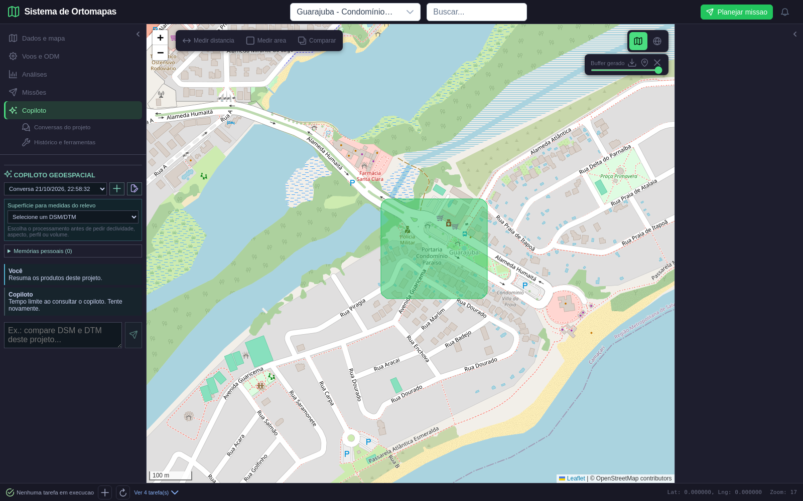

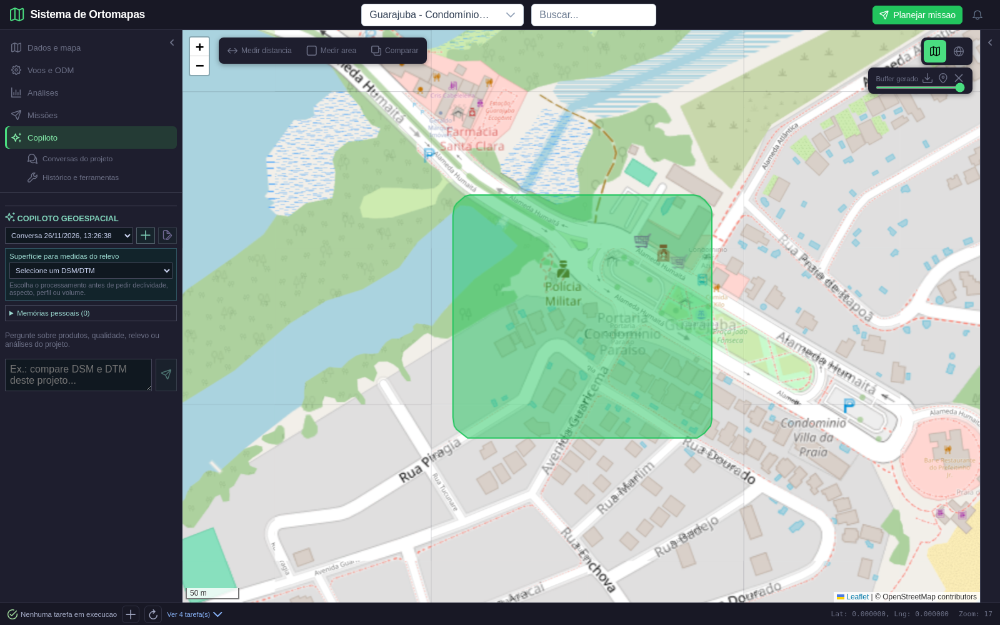

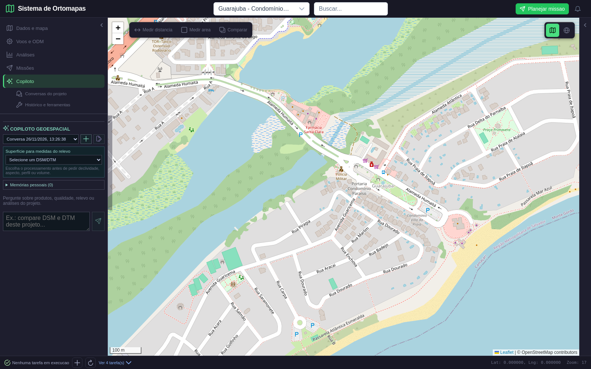

### Navegação, teclado e viewport compacto

**Esperado:** itens de menu levam aos destinos; a barra pode ser recolhida, mantém foco de teclado e se adapta à janela menor.
**Obtido:** 9 de 9 verificações Playwright passaram; a barra recolhida e viewport compacto foram inspecionados; mapas carregaram 25/25 e 30/30 tiles respectivamente.
**Resultado:** aprovado para os cenários cobertos.

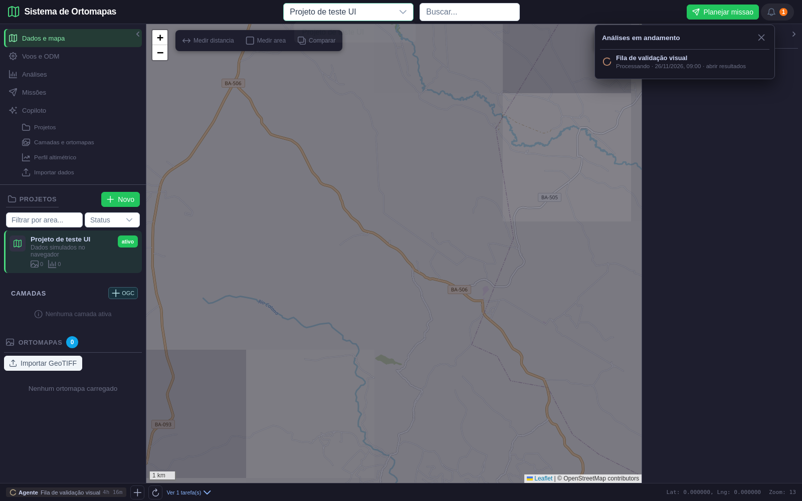

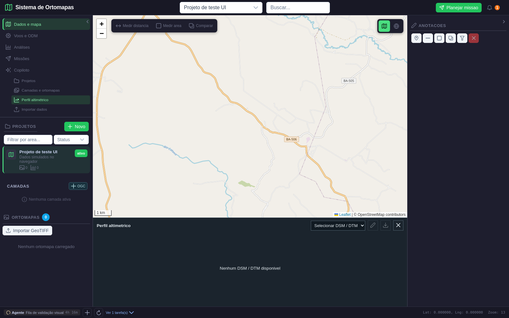

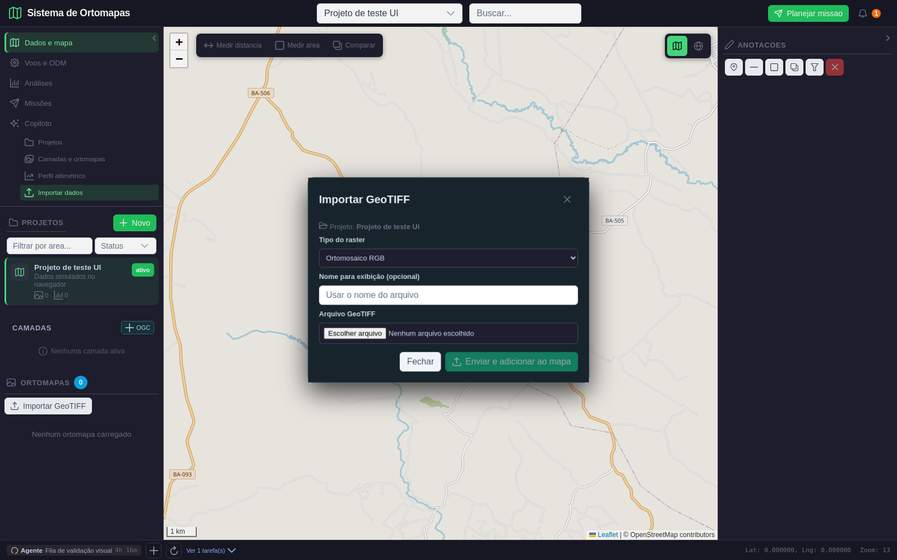

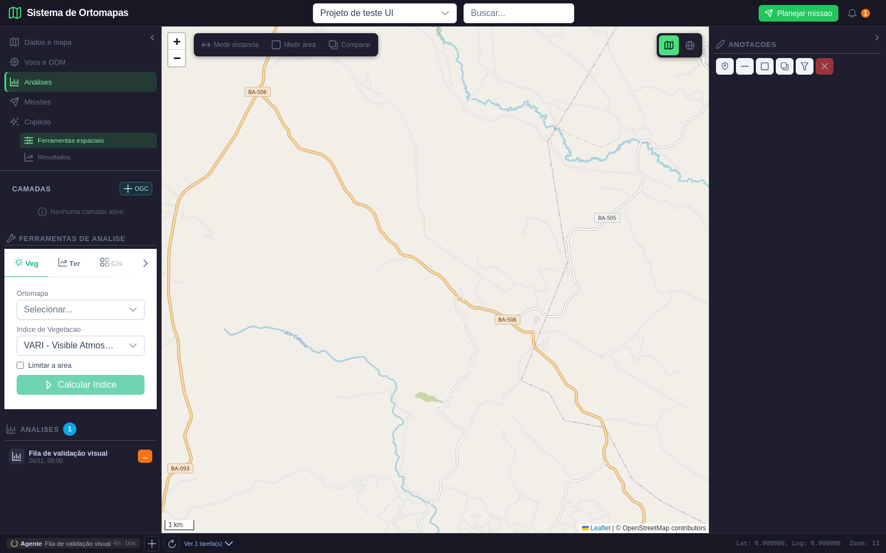

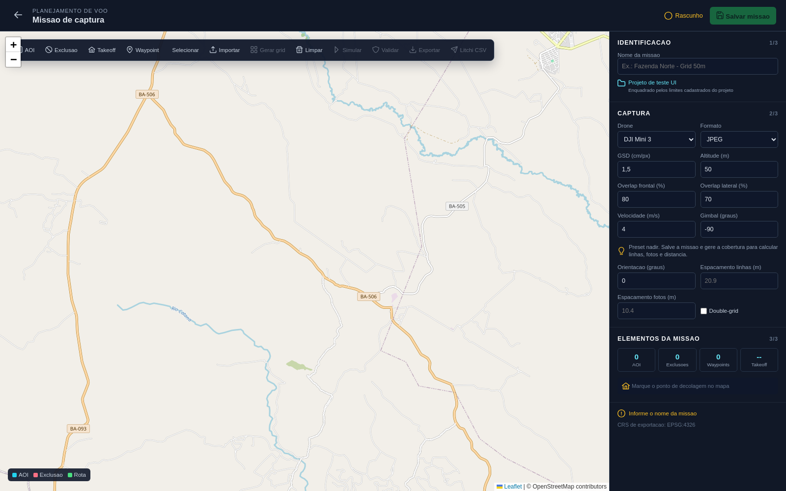

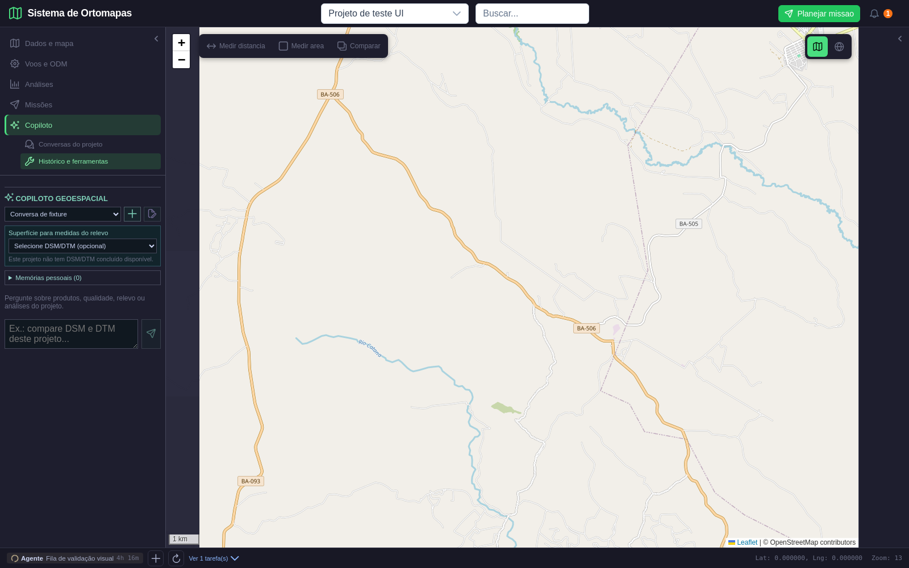

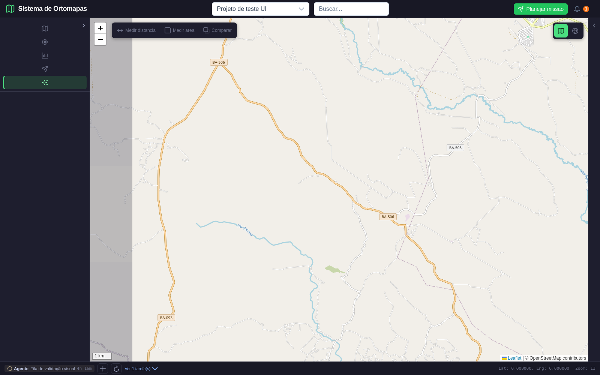

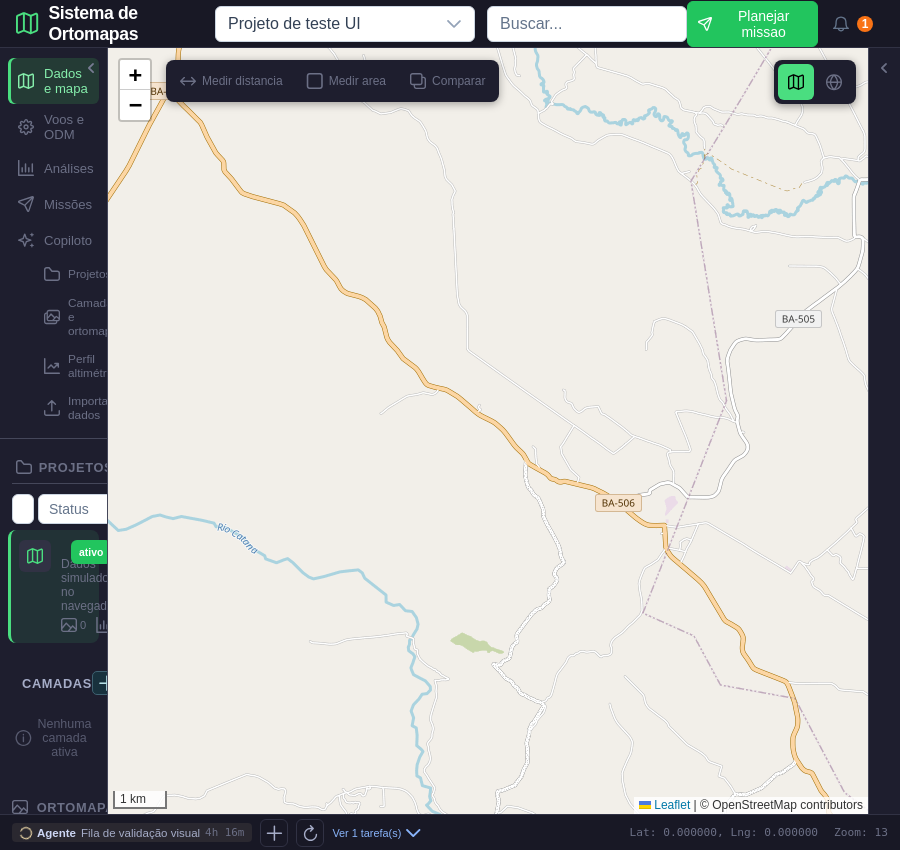

## Sonnet e limite da revisão automática

Foi considerada uma consulta ao Sonnet 5.5, mas **nenhuma requisição foi enviada**. A revisão automática bloqueou a execução porque a pergunta incluiria geometria derivada de dados do projeto e a enviaria a Anthropic, destino externo. A razão informada foi ausência de autorização específica para transferir essa geometria. Não tentei contornar o bloqueio. Para executar esse teste, é necessário consentimento explícito para enviar à Anthropic os dados/geométria desse projeto, ou escolher uma pergunta/dados sintéticos que não exponham dados do projeto.

## Resultado contra os critérios de aceite

| Critério | Resultado observado | Estado |
|---|---|---|
| Navegação, menus, teclado e viewport | Jornadas cobertas sem erros | Aprovado nos cenários executados |
| Login, seleção de projeto e mapa | Projeto 51 e mapa real OSM carregados | Aprovado |
| Integração API e leitura do PostgreSQL | Endpoints utilizados responderam; dados do projeto carregados | Aprovado para leitura/jornada coberta |
| Persistência e isolamento de conversa | Criação vazia, recarga e acesso restrito verificados; limpeza confirmada | Aprovado |
| Exclusão protegida em UI e guardas | Testes unitários atuais e jornadas de fixture de etapas anteriores passaram; nenhuma exclusão de produto real nesta regressão | Aprovado nos casos cobertos; sem nova exclusão contra produto real |
| Produtos cartográficos e algoritmos | Interface lista produtos, mas os registros deste projeto são sintéticos e não foram recomputados | Não equivale a aceite científico |
| ODM | Há um histórico concluído e dois com erro por tarefa NodeODM ausente | Parcial; esses processamentos precisam de diagnóstico/reexecução para aceite operacional |
| Copiloto com resposta nova | Sem chamada ao modelo nesta regressão; histórico contém timeout anterior | Pendente para aceite operacional |
| Build e testes | Build passou; 81/81 testes direcionados passaram | Aprovado, com avisos registrados |

**Fechamento:** Etapa 6 concluída como regressão integrada da interface, API, PostgreSQL, persistência e privacidade, com pendências de aceite de serviços/algoritmos claramente separadas. O inventário de interface pode ser fechado para os cenários exercitados. Não declarar o produto inteiro operacionalmente aceito: o histórico ODM com dois erros, a origem sintética das análises demonstrativas e a resposta live do Copiloto continuam sem validação operacional nesta rodada.

## Arquivos de evidência

- [Resultado consolidado (JSON)](resultado.json)
- [Detalhes da jornada integrada (JSON)](regressao_integrada_real.json)
- [Resultado da privacidade entre usuários (JSON)](privacidade_reteste/privacy_two_users_result.json)
- [Roteiro Playwright de navegação](validar_regressao_navegacao.py)
- [Plano geral atualizado](../../../analise/plano_correcao_lacunas_inventario_interface_2026-11-24.md)
