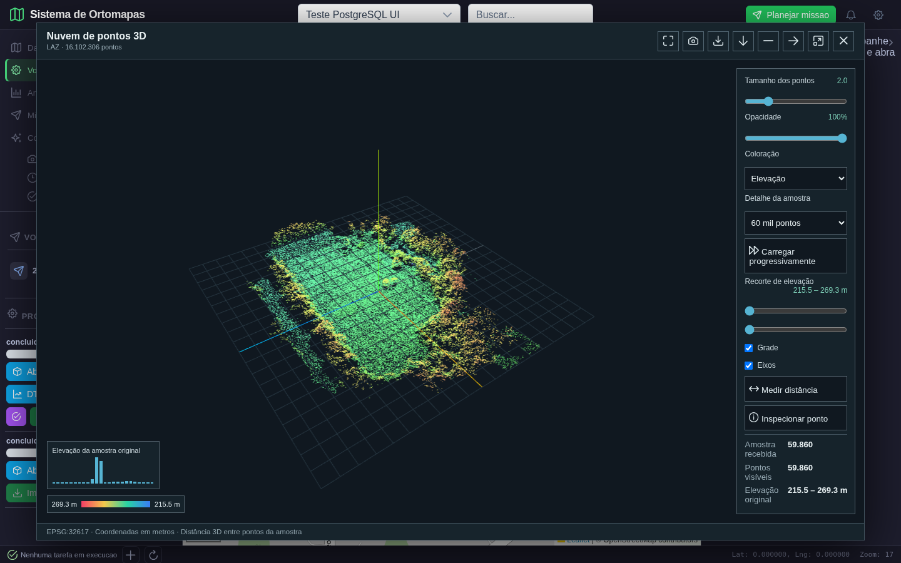
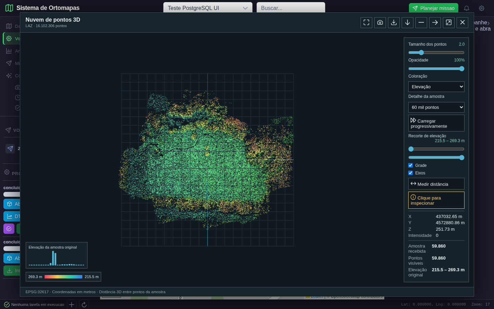
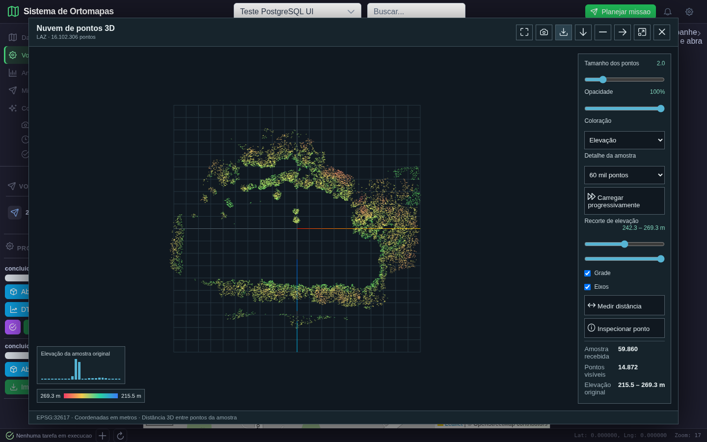
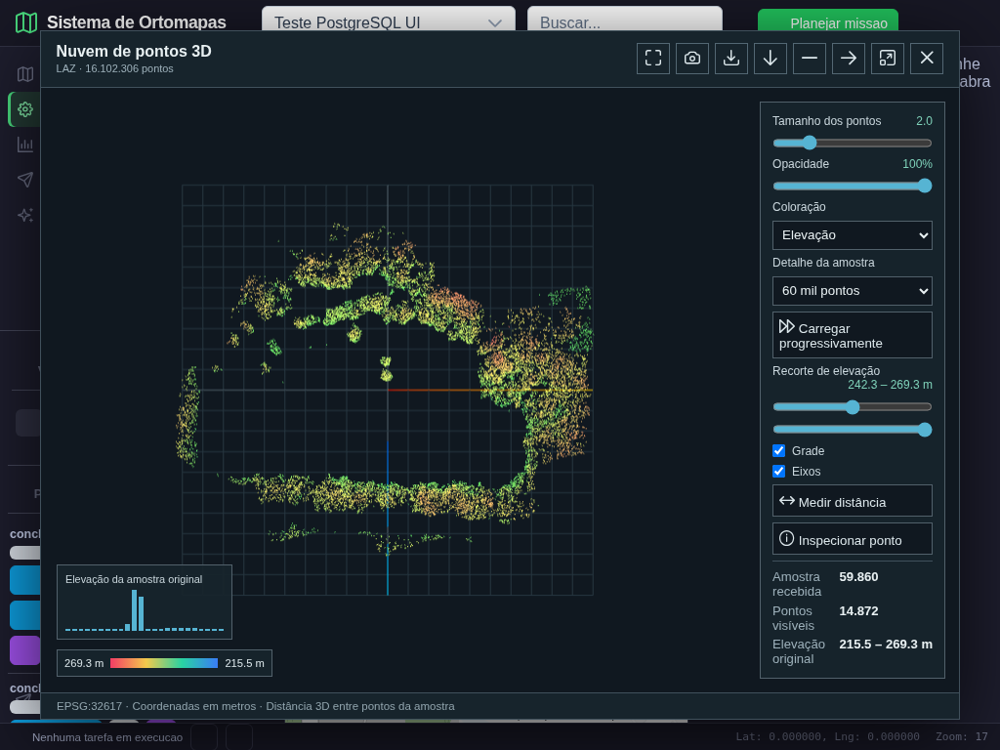

# Fase 2: medidas espaciais e nuvem de pontos real

**Data:** 10/10/2026. **Resultado:** segundo lote aprovado no escopo descrito abaixo; fase 2 ainda em andamento.

## 1. O que foi executado

O navegador entrou com uma conta de teste autenticada, selecionou o projeto **Teste PostgreSQL UI**, abriu **Voos e ODM**, identificou a tarefa real **f7563d3d** e abriu sua nuvem LAZ. O teste fez cliques reais no canvas para inspecionar dois pontos e medir a distancia entre eles. Nao foram injetados resultados de medicao nem simuladas respostas HTTP.

As ferramentas geometricas, declividade e volume foram chamadas diretamente pela API autenticada. Essas chamadas comprovam os calculos e os retornos HTTP; **nao comprovam uma conversa completa com o modelo de linguagem ou uma camada de analise publicada no mapa**. Essa distincao evita apresentar testes de backend como demonstracoes de interface ainda nao realizadas.

### Dados utilizados

| Dado | Origem e uso |
|---|---|
| Nuvem LAZ, produto 8 | Produto real da tarefa ODM existente f7563d3d, conjunto Aukerman, EPSG:32617, 16.102.306 pontos na origem |
| Amostra exibida | 59.860 pontos reais, limite escolhido de 60 mil; nao e o arquivo completo |
| DSM, produto 5 | Arquivo real `data/ortomapas/odm_2_dsm.tif`, EPSG:32617; referencia para declividade e volume |
| Retangulo de referencia | Geometria sintetica de 100 x 200 m em EPSG:32724, exclusivamente para verificar numericamente area e perimetro |
| Ponto em Guarajuba | Coordenada ilustrativa -38,046 / -12,654 para testar buffer de 100 m; nao e levantamento do condominio nem coordenada confirmada de uma propriedade |
| Planos de referencia | Matrizes sinteticas com inclinacao e volume conhecidos, usadas nos testes unitarios, nao apresentadas como produtos fotogrametricos reais |

Nenhum novo processamento de fotografias foi disparado neste lote. A nuvem e o DSM ja estavam armazenados no repositorio e registrados no PostgreSQL.

## 2. Correcoes implementadas

1. A distancia da nuvem usa as coordenadas originais dos pontos, antes da normalizacao visual, evitando erros por escala e precisao Float32 da cena.
2. O indice de cada ponto renderizado permanece ligado ao ponto de origem depois de filtrar por elevacao. A inspecao mostra X/Y/Z desse ponto, nao a posicao aproximada do raio da camera.
3. Norte corresponde ao eixo negativo Z da cena; a camera inicial fica acima da nuvem. O enquadramento considera a proporcao do canvas.
4. Os controles ficam fora da area util do canvas, com rolagem propria quando necessario; o canvas acompanha mudancas de tamanho por ResizeObserver.
5. Uma nova medicao limpa a anterior. Recortes e recarregamentos limpam medidas e coordenadas antigas; respostas atrasadas de requisicoes anteriores nao substituem o produto atual.
6. Cores de elevacao usam a mesma escala antes/depois do recorte. A legenda permanece correspondente; a tela distingue amostra recebida de pontos atualmente visiveis.
7. Area, perimetro, distancia e buffer possuem contrato de CRS e unidades. GeoJSON do mapa assume EPSG:4326, explicitado no retorno; calculos locais usam UTM. Buffers voltam ao CRS de entrada.
8. A declividade usa a transformada da grade efetivamente reamostrada. O motor considera celulas rotacionadas, unidades projetadas em pes e vizinhancas com nodata, sem preencher buracos com uma cota artificial.
9. Volume usa area de pixel pelo determinante da transformada, conversao de unidades horizontais, mascara e valores finitos. Agente e ferramenta de volume compartilham o motor metrico. A saida raster preserva nodata.
10. Rasters sem CRS ou em coordenadas geograficas nao recebem volume/declividade falsamente rotulados em metros: devem ser reprojetados antes. Erros de validacao dessas ferramentas retornam HTTP 422.

O motor nao confirma automaticamente o datum vertical: elevacoes raster sao assumidas em metros, e essa premissa e devolvida no resultado. CRS horizontal nao certifica altura ortometrica, precisao absoluta ou qualidade de campo.

## 3. Esperado versus obtido

| Verificacao | Esperado | Obtido | Parecer |
|---|---|---|---|
| Area do retangulo | 20.000 m2 | 20.000 m2 | Aprovado |
| Perimetro do retangulo | 600 m | 600 m | Aprovado |
| Distancia entre pontos 3/4 | 5 m | 5 m | Aprovado |
| Buffer de 100 m | Poligono local, nao raio de 100 graus | Saida EPSG:4326; calculo EPSG:32724; area com erro abaixo de 0,2% frente a pi x 1002 | Aprovado para buffer poligonal aproximado |
| Plano conhecido | 29,205932 graus, independente do fator de amostragem | Mesmo gradiente com fatores 1 e 4 e grade rotacionada | Aprovado |
| Volume conhecido | 49 m3 acima / 14 m3 abaixo | 49 / 14 m3, celula de 7 m2 | Aprovado |
| DSM real reamostrado | Media conferida com espacamento corrigido | 27,4468657668 graus | Aprovado numericamente; nao e certificacao topografica |
| Volume DSM real, cota 240 m | Soma independente sobre todos os pixels validos | 497.901,870888 m3 acima da referencia | Aprovado para todo o raster |
| Medicao por cliques | Distancia das coordenadas dos pontos reais | 82,31 m exibidos versus 82,3062118 m calculados das coordenadas arredondadas | Aprovado, tolerancia de 0,03 m para a comparacao da exibicao |
| Exportacao CSV | Mesmo numero de pontos da amostra sem recorte | 59.860 linhas de dados | Aprovado |
| Recorte | Menos pontos; sem medida antiga; cores consistentes | 14.872 visiveis; medida e inspecao anteriores removidas | Aprovado |
| Tablet | Controles fora do canvas, texto legivel | 1024 x 768, sem sobreposicao canvas/painel | Aprovado nesse viewport |

A tolerancia de exibicao nao significa precisao fisica de 3 cm. Os pontos escolhidos pertencem a uma amostra do levantamento; nao houve verificacao com pontos de controle de campo. Areas UTM sao planimetricas e sujeitas a distorcao de projecao; extensoes geograficas maiores que o dominio local admitido sao recusadas.

## 4. Evidencias visuais inspecionadas

### Cena 1. Nuvem real carregada e enquadrada



**Acao:** abrir a nuvem do processamento f7563d3d. **Esperado:** estrutura espacial reconhecivel, camera acima, escala uniforme e controles acessiveis. **Obtido:** campo central, bordas com vegetacao elevada e 59.860 pontos reais visiveis. O rodape identifica EPSG:32617 e coordenadas em metros. A nuvem nao e uma superficie texturizada: cada elemento corresponde a um ponto amostrado.

### Cena 2. Inspecao de um ponto selecionado com o mouse



**Acao:** ativar vista superior, ativar inspecao e clicar sobre a nuvem. **Esperado:** coordenadas de um ponto existente, vinculadas ao indice correto. **Obtido:** X 437032,65 m, Y 4572880,86 m e Z 251,73 m. O roteiro conferiu os pontos selecionados contra os arrays recebidos da API, com tolerancia para o arredondamento da tela.

### Cena 3. Medicao concluida entre dois pontos


**Acao:** ativar medicao e clicar em dois pontos inspecionados anteriormente. **Esperado:** dois marcadores, segmento e distancia tridimensional calculada nas coordenadas originais. **Obtido:** 82,31 m. O painel apresenta os extremos A/B; a diferenca vertical faz parte da distancia, que nao deve ser interpretada como distancia horizontal ou percurso sobre o solo. Ambos os extremos foram encontrados na amostra real da API.

### Cena 4. Recorte de elevacao sem informacao antiga



**Acao:** aumentar o limite inferior de elevacao pelo slider. **Esperado:** excluir os pontos abaixo da cota, limpar a medicao anterior e preservar a escala de cores. **Obtido:** 14.872 pontos visiveis; o campo central desaparece por estar abaixo do recorte. Isso e efeito esperado do filtro, nao falha de carregamento. A legenda continua referente a escala original, assim como o histograma explicitamente identificado como original.

### Cena 5. Apresentacao em tablet



**Acao:** mudar o viewport para 1024 x 768. **Esperado:** canvas recalculado e painel sem cobrir os pontos. **Obtido:** cena e controles em areas distintas, com CRS e legenda visiveis. O teste comparou os retangulos do canvas e do painel, alem da inspecao visual. Isso nao aprova todos os tamanhos de celular.

## 5. Execucao e rastreabilidade

- 28 testes Python passaram: regressao de tiles/upload/acesso, grade 3D e nove verificacoes adicionais do motor metrico.
- Testes Node da geometria de terreno e da nuvem passaram; a nuvem inclui caso de distancia 13 m, com componentes 3/4/12, e conservacao da proporcao visual.
- Build de producao passou; permanece aviso de bundle grande, nao resolvido neste lote.
- Seis chamadas de ferramentas pela API autenticada foram verificadas, com entradas e saidas preservadas no JSON.
- Cinco capturas foram produzidas pela execucao do aplicativo; houve inspecao visual e verificacao de pixels, coordenadas, downloads, filtros e layout.
- A nuvem ocupou 8,67% dos pixels do canvas inicial, distinguindo-se do fundo. Esse teste de pixels, sozinho, nao seria suficiente para aprovar a funcionalidade.
- Nao ocorreram erros JavaScript na rodada aprovada.

Durante o desenvolvimento, houve execucoes nao aprovadas: seletor ambiguo entre dois processamentos, nome acessivel afetado por icone e valor de slider fora do passo permitido. O roteiro passou a identificar a tarefa pelo ID; os botoes receberam nome acessivel explicito; o recorte foi ajustado ao passo do controle. As provas deste documento correspondem somente a rodada final aprovada.

Evidencia estruturada: [resultado JSON](medidas_fase2_2026-10-10/resultado.json).

Reproducao, com backend na porta 5018 e frontend na 5302:

```bash
python -m pytest tests/test_metric_analysis.py tests/test_surface_grid.py tests/test_resource_access.py tests/test_raster_tiles.py tests/test_ortomapas_postgres.py -q
node frontend/tests/terrainGeometry.test.js
node frontend/tests/cloudGeometry.test.js
python scripts/validar_medidas_fase2.py
```

O roteiro usa contas de demonstracao existentes com permissao de leitura do projeto real. Nao precisa alterar produtos, conceder novos acessos nem escrever novos registros no banco nesta execucao. Os downloads usados no teste ficam em `/tmp`; as evidencias ficam em `docs/validacao/medidas_fase2_2026-10-10/`.

## 6. Limites e proximo lote

**Este lote nao encerra a fase 2.** A leitura integral do LAZ ainda tem custo de memoria; a amostra de 60 mil facilita a reproducao visual, mas nao substitui teste de desempenho. O datum vertical continua sendo uma premissa, nao uma certificacao.

Pendencias explicitas do plano da fase 2:

1. Substituir o falso perfil medio de colunas por perfil altimetrico amostrado ao longo de uma linha fornecida/desenhada, com distancias acumuladas e grafico.
2. Adicionar exagero vertical explicito e comprovar que medidas das mesmas coordenadas nao mudam entre fatores 1 e 3.
3. Conferir alinhamento de DSM/DTM antes da diferenca, incluindo CRS, grade e mascara; a comparacao atual nao esta aprovada para produtos desalinhados.
4. Ampliar os testes de unidades para os outros motores de aspecto/hillshade, diferenca e corte/aterro antes de aprova-los globalmente.

**Analise por poligono:** declividade e volume validados aqui abrangem TODO o raster. O contrato das ferramentas informa essa limitacao; nao foi implementado o recorte por geometria nesses comandos. A interface/chat que solicita analise dentro de um poligono ainda precisa ser integrada ao motor apropriado, sem alegar um recorte que nao ocorreu.

A fase 3 tratara o contrato dos resultados persistidos e sua publicacao no mapa. Esta revisao nao aprova todos os menus, todas as conversas do copiloto, o processamento de novas fotos ou a seguranca global de rotas legadas.
