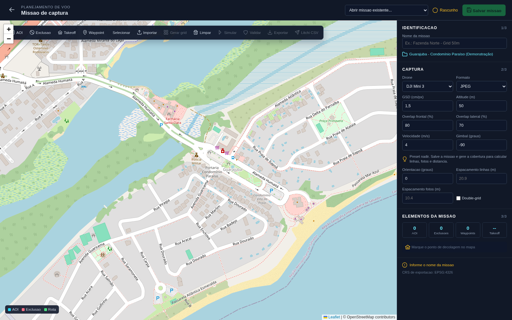
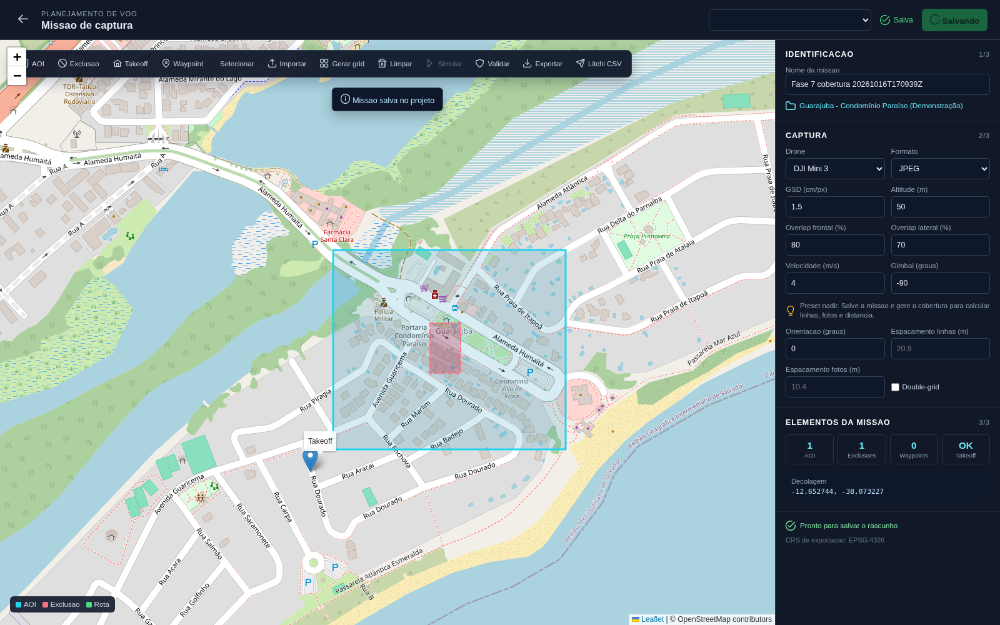
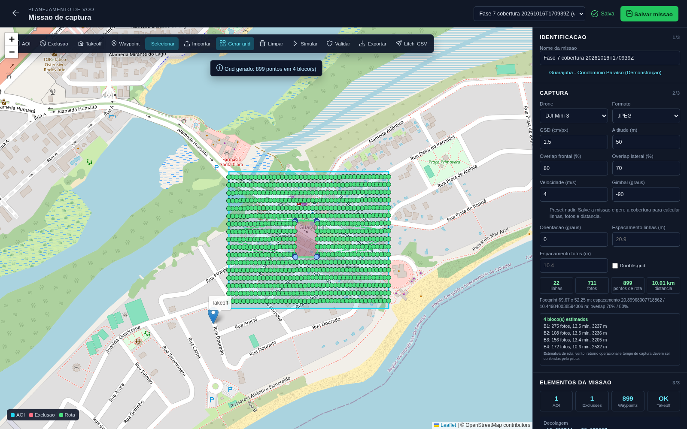
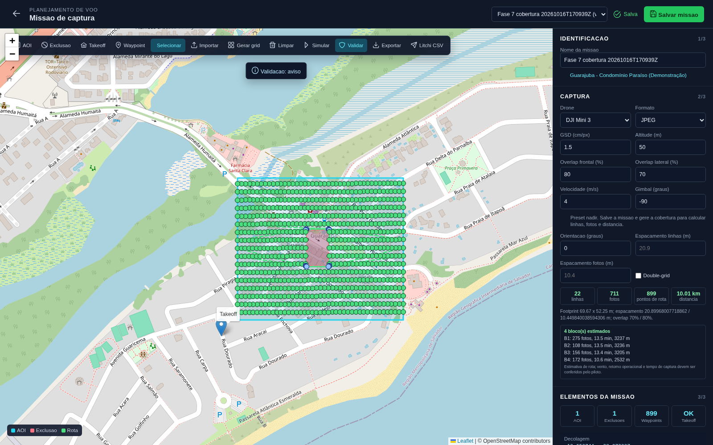
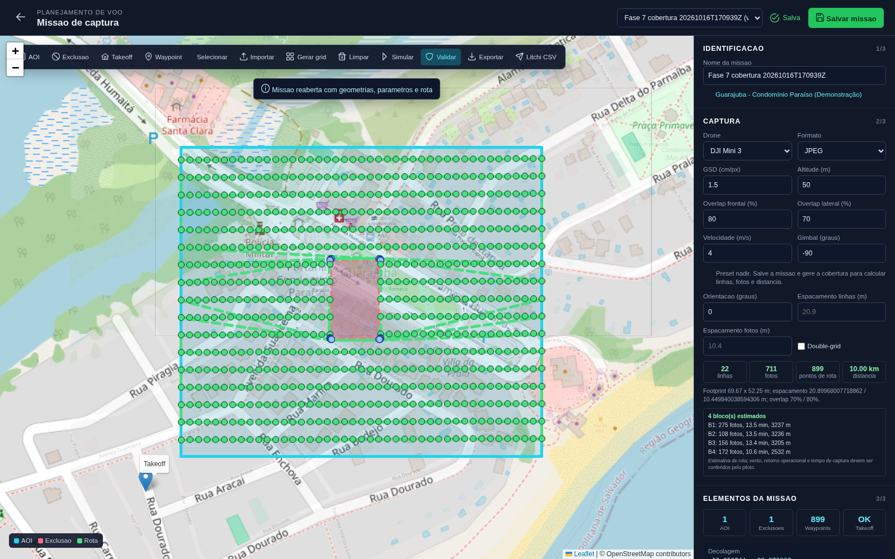
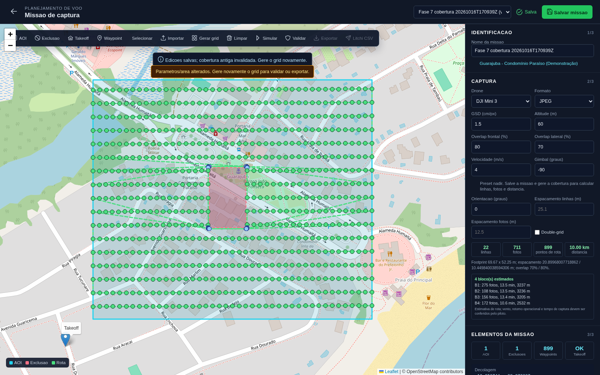
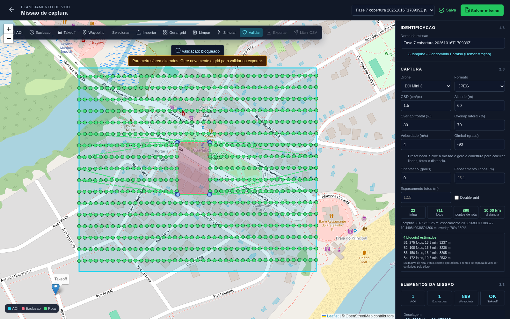
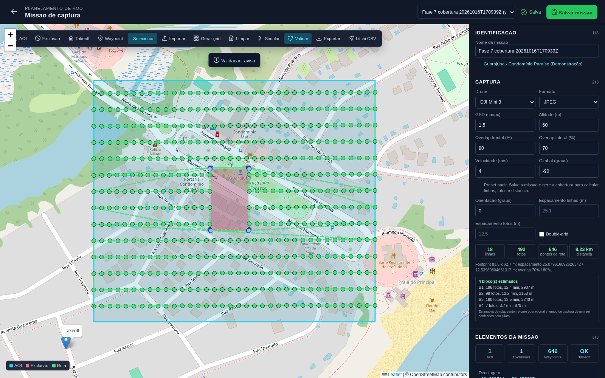
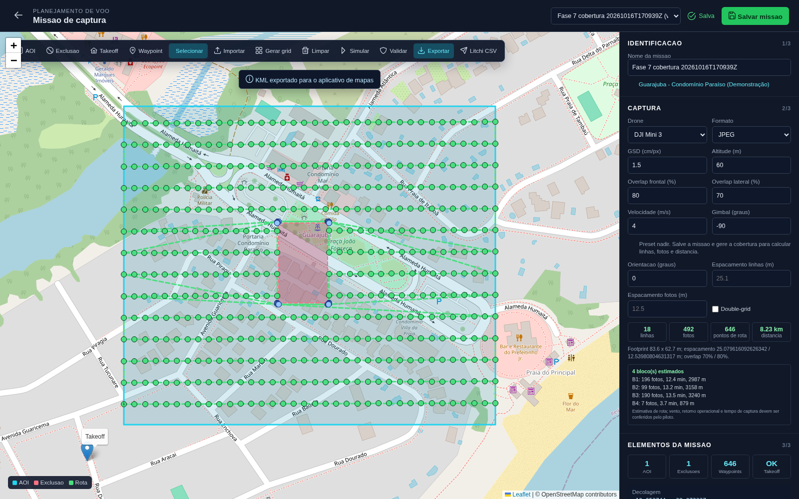

# Validação da Fase 7: missões e cobertura

**Resultado:** fluxo integrado aprovado com um aviso operacional de autonomia.

**Execução:** 16/10/2026, Playwright/Chromium, PostgreSQL/PostGIS.

**Projeto usado:** `Guarajuba - Condomínio Paraíso (Demonstração)`, projeto 51.

**Missão aceita:** `Fase 7 cobertura 20261016T170939Z`, missão 57.

## Escopo e contexto

A validação cobre criar/desenhar uma missão no mapa, gerar cobertura a partir do perfil de câmera e dos overlaps, contornar exclusões, agrupar o percurso em blocos de bateria, validar, reabrir e salvar sem duplicar dados, invalidar uma cobertura antiga quando os parâmetros mudam e exportar CSV Litchi e KML.

A AOI foi desenhada pela interface no entorno da portaria de referência do Condomínio Paraíso. Seu centro ficou a 70,7 m do ponto de referência `-12.6504521, -38.0714399`. A área é apenas demonstrativa e aproximada; não é limite cadastral, autorização de voo nem levantamento topográfico. O mapa de fundo é cartografia OpenStreetMap, não imagem aérea.

## Resultado medido

| Item | Resultado observado |
|---|---:|
| Drone/perfil declarado | DJI Mini 3, câmera principal, 4000 x 3000 px, FOV diagonal configurado de 82,1° |
| Altitude inicial | 50 m AGL |
| Overlap frontal/lateral | 80% / 70% |
| Footprint calculado a 50 m | 69,67 x 52,25 m |
| Espaçamento entre linhas/fotos | 20,90 m / 10,45 m |
| Missão inicial | 899 waypoints de rota; 711 pontos com foto e 188 pontos de trânsito |
| Cobertura inicial | 22 linhas; aproximadamente 10,01 km de rota |
| Autonomia modelada | 4 blocos; reserva configurada 25%; máximo observado 809,14 s de 810 s úteis por bloco |
| Após alterar altitude para 60 m e regenerar | 646 waypoints; 492 ações de foto; 4 blocos |
| Exportação final | CSV Litchi: 646 linhas de missão, 492 ações de foto; KML: 647 Placemark (646 pontos + rota) |

Os tempos de autonomia são uma estimativa geométrica simples: distância dividida pela velocidade configurada. O bloco mais longo ficou a menos de dois segundos do limite modelado de 13,5 minutos. A validação do sistema retorna **aviso**, não aprovação operacional. O cálculo não modela vento, relevo/ganho de altitude, tempo de disparo, envelhecimento da bateria, retorno real, geofencing, restrições legais nem perda de link. O piloto deve reduzir a extensão por bateria e revisar o plano antes de qualquer voo. O FOV e o perfil de câmera precisam ser conferidos com a configuração física/firmware do drone; o teste não envolveu aeronave.

## Roteiro e telas

### 1. Projeto e editor

Login com a conta E2E, seleção do projeto Guarajuba e abertura do planejador. O mapa enquadra o bounding box cadastrado no projeto, em vez de iniciar em uma localização fixa distante.

### 2. Desenho e parâmetros

AOI e exclusão foram desenhadas sobre o mapa; também foi definido o ponto de decolagem. O desenho da AOI é aproximado e não representa a matrícula ou o limite oficial do condomínio. A missão e os parâmetros ficaram persistidos no PostGIS.

### 3. Cobertura gerada

O grid usa a câmera declarada, altitude e overlaps: calcula footprint, linhas, espaçamento e pontos de foto. A exclusão recebe margem de 2 m; quando uma conexão reta cruza obstáculo, a rota usa pontos de trânsito para contorná-lo. Pontos verdes representam captura; pontos azuis, trânsito sem disparo.

### 4. Validação espacial e autonomia

Os waypoints e segmentos são verificados em CRS métrico. Nesta execução, a AOI era válida, nenhum waypoint ficou fora, nenhum waypoint/segmento cruzou a exclusão e os blocos ficaram dentro do tempo útil calculado. A missão continuou com **aviso** porque alguns blocos consumiam mais de 80% da autonomia modelada.

### 5. Reabertura e persistência

A missão foi carregada novamente do banco. Geometrias, parâmetros e waypoints retornaram; a comparação confirmou 899 linhas de waypoints, sem duplicação ao reabrir. Salvar a edição manteve a mesma contagem.

### 6. Invalidação de cobertura antiga

Ao mudar a altitude de 50 m para 60 m, a atualização foi persistida e a cobertura anterior marcada como obsoleta. Exportação fica desabilitada enquanto a missão não for recalculada.

### 7. Bloqueio até recalcular

O backend também bloqueia a validação operacional da versão antiga com a regra `cobertura_atualizada`; não depende apenas de um estado visual no navegador.

### 8. Nova cobertura

O grid foi regenerado para 60 m. Footprint passou a 83,6 x 62,7 m; espaçamentos a 25,08 m entre linhas e 12,54 m entre fotos. A missão voltou a validar com aviso de autonomia, sem bloqueio por cobertura antiga.

### 9. Exportação e conferência

O CSV Litchi contém os 646 waypoints persistidos. As 492 ações `Take Photo` foram conferidas contra o campo de ações no banco; os outros waypoints são de trânsito. O KML contém 646 pontos e uma geometria de rota. Os arquivos exportados nesta execução:

- [CSV Litchi](./missoes_fase7_2026-10-16/missao_litchi_csv.litchi.csv)
- [KML](./missoes_fase7_2026-10-16/missao_kml.kml)

## Correções encontradas durante a validação

- A edição de missão existente salvava só waypoints; agora atualiza nome, câmera, captura, takeoff, AOI e exclusões, removendo a validação antiga.
- A tolerância geográfica era expressa em graus e o validador ignorava segmentos que atravessassem uma exclusão. O cálculo agora é métrico, tolera 2 m na borda da AOI e verifica cada segmento da rota.
- O grid padrão não aplicava a sobreposição configurada ao espaçamento. O perfil de câmera calcula footprint e espaçamentos; os campos permitem override explícito.
- Linhas entre faixas podiam atravessar uma zona de exclusão. O planejador agora calcula conectores seguros e marca pontos intermediários sem ação de foto.
- A autonomia era comparada à duração total da missão como se fosse uma bateria só. O cálculo agora estima blocos, inclui aproximação/retorno ao takeoff e verifica cada bloco contra a bateria útil e a reserva.
- Mudança de parâmetros/geometria agora marca a cobertura como obsoleta, bloqueia validação/exportação e exige novo grid.
- A reabertura removia marcadores do mapa sem limpar a lista em memória; salvar duplicava waypoints. O estado é reinicializado e o Playwright compara lista e persistência.
- O botão de exportação KML passava o evento do clique como formato. O formato agora é explícito; CSV e KML foram baixados e conferidos.
- Ao reabrir/importar geometria, os overlays agora não interceptam cliques das ferramentas de desenho.

## Evidências reproduzíveis

- [Resultado estruturado da execução](./missoes_fase7_2026-10-16/resultado.json)
- [Resumo de capturas Playwright](./missoes_fase7_2026-10-16/execucao_playwright.md)
- Testes geométricos: `python -m pytest -q tests/test_mission_coverage.py` — 3 passaram.
- Frontend: `npm run build` — passou; Vite manteve o aviso existente de bundle principal acima de 500 kB.
- Playwright: `FRONTEND_URL=http://127.0.0.1:18762 python tests/e2e/playwright/test_missoes_fase7.py` — 9 etapas passaram.

**Limite de aceite:** a simulação, geometrias, persistência e arquivos foram testados com o sistema real e dados do projeto de demonstração. Não houve voo físico nem importação do CSV no aplicativo Litchi; compatibilidade final, geofence e segurança operacional ainda exigem verificação no equipamento e no app/firmware exatos.
