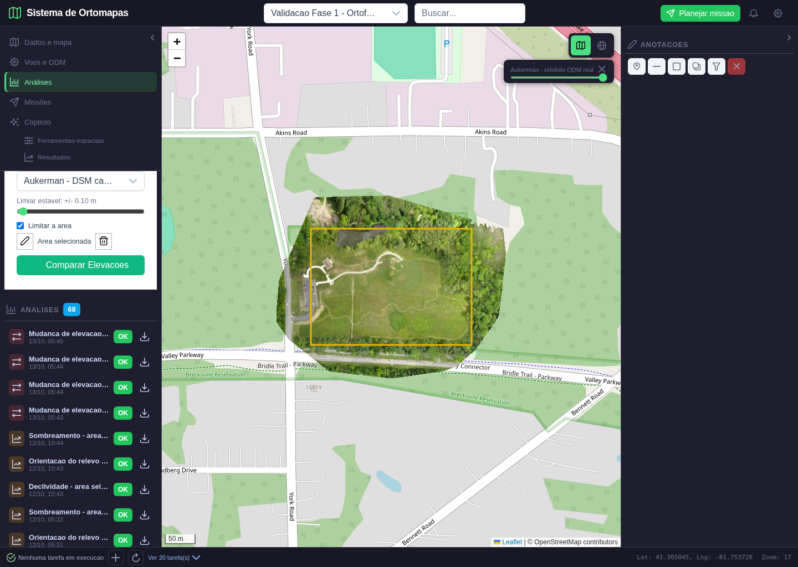
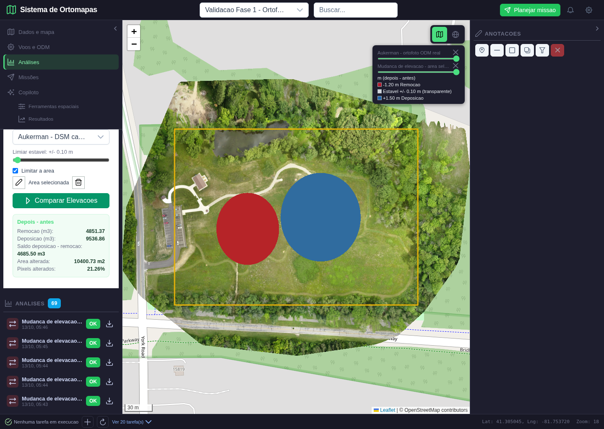
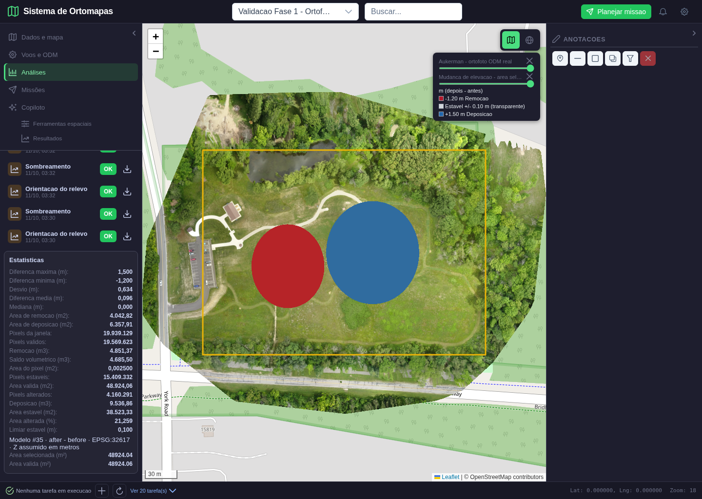

# Validacao da comparacao de elevacao entre campanhas

**Data:** 13/10/2026

**Projeto:** Validacao Fase 1 - Ortofoto real Aukerman (`#62`)

**Resultado final:** aprovado no escopo descrito

**Analise persistida:** `#81`

**Comparacao temporal:** `#5`

## 1. Objetivo e criterio de aceite

Esta validacao comprova o fluxo de comparacao altimetrica entre dois DSM do mesmo projeto. O usuario seleciona o modelo anterior, o modelo posterior, define a tolerancia de estabilidade, desenha uma area e executa a comparacao. O sistema deve alinhar o raster posterior na grade do anterior, calcular `posterior - anterior`, integrar os volumes e publicar um mapa persistente.

O resultado somente seria aprovado se: a geometria realmente limitasse os pixels; os sinais fossem inequívocos; raster e tile coincidissem com uma referencia independente; a inversao das campanhas invertesse corte/deposicao; a reabertura e o download usassem o produto calculado; o banco registrasse os dois modelos na ordem correta; e usuarios sem acesso fossem bloqueados.

## 2. Dados utilizados

O modelo anterior e o DSM real Aukerman `#34`, produzido pelo ODM, com CRS `EPSG:32617`, pixel de 5 cm e dimensoes `7.448 x 5.907`. Como o projeto possuia somente uma campanha DSM, foi criada e carregada uma campanha posterior controlada `#35`.

A campanha `#35` preserva integralmente o relevo real, CRS, resolucao, nodata e grade. Duas regioes centrais receberam alteracoes conhecidas:

| Regiao | Modificacao controlada | Interpretacao esperada |
|---|---:|---|
| Elipse oeste | `-1,20 m` | remocao/corte, vermelho |
| Elipse leste | `+1,50 m` | deposicao/aterro, azul |
| Restante | `0,00 m` | estavel e transparente |

Essas alteracoes sao dados de validacao, nao eventos reais ocorridos em Aukerman. A vantagem e permitir uma prova numerica exata sobre um DSM fotogrametrico real, sem apresentar um resultado ambiental ficticio como observacao de campo.

## 3. Cena 1 - selecao das campanhas e AOI

**Acao executada:** no menu lateral `Analises`, aba `Mud`, foram selecionados o DSM real como modelo anterior e a campanha controlada como posterior. O limiar foi mantido em `+/- 0,10 m`. A opcao `Limitar a area` foi ativada e um retangulo foi desenhado no mapa.

**O que a tela comprova:** os dois produtos aparecem como entradas separadas; a AOI amarela esta geograficamente sobre a ortofoto; o botao permaneceu bloqueado enquanto a area nao estava concluida e foi liberado depois do fechamento do poligono.

**Resultado esperado:** somente centros de pixel dentro da AOI participam do calculo. Valores entre `-0,10 m` e `+0,10 m` sao classificados como estaveis.

## 4. Cena 2 - calculo concluido e interpretacao visual

**Acao executada:** o usuario pressionou `Comparar Elevacoes`. A API alinhou o DSM posterior na grade do anterior, aplicou a mascara real da AOI, calculou volumes e publicou a analise.

**Leitura da tela:** a elipse vermelha representa `-1,20 m` de remocao; a azul representa `+1,50 m` de deposicao. A faixa estavel e transparente, por isso a ortofoto permanece inspecionavel. O contorno amarelo continua identificando o limite usado no calculo. A legenda declara a operacao `m (depois - antes)` e nao depende de inferencia do operador.

**Resumo apresentado ao usuario:**

| Medida | Tela/API |
|---|---:|
| Remocao | `4.851,37 m3` |
| Deposicao | `9.536,86 m3` |
| Saldo deposicao - remocao | `4.685,50 m3` |
| Area alterada | `10.400,73 m2` |
| Pixels alterados | `21,26%` |

## 5. Cena 3 - mapa tematico sobre a ortofoto

Esta cena isola a verificacao cartografica. A camada de mudanca e uma sobreposicao, e nao uma imagem substituta. Pixels estaveis possuem alfa zero; pixels fora da AOI ou sem dados tambem permanecem transparentes. Isso evita o defeito de cobrir a ortofoto inteira com uma superficie branca.

O tile central foi recalculado independentemente a partir do GeoTIFF. Os `256 x 256 x 4` valores RGBA obtidos pelo servidor foram integralmente iguais a referencia. Nesse tile, `35.907` pixels transparentes comprovaram a preservacao da base, enquanto os pixels alterados mantiveram alfa opaco e as cores previstas.

## 6. Cena 4 - persistencia, estatisticas e reabertura

**Acao executada:** a pagina foi recarregada, o projeto foi selecionado novamente e a analise `#81` foi aberta pelo catalogo. A camada voltou ao mapa por tiles autenticados e o painel exibiu as estatisticas persistidas.

**O que foi verificado:** minimo `-1,200 m`, maximo `+1,500 m`, media `0,096 m`, area de remocao `4.042,82 m2`, area de deposicao `6.357,91 m2`, area valida `48.924,06 m2`, limiar `0,100 m`, origem posterior `#35`, operacao `after - before` e CRS `EPSG:32617`.

A interface inicialmente repetia minimo, maximo, media e desvio sob duas familias de chaves. Isso foi corrigido antes desta captura final; o catalogo agora apresenta uma unica leitura de cada estatistica.

## 7. Prova numerica independente

O verificador nao reutilizou o resumo da API. Ele abriu os dois GeoTIFF, reprojetou cada fonte diretamente para a transformacao da saida, calculou `posterior - anterior`, aplicou o limiar e integrou os pixels pela area fisica de `0,0025 m2`.

| Verificacao | Esperado independente | Obtido persistido | Resultado |
|---|---:|---:|---|
| Diferenca minima | `-1,2000 m` | `-1,2000 m` | igual |
| Diferenca maxima | `+1,5000 m` | `+1,5000 m` | igual |
| Volume removido | `4.851,3687 m3` | `4.851,37 m3` | tolerancia de centavos |
| Volume depositado | `9.536,8652 m3` | `9.536,86 m3` | tolerancia de centavos |
| Saldo | `4.685,4961 m3` | `4.685,50 m3` | tolerancia de centavos |
| Area removida | `4.042,8175 m2` | `4.042,82 m2` | igual apos arredondamento |
| Area depositada | `6.357,9100 m2` | `6.357,91 m2` | igual |
| Area estavel | `38.523,3300 m2` | `38.523,33 m2` | igual |
| Pixels validos | `19.569.623` | `19.569.623` | igual |
| Erro maximo da banda | `0 m` | `0 m` | exato |
| Tile tematico | RGBA independente | igualdade integral | exato |

## 8. Ordem temporal, seguranca e persistencia

A comparacao foi repetida invertendo os modelos. O resultado mudou de `+4.685,50 m3` para `-4.685,50 m3`; remocao passou a `9.536,86 m3` e deposicao a `4.851,37 m3`. Isso prova que a ordem temporal nao e decorativa.

Selecionar o mesmo modelo nos dois campos retornou HTTP `422`. Uma conta sem acesso ao projeto recebeu HTTP `403`. O registro `comparacoes_temporais #5` foi consultado no PostgreSQL e contem projeto `#62`, anterior `#34`, posterior `#35` e tipo `elevacao`.

O GeoTIFF baixado pela interface possui `303.104 bytes` e SHA-256 `128744cb19b94ccf210b27eb418081b21e6b8d222252023a85bf66b3af55b874`, identico ao arquivo persistido. Nenhum erro JavaScript foi registrado.

## 9. Testes automatizados e regressao

- Suíte completa: `89 passed`.
- Testes focados apos o ajuste visual: `29 passed`.
- Build Vue/Vite: `419` modulos transformados, aprovado; permanece o aviso conhecido de bundle grande.
- Casos unitarios: sinal, limiar, AOI, resolucoes distintas, reprojecao, ausencia de sobreposicao, valor nao finito e paleta/alfa.
- Playwright real: criacao da AOI, execucao HTTP, tile, resumo, reload, catalogo, download e inspecao das quatro capturas.

## 10. Limites e conclusao

O lote esta aprovado para comparacao altimetrica sincronizada entre DSM ou entre DTM. O alinhamento e geometrico; esta fase nao realiza co-registro fotogrametrico fino nem corrige datum vertical. Comparar DSM de epocas distintas pode refletir copas, veiculos, edificacoes, ruido ou erro de reconstrucao, e nao apenas movimentacao de solo. Para terraplenagem certificada devem ser usados produtos compatíveis, controle de campo e, preferencialmente, DTM.

A funcionalidade implementada nao e mock. As duas fontes sao GeoTIFF registrados, o calculo gera outro GeoTIFF, o mapa e servido a partir desse arquivo e os registros ficam no PostgreSQL. A modificacao da segunda campanha e controlada apenas para tornar a validacao demonstravel e matematicamente verificavel.

**Conclusao:** comparacao por AOI, alinhamento, volumes, sinal, mapa, persistencia, download e isolamento de acesso foram aprovados. Isso conclui este lote, mas nao conclui toda a fase 3 nem todos os casos de uso do sistema.
