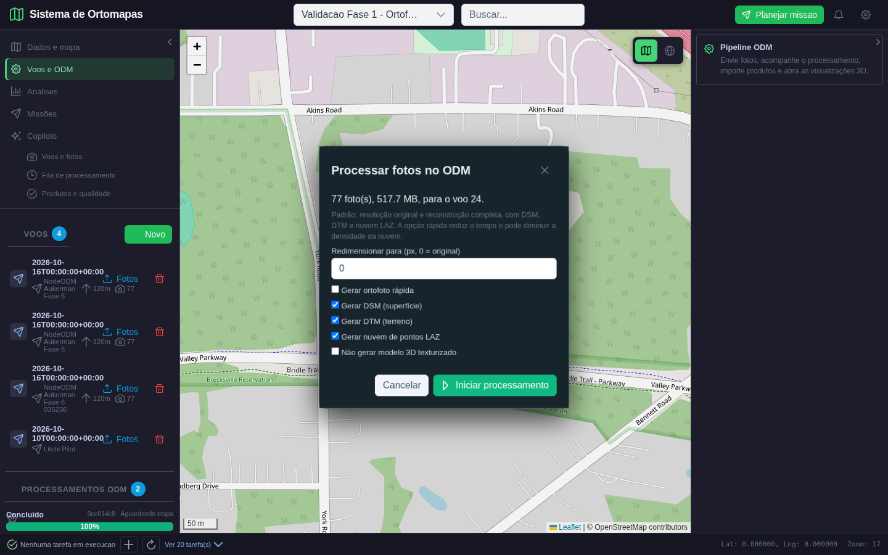
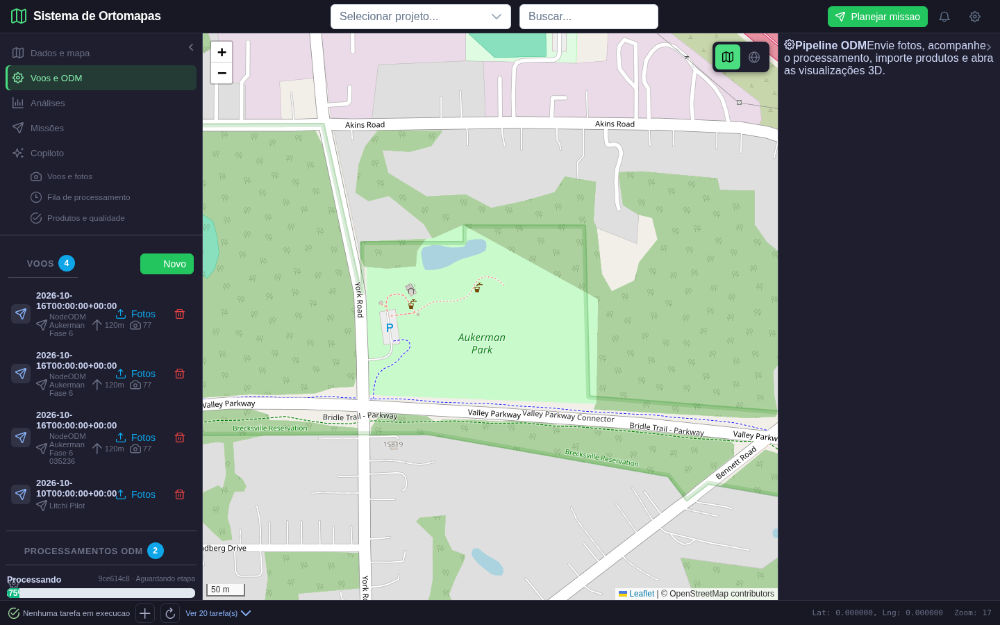
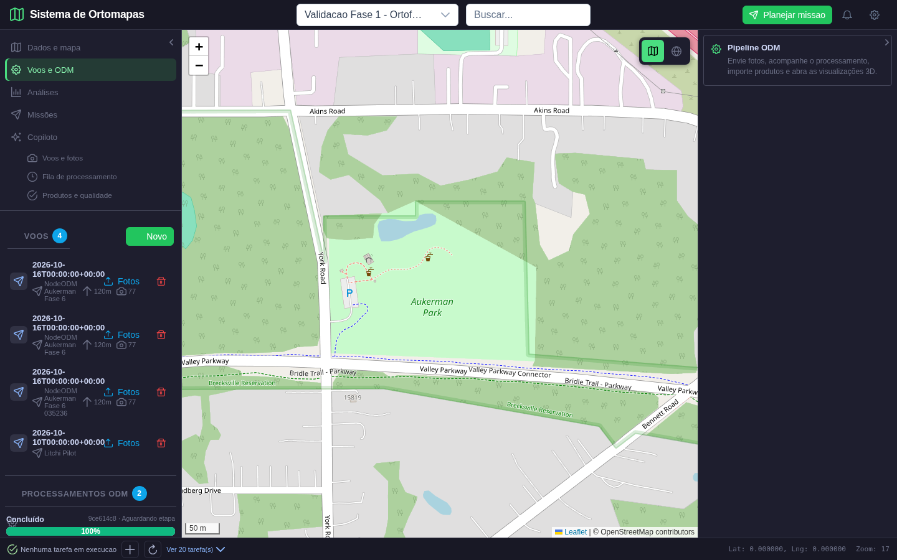
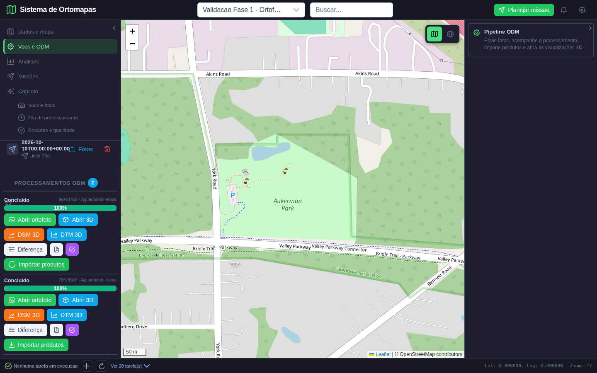
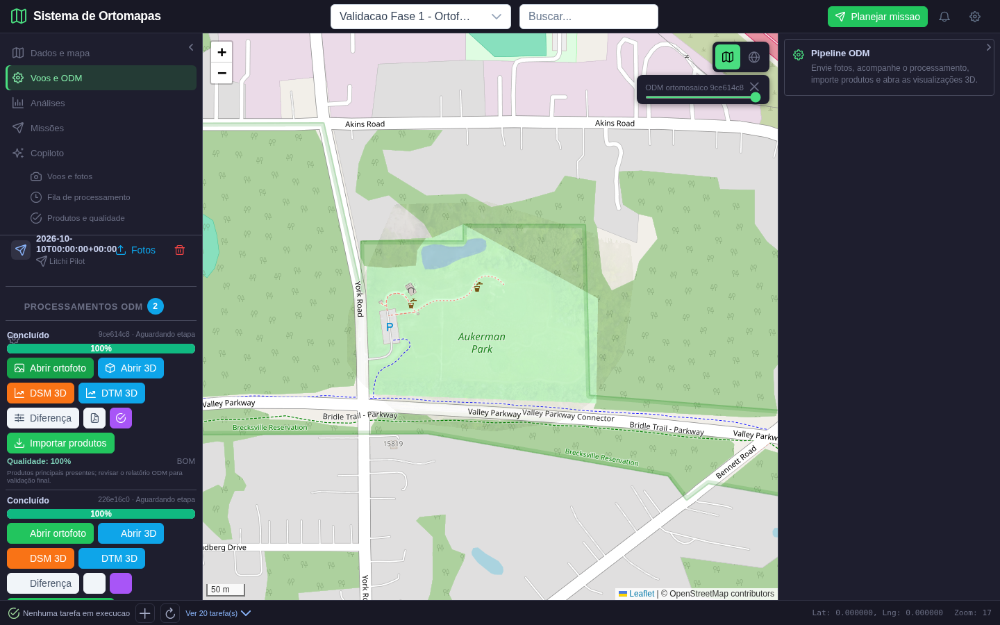
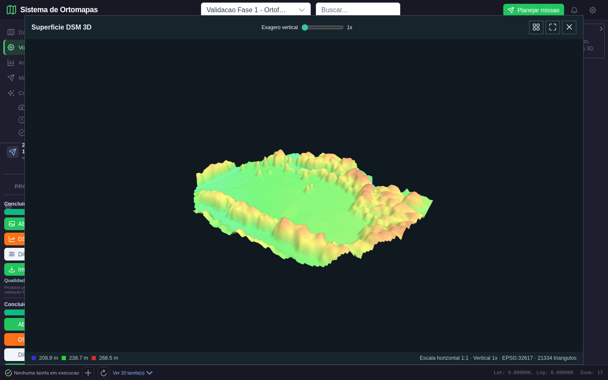
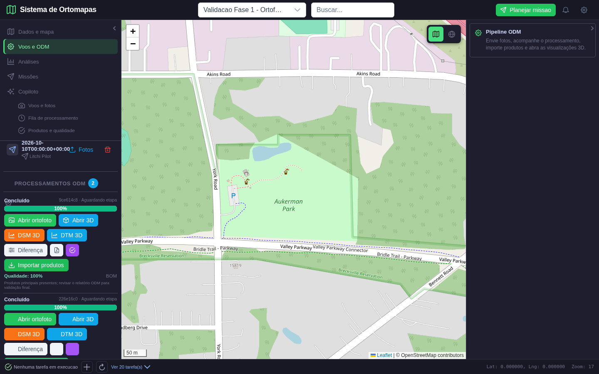
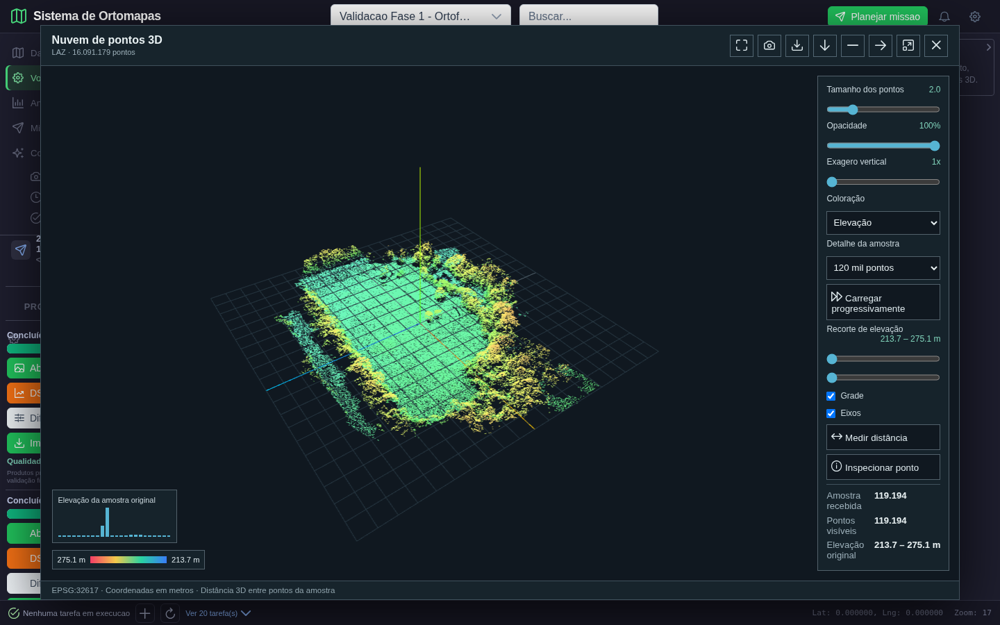

# Validação da Fase 6: processamento ODM pela aplicação

**Data:** 16/10/2026
**Resultado:** fluxo real aprovado com ressalvas registradas abaixo.
**Projeto:** `Validacao Fase 1 - Ortofoto real Aukerman` (ID 62)
**Voo:** ID 24
**Processamento Ortomapas:** ID 13
**NodeODM:** `9ce614c8-ad7c-42c6-8dfd-2dcee9aa234f` (NodeODM 2.2.4, engine ODM 3.5.6)

## Escopo e dados

O fluxo foi executado pela interface do Ortomapas, contra o serviço NodeODM local em `8021`, com 77 fotografias JPEG do conjunto real de exemplo Aukerman já presente em `data/odm_test/odm_data_aukerman-master/images/`. O conjunto soma 517,7 MB; as 77 fotos possuem GPS EXIF. Não são imagens de Guarajuba nem fotos capturadas nesta sessão por um drone. A tarefa e os produtos foram persistidos no projeto; não foram substituídos por dados de demonstração.

No formulário, a resolução original foi mantida (`resize-to` ausente), e ficaram ativos DSM, DTM e exportação LAZ. `fast-orthophoto` e `skip-3dmodel` não foram enviados. O processamento integral levou aproximadamente 22 min, de 06:52:42 a 07:14:56 UTC. A aplicação registrou o UUID, acompanhou o estado real e importou o resultado.

## Sequência visual

### Seleção das fotografias

**Ação:** selecionar 77 arquivos do voo 24.
**Verificado:** quantidade e tamanho calculados na tela; resolução original; DSM, DTM e LAZ selecionados; modo rápido e opção de pular o modelo desmarcados. O envio efetivo respondeu HTTP 202 e identificou as 77 imagens com GPS.

### Processamento em andamento

**Ação:** acompanhar a task na fila do Ortomapas.
**Verificado:** UUID real `9ce614c8…`, estado `processando` e progresso do serviço, sem progresso simulado. A captura foi feita durante a execução, aproximadamente a 54%.

**Nota visual:** esta captura antecede os ajustes de sincronização do seletor de projeto e de espaçamento da barra de ajuda. Esses problemas de apresentação foram corrigidos; as telas seguintes mostram a interface após a correção. Esta captura comprova o estado real do processamento, não é usada como avaliação do acabamento final da interface.

### Conclusão e importação

**Ação:** esperar o status real `concluido`, importar os resultados e repetir a chamada de importação.
**Esperado:** produtos visíveis no projeto, sem duplicação numa segunda importação.
**Obtido:** cinco produtos; a segunda importação respondeu com os já cadastrados e manteve a contagem em cinco.

| Produto | Registro | Resultado observado |
|---|---:|---|
| Ortomosaico | produto 29 / ortomapa 40 | GeoTIFF, EPSG:32617, 7.419 x 5.923, 4 bandas, pixel ~5 cm, 89,1 MB |
| DSM | produto 30 / ortomapa 41 | GeoTIFF, EPSG:32617, 7.419 x 5.922, 1 banda, 59,0 MB; valores 207,60–275,18 m |
| DTM | produto 31 / ortomapa 42 | GeoTIFF, EPSG:32617, 7.419 x 5.922, 1 banda, 71,4 MB; valores 207,57–262,83 m |
| Relatório ODM | produto 32 | PDF, 15,1 MB |
| Nuvem LAZ | produto 33 | 57,1 MB; cabeçalho validado com 16.091.179 pontos, EPSG:32617 |

### Inspeção dos resultados

**Ação:** abrir o ortomosaico a partir da task.
**Verificado:** camada publicada e tiles do produto retornando HTTP 200; a aplicação enquadra o centro geográfico do produto. A imagem possui máscara/áreas transparentes fora da cobertura fotográfica; o mapa-base e anotações do projeto permanecem visíveis por baixo/por cima nas áreas correspondentes.

**Ação:** abrir `DSM 3D`.
**Verificado:** superfície derivada do DSM real, em EPSG:32617, com relevo renderizado e escala de elevação. A visualização não é uma malha texturizada.

**Ação:** solicitar avaliação de qualidade.
**Verificado:** score 100%, com ortomosaico, modelo de elevação e nuvem presentes; contagem LAZ lida como 16.091.179. A recomendação ainda orienta revisar o relatório ODM: o score é uma triagem de presença/contagem de produtos, não certificação de acurácia ou qualidade cartográfica.

**Ação:** abrir `Abrir 3D`.
**Verificado:** arquivo de 16.091.179 pontos carregado; o visualizador renderiza amostra de 119.194 pontos, permite controle de vista, escala vertical, cor por elevação, seleção/medição e carregamento progressivo.

## Correções incluídas nesta fase

- Upload agora exige pelo menos três imagens georreferenciadas, limita quantidade/tamanho, verifica formato, integridade, duplicatas e GPS EXIF, e associa arquivos ao voo e projeto selecionados.
- Consulta/importação de tasks requer autenticação e autorização no projeto; a importação espera conclusão real e é idempotente.
- A UI mostra erros, estado/etapa e ações para abrir ortofoto, superfície, nuvem e qualidade.
- Os padrões do formulário agora usam resolução original e processamento completo. O modo rápido é escolha explícita, pois pode reduzir produtos de alta densidade.
- Corrigida a consulta de qualidade, que tentava ler `caminho` sem incluí-lo no `SELECT` e por isso classificava o LAZ válido como ilegível.
- Ao abrir uma ortofoto ODM, a aplicação enquadra o centro geográfico do raster; a barra de ajuda lateral e o seletor de projeto acompanham corretamente a navegação.

## Ressalvas e pendências

- A avaliação anterior, processamento 12, foi executada com redução para 1.200 px e opções rápidas. Produziu apenas 57.452 pontos LAZ e recebeu 67%/alerta. Ela permanece no projeto como evidência daquela configuração; o processamento 13 é a execução integral aprovada e não a substituiu.
- O pipeline ODM pode gerar malha texturizada, mas o importador atual cadastra ortomosaico, DSM, DTM, LAZ e PDF; não cadastra nem abre a malha OBJ como produto do Ortomapas. As visualizações 3D comprovadas nesta fase são a superfície DSM e a nuvem LAZ.
- A ortofoto é do conjunto de exemplo Aukerman, não de Guarajuba. Não houve voo, validação de campo, checagem independente de pontos de controle nem certificação de acurácia/datum vertical.
- O teste completo real submeteu e acompanhou a task via UI. As verificações pós-processamento foram retomadas pelo UUID após a execução terminar; o Playwright passou no reuso da task, avaliação, idempotência, tiles e viewers. O arquivo `02_task_enviada.png` não é usado aqui porque a captura posterior mostrava a task já concluída, não o estado no instante de submissão.
- A lista de voos contém um voo vazio criado durante uma tentativa automatizada que parou antes do upload; ele foi preservado e não está vinculado a uma task.

## Verificações executadas

- Task real NodeODM 2.2.4 / ODM 3.5.6: concluída sem erro, 77 fotos.
- Playwright ponta a ponta real: captura do formulário, acompanhamento, importação, avaliação, repetição idempotente, visualização ortofoto, DSM 3D e LAZ 3D. Rodada final de retomada: `1 passed`.
- Backend: `compileall` aprovado.
- Frontend: `npm run build` aprovado; permanece o aviso preexistente de bundle principal acima de 500 kB.
- Teste real é opt-in porque cria task e dados persistentes: `ODM_REAL_RUN=1 python -m pytest -q -s tests/e2e/playwright/test_odm_fase6_real.py`.
