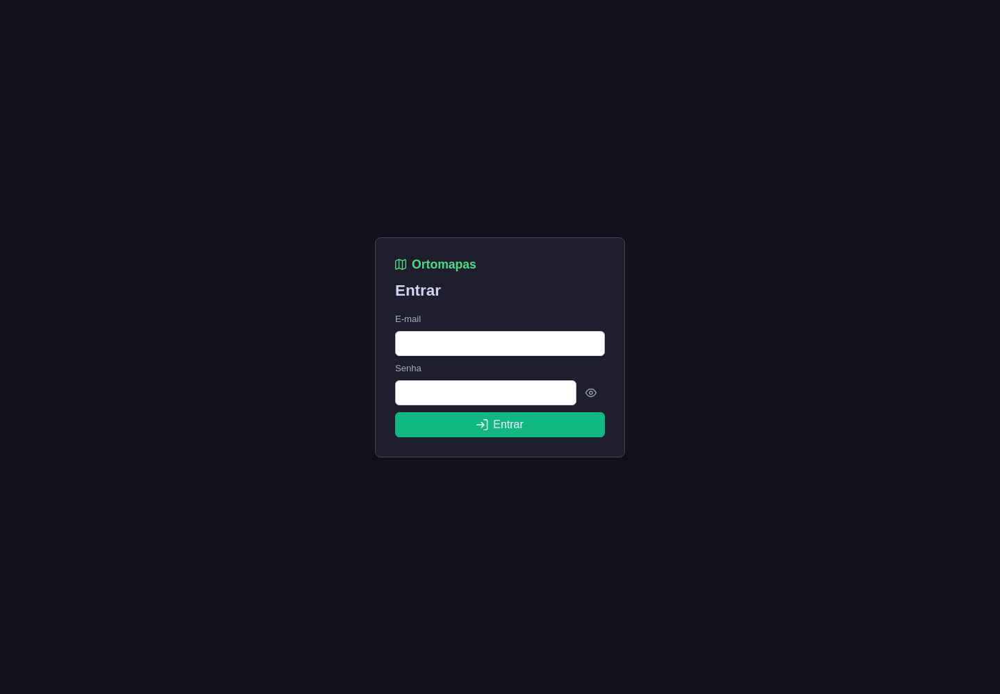
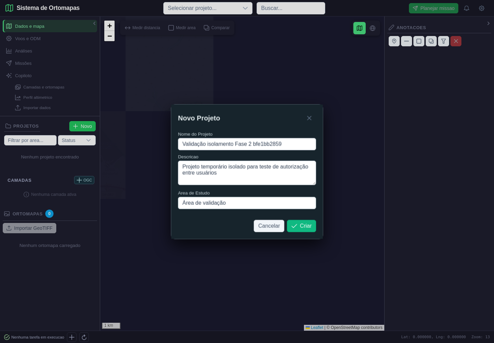
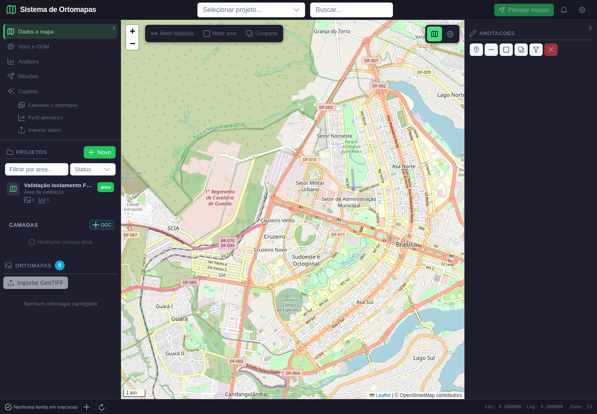
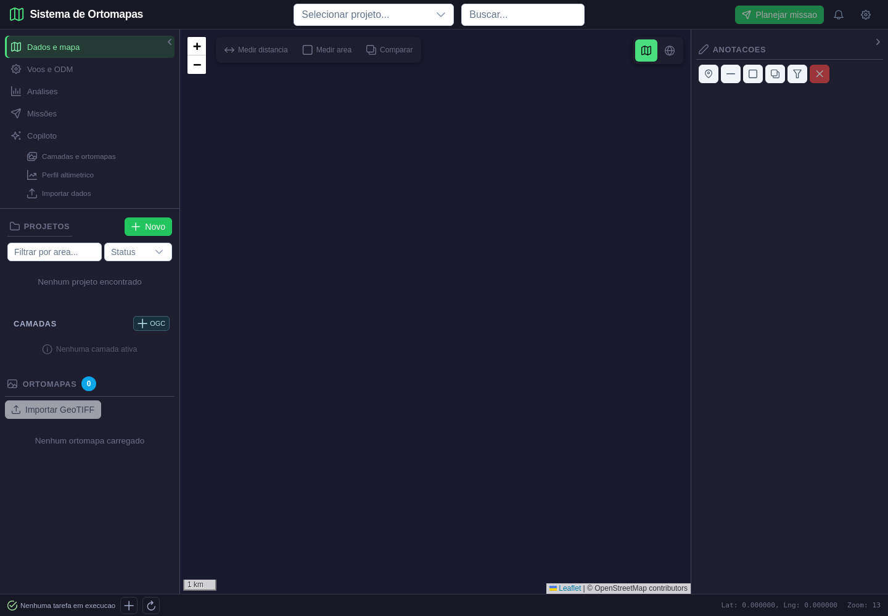

# Relatório de validação — Fase 2/8: identidade, projetos, autorização e persistência

**Data:** 10/11/2026  
**Resultado:** aprovado para os fluxos e recursos testados; não equivale a auditoria completa de todas as rotas.  
**Dados:** duas contas temporárias, um projeto/voo/ortomapa de teste e um arquivo fixture, todos removidos.  
**LLM:** nenhuma chamada.

## Ambiente de teste

- Banco: PostgreSQL do Ortomapas, database `ortomapas`, servido pelo container existente na porta local 5433. A conexão e a presença das tabelas centrais foram confirmadas em leitura antes do teste.
- API: instância temporária em `127.0.0.1:8888`; `AGENT_WORKER_ENABLED=0` durante a execução.
- Interface: Vite em `127.0.0.1:5174`. A porta 5173 estava ocupada por outro processo e não foi alterada.
- Navegador: Google Chrome instalado, dirigido por Playwright.
- Contas: proprietária `pesquisador` e segunda conta `leitor`, registradas com emails/senhas aleatórios de teste. Credenciais não foram gravadas nos artefatos.

## Defeitos encontrados e corrigidos

### 1. Listagem de membros expunha projeto a perfil global de leitor

`GET /api/projetos/{id}/usuarios` aceitava qualquer conta cujo perfil global fosse `leitor`, mesmo sem associação ao projeto. Corrigi o endpoint para exigir associação de projeto com papel de leitura (`proprietario`, `editor` ou `visualizador`); somente `admin` mantém acesso global explícito.

### 2. Lista global de voos não aplicava escopo de usuário

`GET /api/voos` sem `projeto_id` consultava todos os voos. Corrigi a consulta para limitar usuários não administradores aos projetos em `projeto_usuarios`. A consulta filtrada por `projeto_id` continua fazendo verificação de papel antes de devolver o resultado.

## Casos executados: esperado versus observado

| ID | Esperado | Observado | Resultado |
|---|---|---|---|
| P2-UI-01 | Login e criação de projeto pelo proprietário; nome aparece na lista | POST de projeto HTTP 201; diálogo fechou; cartão foi exibido | Aprovado |
| P2-DB-01 | Projeto tem vínculo de proprietário no PostgreSQL | `GET /projetos/{id}` e lista de membros confirmaram associação `proprietario` para o criador | Aprovado |
| P2-OWNER-01 | Proprietário acessa o próprio projeto, voo, produto e arquivo | Recursos retornaram HTTP 200; arquivo fixture foi entregue com conteúdo esperado por URL temporária assinada | Aprovado |
| P2-ISOLATION-01 | Segunda conta não lista nem lê recursos privados e não edita o projeto | Projeto não aparece na lista; acesso direto ao projeto, lista de produtos, produto, voo, ticket de tile, URL de mídia e PUT de edição foram negados | Aprovado |
| P2-REG-01 | Perfil global `leitor`, sem associação, não vê os membros do projeto | Antes da correção havia uma condição permissiva; depois da correção o endpoint retornou HTTP 403 | Aprovado após correção |
| P2-REG-02 | Consulta de voos sem filtro deve permanecer dentro dos projetos associados | A consulta agora inclui filtro por `projeto_usuarios`; proprietária encontra o voo criado e segunda conta recebe lista vazia | Aprovado após correção |
| P2-CLEANUP | Dados de teste não permanecem no banco ou filesystem | API apagou projeto; consulta posterior encontrou 0 contas e 0 projetos de teste; fixture removido | Aprovado |

### Respostas HTTP observadas para a conta sem associação

| Recurso/ação | Status esperado | Status observado |
|---|---:|---:|
| Detalhe do projeto | 403 | 403 |
| Ortomapas do projeto | 403 | 403 |
| Detalhe do produto | 403 | 403 |
| Detalhe do voo | 403 | 403 |
| Obter ticket de tiles | 403 | 403 |
| Solicitar URL de mídia do arquivo | 403 | 403 |
| Alterar o projeto | 403 | 403 |
| Listar membros do projeto | 403 | 403 |
| Listar projetos/voos sem associação | HTTP 200 com recurso ausente | Projeto e voo de teste ausentes |

## Capturas Playwright

As imagens foram inspecionadas após a execução. A terceira captura foi refeita após aguardar o fechamento do modal, para mostrar o estado final do projeto.

### 1. Tela de login

### 2. Formulário de projeto preenchido

### 3. Projeto criado e listado para a conta proprietária

### 4. Segunda conta sem acesso ao projeto

## Testes automatizados e evidências estruturadas

- `tests/test_project_membership_auth.py`: **4 passaram**. Cobrem a proibição de listar membros sem associação, papel visualizador associado e filtragem de voos (incluindo acesso admin).
- `tests/test_resource_access.py::test_data_directory_escape_rejected`: passou junto dos quatro testes acima; total **5 passaram**.
- `test_media_tickets_scope_expiry_and_purpose` já existente ficou fora dessa execução local porque o teste isolado não encerrou no ambiente atual. O fluxo real de mídia desta fase foi coberto pela execução integrada: ticket válido do proprietário leu o arquivo e pedido da segunda conta recebeu 403.
- [Resultado Playwright estruturado](playwright_result.json) registra a execução sem emails, senhas ou tokens.
- O worker de agentes ficou desativado; o teste não acionou LLM nem analisador espacial.

## Limites desta aprovação

Esta etapa valida isolamento de dois usuários em projeto, voos, metadados de ortomapa, arquivo e ticket de tiles, além de persistência básica e login. Não cobre todas as rotas do backend nem todos os papéis de colaboração. O projeto de teste teve produtos sem raster real; a tentativa de renderização de tile de dados de teste não foi necessária, pois a API negou o ticket antes do acesso. A matriz completa de endpoints/roles, usuários compartilhados e permissões de editor/visualizador permanece para ampliação em revisões posteriores.

## Próxima etapa

**Fase 3 de 8 — Fluxo fotogramétrico ponta a ponta e reprodutibilidade.** Repetir, em projeto de validação limpo, o upload de um dataset com licença identificada, a tarefa real no NodeODM, progresso, importação de produtos e reabertura. Acrescentar os testes de erro/idempotência, sem classificar mock como processamento real.
