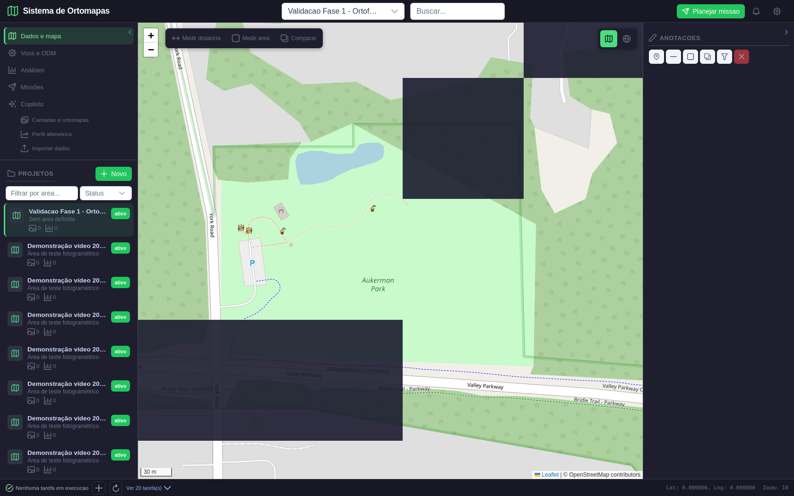
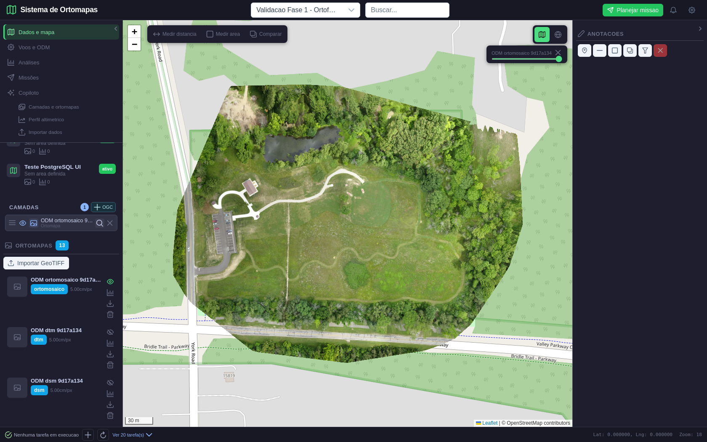
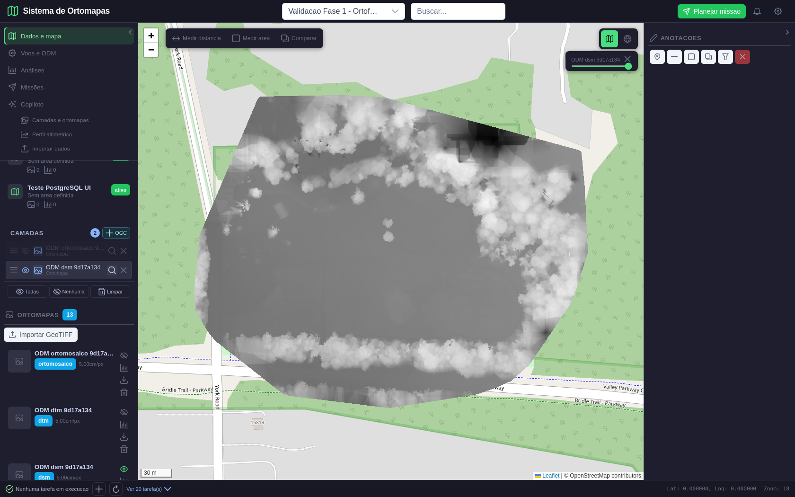
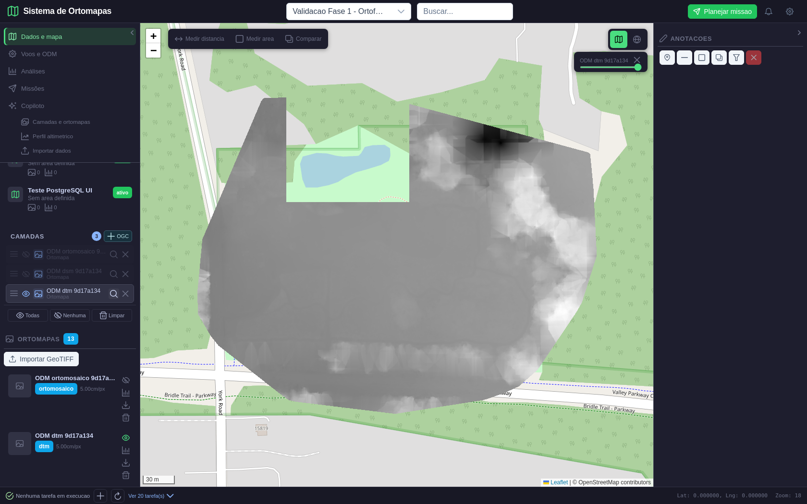
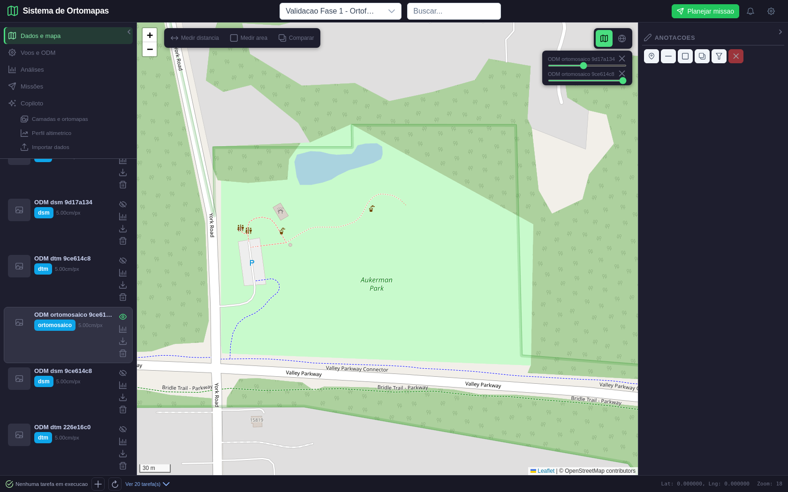
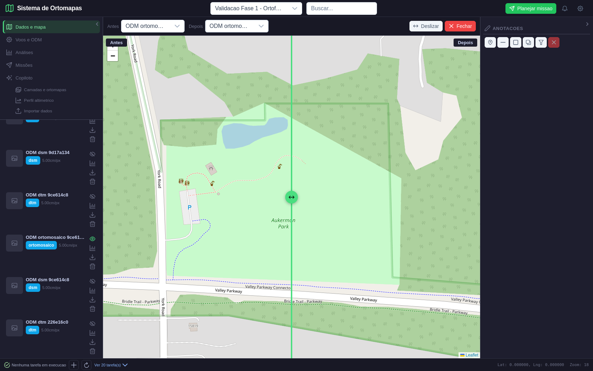
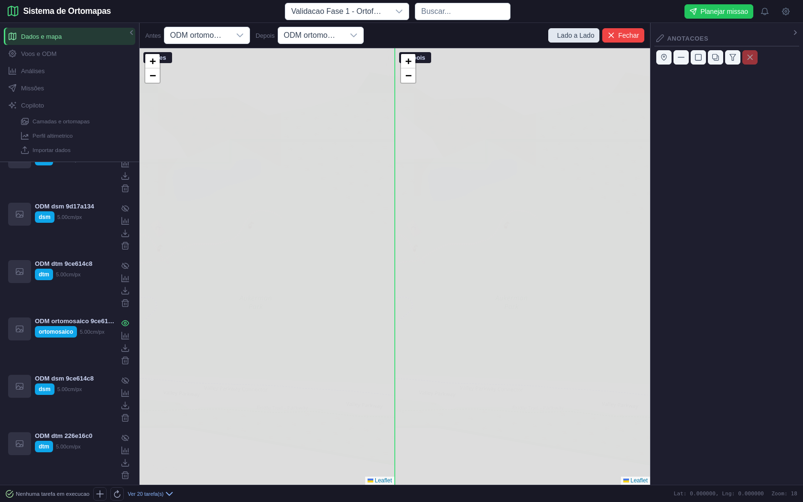
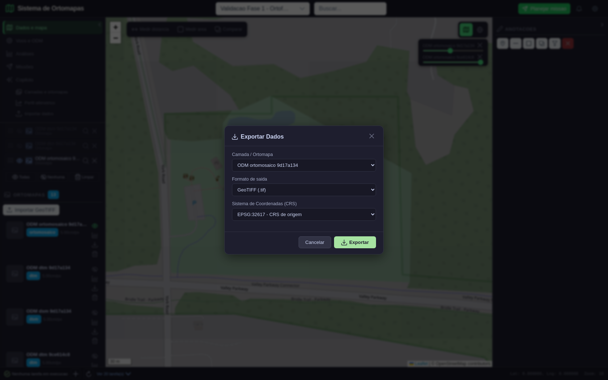
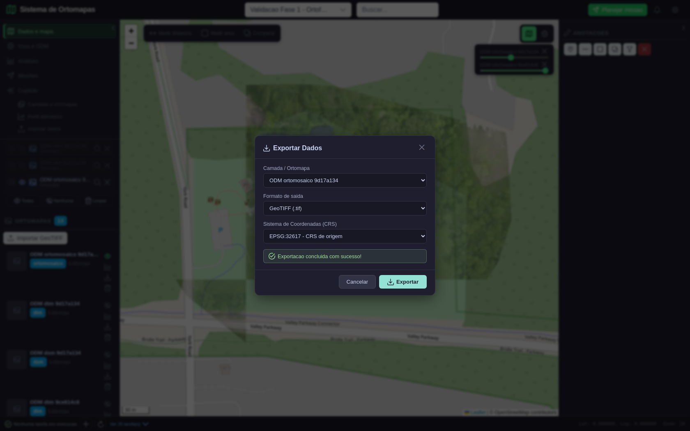

# Fase 4/8 — Mapa 2D, produtos raster e exportação

**Data da execução:** 10/11/2026
**Resultado:** aprovada no escopo raster validado.
**Projeto/dados:** projeto persistido `Validacao Fase 1 - Ortofoto real Aukerman` (ID 62), já existente no PostgreSQL. A execução não criou nem alterou registros do projeto.

## O que foi percorrido

Com Playwright, entrei no aplicativo, selecionei o projeto e abri os produtos do ODM no mapa. Verifiquei ortomosaico, DSM e DTM individualmente, controles de camadas, opacidade, comparação deslizante e lado a lado, além da exportação GeoTIFF pelo botão do cartão. As imagens mostram o Parque Aukerman, no conjunto público de teste; não são imagens de Guarajuba nem uma captura do drone do usuário.

O projeto tinha duas execuções de ortomosaico catalogadas (IDs 43 e 40), além do DSM (ID 44) e DTM (ID 45) da execução `9d17a134`. Os rasters usam EPSG:32617. O ortomosaico principal tem 7.470 × 5.924 pixels, quatro bandas e resolução aproximada de 5 cm/pixel.

## Esperado versus obtido

| Verificação | Resultado esperado | Resultado obtido | Estado |
|---|---|---|---|
| Catálogo e seleção do projeto | Mostrar os produtos raster persistidos no projeto selecionado | Catálogo exibiu 13 produtos; dois ortomosaicos independentes, DSM e DTM identificados pelos seus nomes e IDs | Aprovado |
| Ortofoto no mapa | Raster no local geográfico correto, extent e escala coerentes | 25 tiles autenticados retornaram HTTP 200; ortomosaico visível sobre ruas e feições do Aukerman Park | Aprovado |
| DSM em 2D | DSM selecionado e desenhado como superfície raster | 25/25 tiles HTTP 200; superfície de elevação em escala de cinza visível com o ortomosaico desligado | Aprovado |
| DTM em 2D | DTM selecionado e desenhado separadamente do DSM | 25/25 tiles HTTP 200; superfície do terreno visível com DSM e ortomosaico desligados | Aprovado |
| Opacidade e ordem | Alterar opacidade e manter camadas distintas no painel | Controle da primeira ortofoto permaneceu em 45%; a segunda execução foi adicionada como camada independente | Aprovado |
| Comparação | Abrir as duas seleções e alternar deslizar/lado a lado | Os dois modos abriram com os ortomosaicos IDs 43 e 40 | Aprovado com limite de interpretação |
| Exportação | Diálogo acessível, CRS de origem selecionável, resposta válida e confirmação | Diálogo abriu pelo cartão, pré-selecionou o ortomosaico e EPSG:32617; POST retornou 200; navegador mostrou “Exportação concluída com sucesso!” | Aprovado |
| Conteúdo/metadados do GeoTIFF | CRS, tamanho e extensão preservados ao exportar no CRS original | 93.824.935 bytes, mesmo tamanho da origem; 7.470 × 5.924, 4 bandas, EPSG:32617; bounds iguais, erro máximo 0 m | Aprovado |
| Erros de interface/API | Nenhum erro que interrompa o fluxo ou gere tile ausente | Nenhum erro no navegador, nenhum HTTP 500 e nenhum esgotamento do pool nesta execução final | Aprovado |

### Observação sobre comparação

As duas ortofotos são execuções diferentes sobre o mesmo local e o mesmo conjunto de teste. O comparador foi validado como controle de visualização; a tela não demonstra mudança temporal real nem deve ser interpretada como análise de mudança.

## Correções feitas a partir da validação

1. O botão **Exportar** do cartão não abria o diálogo. Liguei o evento do cartão ao `ExportDialog` e passei o ID selecionado para o diálogo.
2. O seletor de CRS apresentava somente opções brasileiras e omitia EPSG:32617. O CRS da origem agora aparece como opção e é selecionado inicialmente.
3. O exportador reescrevia um GeoTIFF completo mesmo quando a saída usava o CRS de origem. Nesse caso, agora copia o arquivo sem reprojeção; o fixture confirmou cópia byte a byte. O endpoint usa execução síncrona do FastAPI em threadpool, e o cliente aguarda transferências raster de até 10 minutos.
4. Os handlers de tile executavam GDAL dentro de rotas `async`, bloqueando o event loop. Foram convertidos para handlers síncronos em threadpool. A execução concorrente dos tiles revelou ainda que o pool padrão de cinco conexões era insuficiente; o padrão foi elevado para 12 por processo. Na repetição final, ortofoto, DSM e DTM carregaram sem 500, timeout ou erro de interface.

## Roteiro visual e evidências

Todas as capturas abaixo foram feitas por Playwright na execução final. O manifesto registra IDs, CRS, número/status dos tiles, estado do diálogo, tamanho do export e verificações.

### 1. Catálogo de ortofotos do projeto

Selecionei o projeto Aukerman existente. O cartão mostra o ortomosaico persistido e os controles disponíveis. O conjunto foi mantido somente para leitura.

### 2. Ortomosaico enquadrado no mapa

Ativei a camada, usei o enquadramento e confirmei visualmente o ortomosaico junto da base OpenStreetMap. A captura corresponde à região do projeto de teste nos Estados Unidos.

### 3. DSM em mapa 2D

Desliguei a ortofoto e liguei o DSM. A cobertura em tons de cinza representa a superfície observada pelo processamento fotogramétrico; o manifesto registra 25 tiles HTTP 200.

### 4. DTM em mapa 2D

Desliguei o DSM e ativei o DTM separadamente. O terreno fica visível na extensão do raster. O DTM aqui não é uma cena 3D; essa validação pertence à Fase 5.

### 5. Painel de camadas e opacidade

Reativei o ortomosaico e adicionei a segunda execução. O painel lista camadas distintas e o controle da primeira foi ajustado para 45%.

### 6. Comparador deslizante

Abri o comparador com os produtos IDs 43 e 40 e conferi os dois seletores. A comparação é entre execuções do mesmo local de teste.

### 7. Comparador lado a lado

Troquei para duas vistas lado a lado e fechei o comparador para voltar ao mapa.

### 8. Diálogo de exportação e CRS

Acionei **Exportar** no cartão do ortomosaico. O diálogo abriu com a camada correta, formato GeoTIFF e CRS original EPSG:32617 selecionado.

### 9. Confirmação da exportação

O endpoint respondeu HTTP 200, o navegador recebeu o arquivo e a interface apresentou a confirmação. O corpo da resposta tinha 93.824.935 bytes, igual ao raster de origem para a cópia no mesmo CRS.

## Limites desta fase

- O comparador não prova mudanças temporais, pois os dois ortomosaicos são do mesmo local e conjunto.
- Não gerei novo processamento ODM nem alterei o banco ou arquivos de produto.
- Formatos vetoriais, WMS/WMTS, análises derivadas e interpretação analítica ficam em seus respectivos escopos; esta fase aprovou o fluxo raster 2D e GeoTIFF no CRS de origem.
- A Fase 5 vai validar superfícies 3D, GLB e nuvem de pontos com números conferidos contra os arquivos.

## Resultado e próxima etapa

**Fase 4 de 8 aprovada no escopo descrito.** As rotas de mapa exibiram os tiles reais de ortofoto, DSM e DTM; comparação e exportação foram concluídas na UI com resposta verificável. As correções relativas a exportação, execução GDAL e pool de conexões foram repetidas sem erros.

**Próxima etapa: Fase 5 de 8 — Visualização 3D e produtos de elevação.** Conferir DSM/DTM 3D, GLB texturizado e LAZ, valores/unidades/extensão e controles de rotação, zoom e escala contra os próprios produtos ODM.
