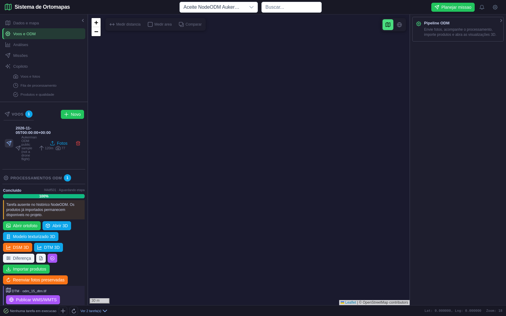
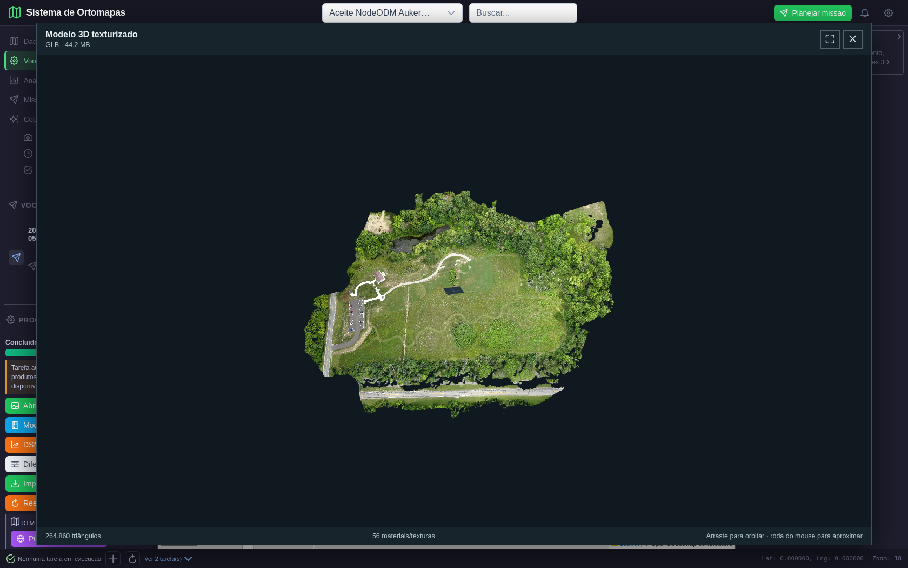
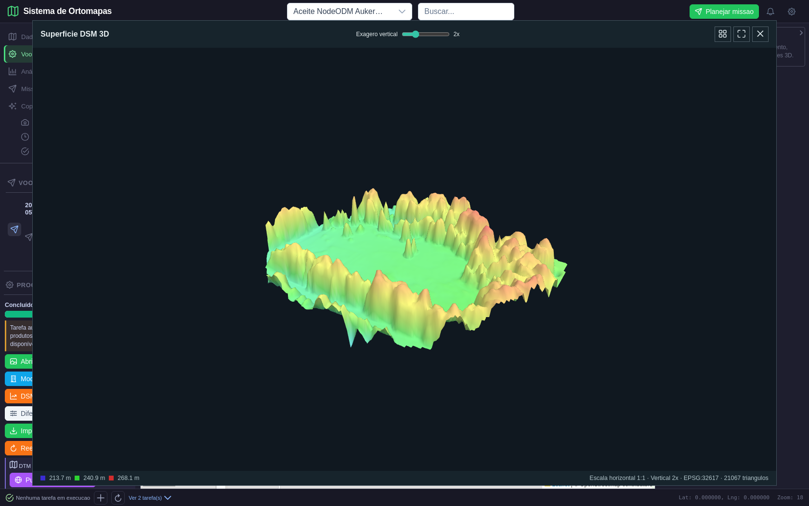
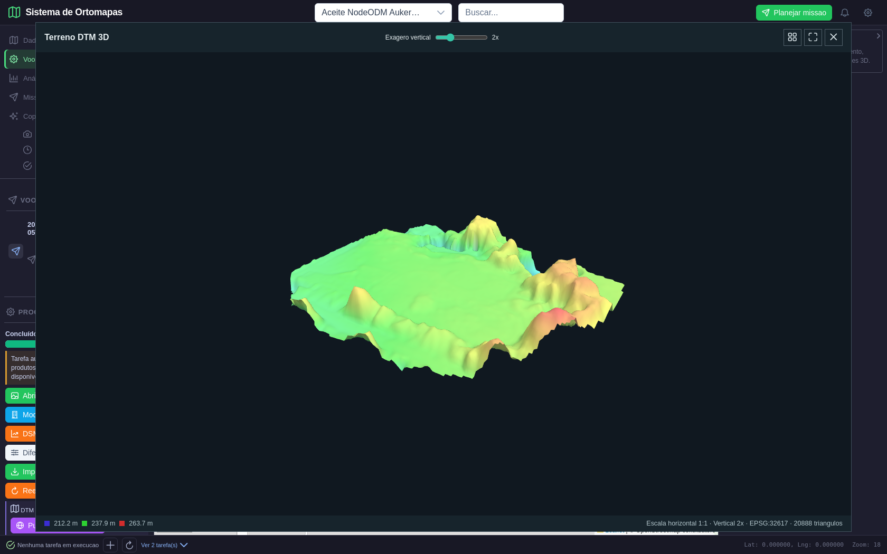
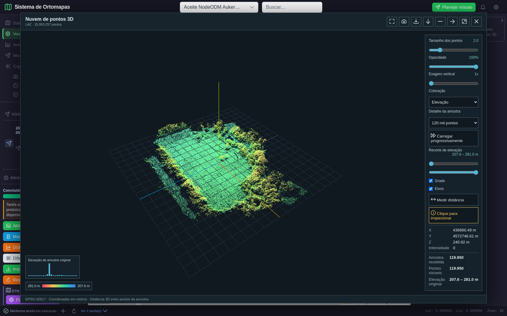

# Validação da Fase 5 — Visualização 3D e produtos de elevação

**Data:** 10/11/2026
**Resultado:** aprovada no escopo testado.
**Projeto e processamento:** projeto 64, `Aceite NodeODM Aukerman 20261105-144156`; processamento 15.
**Dados:** produtos reais processados pelo NodeODM a partir do conjunto público de imagens ODM Aukerman. Não são fotos de voo nem dados de Guarajuba.
**Método:** leitura dos arquivos raster/LAZ/GLB, consultas GET autenticadas à API local e navegação visual com Playwright. O ensaio não alterou registros ou produtos. A sessão E2E foi assinada localmente para um administrador existente; não foi gravada no relatório.

## Escopo e resultado esperado

O plano exige abrir DSM, DTM, modelo GLB e nuvem LAZ, conferir geometria, CRS/unidades, extensão e valores contra os arquivos originais e exercer os controles de navegação. Também exige evidências de tela por produto.

**Resultado observado:** os quatro produtos abriram no visualizador; as respostas de superfície e nuvem retornaram HTTP 200; as extensões raster preservaram os bounds do GeoTIFF com diferença máxima inferior a 1 cm; os valores exibidos correspondem à grade de visualização retornada pela API; contagens do GLB e da nuvem correspondem aos arquivos. Rotação, zoom, vistas predefinidas, enquadramento, inspeção de ponto e tela cheia foram exercitados. O navegador não reportou erros JavaScript.

## Produtos e confronto com os arquivos fonte

| Produto | Referência lida do arquivo | Resultado da API/UI | Comparação |
|---|---|---|---|
| DSM GeoTIFF (produto 41) | 7.478 × 5.889 px; resolução 0,05 m; EPSG:32617; bounds 436848,030–437221,930 E / 4572651,815–4572946,265 N; valores válidos 206,520–281,070 m | Grade API 128 × 101; bounds iguais aos do arquivo; faixa 213,711–268,145 m; interface 213,7 / 240,9 / 268,1 m; 21.067 triângulos | CRS, unidade e extensão conferem. A legenda é da grade amostrada, não dos extremos do GeoTIFF em resolução integral. |
| DTM GeoTIFF (produto 42) | 7.477 × 5.889 px; resolução 0,05 m; EPSG:32617; bounds 436848,040–437221,890 E / 4572651,810–4572946,260 N; valores válidos 206,500–264,224 m | Grade API 128 × 101; bounds iguais aos do arquivo; faixa 212,227–263,663 m; interface 212,2 / 237,9 / 263,7 m; 20.888 triângulos | CRS, unidade e extensão conferem. A legenda é da grade amostrada, não dos extremos do GeoTIFF em resolução integral. |
| Modelo GLB (produto 45) | Arquivo íntegro de 46.357.884 bytes; GLB 2; 1 malha; 264.860 triângulos declarados; 56 materiais; Draco presente | WebGL carregou; rodapé mostrou 264.860 triângulos e 56 materiais/texturas | Contagens coincidem. O GLB foi validado como modelo visual; este ensaio não certifica o seu georreferenciamento para sobreposição cartográfica. |
| Nuvem LAZ (produto 44) | 15.953.257 pontos; EPSG:32617; coordenadas métricas; extensão X 436844,830–437232,860 m, Y 4572648,940–4572953,590 m, Z 206,350–281,240 m | API entregou amostra de 119.950 pontos (limite solicitado: 120.000); UI mostrou 15.953.257 pontos totais, 119.950 pontos da amostra, EPSG:32617 e altitudes amostradas de 207,6–281,0 m | Contagem total, amostragem, CRS e unidades conferem. A amostra visual representa cerca de 0,75% dos pontos do arquivo. |

### Leitura correta da escala e das altitudes

Os rasters originais têm pixel de 5 cm, mas o visualizador recebe uma grade de 128 × 101 para tornar a malha WebGL leve. Na extensão de aproximadamente 374 × 294 m, isso representa cerca de 2,94 m entre vértices, quase 59 vezes mais espaçado que o pixel fonte. Portanto, a superfície 3D é uma pré-visualização de forma e relevo, e os números na legenda são os extremos dessa grade reduzida. Os extremos do GeoTIFF integral permanecem nos metadados do produto; não devem ser confundidos com a faixa da malha exibida.

O slider foi testado em exagero vertical 2×; a escala horizontal permaneceu 1:1. A comparação não é uma validação de precisão topográfica por pontos de controle de campo.

## Interações exercitadas

| Componente | Ação | Resultado observado |
|---|---|---|
| GLB, DSM, DTM e LAZ | Arrastar para orbitar e usar a roda para aproximar | A imagem do canvas mudou em cada ensaio; a contagem de pixels alterados de cada visualizador está no manifesto, pois varia ligeiramente entre execuções. |
| DSM e DTM | Exagero vertical, alternância de wireframe e reenquadramento | O controle atualizou para 2×; wireframe alternou e retornou; o comando reenquadrar funcionou. |
| Nuvem LAZ | Vistas superior/frontal/lateral, reenquadrar e inspecionar ponto | As vistas foram acionadas. A inspeção mostrou X=436860,49 m, Y=4572746,61 m, Z=240,92 m e intensidade 0; valores dentro da extensão original. |
| Nuvem LAZ | Tela cheia e tecla Escape | Tela cheia abriu; Escape removeu a tela cheia e fechou o visualizador, comportamento observado do componente. |

## Evidências de tela

### 01 — Catálogo do processamento

O cartão do processamento concluído oferece ações distintas para o modelo texturizado, DSM, DTM e nuvem. A tarefa original já não existe no histórico remoto do NodeODM, mas os produtos importados continuam disponíveis localmente.



### 02 — Modelo texturizado GLB

O modelo renderizou no WebGL com detalhe visual da área de teste; as contagens conferem com os accessors e materiais declarados no arquivo GLB.



### 03 — DSM como superfície

Superfície de objetos e vegetação renderizada separadamente. A legenda corresponde à grade de visualização 128 × 101, e a tela explicita CRS, escala e número de triângulos.



### 04 — DTM como terreno

O DTM aparece como uma superfície própria e visualmente distinta do DSM, com limites e faixa de elevação conferidos com a grade retornada pela API.



### 05 — Nuvem de pontos LAZ

A nuvem mostra coloração por elevação, histograma, grade/eixos, amostra, faixa vertical, controles de vista e o ponto selecionado com coordenadas e intensidade.



## Roteiro reproduzível

Com o PostgreSQL local, o backend em `127.0.0.1:8888`, o Vite em `127.0.0.1:5176`, Chromium e o ambiente Conda do projeto disponíveis, execute:

```bash
PYTHONPATH=. ./.conda-env/bin/python tests/e2e/playwright/validate_visualizadores_fase5.py
```

O teste é somente leitura, procura os produtos do processamento 15 no PostgreSQL, consulta a API e grava o manifesto e as cinco telas nesta pasta. O arquivo de evidências estruturadas é [`manifest.json`](manifest.json).

## Conclusão e limite de aceite

**Fase 5 aprovada** para o carregamento visual e os controles testados em DSM, DTM, GLB e LAZ reais do projeto Aukerman. Os resultados observados correspondem aos arquivos e à API no nível de detalhe exibido.

Esta aprovação não converte a malha DSM/DTM reduzida em produto de medição de alta resolução, não valida georreferenciamento do GLB e não substitui pontos de controle. A amostra LAZ serve à visualização; o cabeçalho conserva a contagem total.

**Próxima etapa do plano: Fase 6 de 8 — Análises espaciais e qualidade dos resultados.** Validar cada análise da matriz com entrada real, parâmetros, CRS/unidades, saída persistida, referência independente e telas específicas.
