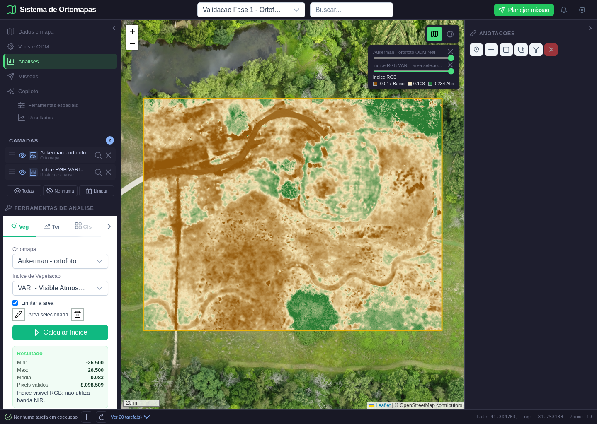
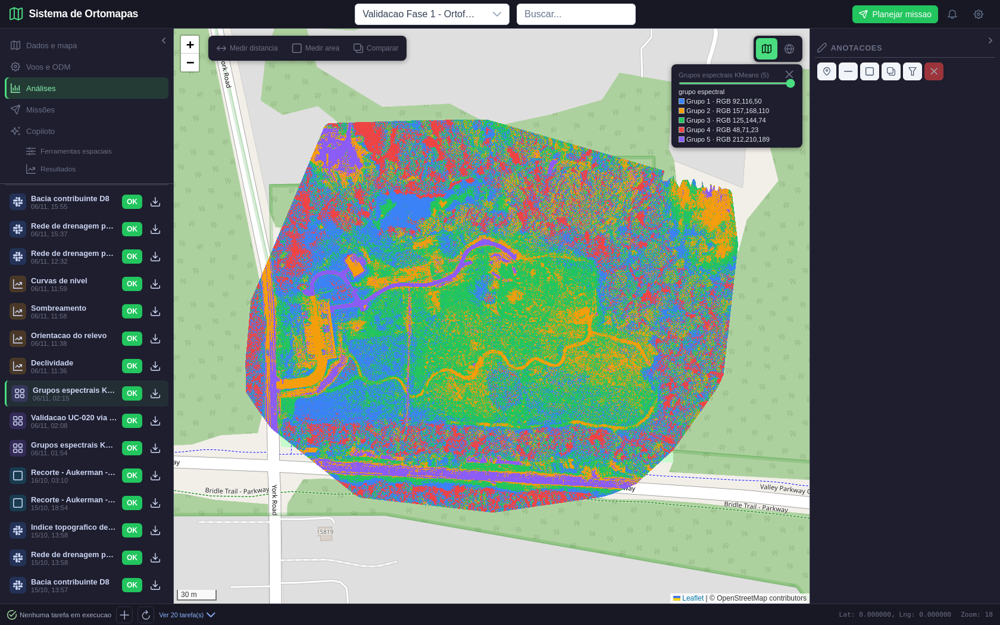
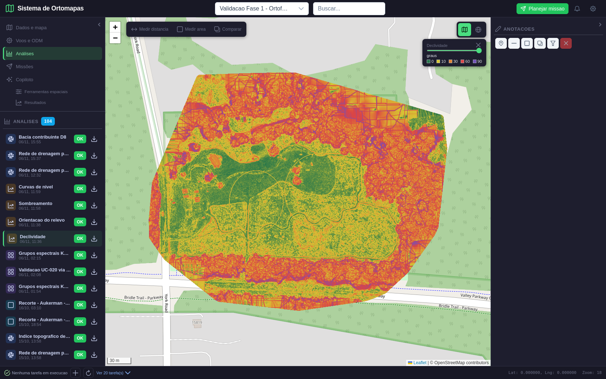
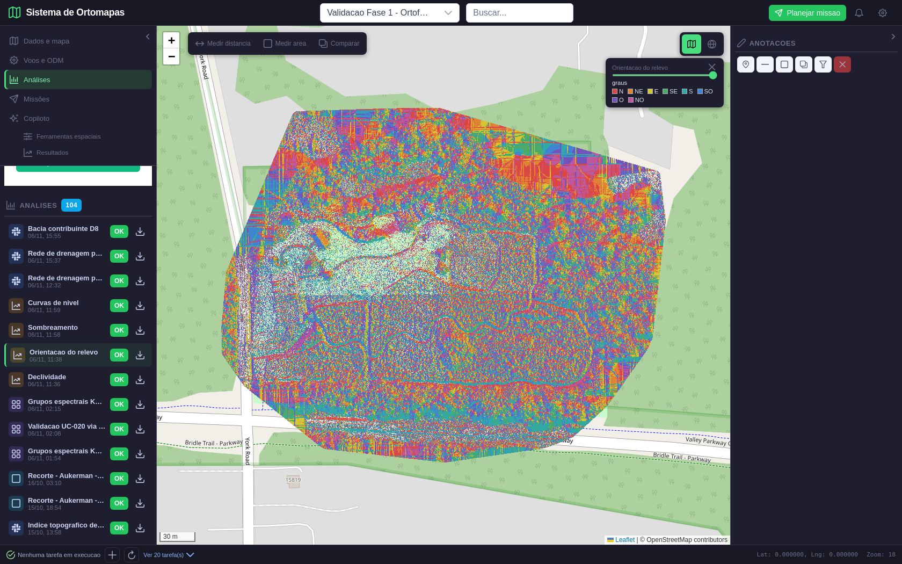
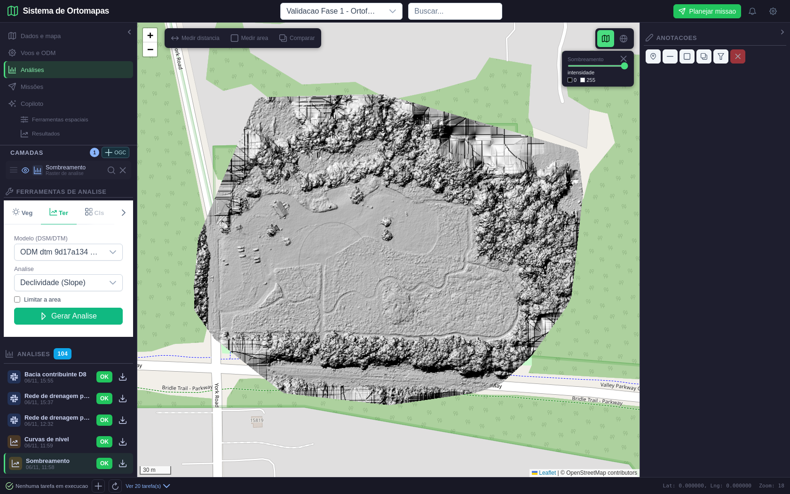
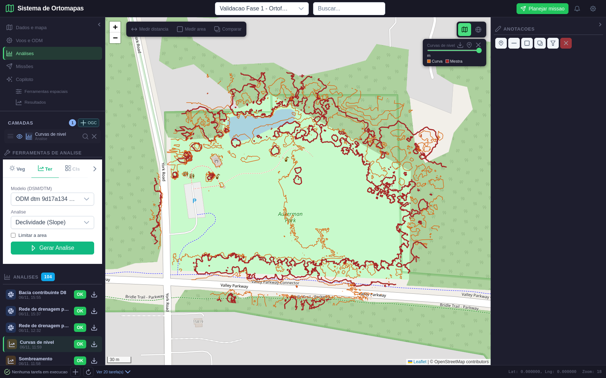
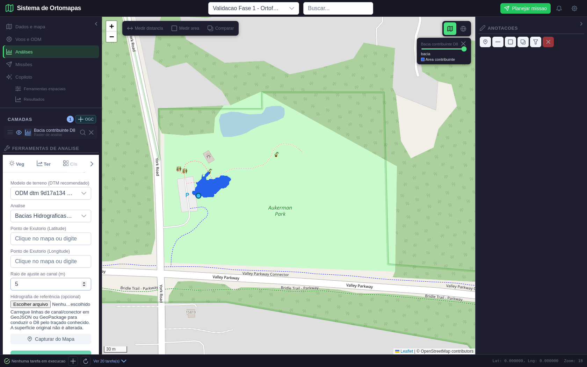
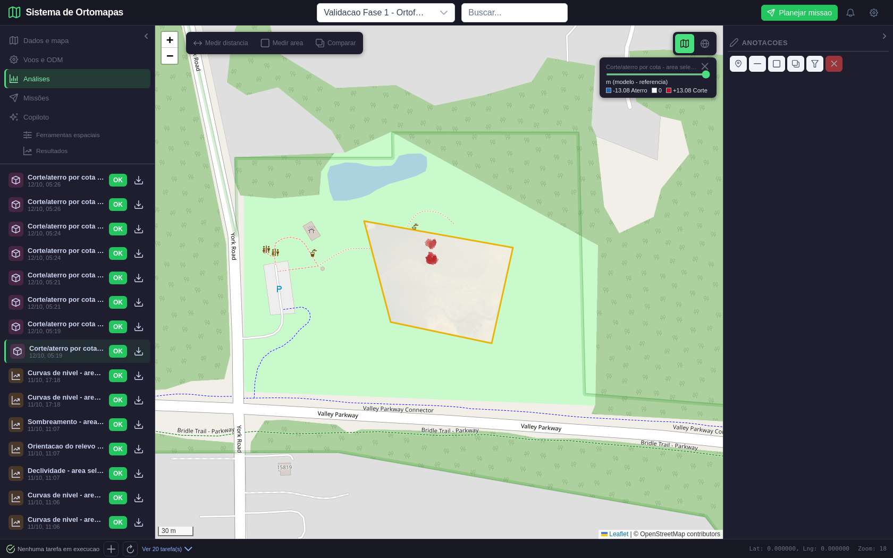
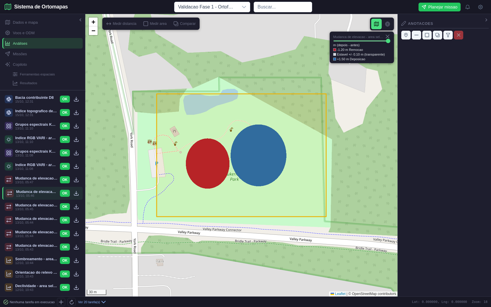

# Fase 6 — validação das análises espaciais e qualidade

**Data da revalidação:** 11/11/2026.
**Resultado da fase:** executada; matriz UC-005–012 atualizada com limites e aceite parcial explícitos.
**Dados:** produtos ODM reais do conjunto público Aukerman, projetos 62 e 64. Não são fotos de Guarajuba nem de um voo do usuário. A campanha DSM #35 contém alterações controladas para validar corte/aterro e sinal de mudança; esses valores não são mudanças observadas no local.
**Método:** auditoria de somente leitura no PostgreSQL e nos GeoTIFF/GeoJSON persistidos, recálculo numérico independente, captura Playwright de oito resultados existentes e inspeção visual das cenas.

## Síntese

As ferramentas geram produtos distintos, com CRS/unidades e vínculo à origem verificados nos casos aplicáveis. VARI, declividade, classificação RGB e volume foram confrontados numericamente com os dados de entrada. Curvas, hillshade, declividade, aspecto, classificação, bacia, volume e mudança apareceram visualmente na UI atual. A interface foi corrigida para que selecionar um resultado também abra a aba da ferramenta correspondente.

Esta execução **não transforma toda a matriz em aceite operacional**. Mudança temporal não foi validada com duas campanhas de campo independentes; K-Means não recebeu rótulos de campo; hidrologia permanece demonstrativa porque não há drenagem de referência na extensão; precisão topográfica dos produtos fotogramétricos não foi aferida por GCP. Esses limites permanecem explícitos na matriz.

## Resultado esperado versus obtido

| UC | Esperado | Obtido nesta auditoria | Parecer |
|---|---|---|---|
| UC-005 — vegetação | Índice RGB matematicamente correto; NIR requerido para NDVI | VARI recalculado temporariamente sobre o ortomosaico real #46 (7.479 × 5.890, EPSG:32617); 317 amostras válidas, erro máximo `1,40×10⁻⁸`; NDVI sem NIR recusado; saída temporária descartada. A tela de resultado real está reproduzida abaixo. | **Aprovado para índices visíveis RGB.** Não afirma saúde vegetal ou valor agronômico de campo. |
| UC-006 — declividade | Derivada em unidade angular correta, CRS e grade preservados | Produtos #116 (DSM) e #117 (DTM), EPSG:32617; fórmula recalculada em 204 e 195 pixels válidos; erro máximo `3,7×10⁻⁶°` e `3,3×10⁻⁶°`; UI raster carregada e tab Terreno selecionada. | **Aprovado como derivada numérica.** Valores próximos a 90° também refletem paredes, vegetação e ruído do DSM; não são declividade de solo certificada. |
| UC-007 — curvas | Linhas em cotas do DSM/DTM, intervalo registrado em metros | GeoJSON da análise #133: 1.573 feições, intervalo de 10 m, cotas 220, 230, 240, 250, 260 e 270 m; captura Playwright mostra as linhas sobre o relevo. | **Aprovado para geração e visualização.** A cota herda a incerteza vertical do DSM fotogramétrico. |
| UC-008 — hillshade | Raster de intensidade com iluminação parametrizada e renderizada | Análise #132, azimute 315°, altitude solar 45°, faixa 0–255, média 154,33; tile e camada visíveis na captura nova. | **Aprovado tecnicamente para visualização.** Não é medição altimétrica. |
| UC-009 — mudanças | Comparação de entradas distintas, área comum, sinal e limiar | Análise #81 compara DSM real #34 com #35 controlado. Validação prévia recalculou pixel a pixel, limite de ±0,10 m, corte `4.851,37 m³`, deposição `9.536,86 m³`, área alterada `10.400,73 m²`; captura atual mostra as zonas vermelha e azul. O segundo DSM foi alterado deliberadamente para controle matemático. | **Parcial.** Cálculo e sinal passam em fixture controlada; não provaram detecção de mudança temporal real. |
| UC-010 — agrupamento | K-Means RGB produz classes categóricas cuja área soma a área válida | Raster #120, cinco rótulos (1–5), 35.538.086 pixels; Playwright mostra a legenda/grupos sobre o ortomosaico real. Contagens por rótulo no manifesto. | **Aprovado para agrupamento espectral não supervisionado.** Rótulos não significam solo, água ou vegetação sem treino/verdade de campo. |
| UC-011 — hidrologia | DTM métrico, exutório documentado, rede/bacia comparada com referência independente | Bacia #143 em DTM real #36; 1.711 células × 0,529026 m² = `905,1637 m²`, igual ao banco; camada visível. Consulta independente anterior não encontrou linha de fluxo ou catchment oficial na extensão Aukerman. | **Demonstrativo; reprovado para aceite operacional.** A área D8 varia fortemente com resolução e não foi calibrada contra bacia levantada. |
| UC-012 — volume | Superfície, AOI e plano de referência explícitos; diferença e integração reproduzíveis | Análise #63, DSM real #34, cota 241 m, 3.479.162 pixels em EPSG:32617. Recálculo float64: acima `1.457,4003 m³`, abaixo `6.817,2069 m³`; diferença pixel a pixel entre saída e DSM−241: `0 m`; UI mostra área, cota e totais. | **Aprovado para a identidade matemática do volume relativo ao plano.** Não certifica volume de obra nem acurácia vertical do DSM. |

## Evidências visuais — um resultado por cena

Cada cena abaixo veio de uma página Playwright nova, sem camada de análise anterior. O teste verificou a mudança de pixels na área do mapa, o item de camada ativo e os tiles autenticados. IDs e respostas detalhadas estão em [`playwright.json`](playwright.json).

### UC-005 — VARI RGB

O mapa usa a ortofoto RGB real e mostra o índice VARI restrito à AOI. A própria UI identifica que o cálculo usa bandas visíveis e não usa NIR. O produto desta captura foi produzido na validação real de outubro; nesta fase, a fórmula também foi recalculada sobre a ortofoto real #46 sem persistir arquivo ou análise.



### UC-010 — K-Means RGB

Cinco grupos espectrais aparecem no mapa e na legenda. A interface identifica os grupos como não supervisionados, sem rótulos semânticos.



### UC-006 — declividade

A legenda está em graus. Ao selecionar “Declividade”, a aba **Terreno** agora é aberta junto com o resultado no mapa.



### UC-006 — orientação do relevo

O raster de aspecto aparece como camada própria; sua legenda indica direções cardeais.



### UC-008 — hillshade

O hillshade renderiza a textura do relevo em escala de cinza. A tela anterior havia sido capturada sem a camada efetivamente visível; a nova cena confirma os pixels do raster no mapa.



### UC-007 — curvas de nível

As linhas vetoriais aparecem sobre o relevo e o painel mostra a ferramenta Terreno. Foram observados 1.573 caminhos SVG na captura anterior; nesta rodada, a área do mapa também mudou visivelmente após abrir a camada.



### UC-011 — bacia D8

A máscara azul representa a bacia calculada para o exutório registrado. A forma é visível, mas a tela por si só não valida sua área física contra hidrografia externa.



### UC-012 — volume por cota

A AOI e as regiões acima/abaixo da cota aparecem sobre a ortofoto; a tela apresenta `1.457,40 m³` acima, `6.817,21 m³` abaixo e área válida de `8.697,90 m²`.



### UC-009 — mudança controlada

O vermelho e o azul representam as alterações `−1,20 m` e `+1,50 m` plantadas na entrada de teste. A captura comprova a camada e a leitura do resultado. **Não representa mudança ocorrida em duas datas reais.**



## Correção encontrada durante a validação

**Problema:** ao abrir um resultado persistido, a camada era exibida, mas a faixa de ferramentas permanecia na aba anteriormente selecionada. Por exemplo, a tela mostrava declividade no mapa enquanto mantinha “Veg” selecionado, confundindo a função consultada com a função visível.

**Correção:** o componente de resultados agora informa o tipo da análise ao workspace; o painel seleciona automaticamente a aba correspondente (Vegetação, Terreno, Classificação, Hidrologia, Mudanças, Volume ou Recorte).

**Verificação:** Playwright abriu oito resultados existentes — #120, #130, #131, #132, #133, #143, #63 e #81 — e confirmou respectivamente Cls, Ter, Ter, Ter, Ter, Hid, Vol e Mud. Cada raster recebeu 25 ou 30 respostas de tile HTTP 200; as curvas foram renderizadas como vetor; a área do mapa mudou entre 126.705 e 540.510 pixels; zero erros JavaScript.

## Reprodução

Com PostgreSQL, API local, Vite e Chromium disponíveis:

```bash
PYTHONPATH=. ./.conda-env/bin/python tests/e2e/playwright/validate_analises_fase6.py
PYTHONPATH=. ./.conda-env/bin/python tests/e2e/playwright/capture_analises_fase6.py
```

O primeiro roteiro inspeciona registros e arquivos, refaz VARI temporariamente, compara declividade por amostras, volume contra `DSM − cota`, contagem de classes/curvas e área da máscara D8. As consultas ao PostgreSQL são somente leitura; a derivada VARI é gravada em diretório temporário. O segundo roteiro somente abre resultados já persistidos e salva oito capturas Playwright.

## Conclusão e pendências

**Fase 6 executada como auditoria da matriz UC-005–012.** Os produtos disponíveis passaram nos critérios numéricos/visuais próprios listados acima. Isto **não** declara aprovados os requisitos científicos que carecem de verdade de campo ou de campanhas reais distintas.

Continuam limitados: classificação semântica do UC-010, detecção temporal real do UC-009, validação de campo/GCP para métricas do terreno e calibração hidrográfica do UC-011. O modelo de mudança #35 e as áreas/cotas de volume servem à prova do algoritmo, não a decisão de obra.

**Próxima etapa do plano: Fase 7 de 8 — Copiloto, conversas e ferramentas.** Avaliar continuidade e isolamento do contexto por usuário, vínculo do projeto, ferramentas com entrada/saída reais, confirmação antes de escrita e respostas sem invenções.
