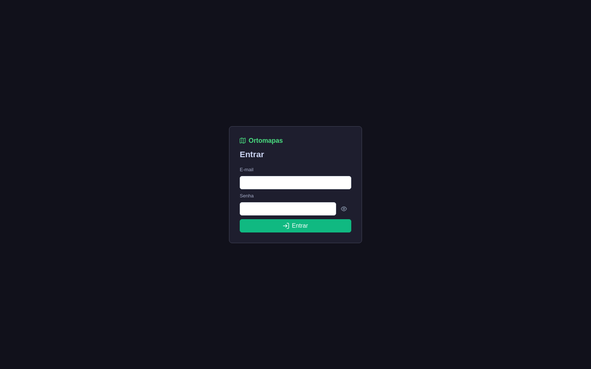
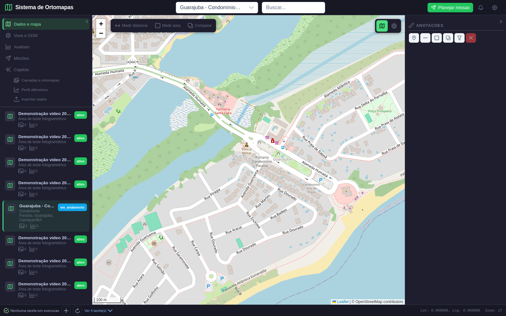
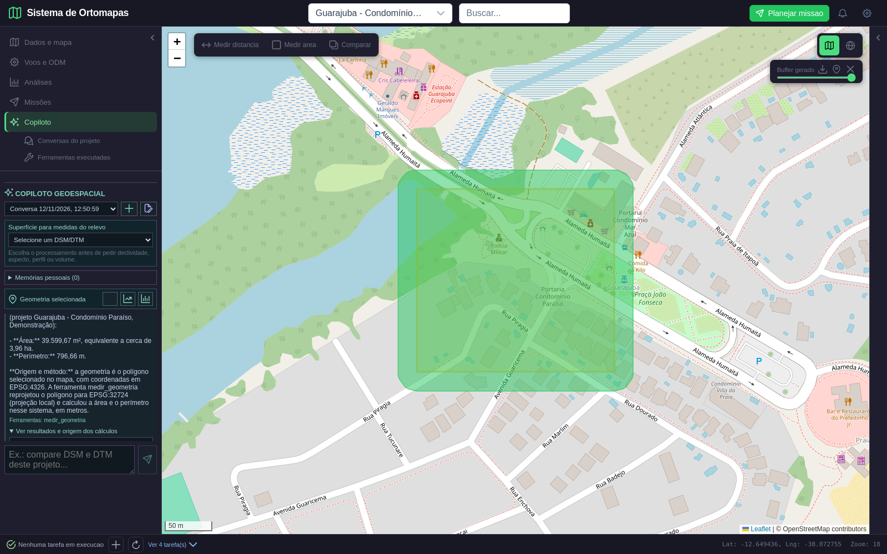
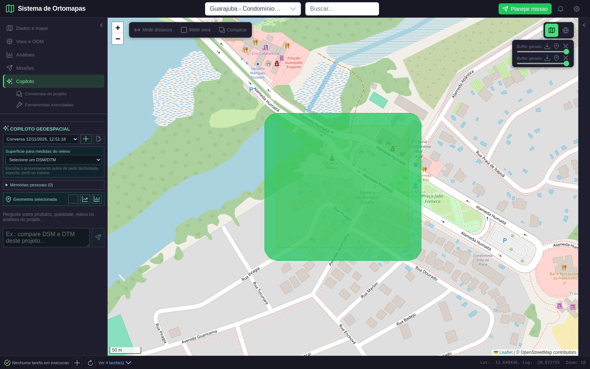
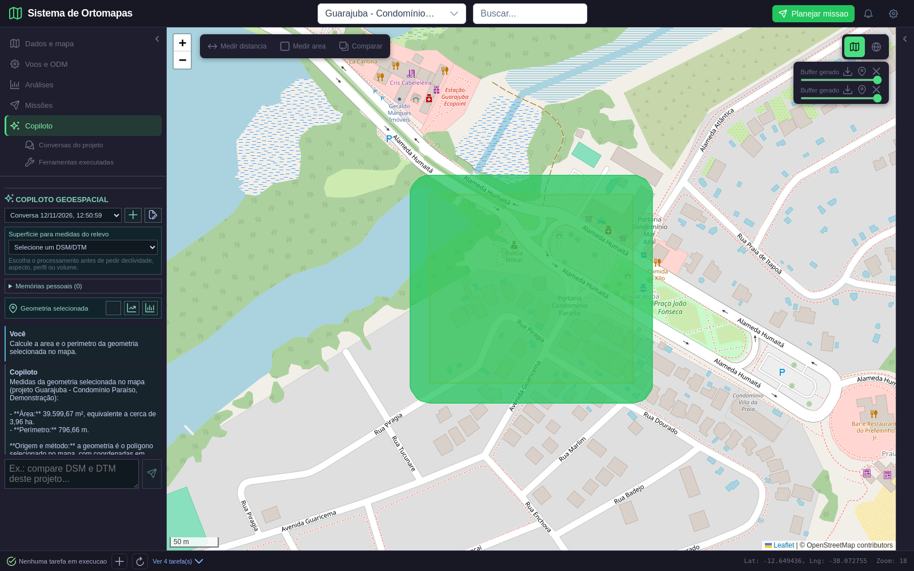
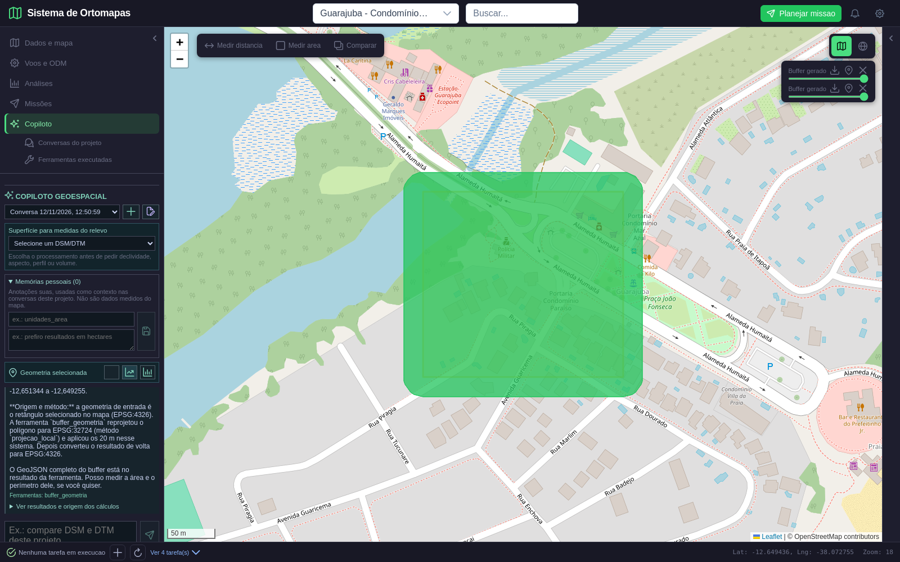
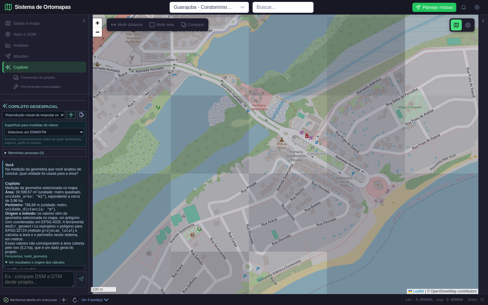

# Validação da Fase 7 — Copiloto, conversas e ferramentas

**Data:** 12/11/2026
**Status:** aprovada no escopo executado; não representa aceite operacional integral do Copiloto.
**Aplicação:** Ortomapas Web, build local; API em `127.0.0.1:8888`, frontend em `127.0.0.1:5176`.
**Modelo usado no fluxo real:** Anthropic `claude-sonnet-5-5`, conforme configuração local. A chave não foi registrada neste documento nem no repositório.

## Escopo e critério

Esta fase verifica que o usuário consegue conversar no contexto do projeto, obter medidas a partir de geometria desenhada, retomar o contexto, revisar evidências de ferramentas, pedir uma operação espacial sem persistência automática, aprovar a gravação, separar conversas e memórias e manter a privacidade entre contas.

O critério esperado era: valores derivados da ferramenta determinística e identificados com unidades/CRS; histórico recuperável; escrita somente após ação explícita; dados privados inacessíveis a outra conta; nenhuma exceção de JavaScript no fluxo.

## Dados e limites da demonstração

Foi usado o projeto **“Guarajuba - Condomínio Paraíso (Demonstração)”**, ID 51, associado à conta de teste `user42`. A área desenhada durante o teste é uma geometria de interação no mapa e **não** um levantamento de campo. Os produtos de ortofoto/elevação associados ao projeto são dados sintéticos de demonstração; portanto, esta prova não valida acurácia fotogramétrica, altimetria real, conteúdo do condomínio ou qualidade de voo. O mapa de fundo é usado para orientar a interface.

O banco indicava 5,2 ha de cobertura do voo. A ferramenta mediu o polígono desenhado como **39.599,67 m² (3,96 ha)** e perímetro **796,66 m**, reprojetando de EPSG:4326 para **EPSG:32724**. A resposta distinguiu explicitamente a área da geometria da área geral do voo. O buffer de 20 m foi calculado em ferramenta e persistiu somente depois do clique em “Salvar camada no projeto”.

## Roteiro, resultado esperado e obtido

| Passo | Esperado | Obtido | Evidência |
|---|---|---|---|
| Login | Tela de autenticação e sessão autenticada | Login concluído; `/auth/me` confirmou a identidade | [Tela 1](fase7_01_login.png) |
| Selecionar projeto | Projeto Guarajuba visível no mapa | Projeto ID 51 selecionado | [Tela 2](fase7_02_projeto.png) |
| Desenhar e selecionar AOI | Polígono aparece e pode ser usado como contexto | Polígono desenhado e selecionado no mapa | [Tela 3](fase7_03_geometria_selecionada.png) |
| Pedir medição | Área/perímetro em unidade métrica, com CRS e ferramenta identificados | 39.599,67 m²; 796,66 m; EPSG:32724; evidência `medir_geometria` disponível | [Tela 4](fase7_04_medicao_com_evidencia.png) |
| Retomar contexto | Pergunta seguinte usa medição anterior e distingue área do voo | Sonnet respondeu unidade e origem; separou os 3,96 ha medidos dos 5,2 ha de cobertura do voo | [Tela 5](fase7_05_retomada_contexto.png) |
| Pré-visualizar buffer | Resultado espacial exibido sem gravação automática | Buffer de 20 m retornado; API mostrou a mesma contagem de camadas antes da aprovação | [Tela 6](fase7_06_buffer_pendente.png) |
| Aprovar persistência | Um clique explícito grava exatamente uma camada | Clique gravou a camada ID 8; API confirmou +1 camada. Havia camada histórica de buffer #7, preservada | [Tela 7](fase7_07_buffer_salvo.png) |
| Nova conversa | Conversa nova sem misturar mensagens | Thread independente criada | [Tela 8](fase7_08_nova_conversa.png) |
| Alternar conversa | Histórico anterior reaparece | A conversa anterior foi reaberta com 4 mensagens persistidas | [Tela 9](fase7_09_troca_conversa.png) |
| Criar/apagar memória pessoal | Memória fica disponível ao próprio usuário e pode ser removida | Memória de teste confirmada pela API e excluída pela interface | [Tela 10](fase7_10_memoria_salva.png), [tela 11](fase7_11_memoria_excluida.png) |
| Isolamento | Outra conta não lê conversa privada | Conta descartável autenticou; requisição à thread alheia recebeu HTTP 404 | [Tela 12](fase7_12_privacidade.png) |
| Formatação | Resposta legível, sem marcadores Markdown crus | Resposta real gravada foi reproduzida em thread temporária para validar a renderização; negrito, lista e código formataram corretamente | [Tela 13 — replay de UI](fase7_13_resposta_formatada_replay.png) |

A tela 13 é um **replay da resposta real já registrada**, sem chamada adicional ao modelo. As telas 1–12 são capturas do fluxo Playwright executado contra a aplicação e API locais.

## Defeito detectado e correção

Na primeira execução exploratória, o clique “Nova conversa” passou o evento do navegador como argumento da função e a guarda de concorrência tratou esse evento como uma requisição obsoleta. A conversa era criada, mas não ficava selecionada; a mensagem da interface não aparecia. O problema foi corrigido chamando explicitamente `newThread()` e controlando a geração das requisições assíncronas. Também foi corrigida a comparação de IDs de projeto como números e o estado da interface passou a impedir envio/troca enquanto a thread está carregando.

A validação visual revelou ainda que a resposta mostrava `**Markdown**` literalmente e a área de mensagens era curta. Foi adicionada renderização limitada e escapada para texto, listas, negrito e código, e aumentada a área visível. O replay posterior usou exatamente o texto retornado na execução real e confirmou a correção sem novo consumo de modelo.

## Uso do modelo e auditoria de custo

No fluxo final bem-sucedido foram feitas **3 interações**, com 2 chamadas de modelo por interação: **6 chamadas**, 22.689 tokens de entrada, 1.957 de saída e custo estimado interno de **US$ 0,064948**. Os três registros de uso vieram completos. A estimativa é a métrica implementada no aplicativo, não é fatura do provedor.

Houve também uma execução exploratória inicial malsucedida da interface: HTTP 200 do endpoint, mas nenhuma mensagem apresentada devido ao defeito acima. O registro de auditoria apontou 2 chamadas, 8.233 tokens de entrada, 677 de saída e **US$ 0,023236 estimados**. Ela foi incluída no total da fase: **8 chamadas, 30.922 tokens de entrada, 2.634 de saída, US$ 0,088184 estimados**. A thread vazia criada por essa tentativa foi removida. Não se ocultou esse custo do relatório.

## Limpeza e integridade

- Camada temporária criada no fluxo removida ao fim (HTTP 200).
- Duas threads temporárias removidas; memória de teste removida; conta descartável removida.
- Não foram encontrados erros JavaScript no navegador.
- A camada preexistente #7 foi preservada; não pertence ao teste atual.
- Os registros de auditoria de uso foram mantidos para rastreabilidade.
- O resultado detalhado do Playwright está em [fase7_result.json](fase7_result.json); o roteiro reproduzível está em [capture_copilot_fase7.py](../../../../tests/e2e/playwright/capture_copilot_fase7.py). O replay visual sem chamada LLM está em [replay_copilot_fase7_format.py](../../../../tests/e2e/playwright/replay_copilot_fase7_format.py).

## Verificações técnicas complementares

- `npm run build`: aprovado (427 módulos transformados). O Vite mantém aviso de chunk JavaScript acima de 500 kB; o build termina com sucesso.
- `py_compile` dos módulos do Copiloto, testes e roteiros Playwright: aprovado.
- Testes unitários pytest: não executados neste ambiente porque o pacote `pytest` não está instalado nem no `.conda-env` do projeto nem no ambiente `stats`.
- `git diff --check` dos arquivos textuais: aprovado; PDFs são binários e foram verificados com `pdfinfo`, `pdftotext` e `pdfimages`.

## Veredito e limites restantes

**Aprovado nesta fase** para: contexto conversacional do fluxo medido; uso de ferramenta geométrica; evidência da origem dos valores; preview espacial; confirmação explícita de gravação; persistência/alternância de threads; memória pessoal CRUD; isolamento da thread entre contas; formatação básica e ausência de erros JS no roteiro.

**Não demonstrado por esta fase:** qualidade factual geral do modelo em prompts abertos; memória automática de longo prazo; RAG (continua postergado); resumo de conversas; todos os tools/UCs; testes de carga, indisponibilidade do provedor, timeout/retry, limites adversariais; precisão de ortofotos/DSM/DTM reais de Guarajuba. Não declarar o Copiloto pronto para uso operacional integral com base somente nesta fase.

## Próxima etapa

**Fase 8 de 8 — Robustez e aceite final.** Reconciliar matriz de casos de uso com o código e a interface; executar fluxos ponta a ponta repetíveis em dados reais e sintéticos identificados; cobrir falha/timeouts e retomada com segurança; revisar telemetria sem segredo; consolidar pendências e emitir o aceite final somente se todos os critérios mandatórios passarem.

## Apêndice — capturas do fluxo

Capturas 1–12 vieram do roteiro Playwright ao vivo. A captura 13 é replay local da resposta real para conferir apenas a formatação visual, sem uma nova chamada LLM.

### 1. Login

### 2. Projeto selecionado

### 3. Geometria desenhada e selecionada

### 4. Resultado de medição e evidência

### 5. Continuidade de contexto

### 6. Buffer antes da aprovação

### 7. Buffer após salvar

### 8. Conversa nova

### 9. Conversa restaurada

### 10. Memória criada

### 11. Memória removida

### 12. Verificação de privacidade

### 13. Resposta formatada — replay sem chamada de modelo

