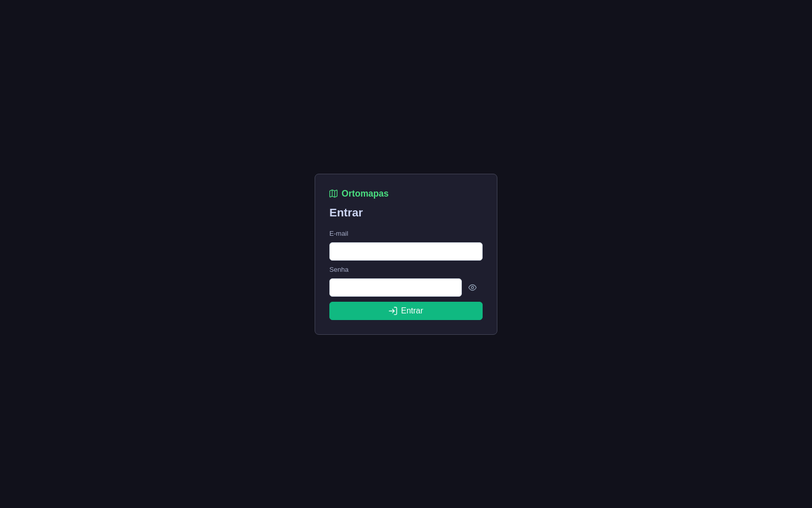
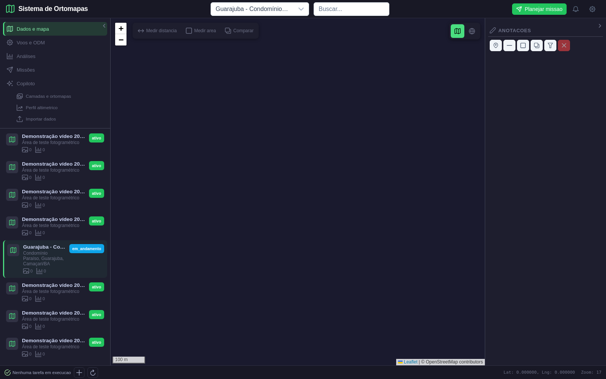
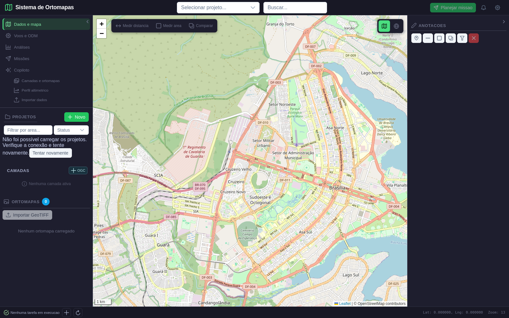
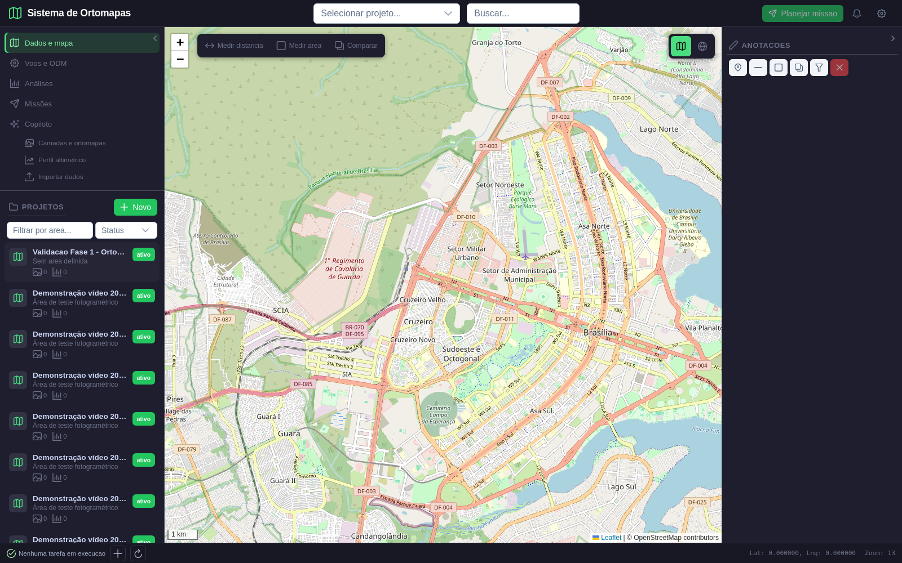
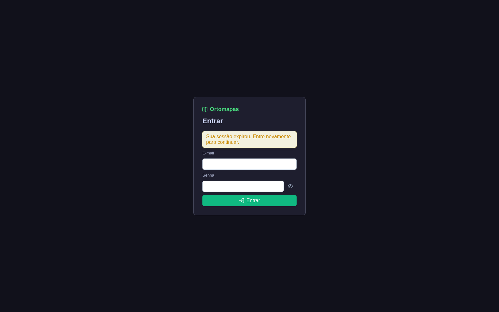
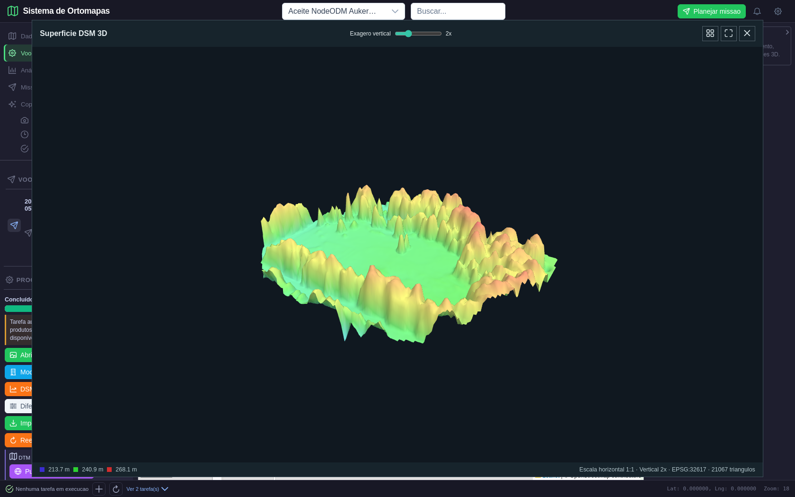
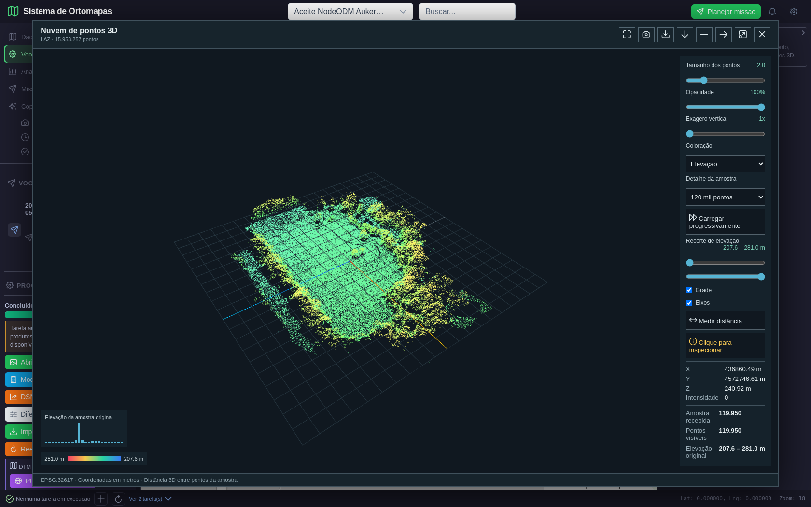
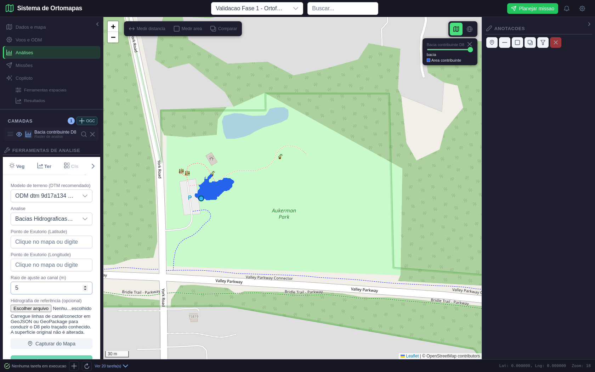

# Fase 8 de 8 — Robustez e aceite final

**Execução:** 12/11/2026
**Estado:** validação de robustez parcial aprovada; aceite operacional geral ainda não concedido.
**Projeto de teste:** “Guarajuba - Condomínio Paraíso (Demonstração)”, ID 51.
**Chamadas ao modelo de linguagem:** zero.

## Objetivo e limites

Esta rodada cobre falhas de autenticação, upload inválido, indisponibilidade simulada da API e recuperação, com captura de tela. A indisponibilidade 503 foi injetada no navegador para uma requisição de listagem; não derrubei o backend nem o PostgreSQL. O produto de Guarajuba segue sendo um projeto de demonstração e não valida a precisão de produtos fotogramétricos locais.

O plano da Fase 8 ainda exige um percurso integrado final reproduzível, incluindo produtos/mapa/análise/exportação, falhas de processamento prolongado e revisão final da matriz. Por isso, os testes abaixo aprovam estes cenários, mas não fecham sozinhos o aceite operacional do sistema.

## Cenários, esperado e obtido

| ID | Resultado esperado | Resultado obtido | Situação |
|---|---|---|---|
| F8-01 — sessão válida | Login, projeto carregado e mapa visível | `/api/projetos` respondeu HTTP 200; projeto 51 e mapa carregaram | Aprovado |
| F8-02 — token inválido | API nega acesso sem dados privados | `/auth/me` respondeu HTTP 401 | Aprovado |
| F8-03 — upload inválido | GeoTIFF corrompido é rejeitado e limpo | HTTP 400; contagem de ortomapas ficou 4 → 4; nenhum arquivo órfão | Aprovado |
| F8-04 — API indisponível | Mensagem diferencia falha de lista vazia e permite retentar | 503 simulado; aviso acionável apareceu; botão “Tentar novamente” recuperou projeto sem reload | Aprovado após correção |
| F8-05 — sessão expirada | Token removido, tela de login apresentada e usuário informado | Token inválido foi limpo; login reapareceu com aviso “Sua sessão expirou”; zero erros JS | Aprovado após correção |
| F8-06 — prontidão/telemetria | API e dependências reportam estado observável | `/health/ready`: database=true e language_model=true. `/health/metrics`: 303 requisições, 0 erros 5xx, latência média 245,76 ms naquele instante | Aprovado como fotografia local; métricas são acumuladas em memória |

Os números de telemetria são uma observação pontual deste processo local, não uma garantia de monitoramento persistente. O dashboard/Prometheus e a retenção após reinício não foram reavaliados nesta rodada.

## Defeitos encontrados e correções

1. **401 sem encerramento da sessão:** com token inválido, a API negava acesso, mas o frontend mantinha o shell autenticado e o token. O cliente agora remove o token e emite evento de sessão inválida; a aplicação valida a sessão antes de montar o mapa e retorna ao login com aviso. Isso também evita uma corrida do Leaflet durante desmontagem inicial.
2. **503 apresentado como lista vazia:** a lista de projetos agora separa falha de carregamento de estado vazio, apresenta alerta e botão de nova tentativa. O retry recuperou o projeto após retirar a falha simulada.
3. **Upload GeoTIFF inválido:** o endpoint já rejeitou o conteúdo antes de gravar metadados e removeu o arquivo temporário; a prova comparou banco e diretório antes/depois.

## Evidências e reprodução

O resultado estruturado do roteiro está em [fase8_result.json](fase8_result.json), e o Playwright reproduz os cenários sem chamar o LLM em [capture_fase8_resilience.py](../../../../tests/e2e/playwright/capture_fase8_resilience.py).

### Tela 1 — login antes da autenticação

### Tela 2 — projeto carregado e mapa visível

### Tela 3 — API indisponível, aviso e ação de retry

### Tela 4 — projeto recuperado pelo retry

### Tela 5 — sessão expirada e aviso ao usuário

## Verificações técnicas

- `npm run build`: passou com 427 módulos; continua o aviso Vite de bundle JavaScript acima de 500 kB.
- Playwright: todos os cinco cenários deste recorte passaram; `page_errors` vazio.
- Nenhum uso do Sonnet/LM Studio ocorreu.
- A verificação do pytest da fase anterior continua limitada porque pytest não está instalado no Conda do projeto nem no ambiente `stats`.

## Conclusão provisória e pendências da Fase 8

**Aprovado:** os cenários F8-01 a F8-06 no escopo acima e as correções de sessão/retry. O backend e PostgreSQL estavam prontos durante a execução.

**Aceite operacional integral permanece pendente:**

- executar roteiro integrado final em projeto de validação controlado, juntando produtos ODM, visualização 2D/3D, análise e exportação em sequência única e repetir abertura/recarga;
- testar timeout e recuperação de tarefa longa contra fixture NodeODM (há evidência específica na Fase 3, mas não foi reexecutada nesta rodada);
- validar a publicação/continuidade do monitoramento após reinício, sem depender apenas de métricas em memória;
- executar o conjunto automatizado Python após disponibilizar pytest no ambiente definido, sem atualizar dependências durante esta rodada;
- reconciliar cada UC obrigatório com evidência das fases 1–8 e registrar explicitamente exclusões/limitações de dados sintéticos, acurácia e RAG.

**Próxima subetapa:** Fase 8 de 8 — executar o roteiro ponta a ponta em um novo projeto controlado e concluir a matriz final. Até concluir essa subetapa, o Ortomapas não deve ser declarado operacionalmente aceito em sua totalidade.

## Reexecução integrada sobre produtos persistidos

Depois dos cenários de resiliência, reexecutei os roteiros existentes de mapa 2D/exportação, visualização 3D e auditoria numérica. Eles são somente leitura: os produtos vieram do dataset público ODM Aukerman e permaneceram nos projetos 62 e 64; os dois projetos contêm produtos do mesmo conjunto público, mas **não são um único projeto integrado recém-criado**.

| Ramo | Esperado | Obtido | Evidência |
|---|---|---|---|
| Mapa 2D e comparação — projeto 62 | Ortofoto/DSM/DTM com tiles, opacidade e dois modos de comparação | 25/25 tiles HTTP 200; opacidade 45%; deslizador e lado a lado passaram; console JS sem erros na repetição diagnóstica | [Manifesto e capturas](integracao-2d/manifest.json) |
| Exportação — projeto 62 | GeoTIFF íntegro, CRS e limites preservados | HTTP 200; 93.824.935 bytes; 7.470 × 5.924 px, 4 bandas, EPSG:32617; erro de bounds 0 m e aviso de sucesso na interface | [Captura da exportação](integracao-2d/07_resultado_exportacao_na_interface.png) |
| Visualizadores — projeto 64/processamento 15 | Abrir GLB, DSM, DTM e LAZ; confrontar dados com fontes | Quatro visualizadores passaram; 264.860 triângulos/56 materiais no GLB; DSM/DTM EPSG:32617; LAZ com 15.953.257 pontos totais e amostra de 119.950; nenhum erro JS | [Manifesto 3D e capturas](integracao-3d/manifest.json) |
| Análises persistidas | Resultado coerente com cálculo independente e grade/unidades | Auditoria read-only aprovada; detalhes numéricos abaixo | [Manifesto da auditoria](integracao-analises/manifest.json) |

Na primeira repetição 2D, iniciada enquanto o Vite acabava de reconstruir o frontend, o navegador reportou erros Leaflet e chamadas que excederam timeout. Após o HMR estabilizar, uma reexecução diagnóstica do mesmo roteiro concluiu com `browser_errors` vazio e todos os checks aprovados. Foram registrados 19 tiles OSM abortados ao mudar o enquadramento e duas consultas de análises canceladas ao encerrar a página; os 25 tiles do produto e a exportação retornaram com sucesso. Este comportamento deve ser confirmado no roteiro final com a aplicação iniciada de forma estável.

### Resultado numérico independente das análises

- **VARI RGB:** 317 amostras válidas; erro absoluto máximo `1.395e-8`; NDVI sem banda NIR foi rejeitado. A saída de recálculo ficou em diretório temporário.
- **Declividade:** 204/240 amostras válidas na fonte 47, erro máximo `3.694e-6 graus`; 195/240 na fonte 48, erro máximo `3.265e-6 graus`; grade e EPSG:32617 preservados.
- **Volume:** saída raster comparada célula a célula à diferença da superfície pela cota de referência de 241 m; erro máximo `0 m`; volumes independentes: 1.457,400 m³ acima e 6.817,207 m³ abaixo.
- **Curvas:** 1.573 feições persistidas e equidistância de 10 m, com cotas de 220 a 270 m.
- **Bacia D8:** 1.711 células × 0,529026 m² = 905,164 m², igual ao valor persistido. **Ainda sem referência hidrográfica independente local**, portanto permanece demonstração, não aceite hidrológico operacional.
- **K-means:** rótulos 1 a 5 e pixels conferidos; **acurácia semântica não avaliada** por falta de rótulos de campo.
- **Mudança de elevação:** fixture controlada confere sinal, AOI e contas, mas não demonstra detecção temporal entre duas datas reais.

As capturas suplementares da sequência aparecem a seguir. Para a tela da bacia, a geometria é um produto demonstrativo no Parque Aukerman; ela não representa Guarajuba.

### 6. Ortofoto ODM real no mapa 2D

### 7. Superfície DSM 3D

### 8. Nuvem de pontos LAZ 3D

### 9. Produto de bacia D8 exibido no mapa

## Estado atualizado da Fase 8

**Aprovado:** resiliência F8-01–06; fluxo visual 2D, exportação e controles; visualizadores 3D; rechecagem matemática independente das análises no escopo declarado. Os roteiros repetidos não chamaram o modelo.

**Ainda pendente para aceite final:** não foi criada uma nova missão ODM neste recorte. A evidência de novo projeto e processamento real existe na Fase 3, enquanto a repetição 2D, 3D e auditoria analítica usa os projetos 62 e 64 separadamente. Falta uma sessão única, limpa e reproduzível que percorra o mesmo projeto novo desde imagens/NodeODM até produto, visualização, análise e exportação. Também falta verificar métricas persistentes depois de reiniciar a API/stack e executar pytest no ambiente de automação definido.

**Próxima subetapa: Fase 8 de 8 — aceite ponta a ponta em um novo projeto controlado e reconciliação final da matriz.** Usar o conjunto público Aukerman (identificado como dataset de teste, não Guarajuba), concluir o ciclo ODM e então verificar produto derivado, mapa, análise e exportação no mesmo projeto; fechar o aceite somente após as verificações de retomada/monitoramento.
