# Fase 8 de 8 — Robustez e aceite final

**Execução:** 12/11/2026
**Estado:** validação de robustez parcial aprovada; aceite operacional geral ainda não concedido.
**Projeto de teste:** “Guarajuba - Condomínio Paraíso (Demonstração)”, ID 51.
**Chamadas ao modelo de linguagem:** zero.

## Objetivo e limites

Esta rodada cobre falhas de autenticação, upload inválido, indisponibilidade simulada da API e recuperação, com captura de tela. A indisponibilidade 503 foi injetada no navegador para uma requisição de listagem; não derrubei o backend nem o PostgreSQL. O produto de Guarajuba segue sendo um projeto de demonstração e não valida a precisão de produtos fotogramétricos locais.

O plano da Fase 8 ainda exige um percurso integrado final reproduzível, incluindo produtos/mapa/análise/exportação, falhas de processamento prolongado e revisão final da matriz. Por isso, os testes abaixo aprovam estes cenários, mas não fecham sozinhos o aceite operacional do sistema.

## Cenários, esperado e obtido

| ID | Resultado esperado | Resultado obtido | Situação |
|---|---|---|---|
| F8-01 — sessão válida | Login, projeto carregado e mapa visível | `/api/projetos` respondeu HTTP 200; projeto 51 e mapa carregaram | Aprovado |
| F8-02 — token inválido | API nega acesso sem dados privados | `/auth/me` respondeu HTTP 401 | Aprovado |
| F8-03 — upload inválido | GeoTIFF corrompido é rejeitado e limpo | HTTP 400; contagem de ortomapas ficou 4 → 4; nenhum arquivo órfão | Aprovado |
| F8-04 — API indisponível | Mensagem diferencia falha de lista vazia e permite retentar | 503 simulado; aviso acionável apareceu; botão “Tentar novamente” recuperou projeto sem reload | Aprovado após correção |
| F8-05 — sessão expirada | Token removido, tela de login apresentada e usuário informado | Token inválido foi limpo; login reapareceu com aviso “Sua sessão expirou”; zero erros JS | Aprovado após correção |
| F8-06 — prontidão/telemetria | API e dependências reportam estado observável | `/health/ready`: database=true e language_model=true. `/health/metrics`: 303 requisições, 0 erros 5xx, latência média 245,76 ms naquele instante | Aprovado como fotografia local; métricas são acumuladas em memória |

Os números de telemetria são uma observação pontual deste processo local, não uma garantia de monitoramento persistente. O dashboard/Prometheus e a retenção após reinício não foram reavaliados nesta rodada.

## Defeitos encontrados e correções

1. **401 sem encerramento da sessão:** com token inválido, a API negava acesso, mas o frontend mantinha o shell autenticado e o token. O cliente agora remove o token e emite evento de sessão inválida; a aplicação valida a sessão antes de montar o mapa e retorna ao login com aviso. Isso também evita uma corrida do Leaflet durante desmontagem inicial.
2. **503 apresentado como lista vazia:** a lista de projetos agora separa falha de carregamento de estado vazio, apresenta alerta e botão de nova tentativa. O retry recuperou o projeto após retirar a falha simulada.
3. **Upload GeoTIFF inválido:** o endpoint já rejeitou o conteúdo antes de gravar metadados e removeu o arquivo temporário; a prova comparou banco e diretório antes/depois.

## Evidências e reprodução

O resultado estruturado do roteiro está em [fase8_result.json](fase8_result.json), e o Playwright reproduz os cenários sem chamar o LLM em [capture_fase8_resilience.py](../../../../tests/e2e/playwright/capture_fase8_resilience.py).

### Tela 1 — login antes da autenticação

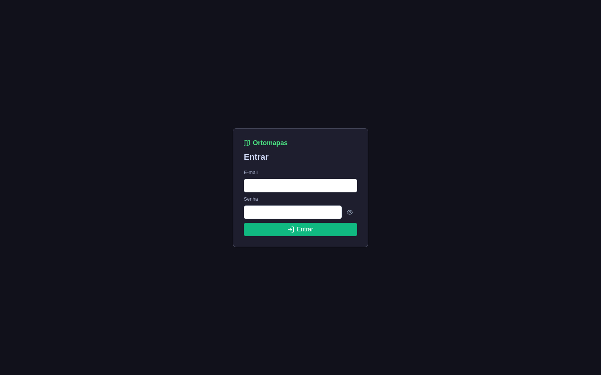

### Tela 2 — projeto carregado e mapa visível

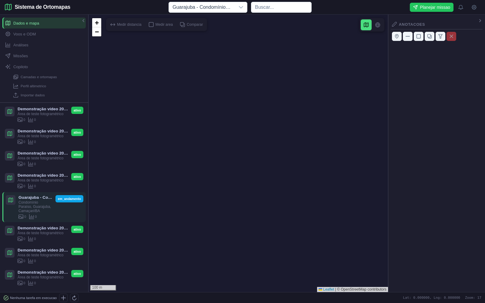

### Tela 3 — API indisponível, aviso e ação de retry

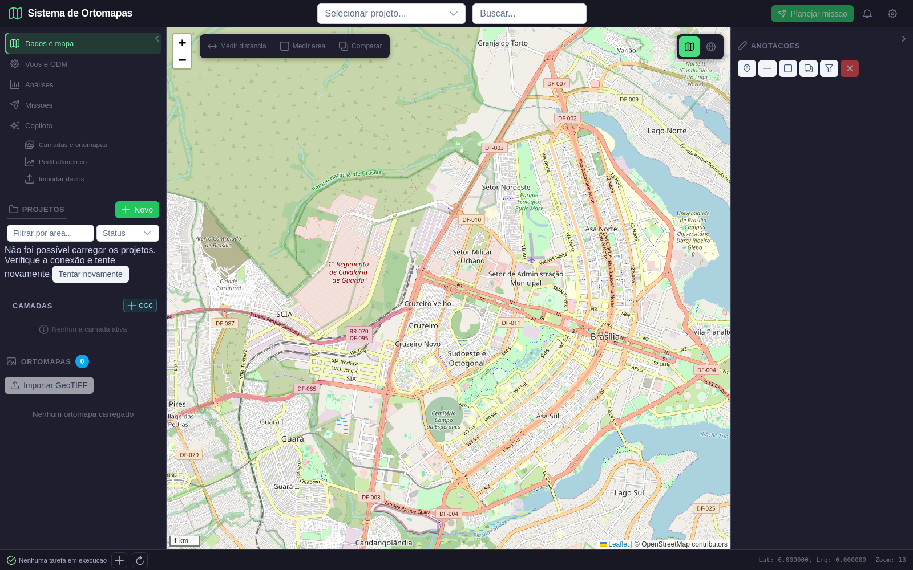

### Tela 4 — projeto recuperado pelo retry

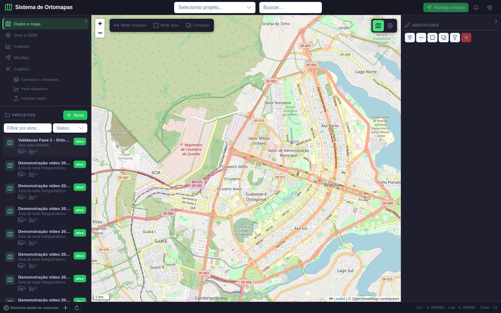

### Tela 5 — sessão expirada e aviso ao usuário

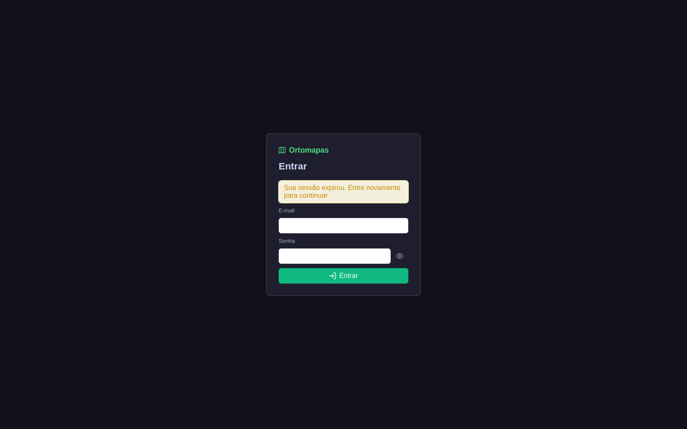

## Verificações técnicas

- `npm run build`: passou com 427 módulos; continua o aviso Vite de bundle JavaScript acima de 500 kB.
- Playwright: todos os cinco cenários deste recorte passaram; `page_errors` vazio.
- Nenhum uso do Sonnet/LM Studio ocorreu.
- A verificação do pytest da fase anterior continua limitada porque pytest não está instalado no Conda do projeto nem no ambiente `stats`.

## Conclusão provisória e pendências da Fase 8

**Aprovado:** os cenários F8-01 a F8-06 no escopo acima e as correções de sessão/retry. O backend e PostgreSQL estavam prontos durante a execução.

**Aceite operacional integral permanece pendente:**

- executar roteiro integrado final em projeto de validação controlado, juntando produtos ODM, visualização 2D/3D, análise e exportação em sequência única e repetir abertura/recarga;
- testar timeout e recuperação de tarefa longa contra fixture NodeODM (há evidência específica na Fase 3, mas não foi reexecutada nesta rodada);
- validar a publicação/continuidade do monitoramento após reinício, sem depender apenas de métricas em memória;
- executar o conjunto automatizado Python após disponibilizar pytest no ambiente definido, sem atualizar dependências durante esta rodada;
- reconciliar cada UC obrigatório com evidência das fases 1–8 e registrar explicitamente exclusões/limitações de dados sintéticos, acurácia e RAG.

**Registro histórico (antes de F8-07):** a próxima subetapa planejada era executar o roteiro ponta a ponta em um novo projeto controlado e concluir a matriz final. Até concluir essa subetapa, o Ortomapas não deve ser declarado operacionalmente aceito em sua totalidade.

## Reexecução integrada sobre produtos persistidos

Depois dos cenários de resiliência, reexecutei os roteiros existentes de mapa 2D/exportação, visualização 3D e auditoria numérica. Eles são somente leitura: os produtos vieram do dataset público ODM Aukerman e permaneceram nos projetos 62 e 64; os dois projetos contêm produtos do mesmo conjunto público, mas **não são um único projeto integrado recém-criado**.

| Ramo | Esperado | Obtido | Evidência |
|---|---|---|---|
| Mapa 2D e comparação — projeto 62 | Ortofoto/DSM/DTM com tiles, opacidade e dois modos de comparação | 25/25 tiles HTTP 200; opacidade 45%; deslizador e lado a lado passaram; console JS sem erros na repetição diagnóstica | [Manifesto e capturas](integracao-2d/manifest.json) |
| Exportação — projeto 62 | GeoTIFF íntegro, CRS e limites preservados | HTTP 200; 93.824.935 bytes; 7.470 × 5.924 px, 4 bandas, EPSG:32617; erro de bounds 0 m e aviso de sucesso na interface | [Captura da exportação](integracao-2d/07_resultado_exportacao_na_interface.png) |
| Visualizadores — projeto 64/processamento 15 | Abrir GLB, DSM, DTM e LAZ; confrontar dados com fontes | Quatro visualizadores passaram; 264.860 triângulos/56 materiais no GLB; DSM/DTM EPSG:32617; LAZ com 15.953.257 pontos totais e amostra de 119.950; nenhum erro JS | [Manifesto 3D e capturas](integracao-3d/manifest.json) |
| Análises persistidas | Resultado coerente com cálculo independente e grade/unidades | Auditoria read-only aprovada; detalhes numéricos abaixo | [Manifesto da auditoria](integracao-analises/manifest.json) |

Na primeira repetição 2D, iniciada enquanto o Vite acabava de reconstruir o frontend, o navegador reportou erros Leaflet e chamadas que excederam timeout. Após o HMR estabilizar, uma reexecução diagnóstica do mesmo roteiro concluiu com `browser_errors` vazio e todos os checks aprovados. Foram registrados 19 tiles OSM abortados ao mudar o enquadramento e duas consultas de análises canceladas ao encerrar a página; os 25 tiles do produto e a exportação retornaram com sucesso. Este comportamento deve ser confirmado no roteiro final com a aplicação iniciada de forma estável.

### Resultado numérico independente das análises

- **VARI RGB:** 317 amostras válidas; erro absoluto máximo `1.395e-8`; NDVI sem banda NIR foi rejeitado. A saída de recálculo ficou em diretório temporário.
- **Declividade:** 204/240 amostras válidas na fonte 47, erro máximo `3.694e-6 graus`; 195/240 na fonte 48, erro máximo `3.265e-6 graus`; grade e EPSG:32617 preservados.
- **Volume:** saída raster comparada célula a célula à diferença da superfície pela cota de referência de 241 m; erro máximo `0 m`; volumes independentes: 1.457,400 m³ acima e 6.817,207 m³ abaixo.
- **Curvas:** 1.573 feições persistidas e equidistância de 10 m, com cotas de 220 a 270 m.
- **Bacia D8:** 1.711 células × 0,529026 m² = 905,164 m², igual ao valor persistido. **Ainda sem referência hidrográfica independente local**, portanto permanece demonstração, não aceite hidrológico operacional.
- **K-means:** rótulos 1 a 5 e pixels conferidos; **acurácia semântica não avaliada** por falta de rótulos de campo.
- **Mudança de elevação:** fixture controlada confere sinal, AOI e contas, mas não demonstra detecção temporal entre duas datas reais.

As capturas suplementares da sequência aparecem a seguir. Para a tela da bacia, a geometria é um produto demonstrativo no Parque Aukerman; ela não representa Guarajuba.

### 6. Ortofoto ODM real no mapa 2D

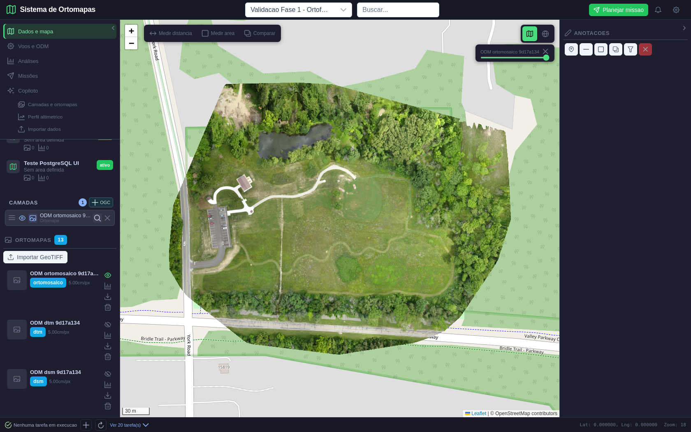

### 7. Superfície DSM 3D

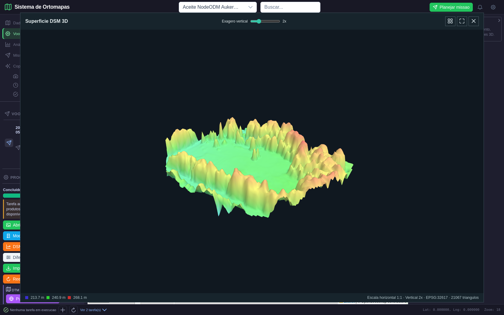

### 8. Nuvem de pontos LAZ 3D

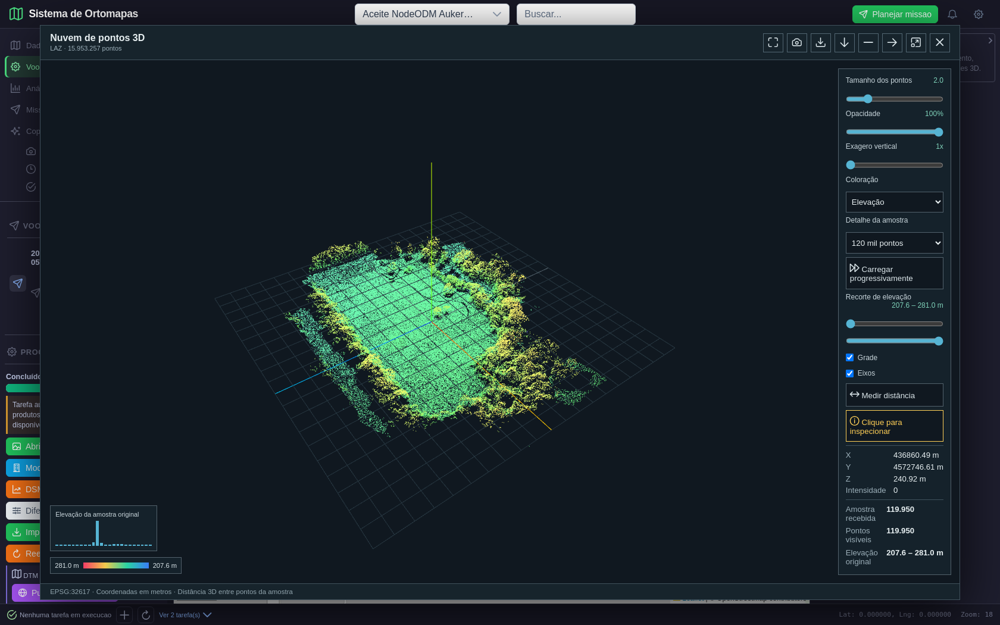

### 9. Produto de bacia D8 exibido no mapa

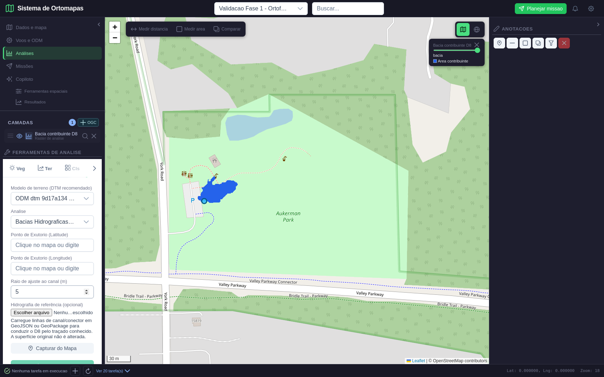

## Aceite integrado em um único projeto novo — F8-07

**Resultado:** aprovado no escopo do ciclo integrado. Projeto **#88**, voo **#34**, processamento local **#21**, tarefa NodeODM `ad503e1b-b88d-55d7-ad2b-6ddcdd78902b`. O roteiro usou 77 imagens públicas com geotags do dataset Aukerman. São imagens de teste de outra área; não representam Guarajuba, Condomínio Paraíso nem um voo executado pelo usuário. Nenhuma chamada ao LLM foi feita.

### Esperado versus obtido

| Passo | Esperado | Obtido | Resultado/evidência |
|---|---|---|---|
| Criar projeto, voo e enviar imagens | Novo projeto isolado; aceitar fotos válidas e rejeitar arquivo inválido antes de criar tarefa | Projeto #88 e voo #34 criados pela interface; 77 fotos aceitas e georreferenciadas. Arquivo `.txt` recebeu HTTP 400 e contagem de tarefas ficou 0 → 0 | Aprovado; capturas 01–07 |
| Processamento NodeODM | Tarefa chegar a estado concluído e permitir importar produtos | Concluído em 27,96 min; os seis tipos esperados foram importados: ortomosaico, DSM, DTM, relatório PDF, nuvem LAZ e modelo GLB | Aprovado; capturas 08–12 e manifesto |
| Mapa e produtos 2D/3D | Abrir cada produto próprio, sem telas repetidas ou modais sobrepostos | Ortofoto no mapa (50 tiles); GLB renderizado (268.775 triângulos, 59 materiais/texturas); DSM e DTM em superfícies distintas; LAZ com 15.889.672 pontos totais e amostra visível de 119.472; comparação DSM–DTM exibiu faixa −14,49 a 41,99 m, média 3,82 m e EPSG:32617 | Aprovado; capturas 13–19, todas inspecionadas |
| Avaliação de qualidade | Apresentar avaliação e recomendação | 100%, nível “BOM”; o sistema recomenda revisar o relatório ODM | Aprovado para o indicador apresentado; 100% indica completude dos produtos, não acurácia topográfica |
| Análise no projeto novo | Calcular uma derivada de terreno a partir do DSM, exibir e persistir o resultado | Declividade executada sobre `odm_21_dsm.tif`; análise #144 no projeto #88, EPSG:32617; 44.980.440 pixels totais, 35.461.895 válidos; min 0°, max 89,895°, média 25,930°, mediana 15,658° | Aprovado no cálculo e persistência; captura 22 e manifesto |
| Exportar e verificar | Baixar GeoTIFF íntegro e confrontar com a fonte | Download iniciado pelo botão da análise. GeoTIFF 7.448 × 5.905, 1 banda float32, EPSG:32617; limites e grade iguais ao DSM. Recálculo independente em todos os 35.461.895 pixels válidos: erro máximo e médio 0° | Aprovado; captura 23 e manifesto numérico |

O raster foi efetivamente baixado e comparado. Seu tamanho é 126.580.809 bytes (SHA-256 `20b92510efcbfeadcb0e47e0b249e0a1447b2a8048e3c7c1e6b8a042e39cc853`). Ele excede o limite de 100 MB por arquivo do GitHub e, por isso, não foi incluído no commit. As capturas, metadados, checksum e comparação numérica ficam no pacote de evidências; o download pode ser reproduzido pelo botão do resultado.

### Inspeção da interface e correção do roteiro

A primeira execução do roteiro parou antes de completar as visualizações porque tentou fechar o modal GLB com `Escape`, que o componente não implementa. O canvas permaneceu sobre os controles e interceptou o clique seguinte. Por esse motivo, uma imagem inicialmente chamada DSM repetia o modelo GLB. Identifiquei isso inspecionando a própria captura, descartei-a e corrigi o roteiro para clicar no botão explícito **Fechar** e aguardar o modal sair do DOM. Também alinhei os seletores do LAZ, da diferença e do botão de qualidade aos componentes efetivos. O roteiro completo corrigido está em [`acceptance_odm_novo_projeto.py`](../../../../tests/e2e/playwright/acceptance_odm_novo_projeto.py), e a repetição somente leitura dos visualizadores, sem novo upload/NodeODM, está em [`resume_odm_acceptance_fase8.py`](../../../../tests/e2e/playwright/resume_odm_acceptance_fase8.py). Essa retomada versionada foi executada: 6 verificações concluídas e `browser_page_errors=[]`.

Na repetição, DSM, DTM, nuvem e diferença produziram capturas distintas; não houve erros JavaScript. A falha identificada era do roteiro de automação e do rótulo de uma captura, não um defeito funcional observado nos visualizadores. O arquivo incorreto foi removido do pacote.

### Capturas do percurso integrado

#### Projeto criado e produtos ODM

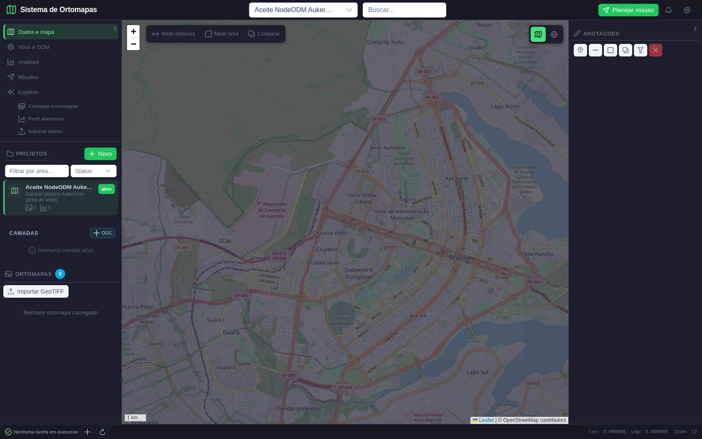

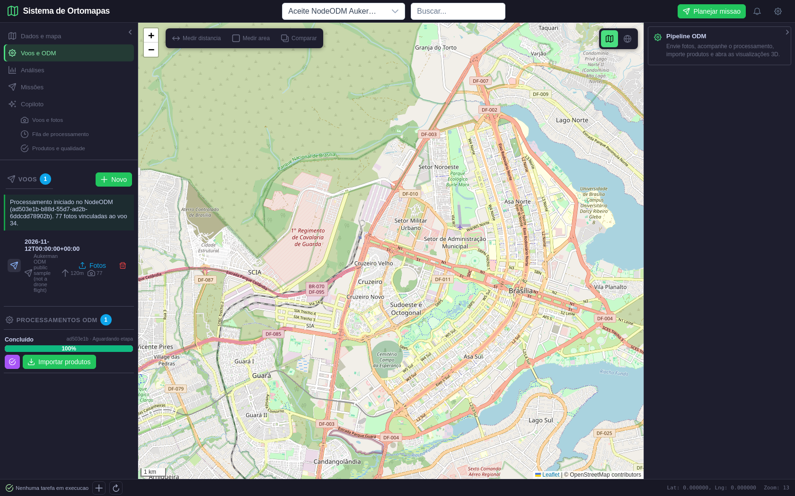

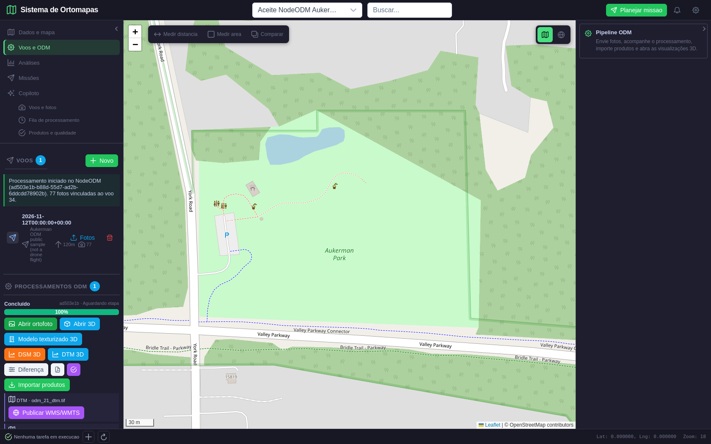

#### Ortofoto, malha, DSM e DTM

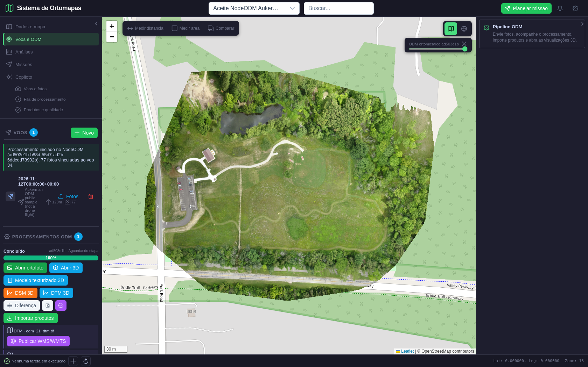

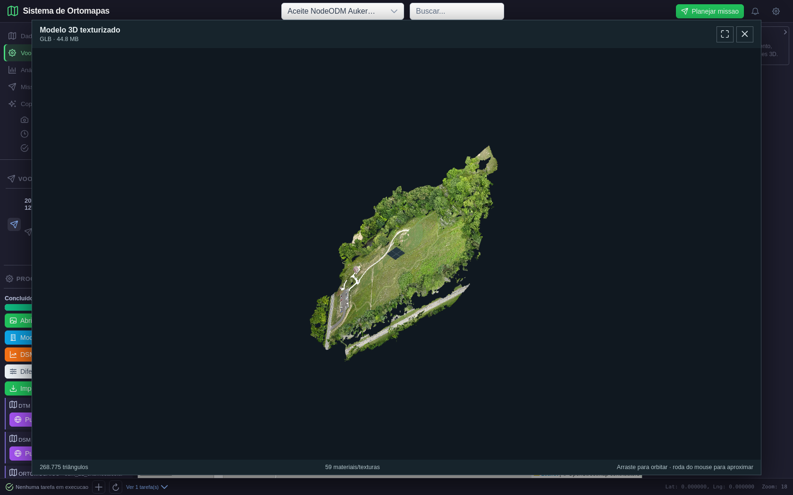

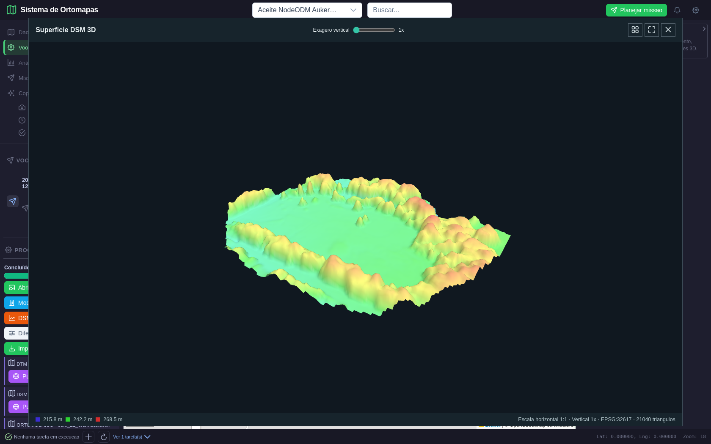

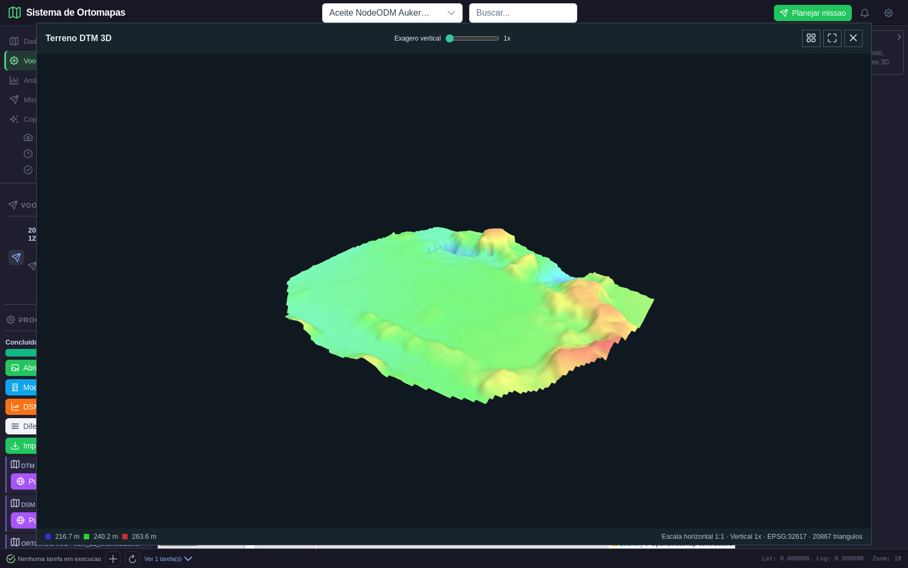

#### Nuvem, diferença e análise

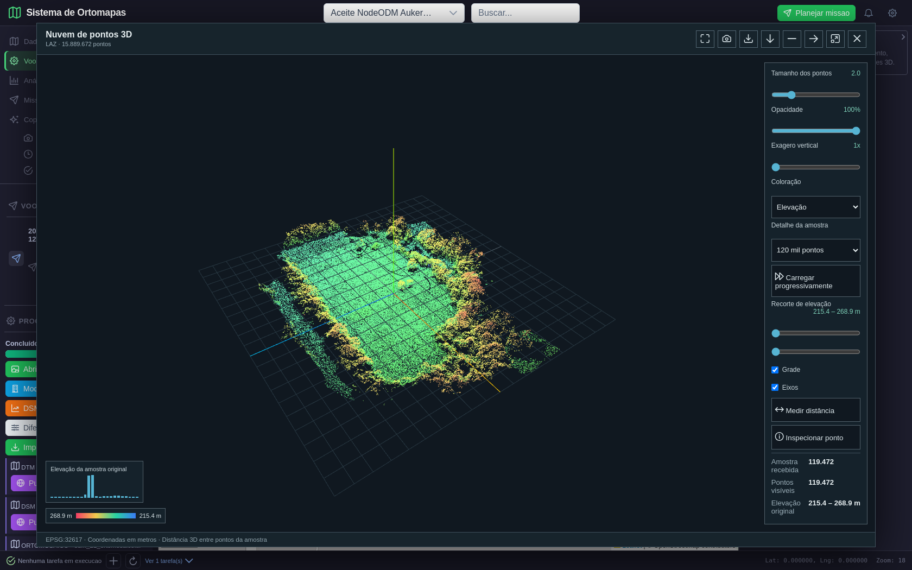

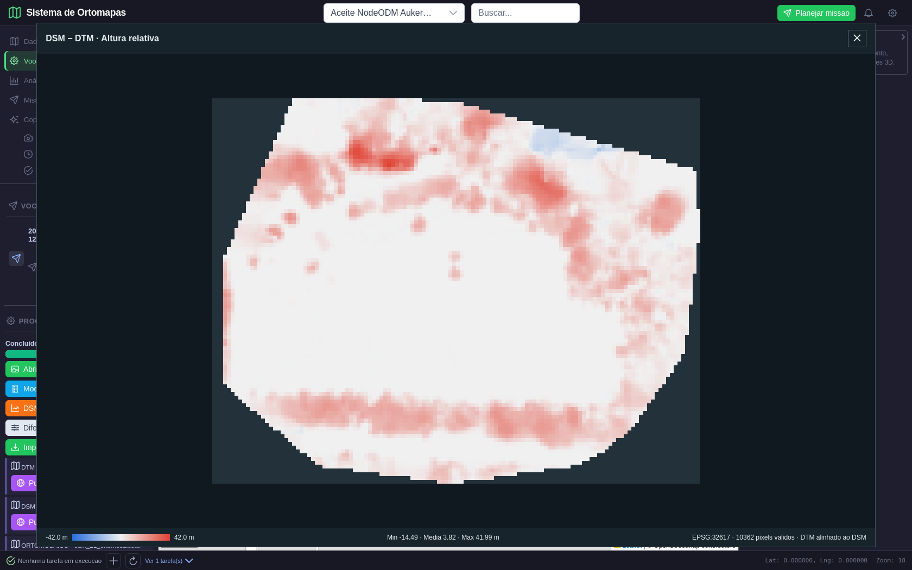

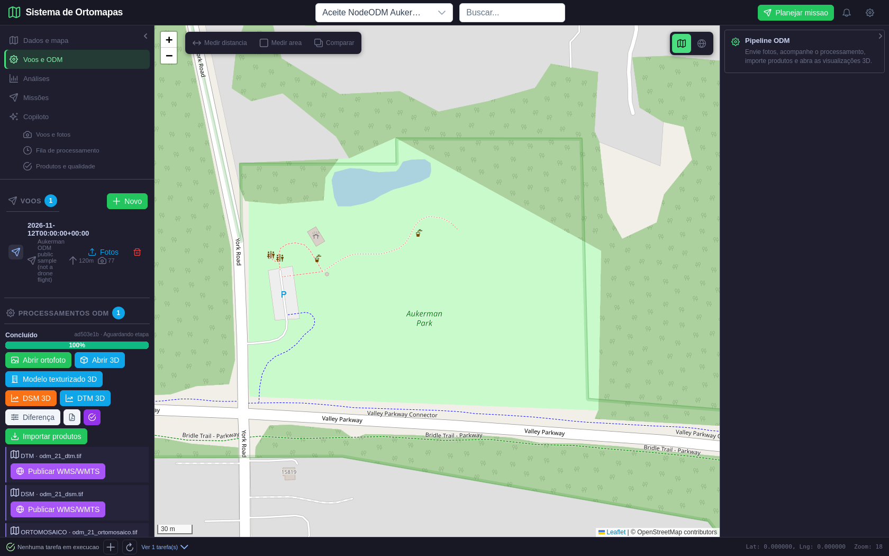

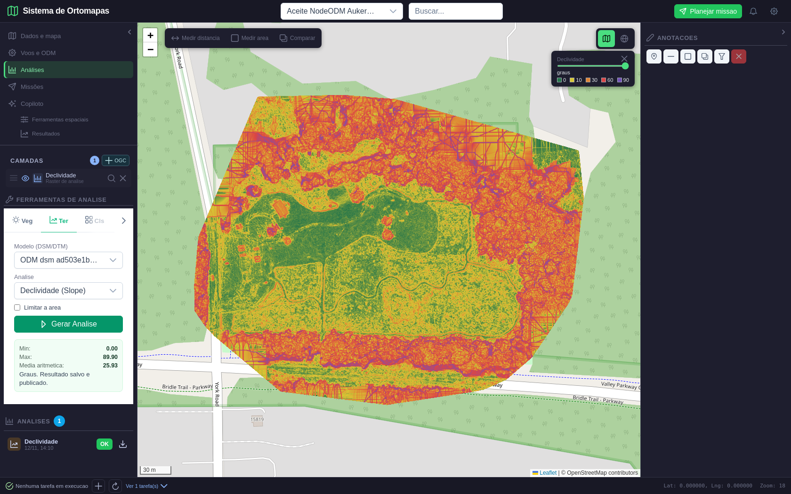

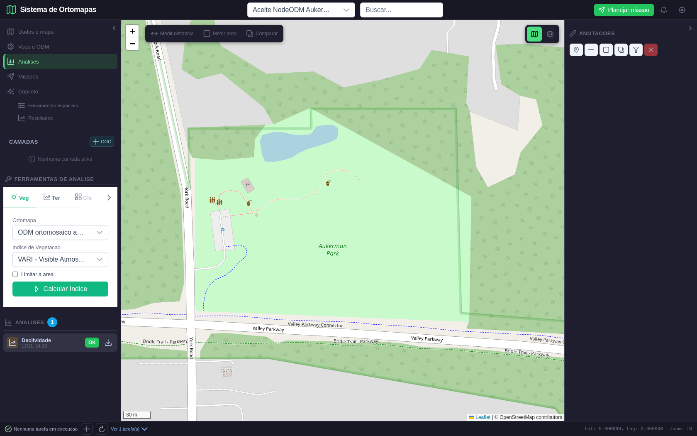

## F8-08 — monitoramento, suíte e reconciliação da matriz

**Execução:** 12/11/2026, após F8-07. **Escopo seguro:** consultas de saúde e métricas, reinício somente do Prometheus, leitura do dashboard e execução dos testes unitários. Não reiniciei a API nem o PostgreSQL. Nenhuma chamada ao LLM foi feita.

### Monitoramento: esperado versus obtido

| Verificação | Esperado | Obtido | Resultado/evidência |
|---|---|---|---|
| Stack observável | Prometheus, Alertmanager, Grafana e OTel disponíveis sem colisões de portas | Prometheus `:9090`, Alertmanager `:9093`, OTel `:4317/:4318`, Grafana `:3011`; a porta 3010 já era usada e foi preservada | Aprovado; configuração em `observability/docker-compose.yml` |
| Alvos de métricas | Exporter alcançável e scrape sem erro | `127.0.0.1:8888/metrics` com target `up=1`, sem `lastError`; consulta Prometheus `up=1` | Aprovado |
| Dashboard | Dados reais e sem erro de navegador | “Ortomapas - Operacional”, contadores de requisições/status e latência; Grafana 11.2.0, health `database=ok`, `page_errors=[]` | Aprovado; [captura](monitoramento/01_dashboard_prometheus.png), [manifesto](monitoramento/manifest.json) |
| Retenção TSDB | Séries sobrevivem a reinício controlado do Prometheus | Antes: contador 3317 e 5 amostras/5 min. Depois: contador 3318 e 6 amostras/5 min; volume persistiu | Aprovado para persistência do Prometheus. Não demonstra preservação dos contadores em memória da API após reiniciar a API |
| Health da aplicação | Dependências reportam prontidão | `/health/ready`: `database=true`, `language_model=true` | Aprovado como fotografia no momento da checagem |
| Segredo local | Credencial do Grafana fora do Git | Senha gerada apenas em `observability/.env`, arquivo ignorado pelo Git e permissão local 600; valor não foi impresso nem versionado | Aprovado |

O Compose usa a porta 3011 para Grafana porque 3010 estava ocupada por outro processo. O stack de observabilidade foi deixado ativo. O coletor OTel está em execução com exporter `debug`; a ingestão efetiva e retenção de traces não foram testadas. Métricas persistentes estão comprovadas; traces persistentes não.

### Suíte automatizada

Comando executado no `.conda-env`, sem integração com o banco ativo:

```text
ORTOMAPAS_DB_INTEGRATION=0 ./.conda-env/bin/python -m pytest -q -o faulthandler_timeout=60 tests/test_*.py
144 passed, 1 skipped, 1883 warnings in 3.59s
```

O teste ignorado foi `tests/test_clip_export_http.py::test_real_project_crop_reopen_and_export`, que exige integração com projeto/banco real e estava desativado intencionalmente para não alterar o banco. Os avisos são principalmente de APIs FastAPI, Rasterio/Affine e Shapely depreciadas; não causaram falhas. `pytest>=8.3,<9` foi declarado em `environment.yml` e instalado no ambiente de automação `.conda-env`; nenhuma dependência do runtime foi atualizada.

### Reconciliação dos casos de uso

Esta tabela distingue evidência funcional de demonstração de aceite científico/operacional. “Aderente no escopo” significa que existe evidência de interface e execução citada; não certifica precisão de campo.

| Caso de uso | Estado após F8-08 | Evidência/limite que permanece |
|---|---|---|
| UC-001 Criar projeto | Aderente no escopo | Matriz v2 e criação de projeto #88 no F8-07 |
| UC-002 Buscar/filtrar projetos | Aderente no escopo | Playwright com projetos existentes, evidência 06/11 |
| UC-003 Selecionar projeto/ortomapas | Aderente no escopo | Mapa 2D e catálogo de produtos, F8-07 |
| UC-004 Upload GeoTIFF | Aderente no escopo | Upload inválido rejeitado sem resíduo (F8-03); fluxo de importação validado nas fases anteriores |
| UC-005 VARI | Aderente matematicamente no escopo | Recálculo independente RGB; falta validação agronômica/verdade de campo |
| UC-006 Declividade | Aderente matematicamente no escopo | Exportação #144 comparada pixel a pixel, erro 0°; não é validação topográfica com GCP |
| UC-007 Curvas de nível | Aderente no escopo demonstrativo | Geometria, equidistância e cotas persistidas auditadas; sem referência topográfica de campo |
| UC-008 Hillshade | Aderente no escopo funcional | Execução e visualização documentadas na Fase 6; sem critério de acurácia de campo |
| UC-009 Mudanças entre datas | Parcial | Fixture controlada valida cálculo; ainda faltam duas campanhas reais independentes e avaliação de registro/erro |
| UC-010 Classificação K-Means | Parcial | Rótulos/pixels verificados; falta verdade de campo e métricas semânticas |
| UC-011 Hidrologia/rede D8 | Parcial | Fila/visualização funcionam; bacia depende da escala e não foi comparada a rede/referência hidrográfica local |
| UC-012 Volume | Aderente matematicamente no escopo | Comparação raster independente, erro 0 m, cota declarada; sem validação de levantamento de campo |
| UC-013 Anotação poligonal | Aderente no escopo | Caso descrito e implementado na matriz v2; não reexecutado em F8-08 |
| UC-014 Anotação pontual | Aderente no escopo | Caso descrito e implementado na matriz v2; não reexecutado em F8-08 |
| UC-015 Medir distância | Aderente no escopo | Playwright dedicado, segmentos, desfazer/limpar (06/11) |
| UC-016 Medir área | Aderente no escopo | Playwright dedicado, área/perímetro, limpar/fechar (06/11) |
| UC-017 Comparar ortomapas | Aderente no escopo | Swipe/lado a lado, duas fontes reais e tiles verificados (06/11) |
| UC-018 Exportar ortomapa | Aderente no escopo | Exportação raster com dimensões/CRS/bounds verificados; F8-07 também conferiu produto de análise |
| UC-019 Registrar voo | Aderente no escopo | Voo #34 criado e associado ao projeto #88, F8-07 |
| UC-020 Disparar análises por agente/fila | Parcial | Fila validada para operações existentes; direção D8, acumulação D8 e TWI agora estão conectadas ao worker e executadas no DTM real #21 (etapa 9.1), mas aguardam teste visual via API/DB. Mudança, volume, segmentação e classificadores supervisionados seguem fora da fila. RAG permanece explicitamente adiado |
| UC-021 Importar fotos de voo | Aderente no escopo | 77 fotos públicas georreferenciadas aceitas no voo #34; arquivo `.txt` recebeu HTTP 400 |
| UC-022 Criar processamento ODM | Aderente no escopo | NodeODM task UUID registrada no F8-07 |
| UC-023 Acompanhar processamento | Aderente no escopo | Tarefa chegou a concluída; tela e produtos documentados no F8-07 |
| UC-024 Cancelar/repetir | Parcial | Contrato de cancelamento/retry com fixture NodeODM na Fase 3; não repetido contra tarefa real nesta etapa |
| UC-025 Importar produtos ODM | Aderente no escopo | Seis produtos importados no projeto #88 |
| UC-026 Validar qualidade | Parcial | UI exibiu 100%/“BOM”, mas essa pontuação mede completude e recomenda revisão do relatório; falta validar GSD/alinhamento/acurácia com referências independentes |
| UC-027 Visualizar produtos derivados | Aderente na visualização testada | Ortofoto, DSM, DTM, GLB e exportação mostrados no projeto #88; aceite de CRS incompatível e precisão geográfica do GLB não foi ampliado |
| UC-028 Visualizar nuvem 3D | Aderente na pré-visualização | LAZ real carregado e amostrado no visualizador; densidade mostrada, sem auditoria de todas as classes/pontos |
| UC-029 Reprocessar com parâmetros diferentes | Parcial/não aceito | Interface de confirmação observada, mas diálogo foi cancelado para evitar processamento de ~25 min; não há prova de nova tarefa real e comparação versionada |

A matriz de requisitos existente marca alguns itens como “Aderente” por interface/execução. As ressalvas acima refinam essa classificação para aceite operacional: UC-009/010/011/026 não têm referência externa suficiente, UC-020 permanece parcialmente integrado (as novas análises hidrológicas aguardam Playwright via API/DB; outras operações continuam ausentes) e UC-029 não teve reprocessamento real. Não declaro o sistema integralmente aceito enquanto os critérios obrigatórios desses casos não forem resolvidos ou formalmente excluídos do escopo.

### Conclusão e próxima etapa

**F8-08 aprovada para o escopo executado:** dashboard com métricas reais, target Prometheus ativo, persistência TSDB após reinício controlado, health observado e suíte Python com 144 aprovações e 1 integração intencionalmente ignorada. Os avisos de depreciação estão registrados.

**A Fase 8 de robustez foi concluída; o aceite global do Ortomapas continua parcial pelos gaps da matriz.** Não há base para chamar o produto inteiro de operacionalmente aceito ainda. Naquele ponto, definiu-se a **Etapa 9 de 9 — fechamento dos UCs parciais UC-009, UC-010, UC-011, UC-020, UC-024, UC-026 e UC-029**. A atualização 9.1 aparece adiante neste relatório. Para cada caso, deve-se definir dado de referência e critério quantitativo antes de alegar precisão. RAG segue fora do escopo conforme decisão anterior. Depois dessa etapa, reavaliar a matriz e decidir aceite ou registrar exclusões formais.


## Etapa 9 de 9 — andamento 9.1: ampliar fila hidrológica

**Objetivo desta entrega:** conectar ao UC-020 três resultados que já apareciam como operações hidrológicas, mas estavam sem execução enfileirada: direção de fluxo D8, acumulação D8 e TWI. A seleção da interface anteriormente desabilitava a fila para os três; o backend também os recusava.

### Mudanças implementadas

- Incluídas direção D8, acumulação D8 e TWI como operações da fila do endpoint de análises e do worker hidrológico.
- Incluído TWI no seletor da interface; as três operações podem permanecer na opção de execução enfileirada.
- Publicação gera GeoTIFF com CRS, estatísticas, proveniência e estilo de mapa. Direção usa legenda categórica D8; acumulação usa faixa contínua; TWI usa legenda de umidade.
- Acrescentados testes do worker com adaptador de persistência isolado e testes de direção/acumulação, paleta e TWI.

### Validação obtida

| Critério | Esperado | Obtido | Resultado/evidência |
|---|---|---|---|
| Algoritmo/worker | As três operações produzem rasters válidos, preservam CRS e terminam sem erro | Teste parametrizado executou o worker para direção, acumulação e TWI; 23 testes focados passaram | Aprovado em execução isolada; [testes do worker](../../../../tests/test_hydrology_queue_agent.py), [manifesto DTM real](../etapa-09/uc020_dtm_real.json) |
| Dados representativos | Executar sobre um produto ODM real, sem declarar referência hidrológica de campo | DTM #21, 7.449 × 5.906, EPSG:32617; worker gerou três GeoTIFFs em grade comum 256 × 203, célula aproximada 1,455 m | Aprovado como demonstração algorítmica; saídas/checksums no manifesto |
| Direção D8 | Códigos de direção válidos e legenda inteligível | 41.861 células válidas; códigos entre 1 e 128; raster int16 | Aprovado no processamento; ainda falta confirmar tiles e legenda pela interface autenticada |
| Acumulação D8 | Contagem positiva de células contribuintes e variação espacial | 51.968 células válidas; mínimo 1, máximo 13.358; raster int32 | Aprovado no processamento; resultado ainda precisa de verificação visual no aplicativo |
| TWI | Raster float finito e georreferenciado | 41.637 células válidas; min −0,653, máx 16,705, média 4,555; float32 | Aprovado como cálculo demonstrativo. Valores dependem de resolução, condicionamento, declividade e convenção de área contribuinte; sem interpretação de campo |
| Interface/build | Formulário compila e mostra as novas opções | Build Vite passou (427 módulos); bundle principal 1.622,63 kB gera aviso de chunk acima de 500 kB | Aprovado no build, não equivale a validação visual |
| Regressão | Suíte completa permanece estável | 148 passed, 1 skipped, 1.890 warnings em 3,82 s (`ORTOMAPAS_DB_INTEGRATION=0`) | Aprovado. Um teste de exportação requer integração com banco real; avisos deprecation não causaram falhas |

O manifesto do DTM real documenta que o `publish_hydrology` foi substituído por um capturador local e a conexão foi simulada; portanto, esse ensaio executou o algoritmo/worker e criou produtos reais a partir do DTM, mas **não gravou no PostgreSQL e não validou a transação do endpoint**. Não houve alteração de dados persistidos.

### Limite da validação visual

Não foi possível executar Playwright contra a aplicação neste momento: `pg_isready` informou que não há resposta em `localhost:5432`; as rotas locais `:8888` (API) e `:5176` (frontend) não responderam; `docker ps` não listou containers ativos. Por isso, não há captura de tela nova para essa subetapa, e o teste não é apresentado como percurso completo de usuário. A captura do dashboard da etapa 8 é evidência de observabilidade, não de análise hidrológica.

A grade hidrológica generaliza o raster ODM original de aproximadamente 5 cm para cerca de 1,455 m por célula. Isso reduz custo e torna a execução demonstrável, mas perde detalhe e, junto à sensibilidade D8 já medida, impede aceitar esses resultados como hidrologia operacional. Não foram comparados a rede oficial, pontos de controle ou medições de campo.

**Estado da etapa 9:** subetapa 9.1 concluída para integração do código e execução do worker; UC-020 segue parcial. **Próxima subetapa 9.2:** disponibilizar PostgreSQL, API, frontend e worker nesta cópia; então usar Playwright para selecionar o DTM, enfileirar cada uma das três operações, acompanhar estado, abrir cada camada e conferir CRS, legenda, tiles e estatísticas contra os GeoTIFFs. Em seguida continuar os casos UC-009/010/011/024/026/029 e as funções de UC-020 ainda ausentes.

## Etapa 9 de 9 — subetapa 9.2: validação visual da fila hidrológica

**Data:** 12/11/2026. **UC:** UC-020 (fila de análises espaciais) e interface de visualização do UC-003. **Objetivo:** provar o fluxo autenticado de seleção do projeto/DTM, submissão pela interface, conclusão da tarefa, persistência do resultado e exibição do mapa/estatísticas para as três operações adicionadas na 9.1.

### Ambiente e dados usados

- Projeto #88, “Aceite NodeODM Aukerman 20261112-163150”, acessado pela conta proprietária de teste; DTM #72 (“ODM dtm ad503e1b”), criado pelo processamento fotogramétrico NodeODM do conjunto público Aukerman.
- Raster de origem real do processamento: 7.449 × 5.906 pixels, EPSG:32617. Não é captura de Guarajuba nem validação de campo.
- PostgreSQL/PostGIS, API e frontend locais ativos; a API foi reiniciada isoladamente para carregar a versão em validação. PostgreSQL, NodeODM e demais contêineres não foram reiniciados.
- Execução visual via Chrome headless/Playwright, com sessão autenticada. Nenhuma chamada ao Copiloto/LLM foi feita (`llm_calls=0`). O teste não registra senha, token ou segredo no manifesto.

### Roteiro executado e esperado versus obtido

| Passo | Esperado | Obtido | Resultado |
|---|---|---|---|
| Login e contexto | Autenticar e abrir o projeto correto | Login HTTP/UI concluído; projeto #88 e produto DTM #72 selecionados | Aprovado |
| Preenchimento | Formulário indica DTM, análise hidrológica, tipo e opção de fila | Repetido para direção D8, acumulação D8 e TWI; o texto foi corrigido para “Enviar para fila de processamento”, sem sugerir uso de IA | Aprovado |
| Submissão | UI recebe HTTP 202 com IDs de análise/tarefa | Direção: análise #148/tarefa #30; acumulação: #149/#31; TWI: #150/#32 | Aprovado |
| Execução/persistência | Tarefa termina e produto persiste com referência à fonte | As três análises ficaram `concluida`, com caminho de resultado persistido | Aprovado para as três tarefas |
| Tiles e mapa | Camada selecionada solicita tiles HTTP 200 e aparece com legenda própria | 25/25 tiles HTTP 200 por produto; camada e painel de estatísticas visíveis nas três telas | Aprovado no percurso visual executado |
| Integridade da página | Sem exceções de JavaScript | `page_errors=[]`; nenhum erro de console fatal capturado | Aprovado |

O worker generalizou cada DTM para grade de 256 × 203 células (passo aproximado de 1,455 m, a partir da fonte de cerca de 5 cm). Resultados registrados: direção D8 com 41.861 células válidas e códigos 1–128; acumulação com 51.968 células válidas, mínimo 1 e máximo 13.358 células contribuintes; TWI com 41.637 células válidas, mínimo −0,653, máximo 16,705 e média 4,555. O mapa mostra a camada escolhida e a respectiva legenda. A escala reduzida e a ausência de referência hidrográfica/controle de campo limitam os resultados a demonstração funcional e algorítmica, sem aceite hidrológico operacional.

As três análises permaneceram no projeto #88 para permitir inspeção posterior pela aplicação. O manifesto compactado registra IDs, estados, CRS, dimensões, estatísticas essenciais, contagem/status dos tiles e escopo, sem histogramas extensos nem caminhos locais. O teste criou registros de demonstração no PostgreSQL e arquivos derivados; não houve limpeza desses resultados.

### Capturas da execução real

As capturas abaixo são imagens produzidas pelo Playwright nesta execução, não ilustrações sintéticas. Os formulários mostram a entrada selecionada; as telas de resultado mostram a camada renderizada, a legenda, o projeto e o painel estatístico.

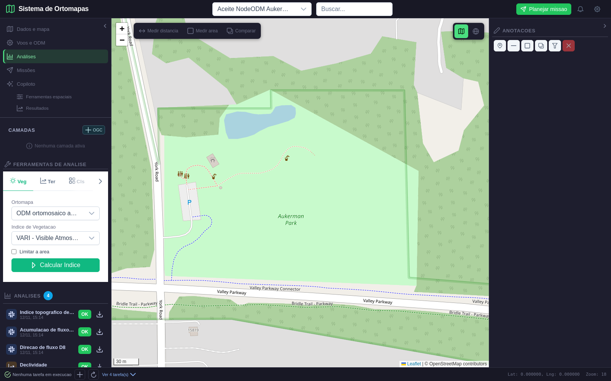

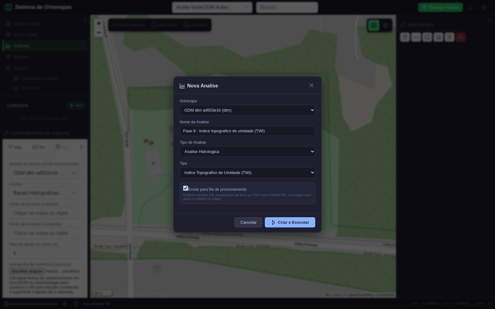

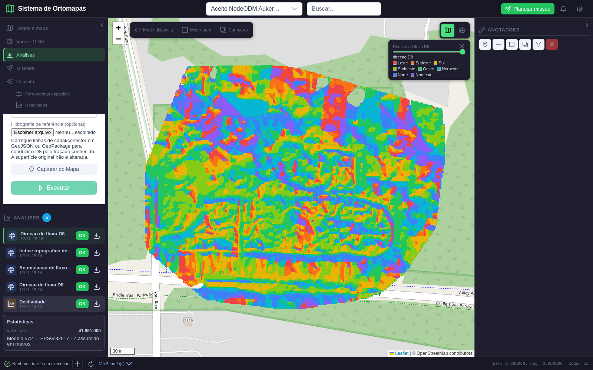

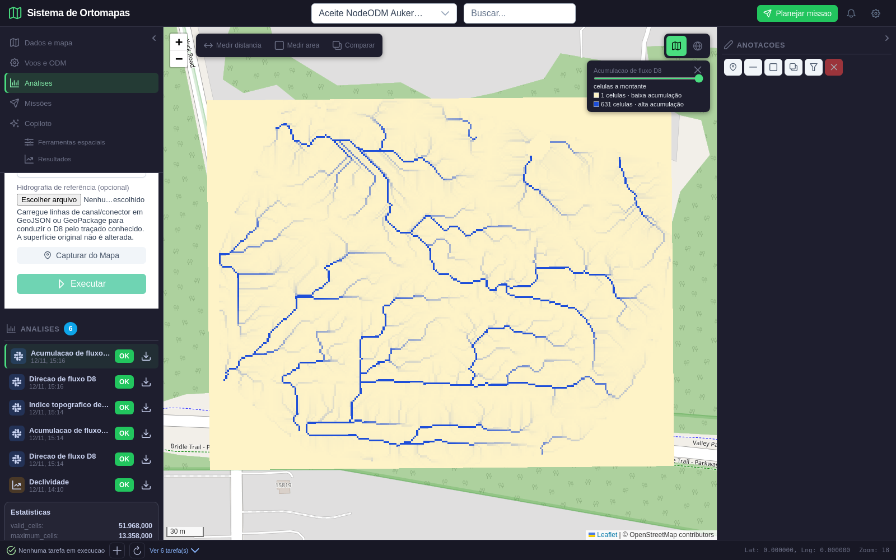

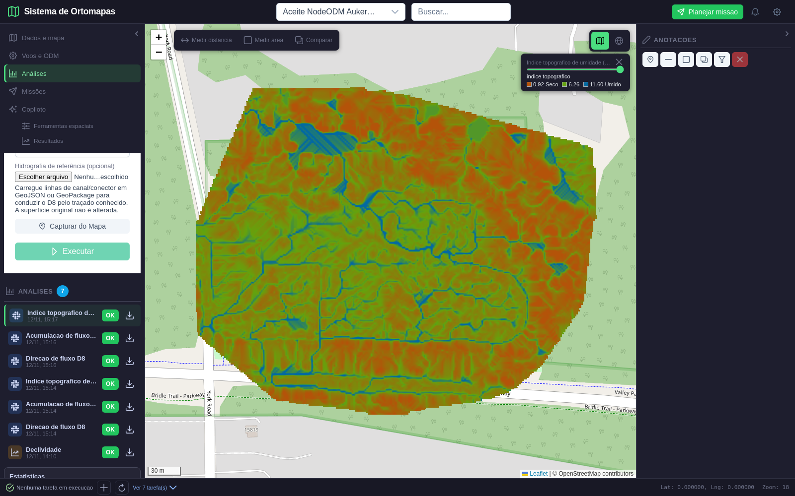

Capturas adicionais de cada formulário e login, mais o [manifesto Playwright](../etapa-09/playwright/manifest.json) e o [script reproduzível](../../../../tests/e2e/playwright/validate_hydro_queue_phase9.py), ficam junto das evidências. As imagens `tiles/` são tiles de resultado gerados pela aplicação e não capturas de tela.

### Avaliação e limite de aceite

| Critério | Resultado | Conclusão |
|---|---|---|
| Seleção do projeto/produto e envio pela interface autenticada | 3 operações executadas com HTTP 202 | Aprovado |
| Worker, persistência e reabertura do mapa | 3 tarefas concluídas; produto consultado pela UI; 25 tiles HTTP 200 cada | Aprovado funcionalmente |
| Legenda/estatísticas próprias por resultado | Direção categórica, acumulação contínua e TWI contínuo visíveis; métricas compatíveis com o manifesto | Aprovado para demonstração |
| Acurácia hidrológica | Sem rede de drenagem independente, pontos de controle ou validação de campo; grade generalizada | **Não avaliada; UC-011/UC-020 continuam parciais** |
| UX sem ambiguidade de camadas anteriores | A camada ativa e a legenda mudam por seleção; a lista mantém histórico das análises | Aceito para esta execução; revisão de UX da lista pode ser feita separadamente |

Portanto, 9.2 fecha a lacuna anterior de “sem teste visual/sem persistência do endpoint” para estas três operações. Isso não aprova o algoritmo hidrológico para decisão de engenharia, nem fecha UC-020: drenagem/bacia, outras ferramentas enfileiradas e referências independentes ainda precisam de tratamento documentado.

**Estado:** subetapas 9.1 e 9.2 concluídas para direção D8, acumulação D8 e TWI; UC-020 continua parcial. **Próxima subetapa 9.3 de 9:** validar e corrigir o fluxo enfileirado de rede de drenagem e delimitação de bacia (com exutório), usando o mesmo DTM real, conferir parâmetros/unidades, GeoJSON/GeoTIFF, tiles/forma resultante e interação do mapa; para alegação de qualidade hidrológica, antes estabelecer uma referência independente apropriada.

## Etapa 9 de 9 — subetapa 9.3: rede de drenagem e bacia por exutório

**Data:** 12/11/2026. **UC:** UC-020 (fila de análise hidrológica) e UC-011 (análise de bacia/rede D8). **Entrada:** projeto ODM #88, DTM #72, conjunto público Aukerman/Westerville, Ohio, EPSG:32617, 7.449 × 5.906 pixels. A entrada é produto fotogramétrico real do NodeODM, mas a área foi generalizada pelo worker; não existe referência de campo nesta execução.

### Percurso e resultado observado

| Critério | Esperado | Obtido | Resultado |
|---|---|---|---|
| Rede D8 — submissão | Formulário DTM/hidrologia, área mínima e Strahler; API aceita fila | DTM #72, limiar 1.000 m², Strahler mínimo 1; HTTP 202, análise #155/tarefa #37 | Aprovado |
| Rede D8 — processamento | Saída vetorial persistida com segmentos LineString | Concluída como `.geojson`: 21 feições LineString, 1.198 células de canal, 1,975 km acumulados; ordem máxima 3 | Aprovado funcionalmente |
| Rede D8 — visual/exportação | Rede visível no mapa e exportável em formatos previstos | 21 caminhos SVG do Leaflet; download GeoJSON 95.762 bytes e KML 38.813 bytes, ambos lidos e validados pelo roteiro | Aprovado para apresentação/exportação |
| Bacia — validação de entrada | Fila não deve aceitar bacia sem exutório | Formulário bloqueou a ação e exibiu mensagem; não ocorreu POST de análise | Aprovado |
| Bacia — ponto e ajuste | Clique marca ponto; célula de canal fica dentro do raio configurado | Ponto solicitado `41.304187, -81.752164`; raio configurado 100 m; ajuste D8 a `41.303474, -81.752567`, distância 85,999 m e acumulação 21.685 células | Aprovado para o raio informado |
| Bacia — produto/mapa | GeoTIFF persistido, área positiva, tiles acessíveis e feição visual | HTTP 202, análise #156/tarefa #38 concluída; 21.693 células, 11.477,705 m² (1,14777 ha), 25 tiles HTTP 200; raster azul e marcador visíveis | Aprovado funcionalmente |
| Integridade do navegador | Sem exceções JS e sem chamadas ao Copiloto/LLM | `page_errors=[]`, `llm_calls=0` | Aprovado |

O processamento de drenagem usou grade de 256 × 203, pixel de 2,116 m²; por isso 1.000 m² correspondeu ao limiar de 473 células. As 21 feições totalizaram 1.312,953 m de ordem 1, 503,479 m de ordem 2 e 158,591 m de ordem 3. A bacia usou grade 512 × 406, célula de 0,5291 m². Como o ponto clicado ficou longe de uma célula de maior acumulação, o raio de 100 m moveu o exutório em 86 m; o default do formulário é 5 m. Essa distância aparece no resultado e no marcador. Não deve ser confundida com erro de posicionamento medido em campo.

### Correção visual feita durante a etapa

A captura inicial mostrou que o botão “Escolher exutório no mapa” aparecia como botão HTML sem estilo. Foi aplicado estilo visual consistente com o modal e ícone de localização. A captura atualizada mostra o controle legível e com foco visual. Também foi verificado o estado sem ponto: a interface informa que o exutório precisa ser escolhido antes da fila e não envia a análise.

A primeira versão do roteiro tentou abrir o resultado recém-concluído antes de atualizar a lista e não encontrou as feições no mapa. A leitura da análise persistida confirmou 21 feições; ao usar o botão de atualização já disponível e esperar o SVG do Leaflet, a tela montou todas as 21 linhas. Não houve alteração no endpoint nem no algoritmo por causa dessa falha do roteiro.

### Capturas e arquivos reproduzíveis

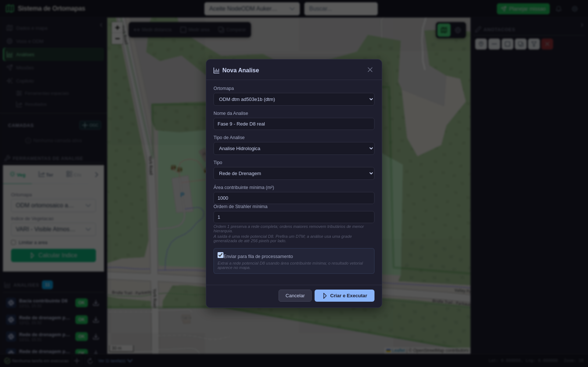

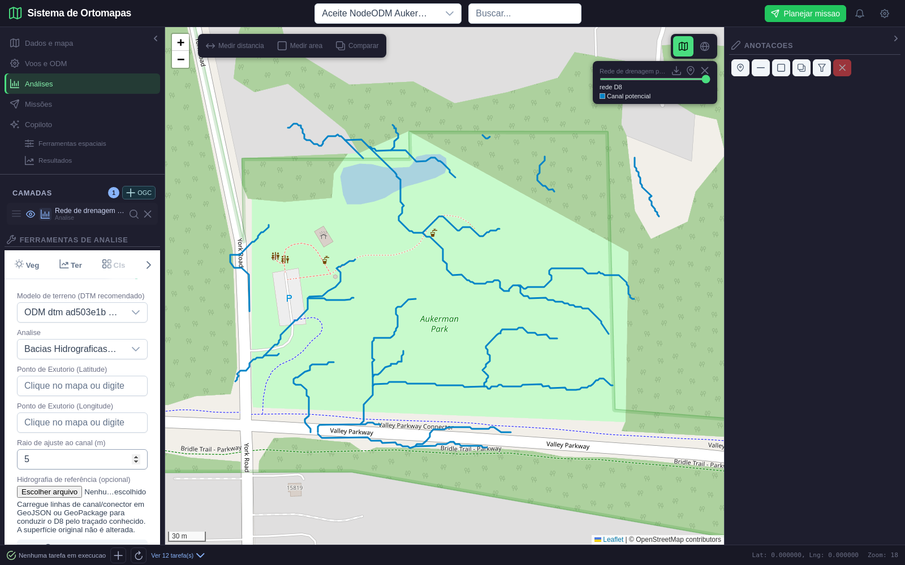

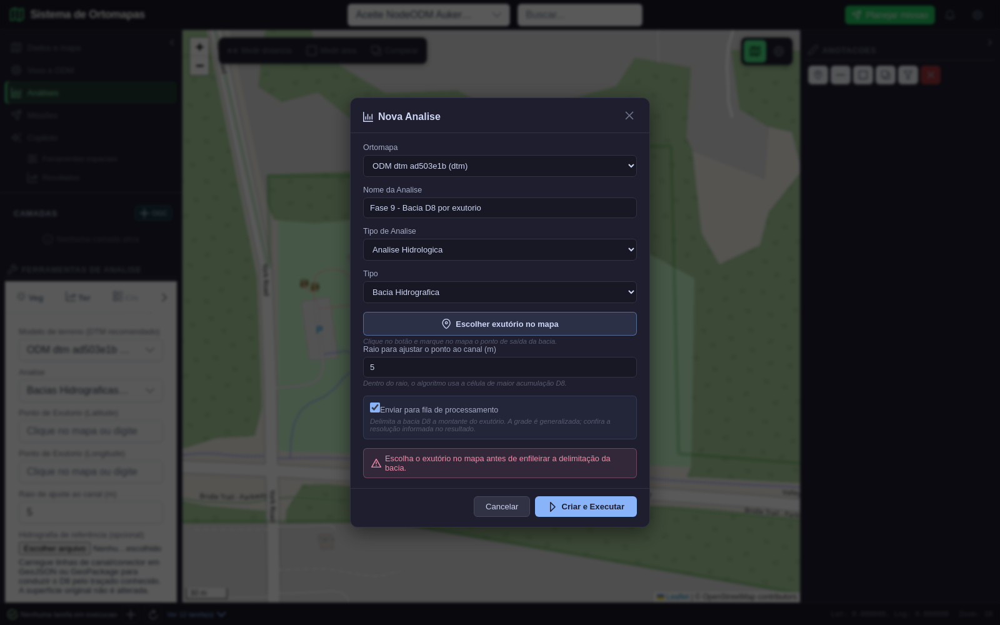

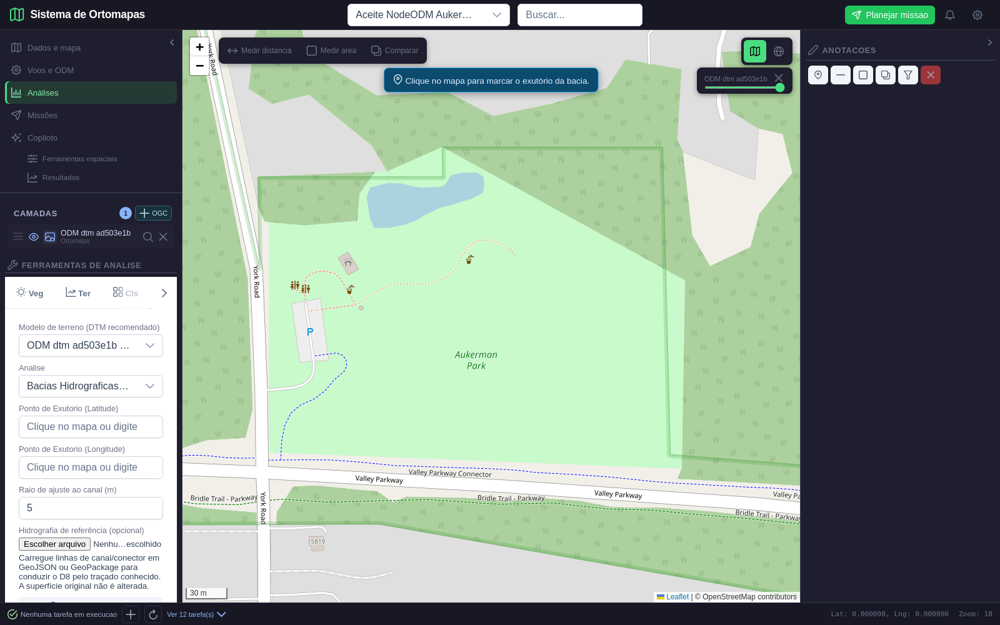

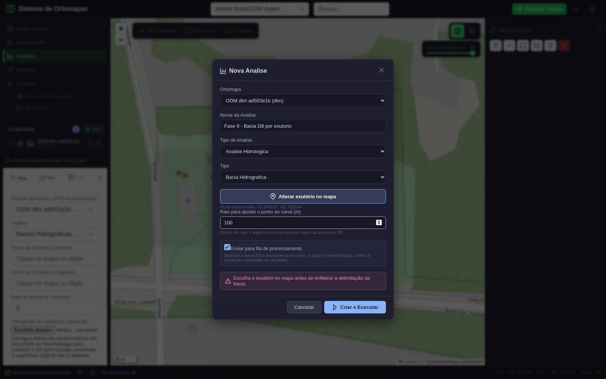

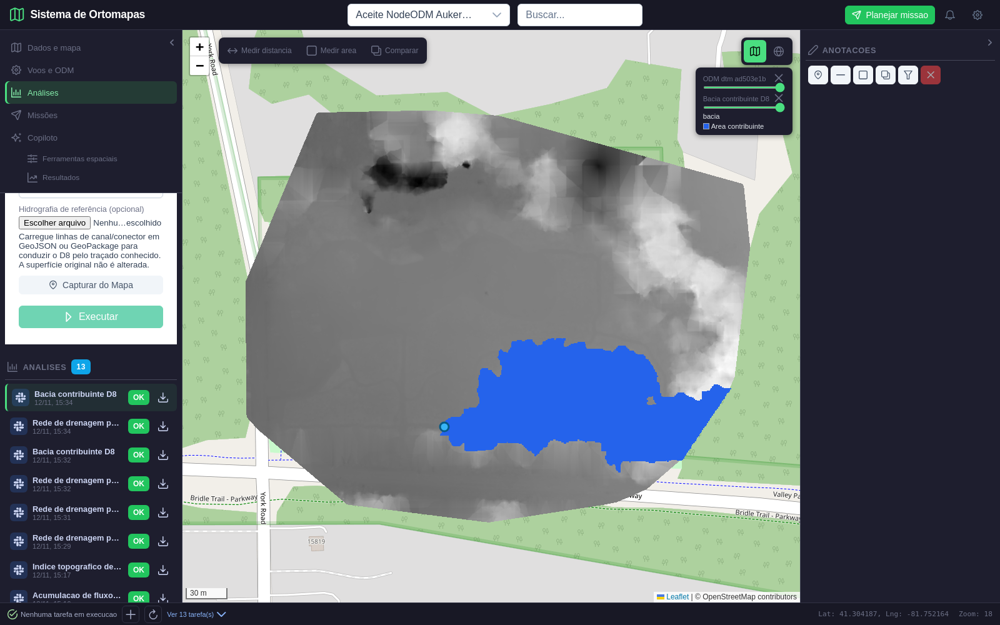

O [manifesto completo](../etapa-09/playwright/hydrology_network_manifest.json) registra parâmetros, IDs, estatísticas, resposta da validação de entrada, exports e captura sem credenciais. Os arquivos [GeoJSON exportado](../etapa-09/playwright/04_drenagem_exportada.geojson) e [KML exportado](../etapa-09/playwright/04_drenagem_exportada.kml), junto do [roteiro Playwright](../../../../tests/e2e/playwright/validate_hydro_network_phase9.py), acompanham as telas. Nesta subetapa, um JWT efêmero foi assinado pelo módulo local para o usuário de validação id 60 e fornecido somente via ambiente ao Playwright; o login por e-mail/senha foi demonstrado na subetapa 9.2, mas não foi repetido aqui.

### Conclusão e limite operacional

**Aprovado funcionalmente:** DTM → fila → rede vetorial e bacia raster → persistência → mapa → exportação da rede. A saída D8 não foi confrontada com uma rede hidrográfica oficial, levantamento de campo ou outro DTM independente. A escala do processamento e a escolha do raio influenciam a geometria; portanto, UC-011 e o aceite hidrológico de UC-020 continuam **parciais**, sem recomendação para decisões de drenagem/engenharia.

**Próxima subetapa 9.4 de 9:** montar uma comparação independente para hidrologia na área do DTM: obter uma referência hidrográfica pública, reprojetar e recortar com critério registrado, parear redes por ordem/tipo de feição e quantificar coincidência, distância e divergências. A comparação deve tratar a resolução de 0,727 m do watershed e a grade mais grossa da drenagem, sem equiparar pixels generalizados a observações de campo. Se não houver referência pública de escala/licença adequadas, registrar a limitação e não aprovar acurácia por consistência interna.

## Etapa 9 de 9 — subetapa 9.4: tentativa de comparação independente com 3DHP

**Data:** 12/11/2026. **Vínculo:** UC-011 (rede de drenagem) e UC-020 (fila hidrológica). **Objetivo:** comparar a rede potencial derivada pelo Ortomapas com uma fonte hidrográfica pública, recortando ambas ao mesmo DTM e pareando por ordem Strahler e tipo.

### Dados, origem e método

- Rede prevista: export GeoJSON real da análise D8 #155, feita no projeto #88 a partir do DTM ODM #72. São 21 LineStrings, com ordens 1–3, limiar de área contribuinte 1.000 m². O DTM está em EPSG:32617, 7.449 × 5.906 pixels, extensão projetada `436847.28, 4572650.85, 437219.73, 4572946.15`.
- Referência: USGS 3D Hydrography Program (3DHP), serviço público Flowline, camada 50. A consulta espacial em WGS84 cobriu `[-81.760, 41.300, -81.748, 41.308]` e retornou quatro linhas `featuretype=1` (“Channel Line”), ordens Strahler 1 ou 2, com data de feição 2023-09-14. O [manifesto da consulta](../etapa-09/referencias/3dhp_source_metadata.json) registra URL, parâmetros, data e ressalvas; o GeoJSON baixado e seu SHA-256 acompanham o relatório.
- Método reproduzível: reprojetar as linhas para EPSG:32617, recortar pela extensão do DTM, contar feições por ordem/tipo e calcular métricas somente para classes presentes nos dois lados. Se houvesse pares, o script calcularia distâncias entre linhas amostradas a cada 1 m e cobertura em tolerâncias de 2, 5 e 10 m. Não converte essas métricas em certificado de acurácia.

Fontes oficiais consultadas: [catálogo e acesso aos produtos 3DHP](https://www.usgs.gov/3d-hydrography-program/access-3dhp-data-products), [esquema da camada Flowline](https://www.usgs.gov/ngp-standards-and-specifications/3d-hydrography-program-3dhpall-flowline) e [derivados da rede e ordem de fluxo](https://www.usgs.gov/3d-hydrography-program/3dhp-flow-network-derivatives). A ordem de fluxo existe no esquema 3DHP; o rótulo observado no retorno para `featuretype=1` foi “Channel Line”.

### Esperado versus obtido

| Critério | Esperado | Obtido | Resultado |
|---|---|---|---|
| Referência independente | Feições hidrográficas da mesma área do DTM | Quatro candidatas na janela de consulta; zero intersectam a extensão do DTM | **Não atendido** |
| Pareamento por classe | Comparar somente tipo/ordem existentes em ambos os conjuntos | Zero pares válidos; ordens disponíveis na rede D8: 1, 2, 3; ordens de referência dentro do DTM: nenhuma | **Não comparável** |
| Recorte e transparência | Mostrar as duas redes sobre a mesma extensão | O mapa exibe D8 azul/rosa/verde dentro do retângulo DTM e candidatas USGS tracejadas fora dele | Aprovado como diagnóstico espacial |
| Distâncias | Reportar similaridade apenas com sobreposição/extensão comum | Candidata 3DHP mais próxima está 34,130 m da borda do DTM; distância mínima até a rede D8 é 75,088 m | Apenas distância a feições próximas; não é métrica de erro |
| Reprodutibilidade | Script, fontes, entradas e resultado registráveis | Script executado, GeoJSON bruto/recortado, JSON de métricas e figura salvos | Aprovado para reprodução da tentativa |

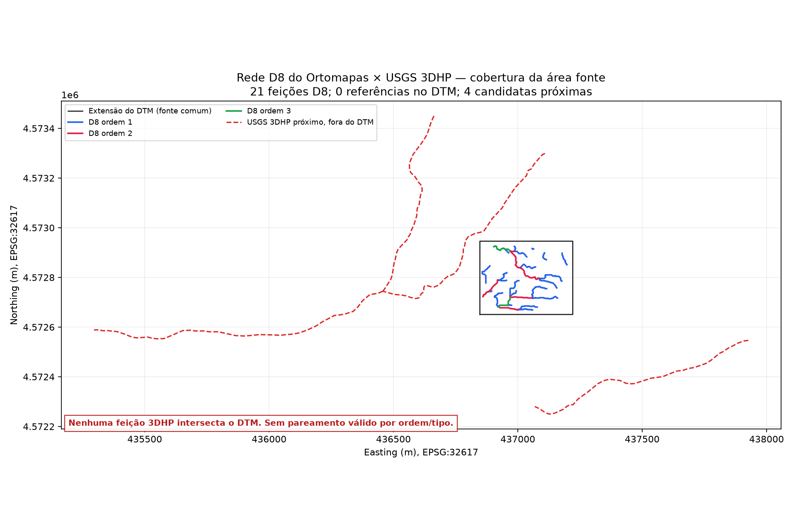

O [resultado JSON](../etapa-09/referencias/comparacao_3dhp_d8.json) marca `not_comparable_reference_does_not_intersect_dtm`, com `orders_compared=[]`, `valid_pairs=0` e `by_order={}`. A versão inicial da figura omitia as linhas D8 porque o laço de desenho estava limitado às ordens comparáveis; corrigi isso e inspecionei a figura regenerada: as 21 linhas D8 aparecem agora dentro do retângulo do DTM, enquanto as quatro candidatas 3DHP ficam fora. Essa correção foi exclusivamente de visualização; não alterou as entradas ou os números espaciais.

### Conclusão

A etapa **não valida nem reprova a acurácia** da rede D8. Ela demonstra que a fonte pública próxima não serve como referência comum para esse DTM. O dado oficial consultado é cartografia hidrográfica com data/linhagem diferentes, não verdade de campo; a generalização do worker (célula de aproximadamente 1,455 m na drenagem) também limita interpretação de detalhe. A alegação de qualidade hidrológica e o aceite UC-011/UC-020 permanecem parciais. Para concluir esta comparação é necessário um DTM com hidrografia oficial intersectante adequada, dados de campo compatíveis, ou declarar explicitamente a ausência de validação externa.

**Artefatos:** [roteiro reproduzível](../../../../scripts/compare_hydrology_reference_9_4.py), [resposta USGS](../etapa-09/referencias/3dhp_flowlines_aukerman.geojson), [recorte ao DTM (vazio por não interseção)](../etapa-09/referencias/3dhp_flowlines_dtm_clip.geojson), [metadados da consulta](../etapa-09/referencias/3dhp_source_metadata.json), [resultado quantitativo](../etapa-09/referencias/comparacao_3dhp_d8.json) e [mapa comparativo](../etapa-09/referencias/comparacao_rede_d8_3dhp.png).

**Próxima subetapa 9.5 de 9:** localizar um conjunto público em que DTM/DEM e hidrografia oficial cubram a mesma área, ou formalizar uma validação interna sem alegar acurácia externa. Registrar licenças, resolução, CRS e limitações; executar comparação pareada apenas quando existir interseção espacial real. Em paralelo, continuar a matriz dos UCs parciais UC-009, UC-010, UC-024, UC-026 e UC-029. O aceite operacional global continua retido.

## Etapa 9 de 9 — subetapa 9.5: benchmark D8 com DEM 3DEP e linhas 3DHP co-localizados

**Data:** 12/11/2026. **Objetivo:** executar a implementação D8 do Ortomapas sobre um DEM público e comparar as redes com hidrografia oficial que cruza a mesma extensão, mantendo o ensaio separado do projeto ODM #88/DTM #72.

### Dados e execução

- DEM: recorte público do USGS 3DEP ImageServer; imagem de 256 × 160 pixels solicitada em EPSG:4326 e reprojetada pelo teste para EPSG:32617. A grade real de processamento ficou em 234 × 195, com células de 25,933 m. A imagem é uma exportação dinâmica reamostrada; não é lidar de alta resolução.
- Referência: consulta 3DHP na extensão do DEM retornou 98 linhas/feições, todas recortadas à área do DEM: 75 `featuretype=1` (“Channel Line”), 19 tipo 5 e 4 tipo 4. Das linhas tipo 1, 71 têm `streamorder` preenchido; quatro sem ordem ficaram fora do pareamento. Classes por tipo e ordem foram pareadas, sem tratar connectors dos tipos 4/5 como rios.
- O [roteiro reproduzível](../../../../scripts/validate_hydro_3dep_9_5.py) executou diretamente as rotinas do backend: `prepare_dem` → preenchimento Priority-Flood → direção D8 → acumulação → extração de linhas. A análise foi feita em diretório temporário; não alterou PostgreSQL, tarefas nem produtos do projeto.
- Para evitar escolher o parâmetro que “vence” depois de observar os resultados, foram registrados três limiares de área contribuinte: 10.000, 50.000 e 100.000 m². Compararam-se ordens coincidentes em tolerâncias de 25, 50 e 100 m; a figura mostra o limiar intermediário de 50.000 m².

Fontes oficiais: [serviço de elevação 3DEP](https://www.usgs.gov/news/technical-announcement/new-elevation-map-service-available-usgs-3d-elevation-program), [produtos 3DHP](https://www.usgs.gov/3d-hydrography-program/access-3dhp-data-products), [esquema Flowline](https://www.usgs.gov/ngp-standards-and-specifications/3d-hydrography-program-3dhpall-flowline) e [ordem de fluxo](https://www.usgs.gov/3d-hydrography-program/3dhp-flow-network-derivatives). O manifesto [3DEP/3DHP](../etapa-09/referencias/3dep_3dhp_benchmark_metadata.json) registra as consultas, parâmetros e limitações.

### Esperado versus obtido

| Critério | Esperado | Obtido | Resultado |
|---|---|---|---|
| Cobertura comum | DEM e linhas de referência com extensão intersectante | 98 feições dentro do DEM; 75 rios tipo 1, 71 com ordem utilizável | Aprovado para comparabilidade espacial |
| Execução da implementação | Rodar as rotinas de produção, sem mock, e produzir linhas D8 | Três execuções reais do backend; limiar 10k: 839 feições; 50k: 147; 100k: 77 | Aprovado para execução reproduzível |
| Pareamento por ordem/tipo | Comparar classes comuns, não connectors | Tipos 4/5 excluídos; ordens 1–4 pareadas nas três configurações | Aprovado para cálculo por classe |
| Concordância espacial | Coincidência coerente para todos os limiares/classes dentro da tolerância escolhida | A 50 m e limiar 50k: cobertura da rede prevista por classe foi 41,7% (ordem 1), 21,6% (ordem 2), 2,6% (ordem 3) e 48,7% (ordem 4). Medianas das distâncias previstas→referência: 92,3 m, 444,4 m, 1.535,9 m e 52,4 m, respectivamente | **Não aprovado para acurácia operacional** |
| Robustez a limiar | Resultado estável quando varia área mínima | A concordância variou bastante entre limiares de 10k/50k/100k e ordens; a ordem 4 no limiar 100k teve cobertura nula a 50 m | Limitação identificada; requer calibração/referência apropriada |

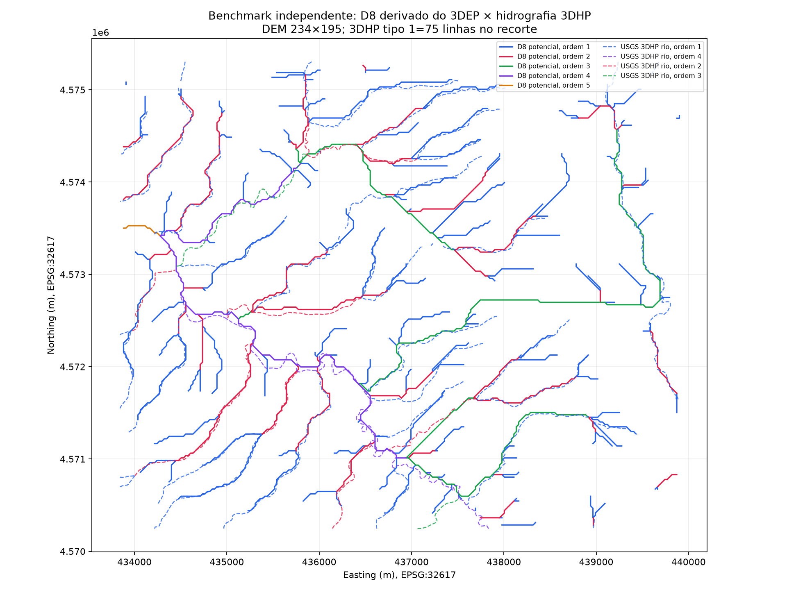

O gráfico mostra trechos coincidentes e divergentes; a tabela e o [JSON integral](../etapa-09/referencias/benchmark_3dep_3dhp_d8.json) conservam medidas por ordem, distâncias P95, comprimentos, resultados nas três tolerâncias e sensibilidade ao limiar. As métricas de cobertura são dirigidas: percentagem da rede prevista próxima da referência e percentagem da referência próxima da rede prevista não significam a mesma coisa. O deslocamento de linhas pode resultar da baixa resolução de 25,9 m, da reamostragem, da escala do limiar ou de diferenças de data/linhagem entre relevo e cartografia. Não se atribui causalidade a um único fator com este teste.

### Conclusão da subetapa

**Aprovado:** os componentes de produção executaram com dados públicos reais, produziram redes com ordem, foram pareados por tipo/ordem numa extensão comum e geraram artefatos reproduzíveis. **Reprovado para aceite de acurácia operacional:** concordância é desigual e sensível ao parâmetro; não existe critério de tolerância/homologação previamente especificado, e os dados são grosseiros/cartográficos, não controle de campo. Isto é evidência útil de desempenho comparativo, não valida hidrologia para projeto de engenharia e não muda o resultado da etapa 9.4 para DTM #72.

**Artefatos:** [DEM 3DEP](../etapa-09/referencias/3dep_aukerman_dem_context.tif), [3DHP consultado](../etapa-09/referencias/3dhp_flowlines_aukerman_context.geojson), [linhas recortadas](../etapa-09/referencias/3dhp_flowlines_3dep_clip.geojson), [manifesto](../etapa-09/referencias/3dep_3dhp_benchmark_metadata.json), [script](../../../../scripts/validate_hydro_3dep_9_5.py), [métricas](../etapa-09/referencias/benchmark_3dep_3dhp_d8.json) e [mapa](../etapa-09/referencias/benchmark_3dep_3dhp_d8.png).

**Registro histórico:** a próxima subetapa era 9.6. Ela foi executada no complemento abaixo. Nesta numeração, “9/9” identifica a fase macro final; 9.1 a 9.9 são suas subetapas. Após a 9.6, permanecem 9.7, 9.8 e 9.9 (três subetapas). O UC-010 já tem evidência de execução K-Means RGB referenciada na matriz. Aceite global continua retido.

## Fase macro 9/9 — subetapa 9.6: comparação RGB do UC-009

**Data:** 12/11/2026. **Caso de uso:** UC-009 — Detectar Mudanças Entre Dois Ortomapas. **Escopo:** correção e validação funcional da comparação de imagens RGB, incluindo alinhamento, máscara de validade, limiar, cálculo de área, persistência e visualização no mapa.

### O que a etapa encontrou e corrigiu

O UC-009 especifica comparação entre ortomapas, mas a aba “Mud” da aplicação oferecia apenas diferença de elevação DSM/DTM. A rota antiga de mudança não estava integrada ao formulário e à camada visual. A interface agora oferece dois modos distintos: mudança RGB entre ortomosaicos e diferença altimétrica entre DSM/DTM. O modo RGB permite escolher os produtos anterior e posterior, definir limiar normalizado de 0 a 1, executar, visualizar a máscara e consultar estatísticas; análise e comparação ficam persistidas no projeto.

Durante a validação, um teste conhecido mostrou que a banda alpha de GeoTIFF RGBA estava sendo contada como banda de conteúdo e distorcia o resultado. O alinhamento foi corrigido para usar apenas RGB e combinar as máscaras válidas dos dois rasters. Também foram corrigidos o uso de CRS para detectar unidade projetada e o retorno da rota que deveria separar os dados da análise e o ID da comparação. O teste de unidade e o fluxo final foram executados após essas correções.

### Dados e procedimento

- O projeto isolado de validação é o **#89**; os produtos RGB anterior/posterior são **#73** e **#74**. Foram criados a partir de um recorte de 512 × 512 pixels do ortomosaico real produzido pelo ODM, produto **#70**. Os arquivos têm EPSG:32617, grade coincidente e pixels de aproximadamente 0,05 m.
- Para conhecer a resposta esperada sem ambiguidade, a segunda imagem é uma cópia do recorte com os valores RGB invertidos somente numa janela de 100 × 100 pixels (linhas 200–299, colunas 200–299). A banda alpha e a máscara são mantidas. Assim, o teste verifica o algoritmo e a interface com uma alteração sintética conhecida, não representa duas datas/campanhas de voo reais.
- A interface executou o endpoint autenticado com limiar `0,15` (equivalente a `38,25` níveis na banda uint8), mostrou a máscara como camada de análise e registrou análise **#161** e comparação **#11** no PostgreSQL do Ortomapas. Uma consulta somente leitura confirmou os dois registros associados ao projeto #89 e aos produtos #73/#74.
- O roteiro reproduzível é [validate_uc009_rgb_phase9.py](../../../../tests/e2e/playwright/validate_uc009_rgb_phase9.py); os dados podem ser recriados por [seed_uc009_change_fixture.py](../../../../scripts/seed_uc009_change_fixture.py), desde que o produto ODM #70 esteja disponível localmente. O manifesto da execução registra IDs, respostas HTTP, controles e erros do navegador.

### Esperado versus obtido

| Critério | Esperado | Obtido | Resultado |
|---|---|---|---|
| Seleção de entradas | Dois produtos RGB do mesmo projeto e formulário próprio | Projeto #89; produtos #73 e #74 aparecem selecionados como anterior e posterior | Aprovado |
| Região conhecida | Detectar somente os 10.000 pixels RGB alterados; ignorar alpha/nodata | 10.000 pixels alterados de 262.144 válidos; teste dedicado RGBA passou | Aprovado para fixture controlada |
| Área | 10.000 × 0,00249969 m² = 24,9969 m² | API e interface apresentam 25 m² (arredondamento); 3,81% dos pixels válidos | Aprovado dentro do arredondamento |
| Mapa e legenda | Máscara visível sobre mapa, sem alteração representada como transparente | Captura mostra o patch de mudança em vermelho, legenda e camada persistida | Aprovado visualmente |
| Persistência | Salvar resultado e relação entre produtos | análise #161 (mudanças, concluída) e comparação #11 (projeto #89, produtos #73/#74) | Aprovado |
| Robustez do navegador/rota | HTTP 200, sem exceção JS; nenhum LLM necessário | Rota RGB e tiles retornaram 200; 50 tiles carregados; `page_errors=[]`, `console_errors=[]`, `llm_calls=0` | Aprovado no fluxo executado |

### Evidências Playwright

1. [Projeto com os dois ortomosaicos de teste](../etapa-09/playwright/uc009_rgb/01_projeto_com_dois_ortomosaicos.png)
2. [Formulário, escolha antes/depois e limiar](../etapa-09/playwright/uc009_rgb/02_uc009_formulario_antes_depois_limiar.png)
3. [Máscara RGB no mapa, legenda e estatísticas](../etapa-09/playwright/uc009_rgb/03_uc009_mascara_rgb_e_resultado.png)
4. [Manifesto com valores esperados, IDs e respostas](../etapa-09/playwright/uc009_rgb/manifest.json)

### Conclusão e limite

**Aprovado funcionalmente para comparação RGB determinística:** o sistema detectou o patch conhecido, calculou sua área, exibiu a camada e persistiu a comparação. A etapa corrige a lacuna entre o UC-009 e a antiga interface que só comparava elevação. **O UC-009 ainda não está aprovado para uso temporal operacional:** o ensaio posterior é sintético, derivado do mesmo voo/ortomosaico; não mede variações reais de iluminação, estação, alinhamento residual, vegetação ou mudanças semânticas. Para essa alegação será necessário comparar capturas independentes de datas distintas e estabelecer um limiar/critério de aceite adequado.

**Próxima subetapa 9.7 de 9 — UC-024/UC-029:** testar cancelamento, retomada e reprocessamento versionado com execução persistida; verificar transições de estado, idempotência, ausência de duplicidade, versões e recuperação observável. Restarão então 9.8 (revisão de critérios científicos do UC-026) e 9.9 (fechamento UC-011/UC-020 e matriz global). Portanto, 9.6 é a sexta subetapa da fase macro 9/9, não a última.

## Fase macro 9/9 — subetapa 9.7: cancelamento e reprocessamento versionado (UC-024/UC-029)

**Data:** 17/11/2026. **Objetivo:** confirmar no NodeODM real que a aplicação cria nova versão com novos parâmetros, mantém a linhagem e permite cancelar a tarefa sem afetar o processamento anterior nem seus produtos.

### Dados e método

- Projeto de validação #88, com processamento concluído #21 e 77 fotos originais preservadas (542.880.685 bytes). O processamento de origem foi gerado anteriormente com o dataset público Aukerman; não é voo do usuário. Os seis produtos originais estavam catalogados antes do ensaio.
- Serviço real consultado: NodeODM 2.2.4, motor ODM 3.5.6. Foi solicitada nova versão alterando `orthophoto-resolution` do padrão ODM para 10 cm/pixel. A aplicação reenviou as mesmas fotos preservadas, enviou as opções originais junto da opção alterada e gravou a linhagem no PostgreSQL.
- A nova tarefa foi cancelada enquanto ativa para validar a interrupção e preservar recursos. O primeiro ensaio criou #22 (versão 2); depois de corrigir os rótulos da tela e proteger a alocação concorrente do número de versão, a repetição final criou #23 (versão 3). Ambas foram canceladas, sem importar produtos. Portanto, não se executou a segunda fotogrametria até o fim. O roteiro registra a execução final #23; a captura final mostra também o histórico cancelado #22 e o processamento original.
- O [roteiro Playwright reproduzível](../../../../tests/e2e/playwright/validate_odm_versioned_reprocess_phase9.py) usa a conta local de validação; o token assinado é temporário e não é salvo no manifesto. Os cinco screenshots e o manifesto estão em [`playwright/uc024_029`](../etapa-09/playwright/uc024_029/).

### Esperado versus obtido

| Critério | Esperado | Obtido | Resultado |
|---|---|---|---|
| Nova versão e linhagem | Criar outra tarefa, vinculada ao processo #21, sem substituir a origem | Repetição final: processo #23, versão 3, `parent_processing_id=21`, NodeODM devolveu HTTP 202 e UUID próprio. O primeiro reteste registrou #22, versão 2 | Aprovado |
| Parâmetros e engine | Alterar o parâmetro escolhido e preservar os demais; registrar engine/versão | `orthophoto-resolution=10`; `dsm`, `dtm` e `pc-las` preservados; engine `odm`, versão 3.5.6 | Aprovado para o envio e persistência |
| Idempotência | Repetir a mesma chave/payload não cria tarefa; reutilizar chave com payload diferente conflita | Na execução final, replay: HTTP 200 e mesmo processo #23; alteração do payload com a mesma chave: HTTP 409 | Aprovado |
| Cancelamento real | NodeODM confirma estado terminal cancelado e histórico mantém as versões | API HTTP 200; NodeODM status code 50; #23 `cancelado`; #21 continua `concluido`; #22 também permanece cancelado do reteste anterior | Aprovado |
| Preservação dos produtos | Produtos da origem não são removidos ou alterados | #21 manteve os mesmos seis produtos; #22 e #23 não importaram produtos | Aprovado para preservação |
| Interface | Confirmação explica origem/parâmetro; histórico mostra versão e pai; cancelamento não deve parecer conclusão | Cinco capturas distintas; versão/pai visíveis; inspeção encontrou barra 100% e texto “Aguardando etapa” em tarefa cancelada. A tela foi corrigida e a captura 05 mostra “Interrompido”, aviso de ausência de produtos e sem barra enganosa; Playwright sem erro JS | Aprovado após correção visual |

### Capturas de tela

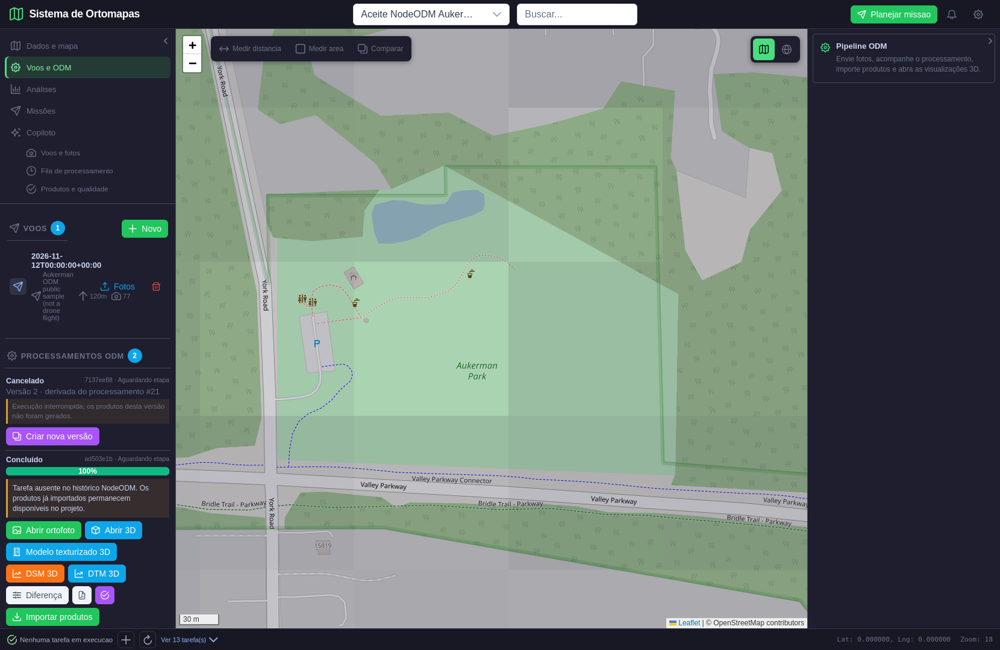

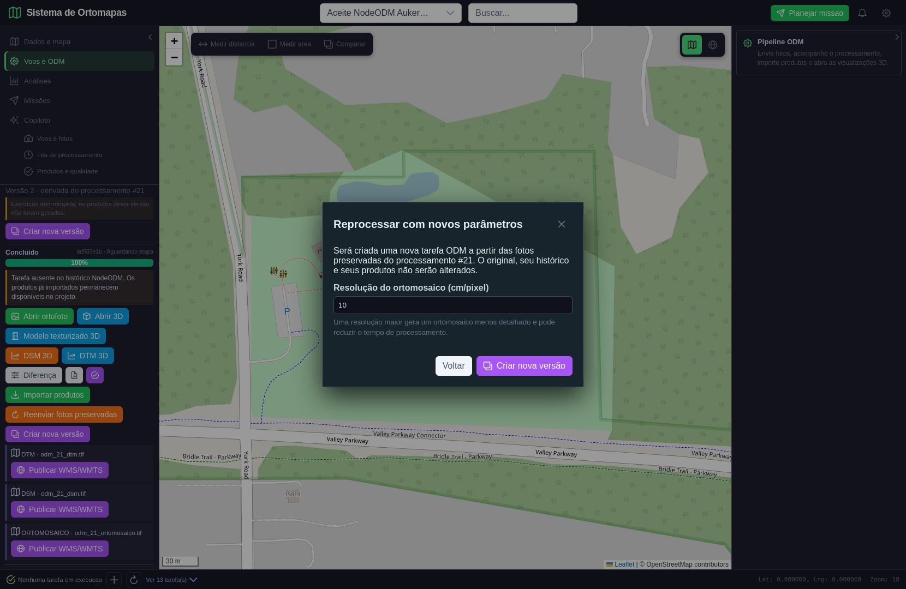

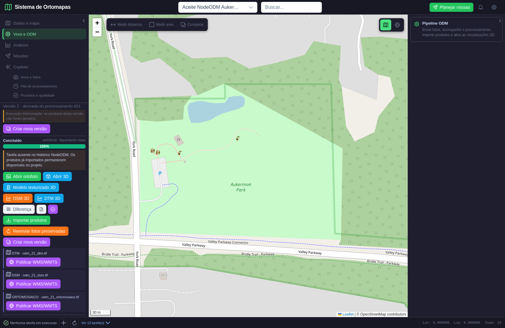

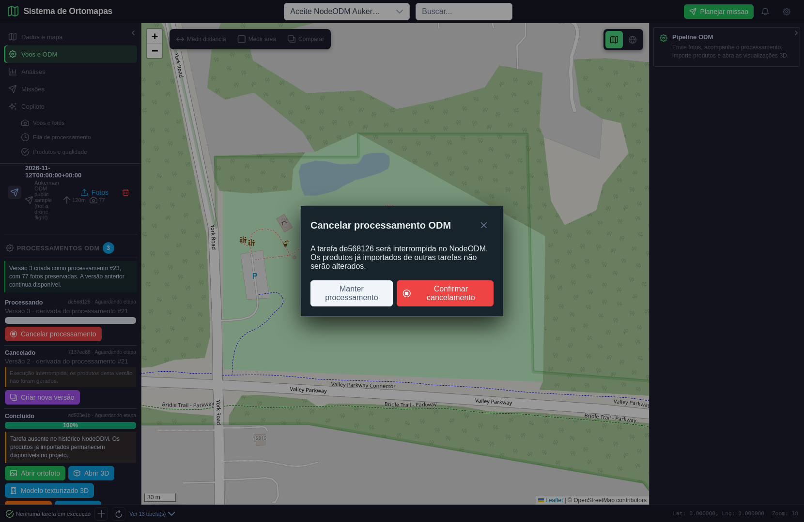

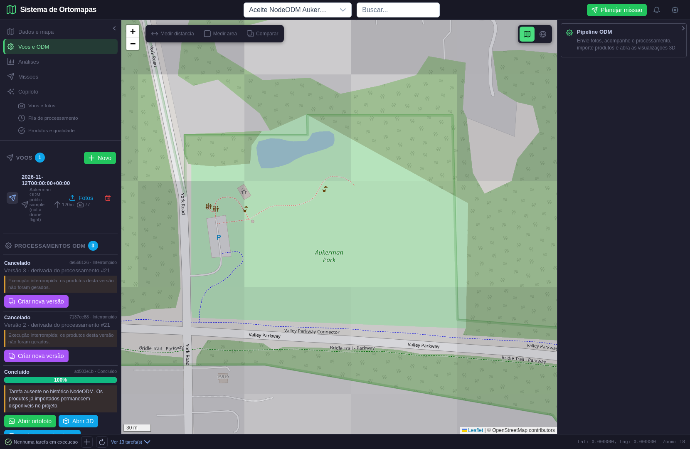

O [manifesto de validação](../etapa-09/playwright/uc024_029/manifest.json) conserva IDs, parâmetros, respostas e verificações sem tokens.

### Conclusão e limite

**UC-024:** cancelamento de tarefa real e idempotência do envio repetido foram aprovados neste cenário. A recuperação de histórico ausente já tinha evidência de contrato controlado na Fase 3; aqui, a tarefa #21 estava ausente do histórico atual do NodeODM, e a aplicação continuou mostrando seus produtos importados e permitiu criar uma versão usando as fotos locais preservadas.

**UC-029 permanece parcial:** o sistema agora cria e identifica versões com parâmetros diferentes, mas a nova tarefa foi cancelada antes de gerar ortomosaico/DSM. Assim, ainda não há comparação quantitativa de dois resultados fotogramétricos concluídos. O aceite dessa parte exige executar versões de origem e reprocessada até o fim e comparar dimensões, CRS, GSD, métricas de qualidade e produtos; este teste não afirma essa comparação.

**Próxima subetapa 9.8 de 9 — UC-026:** auditar indicadores/relatórios de qualidade e separar métricas operacionais de acurácia posicional/vertical; comparar cada afirmação com o que os dados realmente permitem concluir. Restará a 9.9 para fechar UC-011/UC-020, reconciliar UCs ainda parciais — incluindo a comparação de resultados do UC-029 — e decidir o aceite global. Após a 9.7, faltam duas subetapas.

## Fase macro 9/9 — subetapa 9.8: auditoria do indicador de qualidade ODM (UC-026)

**Data:** 17/11/2026. **Objetivo:** verificar o que a nota de qualidade realmente calcula, confrontá-la com os produtos e o relatório ODM reais, corrigir a semântica apresentada ao usuário e registrar os limites de acurácia.

### Dados reais e método

- Projeto #88 e processamento concluído #21; mesmo conjunto público Aukerman já processado por ODM 3.5.6 (77 imagens). Nenhum novo processamento fotogramétrico foi iniciado e nenhuma chamada a LLM foi feita.
- Os seis produtos permaneceram no PostgreSQL; ortomosaico, DSM e DTM foram inspecionados com Rasterio, nuvem LAZ com Laspy e o relatório PDF original com `pdftotext`. A captura foi refeita por Playwright na interface e o endpoint autenticado foi consultado por HTTP GET.
- A pontuação do código era a média de três condições booleanas: registro de ortomosaico, registro de DSM/DTM e nuvem LAZ com pelo menos 100 mil pontos. Não consultava checkpoints de campo, GCP independentes, erro de reprojeção, GSD alvo, qualidade de alinhamento nem qualidade radiométrica. Embora devolvesse `nivel=bom`, não era uma nota de qualidade científica.
- Corrigi o contrato sem remover a chave `score` usada por compatibilidade: a API agora declara `tipo_score=completude_de_catalogo_e_volume_de_nuvem`, informa que avalia registros de ortomosaico e DSM/DTM mais a leitura do cabeçalho LAZ com limiar de pontos, explicita limites, usa `nivel=completa/parcial` e identifica a resolução raster em unidades do CRS. A interface passou a exibir “Completude de produtos” e um aviso visível de que não é uma nota de acurácia.

### Esperado versus obtido

| Critério | Esperado | Obtido | Resultado |
|---|---|---|---|
| Significado da nota | Diferenciar completude operacional de qualidade/precisão fotogramétrica | API retornou `score=100`, `tipo_score=completude_de_catalogo_e_volume_de_nuvem`, `nivel=completa` e limites explícitos; UI mostra completude, não “Qualidade: 100%” | Aprovado após correção semântica |
| Regras contabilizadas | Expor as três verificações que compõem a nota | Ortomosaico presente; DSM/DTM presente; nuvem LAZ presente e 15.889.672 pontos (limite interno: 100.000) | Aprovado como indicador de presença/completude |
| Geometria dos rasters | API coerente com arquivos reais quanto a dimensão, CRS e resolução | Orto 7.449 × 5.906, DSM 7.448 × 5.905, DTM 7.449 × 5.906; os três em EPSG:32617 e aproximadamente 0,05 m/pixel; dimensões/pixels da API conferiram com Rasterio | Aprovado para leitura de metadados; não é validação da acurácia do raster |
| Relatório ODM | Ler indicadores do processamento sem tratá-los como prova de campo | PDF: 77/77 imagens reconstruídas, GSD médio reportado 2,8 cm, erro GPS 0,85 m, CE90 horizontal absoluto 0,717 m e LE90 vertical absoluto 1,220 m | Valores do relatório confirmados; são estimativas ODM e não foram comparados a checkpoints independentes |
| GSD versus pixel exportado | Não confundir resolução de saída com GSD | Relatório estima GSD de 2,8 cm; GeoTIFF tem pixel próximo de 5 cm. São medidas distintas (GSD médio estimado versus espaçamento da grade de saída), não necessariamente uma inconsistência | Limite esclarecido; adequação ao uso não certificada |
| Tela e navegador | Mostrar o alcance do score e o aviso ao usuário na tarefa real | Captura mostra projeto #88, processo concluído #21, completude 100%, escopo das três condições e aviso contra inferir acurácia; `page_errors=[]`, `console_errors=[]` | Aprovado visualmente |

### Captura e manifesto

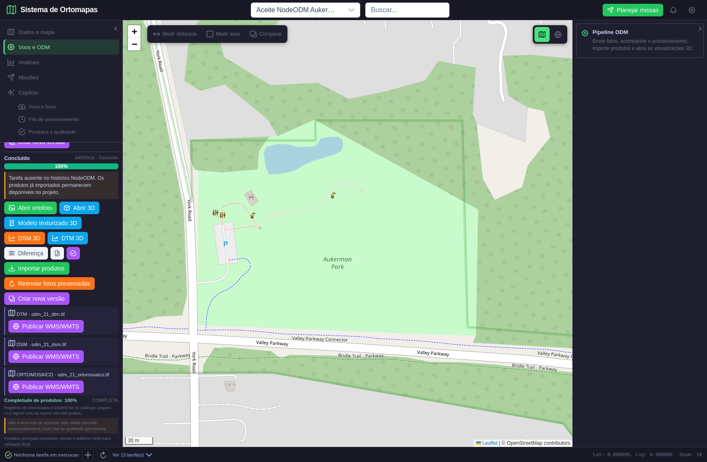

O [manifesto da validação](../etapa-09/playwright/uc026_quality/manifest.json) contém status HTTP, comparação esperado/obtido, metadados conferidos independentemente, estatísticas transcritas do relatório, caminhos relativos dos produtos e ausência de erros do navegador. O [roteiro Playwright reproduzível](../../../../tests/e2e/playwright/validate_uc026_quality_phase9.py) não persiste o token temporário.

### Conclusão e pendência

**Correção funcional/semântica aprovada:** a API e a interface não apresentam mais as três checagens como avaliação abrangente de qualidade; a tela deixa claro o que 100% significa. Os metadados de raster e a contagem da nuvem coincidiram com leituras independentes dos arquivos.

**UC-026 permanece parcial para aceite científico/operacional.** O PDF do ODM reporta estimativas baseadas no ajuste do conjunto com referência GPS, mas esta revisão não dispõe de pontos de checagem independentes nem de levantamento de referência para confirmar acurácia absoluta/relativa. Também não foi estabelecido um erro máximo tolerável para o uso pretendido. Portanto, 100% significa somente que as três condições operacionais passaram; não certifica a precisão nem a aptidão do mapa para medições.

**Próxima subetapa 9.9 de 9 — reconciliação e decisão de aceite:** fechar UC-011/UC-020 nos limites científicos já registrados, definir explicitamente o destino das pendências obrigatórias (inclusive UC-009 campanhas independentes, UC-029 comparação de duas fotogrametrias concluídas e UC-026 checkpoints/tolerâncias), atualizar a matriz final e decidir se há aceite ou bloqueio por falta de dados de referência. Após a 9.8, resta uma subetapa.

## Fase macro 9/9 — subetapa 9.9: reconciliação final e decisão de aceite

**Execução:** 18/11/2026
**Objetivo:** concluir a validação funcional comparativa do UC-029, reconciliar os UCs parciais e decidir formalmente se o produto pode receber aceite operacional global.

### UC-029 — duas versões reais concluídas

O teste usou o projeto #88 e o conjunto público Aukerman de 77 fotografias (542.880.685 bytes preservados). É um dataset público de demonstração, não voo de drone do usuário nem levantamento de Guarajuba. O processamento original #21 já estava concluído. Pela interface foi criada e enviada ao NodeODM a versão #24 (versão 4, pai #21), alterando `orthophoto-resolution` para 10 cm/pixel. NodeODM 2.2.4 executou ODM 3.5.6 e terminou com status code 40, 100%, em 1.438.751 ms (23 min 59 s). O Playwright importou os seis produtos: ortomosaico, DSM, DTM, relatório, nuvem LAZ e modelo 3D.

### Esperado versus obtido

| Critério | Esperado | Obtido | Resultado |
|---|---|---|---|
| Execução terminal | Processo novo conclui no NodeODM e persiste como concluído | NodeODM code 40; API/DB #24 `concluido`; versão 4 e referência ao pai #21 | Aprovado funcionalmente |
| Parâmetro | 10 cm/pixel aplicado à ortofoto | Orto #21: 0,049999 m/pixel; #24: 0,100000 m/pixel; ambos EPSG:32617 | Aprovado |
| Importação e proteção do histórico | Seis saídas novas catalogadas; seis produtos originais preservados | Importação HTTP 200; produtos #24: ortomosaico, DSM, DTM, relatório, LAZ, modelo 3D; produtos #21: 6 antes e depois | Aprovado funcionalmente |
| Cobertura/grade comparável | Sobreposição espacial e amostra comum verificáveis | Orto/DSM/DTM em EPSG:32617; extensão comum equivale a 100% da extensão original; janela central pareada 512×512 com 262.144 pixels válidos em cada comparação | Aprovado para comparação interna |
| Diferença do ortomosaico | Medir diferença radiométrica, sem presumir limite inexistente | 3 bandas RGB; MAE 5,542 DN, RMSE 7,817 DN, máximo 88 DN. Orto #21 7449×5906; #24 3739×2979 | Medido; não existe limiar de aceitação radiométrica definido |
| Diferença DSM | Comparar superfícies nas mesmas coordenadas | MAE 0,041879 m; RMSE 0,288360 m; máximo 11,837997 m | Medido; sem checkpoint/limiar independente, não prova acurácia vertical |
| Diferença DTM | Comparar terreno nas mesmas coordenadas | MAE 0,023157 m; RMSE 0,028451 m; máximo 0,204498 m | Medido; sem checkpoint/limiar independente, não prova acurácia vertical |
| Nuvem de pontos | Confirmar arquivos e cardinalidade | LAZ #21: 15.889.672 pontos; #24: 15.783.502 pontos | Produtos presentes; variação de contagem sem critério de qualidade definido |
| Linhagem e não destruição | Pai/versão explícitos, histórico da origem intacto | #24/v4 deriva de #21; seis produtos #21 continuam registrados; verificações automatizadas passaram | Aprovado |
| Interface | Mostrar tarefa concluída e produtos sem erro de navegador | Captura Playwright após importação; erros de página e console vazios | Aprovado visualmente |

As diferenças de pixel e elevação são comparações entre duas reconstruções das **mesmas 77 fotos**. Elas comprovam que o versionamento e a comparação funcionam e descrevem as saídas observadas; não certificam georreferenciamento, qualidade fotogramétrica, acurácia vertical ou aptidão para projeto de engenharia. Para isso faltam GCP/checkpoints independentes e tolerâncias quantitativas previamente acordadas.

### Capturas da execução

1. A tarefa #24 aparece concluída no NodeODM, antes da importação: [captura 06](../etapa-09/playwright/uc029_reprocess/06_tarefa_concluida_antes_importar.png).
2. Produtos da versão importada aparecem no projeto junto ao histórico: [captura 07](../etapa-09/playwright/uc029_reprocess/07_produtos_importados_comparacao.png).
3. As capturas anteriores mostram a origem preservada, alteração para 10 cm, envio, fila e progresso: [01 versão original](../etapa-09/playwright/uc029_reprocess/01_versao_original.png), [02 parâmetro](../etapa-09/playwright/uc029_reprocess/02_parametro_alterado.png), [03 tarefa ativa](../etapa-09/playwright/uc029_reprocess/03_tarefa_ativa_nodeodm.png), [04 rótulo incorreto detectado](../etapa-09/playwright/uc029_reprocess/04_progresso_intermediario.png) e [05 reteste após correção](../etapa-09/playwright/uc029_reprocess/05_rotulo_processando_corrigido.png).

A captura 04 encontrou uma inconsistência de UI: processo em execução sem subetapa mostrava “Aguardando etapa”. Corrigi o fallback em `OdmTasks.vue` para “Executando no NodeODM”. A captura 05 confirma estado “Processando”, progresso visível e mensagem coerente. O build e a validação Playwright foram refeitos; não houve erro JS/console. As observações desta correção estão no [manifesto JSON](../etapa-09/playwright/uc029_reprocess/manifest.json), junto com opções efetivas, resposta terminal, métricas, produtos importados e checks.

### Reconciliação final dos casos de uso

| UC | Estado após a reconciliação 9.9 | O que ainda impede aceite operacional pleno |
|---|---|---|
| UC-009 — comparação de mudanças | Parcial: comparação RGB controlada foi demonstrada na 9.6 | Campanhas reais independentes, registro entre datas e critérios para iluminação/estação |
| UC-010 — classificação | K-Means RGB foi executado nos dados testados; sem validação semântica | Amostras rotuladas independentes e métricas de classe; RGB não equivale a multiespectral |
| UC-011 — hidrologia | Algoritmos e fluxo visual demonstrativos funcionam; aceite hidrológico retido | DTM e rede de referência coincidentes, referência independente e critérios quantitativos aprovados |
| UC-020 — fila de análise | Fila/worker provados apenas para tipos descritos na matriz; parcial | Enfileirar mudança e volume, integrar segmentação/classificadores supervisionados e manter fila separada do Copiloto |
| UC-024 — recuperação | Cancelamento, idempotência e nova versão testados com NodeODM real | Cenário de tarefa perdida e endpoint `/recuperar` ainda não executados contra falha real no serviço |
| UC-026 — qualidade | Indicador corrigido para completude operacional, não “qualidade 100%” | Checkpoints/GCP independentes, tolerâncias e critérios adequados ao uso |
| UC-029 — reprocessamento comparativo | **Aprovado funcionalmente** em #21/#24, incluindo importação, versão, parâmetro e comparação | A aprovação não inclui acurácia externa; esta segue dependente de referência independente e tolerâncias |

Os resultados individuais, evidências anteriores e links estão na [matriz de rastreabilidade reconciliada](../../analise/matriz_rastreabilidade_ortomapas_fase1.md). A fila de análises espaciais UC-020 não é o chat do Copiloto; nenhuma aprovação dos workers foi usada como prova do agente conversacional.

### Decisão final da Fase 9

**Subetapas 9.1 a 9.9 concluídas; restam zero etapas numeradas no plano atual.** A conclusão da fase significa que todos os trabalhos nela planejados foram reconciliados e documentados. Não significa que todos os casos de uso receberam aceite operacional.

**Decisão: aceite operacional global retido.** Razões: faltam evidências de campo/referência independente para os critérios científicos de UC-009, UC-011 e UC-026; UC-020 ainda tem tipos de análise fora da fila; UC-024 não tem recuperação real testada; UC-010 não tem verdade de campo para qualidade semântica. UC-029, ao contrário, passou no escopo funcional versionado explicitado nesta seção. Para avançar ao aceite global será preciso fornecer datasets/referências e tolerâncias para essas validações, completar os tipos de análise pendentes e executar a matriz correspondente. Não restam etapas da Fase 9 a renumerar; são critérios de produto que ainda requerem entradas e trabalho próprio.

Android, controle DJI e simulador de drone seguem como produtos separados e não alteram esta decisão do Ortomapas Web.

## Fase pós-9 — etapa proposta 10.1: recuperação real de tarefa NodeODM (UC-024)

**Execução:** 19/11/2026
**Estado:** aprovada para o cenário real de recuperação executado. A Fase 10 é uma sequência proposta depois do plano original 9.1–9.9, sem renumerar a Fase 9.

### Pré-condição real e esperado

No projeto #88, o processo de origem #21 estava concluído no PostgreSQL, com 77 fotos originais preservadas (542.880.685 bytes) e seis produtos catalogados. O NodeODM 2.2.4 confirmou que o UUID original `ad503e1b-b88d-55d7-ad2b-6ddcdd78902b` não existe mais: `GET /task/{uuid}/info` respondeu HTTP 200 com JSON de erro `not found`. A API do Ortomapas marcou `nodeodm_missing=true` e `recovery_available=true`; a interface exibiu o aviso e o botão de reenviar as fotos.

O resultado esperado era reenviar as fotos preservadas uma vez ao NodeODM real, criar uma nova linha de processamento ligada ao #21, acompanhar até terminar, importar os seis tipos de produto e manter intactos as fotos e os produtos originais.

### Execução e esperado versus obtido

| Verificação | Esperado | Obtido | Resultado |
|---|---|---|---|
| Detecção da ausência | Distinguir UUID inexistente de NodeODM indisponível | NodeODM respondeu HTTP 200 com erro `not found`; API classificou a tarefa como ausente e habilitou recuperação | Aprovado |
| Proteção dos originais | Manter 77 fotos e seis produtos do processamento #21 | Antes e depois: 77 fotos, 542.880.685 bytes e seis produtos; processo #21 continuou `concluido` | Aprovado |
| Reenvio real | A UI envia as fotos locais e registra relação de origem | Clique confirmado na interface; API HTTP 202; processamento #25 ligado ao #21, UUID novo, 77 imagens e 542.880.685 bytes | Aprovado |
| Estado NodeODM | Acompanhar tarefa até status final de sucesso | NodeODM 2.2.4 / ODM 3.5.6: status code 40, 100%; processamento #25 terminou em 1.582.134 ms (26 min 22 s) | Aprovado |
| Importação | Catalogar ortomosaico, DSM, DTM, relatório, LAZ e modelo 3D | Endpoint de importação HTTP 200; seis tipos catalogados e seis arquivos físicos confirmados; uma única linha de recuperação para #21 e UUID substituto presente em `/task/list` | Aprovado sem duplicidade neste envio |
| Rasters | Confirmar CRS, resolução e dimensões dos novos arquivos | Orto EPSG:32617, ~0,05 m/pixel, 7.419×5.923; DSM e DTM EPSG:32617, 0,05 m/pixel, 7.419×5.922 | Aprovado como existência/metadados, sem declarar acurácia |
| Navegador | Executar o fluxo pela UI sem erros de JavaScript | `page_errors=[]`, `console_errors=[]`; manifesto não armazena token e não houve chamada a LLM | Aprovado |

Todos os seis arquivos físicos foram encontrados: GeoTIFF de ortomosaico (90.192.112 bytes), DSM (59.441.101 bytes), DTM (72.624.182 bytes), PDF do relatório (15.570.044 bytes), LAZ (58.940.461 bytes; 15.769.914 pontos, EPSG:32617) e GLB (43.861.476 bytes). As verificações de tipos, tamanhos, CRS e geometrias atestam catalogação/geração, não precisão científica.

### Capturas e recuperação do monitoramento

- [01 — tarefa #21 ausente, produtos preservados e botão habilitado](../etapa-10/uc024_real_recovery/01_tarefa_origem_ausente.png)
- [02 — diálogo de confirmação do reenvio](../etapa-10/uc024_real_recovery/02_confirmacao_de_recuperacao.png)
- [03 — nova tarefa real no NodeODM](../etapa-10/uc024_real_recovery/03_nova_tarefa_nodeodm.png)
- [Capturas intermediárias de progresso](../etapa-10/uc024_real_recovery/)
- [Tela final com #25 concluído e produtos importados](../etapa-10/uc024_real_recovery/recuperacao_concluida_produtos_importados.png)

O processo de acompanhamento no terminal foi encerrado pelo ambiente depois de aproximadamente 20 minutos, enquanto o NodeODM seguia executando. A retomada usou o UUID #25 já gravado no manifesto; **não reenviou as fotos nem criou nova tarefa**. O mesmo monitor capturou 58,5%, 73,8%, 88,2% e 100%, importou os produtos e confirmou o estado terminal. A sequência aparece no [manifesto JSON](../etapa-10/uc024_real_recovery/manifest.json). Os roteiros reproduzíveis são [`validate_uc024_real_recovery_phase10.py`](../../../../tests/e2e/playwright/validate_uc024_real_recovery_phase10.py) e [`finalize_uc024_real_recovery_phase10.py`](../../../../tests/e2e/playwright/finalize_uc024_real_recovery_phase10.py).

### Conclusão da etapa 10.1

**UC-024 aprovado nos cenários exercitados:** além do cancelamento e da idempotência/conflito registrados na 9.7, a recuperação foi executada com a tarefa ausente no NodeODM real, e os produtos foram regenerados/importados sem perder a origem. Isto valida a recuperação operacional desse caso específico, com fotos preservadas. Não prova retomada a partir de checkpoint intermediário do ODM: o comportamento executado reenviou o conjunto completo e iniciou um processamento novo, como a própria UI informa.

**Status atualizado após a etapa 10.2:** concluída. A etapa seguinte 10.3 e seu encerramento estão documentados abaixo. A Fase 10 é um plano pós-Fase 9 e seu escopo continua sujeito à matriz de requisitos. Veja o [relatório detalhado da 10.2](../etapa-10/uc020_queue_coverage/relatorio.md) e o [plano MD/PDF](../../analise/plano_conclusao_ortomapas_web.md).

## Fase pós-9 — etapa proposta 10.2: cobertura da fila espacial (UC-020)

**Execução:** 19/11/2026
**Estado:** aprovada funcionalmente para o escopo v2 da fila.
**Relatório detalhado:** [UC-020 — mudança RGB e volume](../etapa-10/uc020_queue_coverage/relatorio.md).

A etapa integrou à fila duas operações já previstas em casos de uso próprios: mudança RGB (UC-009) e volume por cota (UC-012). Playwright iniciou ambas no projeto público Aukerman #88; a API devolveu HTTP 202, o worker `agente_mudanca_fila` processou e o PostgreSQL manteve tarefa e resultado concluídos. A interface foi percorrida, a camada selecionada no mapa, estatísticas conferidas e o serviço autenticado de tiles respondeu HTTP 200 para as duas saídas. Foram capturadas telas do formulário e do mapa.

### Comparação do esperado com o obtido

| Checagem | Esperado | Obtido |
|---|---|---|
| Mudança RGB | Análise assíncrona, máscara persistida, comparação registrada, camada e tile renderizados | Análise #168, tarefa #45; `concluida`/`concluido`; um registro temporal; tile 256×256 com 1.585 pixels opacos; camada e estatísticas visíveis |
| Mudança medida | Contagem de pixels válidos e acima do limiar | 2.056.078 de 43.993.794 pixels válidos (4,674%) com limiar 0,15 |
| Volume | DSM/cota válidos, raster persistido, corte e aterro e camada visíveis | Análise #169, tarefa #46; DSM #71 e cota 241 m; 35.481.781 pixels válidos (88.704,45 m²); corte 456.241,11 m³; aterro 109.387,50 m³; saldo 346.853,62 m³; tile com 27.586 pixels opacos |
| UI/JavaScript | formulário descreve a operação selecionada e abre o resultado atualizado | dica específica exibida; camada e estatísticas confirmadas; nenhum erro de página |

O dataset é público CC0 Aukerman. As duas ortofotos são resoluções diferentes da **mesma missão de 77 fotos**, não campanhas independentes. Portanto, a mudança demonstra que o fluxo e o algoritmo executam; não demonstra variação temporal real nem correção por luz/sazonalidade. O volume usa elevações do DSM e assume metros; o número não foi comparado a topografia de campo.

A validação visual detectou uma lista com metadados desatualizados: a linha mostrava “OK”, mas a camada não era adicionada ao mapa. Corrigi `AnalysisResults.vue` para consultar o detalhe antes de criar a camada. A repetição final comprovou painel da camada, estatísticas e tiles autenticados para ambos os resultados. Também corrigi a dica de fila no formulário e retirei opções de mudança e classificação que não correspondiam aos algoritmos efetivamente aceitos. UC-010 v2 define K-Means RGB; segmentação e classificação supervisionada não são critérios aprovados de UC-020.

O teste numérico determinístico controlado confirmou 4 pixels alterados e volumes de 12,00 m³/12,00 m³/saldo zero nos rasters sintéticos de controle. Isso valida os cálculos básicos, não qualidade de campo.

**Decisão:** UC-020 está implementado com evidência funcional no escopo aprovado. A decisão não promove a qualidade científica de UC-009/010/011/012; as limitações próprias desses UCs permanecem. A fila assíncrona não é o Copiloto.

**Próxima etapa: 10.3 de 7 — comparação entre campanhas independentes (UC-009). Restam cinco etapas propostas, 10.3–10.7.**

## Fase pós-9 — etapa proposta 10.3: campanhas independentes para UC-009

**Execução:** 20/11/2026
**Resultado:** fluxo funcional aprovado; qualidade da detecção física segue parcialmente aceita.
**Relatório detalhado:** [UC-009 — Aklavik 2022/2024](../etapa-10/uc009_independent_campaigns/relatorio.md).

A etapa anterior 10.2 usou ortofotos de resoluções diferentes da mesma missão. Para esta, baixei apenas os ortomosaicos do dataset público [Aklavik UAV 2022/2024](https://zenodo.org/records/14608566), duas campanhas DJI Mini 2 no mesmo local, separadas por cerca de 18 meses. A publicação informa alinhamento entre elas. O MD5 dos dois TIFFs (710.706.206 bytes cada) bate com o registro. Os originais seguem locais em `data/validacao/uc009_aklavik/`, fora do Git.

### Esperado versus obtido

| Checagem | Esperado | Obtido |
|---|---|---|
| Campanhas independentes | Datas/aquisições diferentes, não novos processamentos da mesma captura | 19–21/09/2022 e 22–24/03/2024 segundo o dataset; produtos #81/#82 no projeto #90 |
| Compatibilidade | CRS/resolução compatíveis e área coincidente | EPSG:32608; grade 15.993×14.811; ~0,10 m; affine igual e 100% de sobreposição |
| Fila e persistência | HTTP 202, worker concluído, máscara e registro temporal | Análise #171, tarefa #48; `concluida`/`concluido`; um registro temporal |
| Apresentação | Resultado RGB visível com estatísticas e tiles autorizados | 24 tiles no mapa HTTP 200, tile independente 256×256 com 9.134 pixels opacos, painel de estatísticas presente, erros JS/console zero |
| Interpretação | Não rotular pixels acima do limiar como verdade de campo | 77,96% (184.657.551/236.872.323 pixels) acima do limiar; UI agora nomeia a métrica assim e mostra aviso de iluminação/estação |

As medianas RGB amostradas foram 153/142/136 (2022) e 81/86/91 (2024), confirmando forte diferença de distribuição entre épocas. Os 77,96% e 184,65 ha são resposta matemática do método de diferença RGB com limiar 0,15; sem polígonos rotulados, não medem construções, desmatamento ou outras mudanças físicas verdadeiras. A aplicação alinha grades por reprojeção, mas não estima registro por feições nem normaliza variação sazonal. Não acrescentei uma normalização não validada sem verdade independente que indique se ela remove falsos positivos ou mascara mudanças reais.

A revisão das capturas também revelou rótulos genéricos e potencialmente enganadores para a máscara binária. Corrigi `AnalysisResults.vue`: as métricas de mudança agora dizem “pixels/área acima do limiar”, exibem apenas contagens/áreas relevantes e explicam a sensibilidade sazonal. Rebuild passou. O reteste visual confirmou aviso, sete métricas, 24 tiles HTTP 200 e overlay vermelho visível no mapa.

### Evidência visual

- [Formulário 2022/2024, limiar 0,15 e fila](../etapa-10/uc009_independent_campaigns/01_formulario_campanhas_antes_depois.png)
- [Máscara sobre Aklavik, métricas e aviso](../etapa-10/uc009_independent_campaigns/02_resultado_mascara_mapa_estatisticas.png)
- [Tile da máscara](../etapa-10/uc009_independent_campaigns/tile_uc009_mudancas.png)
- [Manifesto sanitizado com checks, status e medidas](../etapa-10/uc009_independent_campaigns/manifest.json)

**Decisão:** a etapa 10.3 está concluída no escopo funcional: o sistema compara duas campanhas independentes, persiste e exibe o resultado. UC-009 continua parcial para aceite científico/operacional, devido à falta de referência rotulada e à sensibilidade a estação/iluminação demonstrada nesta execução.

**Próxima etapa: 10.4 de 7 — qualidade semântica de classificação (UC-010). Restavam quatro etapas propostas, 10.4–10.7.**

## Fase pós-9 — etapa proposta 10.4: auditoria K-Means RGB (UC-010)

**Execução:** 24/11/2026
**Resultado:** repetibilidade funcional aprovada nos dados reais exercitados; aceite semântico parcial.
**Relatório detalhado:** [UC-010 — K-Means RGB e qualidade semântica](../etapa-10/uc010_semantic_quality/relatorio.md).

O script de auditoria chamou a mesma função K-Means de produção em janelas de 768×768 dos ortomosaicos UAV Aklavik 2022 e 2024. Cada fonte produziu cinco grupos ocupados a partir de 100.000 amostras. A repetição do processamento deu concordância exata de 100% em cada campanha e preservou EPSG:32608, transformação, contagem, áreas e percentuais. Depois, o fluxo Playwright foi percorrido no projeto #90: ativou o ortomosaico #81, desenhou uma AOI, gerou e persistiu a análise #173 e exibiu o resultado classificado no mapa. O teste confirmou 25 tiles carregados, com tile de resultado de 256×256/65.536 pixels opacos e zero erros de browser/console.

### Esperado versus obtido

| Verificação | Esperado | Obtido |
|---|---|---|
| Processar imagens UAV reais | Cinco grupos solicitados e ocupados | Cinco grupos ocupados em cada janela de 589.824 pixels |
| Amostragem | No máximo 100.000 amostras válidas | 100.000 por campanha |
| Repetibilidade | Mesma entrada e parâmetros produzem o mesmo raster | Concordância pixel a pixel de 100% nas duas campanhas |
| Sistema de coordenadas | Preservar referência e grade | EPSG:32608 e affine preservados |
| Acurácia semântica | Comparar a máscaras independentes e medir IoU/F1 etc. | Sem máscara local correspondente; tentativa de baixar LandCover.ai falhou por DNS. Nenhuma acurácia foi inventada |

As capturas [formulário](../etapa-10/uc010_semantic_quality/03_ui_projeto_mapa_e_configuracao_uc010.png), [desenho da AOI](../etapa-10/uc010_semantic_quality/04_ui_aoi_em_desenho.png), [AOI finalizada](../etapa-10/uc010_semantic_quality/05_ui_aoi_selecionada_no_ortomosaico.png) e [resultado colorido e estatísticas](../etapa-10/uc010_semantic_quality/06_ui_resultado_kmeans_grupos_e_mapa.png) mostram quatro estados distintos. O [tile rasterizado](../etapa-10/uc010_semantic_quality/07_tile_kmeans_classificacao.png) e o [manifesto Playwright](../etapa-10/uc010_semantic_quality/playwright_manifest.json) complementam a conferência visual.

Na primeira execução da UI, o processamento #172 terminou; o roteiro marcou erro porque examinou uma margem transparente como se fosse o tile de dados. Ajustei a asserção para percorrer vários XYZ e confirmar um tile com conteúdo. A execução final #173 passou. Ambos os produtos foram preservados como dados de validação no projeto.

A inspeção detectou que uma janela 2024 totalmente preta podia ser aceita pelo scikit-learn com cinco grupos solicitados, embora somente um estivesse ocupado. O backend agora rejeita diversidade insuficiente antes de gravar saída; o teste de regressão comprova o erro claro e a ausência do GeoTIFF parcial. Pixels pretos continuam válidos como entrada RGB, conforme o requisito.

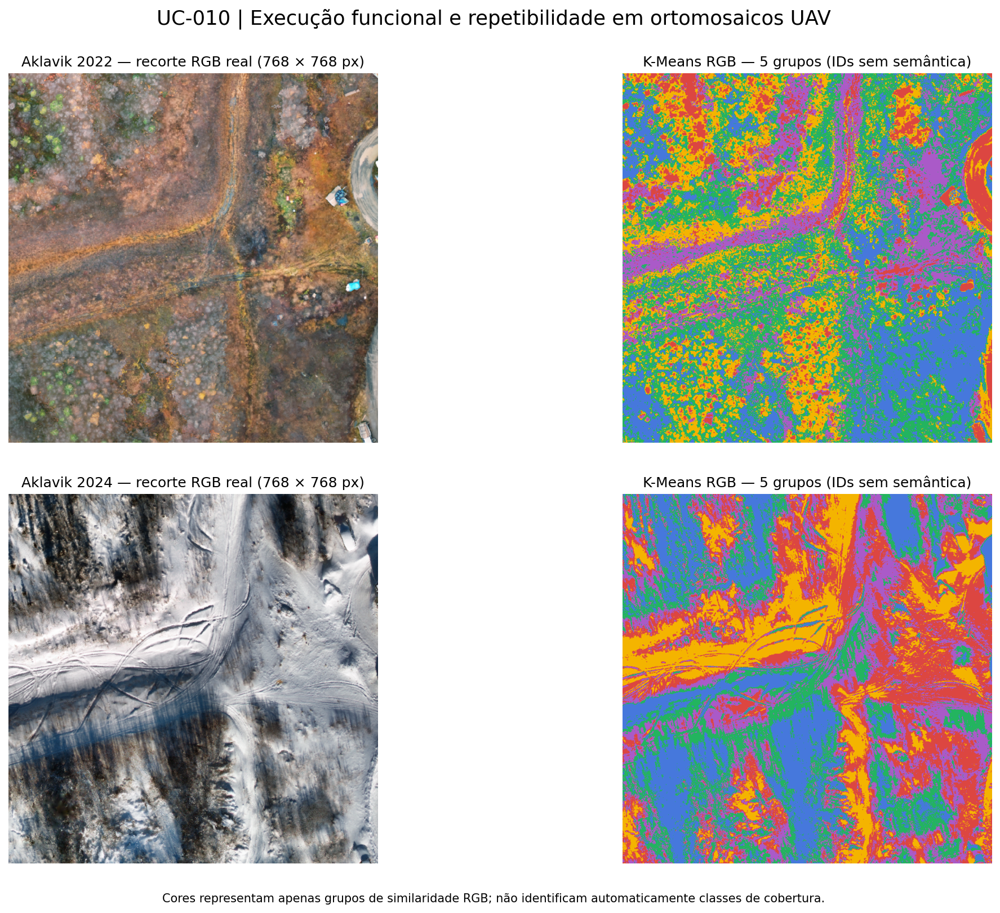

A figura é uma composição técnica dos rasters reais, não uma captura da interface. As cores/IDs expressam apenas agrupamento por similaridade RGB; não representam classes como vegetação, água ou solo. O conjunto rotulado [LandCover.ai](https://landcover.ai/download/landcover.ai.v1.zip) foi localizado na web, mas não pôde ser transferido por falha DNS. O [ISPRS Potsdam](https://www.isprs.org/resources/datasets/benchmarks/UrbanSemLab/2d-sem-label-potsdam.aspx) é uma alternativa oficial de referência, mas seu pacote indicado no portal é de 13,3 GB e não foi baixado. O [UAVid](https://uavid.nl/) também oferece imagens UAV e rótulos semânticos.

**Decisão:** a etapa 10.4 encerra a auditoria funcional/robustez; UC-010 ainda é parcial para interpretação semântica. Não há evidência para alegar acurácia de classificação de cobertura do solo. 10 testes de `test_vegetation_classification.py` passaram. O relatório individual e o manifesto registram dados, métricas e limitação.

## Fechamento da Fase 10 — etapas 10.5–10.7 (24/11/2026)

As três etapas restantes do plano foram executadas, validadas e documentadas com capturas próprias da interface.

### 10.5 — Hidrologia/UC-011

Playwright percorreu rede D8, exportação GeoJSON/KML, bloqueio de submissão sem exutório e delimitação de bacia com o DTM real #72 do projeto #88. As análises #174/#175 foram persistidas como concluídas; a rede apresentou 21 feições, e os 25 tiles da bacia responderam HTTP 200. O exutório foi ajustado em 86,0 m dentro do raio de 100 m. Esse valor é um alerta de localização, não prova de precisão. O benchmark independente no recorte USGS 3DEP/3DHP concordou com GRASS (IoU 98,66%), mas o D8 não condicionado obteve IoU 0,256% contra o catchment oficial; o condicionamento elevou a IoU a 71,34%. A rede pareada teve F1 71,61% para uma ordem/tolerância em uma bacia. **Fluxo funcional aprovado; UC-011 segue parcial e não aceito para hidrologia operacional ampla.** Ver [relatório, telas e manifesto](../etapa-10/uc011_hydrology/relatorio.md).

### 10.6 — Acurácia/UC-026

A API/tela do processamento real #21 foi repetida e comparada com leitura independente de GeoTIFF, LAZ e PDF ODM. A completude 100% corresponde a três verificações de catálogo/volume da nuvem; o LAZ contém 15.889.672 pontos, e os rasters estão em EPSG:32617 com pixels próximos de 0,05 m. O relatório ODM informa GSD de 2,8 cm, GPS de 0,85 m, CE90 de 0,717 m e LE90 de 1,220 m, mas não foram localizados checkpoints independentes nem tolerâncias estabelecidas. **A auditoria de completude/metadados passou; acurácia externa segue não comprovada.** Ver [relatório, captura e manifesto](../etapa-10/uc026_accuracy/relatorio.md).

### 10.7 — Regressão e decisão

O conjunto direcionado de 13 módulos geoespaciais/autorização passou com **101 testes, 0 falhas e 230 avisos** (principalmente depreciação de Rasterio/Affine e Shapely). Os manifests das repetições visuais registraram zero erros de browser/console na tela de qualidade e zero page errors na hidrologia. A rastreabilidade final foi atualizada na [matriz de casos de uso](../../analise/matriz_rastreabilidade_ortomapas_fase1.md). **Decisão formal: a Fase 10 de auditoria está encerrada; o aceite operacional global permanece retido.** UC-009, UC-010, UC-011 e UC-026 continuam parciais pelas referências científicas independentes que faltam. Os 101 testes não substituem essas referências. Ver [relatório de regressão/aceite](../etapa-10/uc027_regression_acceptance/relatorio.md) e [manifesto](../etapa-10/uc027_regression_acceptance/regression_manifest.json).

Não resta etapa numerada na Fase 10 deste plano. A mudança da decisão global depende de dados independentes e tolerâncias adequadas ao uso, não de rebatizar uma etapa. Android, controlador do drone e simulador permanecem em trilhas separadas.
