# Fase 8 de 8 — Robustez e aceite final

**Execução:** 12/11/2026
**Estado:** validação de robustez parcial aprovada; aceite operacional geral ainda não concedido.
**Projeto de teste:** “Guarajuba - Condomínio Paraíso (Demonstração)”, ID 51.
**Chamadas ao modelo de linguagem:** zero.

## Objetivo e limites

Esta rodada cobre falhas de autenticação, upload inválido, indisponibilidade simulada da API e recuperação, com captura de tela. A indisponibilidade 503 foi injetada no navegador para uma requisição de listagem; não derrubei o backend nem o PostgreSQL. O produto de Guarajuba segue sendo um projeto de demonstração e não valida a precisão de produtos fotogramétricos locais.

O plano da Fase 8 ainda exige um percurso integrado final reproduzível, incluindo produtos/mapa/análise/exportação, falhas de processamento prolongado e revisão final da matriz. Por isso, os testes abaixo aprovam estes cenários, mas não fecham sozinhos o aceite operacional do sistema.

## Cenários, esperado e obtido

| ID | Resultado esperado | Resultado obtido | Situação |
|---|---|---|---|
| F8-01 — sessão válida | Login, projeto carregado e mapa visível | `/api/projetos` respondeu HTTP 200; projeto 51 e mapa carregaram | Aprovado |
| F8-02 — token inválido | API nega acesso sem dados privados | `/auth/me` respondeu HTTP 401 | Aprovado |
| F8-03 — upload inválido | GeoTIFF corrompido é rejeitado e limpo | HTTP 400; contagem de ortomapas ficou 4 → 4; nenhum arquivo órfão | Aprovado |
| F8-04 — API indisponível | Mensagem diferencia falha de lista vazia e permite retentar | 503 simulado; aviso acionável apareceu; botão “Tentar novamente” recuperou projeto sem reload | Aprovado após correção |
| F8-05 — sessão expirada | Token removido, tela de login apresentada e usuário informado | Token inválido foi limpo; login reapareceu com aviso “Sua sessão expirou”; zero erros JS | Aprovado após correção |
| F8-06 — prontidão/telemetria | API e dependências reportam estado observável | `/health/ready`: database=true e language_model=true. `/health/metrics`: 303 requisições, 0 erros 5xx, latência média 245,76 ms naquele instante | Aprovado como fotografia local; métricas são acumuladas em memória |

Os números de telemetria são uma observação pontual deste processo local, não uma garantia de monitoramento persistente. O dashboard/Prometheus e a retenção após reinício não foram reavaliados nesta rodada.

## Defeitos encontrados e correções

1. **401 sem encerramento da sessão:** com token inválido, a API negava acesso, mas o frontend mantinha o shell autenticado e o token. O cliente agora remove o token e emite evento de sessão inválida; a aplicação valida a sessão antes de montar o mapa e retorna ao login com aviso. Isso também evita uma corrida do Leaflet durante desmontagem inicial.
2. **503 apresentado como lista vazia:** a lista de projetos agora separa falha de carregamento de estado vazio, apresenta alerta e botão de nova tentativa. O retry recuperou o projeto após retirar a falha simulada.
3. **Upload GeoTIFF inválido:** o endpoint já rejeitou o conteúdo antes de gravar metadados e removeu o arquivo temporário; a prova comparou banco e diretório antes/depois.

## Evidências e reprodução

O resultado estruturado do roteiro está em [fase8_result.json](fase8_result.json), e o Playwright reproduz os cenários sem chamar o LLM em [capture_fase8_resilience.py](../../../../tests/e2e/playwright/capture_fase8_resilience.py).

### Tela 1 — login antes da autenticação


### Tela 2 — projeto carregado e mapa visível


### Tela 3 — API indisponível, aviso e ação de retry


### Tela 4 — projeto recuperado pelo retry


### Tela 5 — sessão expirada e aviso ao usuário


## Verificações técnicas

- `npm run build`: passou com 427 módulos; continua o aviso Vite de bundle JavaScript acima de 500 kB.
- Playwright: todos os cinco cenários deste recorte passaram; `page_errors` vazio.
- Nenhum uso do Sonnet/LM Studio ocorreu.
- A verificação do pytest da fase anterior continua limitada porque pytest não está instalado no Conda do projeto nem no ambiente `stats`.

## Conclusão provisória e pendências da Fase 8

**Aprovado:** os cenários F8-01 a F8-06 no escopo acima e as correções de sessão/retry. O backend e PostgreSQL estavam prontos durante a execução.

**Aceite operacional integral permanece pendente:**

- executar roteiro integrado final em projeto de validação controlado, juntando produtos ODM, visualização 2D/3D, análise e exportação em sequência única e repetir abertura/recarga;
- testar timeout e recuperação de tarefa longa contra fixture NodeODM (há evidência específica na Fase 3, mas não foi reexecutada nesta rodada);
- validar a publicação/continuidade do monitoramento após reinício, sem depender apenas de métricas em memória;
- executar o conjunto automatizado Python após disponibilizar pytest no ambiente definido, sem atualizar dependências durante esta rodada;
- reconciliar cada UC obrigatório com evidência das fases 1–8 e registrar explicitamente exclusões/limitações de dados sintéticos, acurácia e RAG.

**Registro histórico (antes de F8-07):** a próxima subetapa planejada era executar o roteiro ponta a ponta em um novo projeto controlado e concluir a matriz final. Até concluir essa subetapa, o Ortomapas não deve ser declarado operacionalmente aceito em sua totalidade.

## Reexecução integrada sobre produtos persistidos

Depois dos cenários de resiliência, reexecutei os roteiros existentes de mapa 2D/exportação, visualização 3D e auditoria numérica. Eles são somente leitura: os produtos vieram do dataset público ODM Aukerman e permaneceram nos projetos 62 e 64; os dois projetos contêm produtos do mesmo conjunto público, mas **não são um único projeto integrado recém-criado**.

| Ramo | Esperado | Obtido | Evidência |
|---|---|---|---|
| Mapa 2D e comparação — projeto 62 | Ortofoto/DSM/DTM com tiles, opacidade e dois modos de comparação | 25/25 tiles HTTP 200; opacidade 45%; deslizador e lado a lado passaram; console JS sem erros na repetição diagnóstica | [Manifesto e capturas](integracao-2d/manifest.json) |
| Exportação — projeto 62 | GeoTIFF íntegro, CRS e limites preservados | HTTP 200; 93.824.935 bytes; 7.470 × 5.924 px, 4 bandas, EPSG:32617; erro de bounds 0 m e aviso de sucesso na interface | [Captura da exportação](integracao-2d/07_resultado_exportacao_na_interface.png) |
| Visualizadores — projeto 64/processamento 15 | Abrir GLB, DSM, DTM e LAZ; confrontar dados com fontes | Quatro visualizadores passaram; 264.860 triângulos/56 materiais no GLB; DSM/DTM EPSG:32617; LAZ com 15.953.257 pontos totais e amostra de 119.950; nenhum erro JS | [Manifesto 3D e capturas](integracao-3d/manifest.json) |
| Análises persistidas | Resultado coerente com cálculo independente e grade/unidades | Auditoria read-only aprovada; detalhes numéricos abaixo | [Manifesto da auditoria](integracao-analises/manifest.json) |

Na primeira repetição 2D, iniciada enquanto o Vite acabava de reconstruir o frontend, o navegador reportou erros Leaflet e chamadas que excederam timeout. Após o HMR estabilizar, uma reexecução diagnóstica do mesmo roteiro concluiu com `browser_errors` vazio e todos os checks aprovados. Foram registrados 19 tiles OSM abortados ao mudar o enquadramento e duas consultas de análises canceladas ao encerrar a página; os 25 tiles do produto e a exportação retornaram com sucesso. Este comportamento deve ser confirmado no roteiro final com a aplicação iniciada de forma estável.

### Resultado numérico independente das análises

- **VARI RGB:** 317 amostras válidas; erro absoluto máximo `1.395e-8`; NDVI sem banda NIR foi rejeitado. A saída de recálculo ficou em diretório temporário.
- **Declividade:** 204/240 amostras válidas na fonte 47, erro máximo `3.694e-6 graus`; 195/240 na fonte 48, erro máximo `3.265e-6 graus`; grade e EPSG:32617 preservados.
- **Volume:** saída raster comparada célula a célula à diferença da superfície pela cota de referência de 241 m; erro máximo `0 m`; volumes independentes: 1.457,400 m³ acima e 6.817,207 m³ abaixo.
- **Curvas:** 1.573 feições persistidas e equidistância de 10 m, com cotas de 220 a 270 m.
- **Bacia D8:** 1.711 células × 0,529026 m² = 905,164 m², igual ao valor persistido. **Ainda sem referência hidrográfica independente local**, portanto permanece demonstração, não aceite hidrológico operacional.
- **K-means:** rótulos 1 a 5 e pixels conferidos; **acurácia semântica não avaliada** por falta de rótulos de campo.
- **Mudança de elevação:** fixture controlada confere sinal, AOI e contas, mas não demonstra detecção temporal entre duas datas reais.

As capturas suplementares da sequência aparecem a seguir. Para a tela da bacia, a geometria é um produto demonstrativo no Parque Aukerman; ela não representa Guarajuba.

### 6. Ortofoto ODM real no mapa 2D

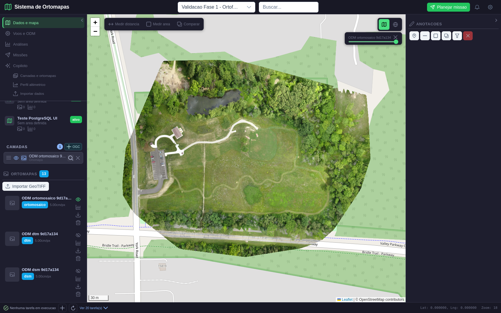

### 7. Superfície DSM 3D


### 8. Nuvem de pontos LAZ 3D


### 9. Produto de bacia D8 exibido no mapa


## Aceite integrado em um único projeto novo — F8-07

**Resultado:** aprovado no escopo do ciclo integrado. Projeto **#88**, voo **#34**, processamento local **#21**, tarefa NodeODM `ad503e1b-b88d-55d7-ad2b-6ddcdd78902b`. O roteiro usou 77 imagens públicas com geotags do dataset Aukerman. São imagens de teste de outra área; não representam Guarajuba, Condomínio Paraíso nem um voo executado pelo usuário. Nenhuma chamada ao LLM foi feita.

### Esperado versus obtido

| Passo | Esperado | Obtido | Resultado/evidência |
|---|---|---|---|
| Criar projeto, voo e enviar imagens | Novo projeto isolado; aceitar fotos válidas e rejeitar arquivo inválido antes de criar tarefa | Projeto #88 e voo #34 criados pela interface; 77 fotos aceitas e georreferenciadas. Arquivo `.txt` recebeu HTTP 400 e contagem de tarefas ficou 0 → 0 | Aprovado; capturas 01–07 |
| Processamento NodeODM | Tarefa chegar a estado concluído e permitir importar produtos | Concluído em 27,96 min; os seis tipos esperados foram importados: ortomosaico, DSM, DTM, relatório PDF, nuvem LAZ e modelo GLB | Aprovado; capturas 08–12 e manifesto |
| Mapa e produtos 2D/3D | Abrir cada produto próprio, sem telas repetidas ou modais sobrepostos | Ortofoto no mapa (50 tiles); GLB renderizado (268.775 triângulos, 59 materiais/texturas); DSM e DTM em superfícies distintas; LAZ com 15.889.672 pontos totais e amostra visível de 119.472; comparação DSM–DTM exibiu faixa −14,49 a 41,99 m, média 3,82 m e EPSG:32617 | Aprovado; capturas 13–19, todas inspecionadas |
| Avaliação de qualidade | Apresentar avaliação e recomendação | 100%, nível “BOM”; o sistema recomenda revisar o relatório ODM | Aprovado para o indicador apresentado; 100% indica completude dos produtos, não acurácia topográfica |
| Análise no projeto novo | Calcular uma derivada de terreno a partir do DSM, exibir e persistir o resultado | Declividade executada sobre `odm_21_dsm.tif`; análise #144 no projeto #88, EPSG:32617; 44.980.440 pixels totais, 35.461.895 válidos; min 0°, max 89,895°, média 25,930°, mediana 15,658° | Aprovado no cálculo e persistência; captura 22 e manifesto |
| Exportar e verificar | Baixar GeoTIFF íntegro e confrontar com a fonte | Download iniciado pelo botão da análise. GeoTIFF 7.448 × 5.905, 1 banda float32, EPSG:32617; limites e grade iguais ao DSM. Recálculo independente em todos os 35.461.895 pixels válidos: erro máximo e médio 0° | Aprovado; captura 23 e manifesto numérico |

O raster foi efetivamente baixado e comparado. Seu tamanho é 126.580.809 bytes (SHA-256 `20b92510efcbfeadcb0e47e0b249e0a1447b2a8048e3c7c1e6b8a042e39cc853`). Ele excede o limite de 100 MB por arquivo do GitHub e, por isso, não foi incluído no commit. As capturas, metadados, checksum e comparação numérica ficam no pacote de evidências; o download pode ser reproduzido pelo botão do resultado.

### Inspeção da interface e correção do roteiro

A primeira execução do roteiro parou antes de completar as visualizações porque tentou fechar o modal GLB com `Escape`, que o componente não implementa. O canvas permaneceu sobre os controles e interceptou o clique seguinte. Por esse motivo, uma imagem inicialmente chamada DSM repetia o modelo GLB. Identifiquei isso inspecionando a própria captura, descartei-a e corrigi o roteiro para clicar no botão explícito **Fechar** e aguardar o modal sair do DOM. Também alinhei os seletores do LAZ, da diferença e do botão de qualidade aos componentes efetivos. O roteiro completo corrigido está em [`acceptance_odm_novo_projeto.py`](../../../../tests/e2e/playwright/acceptance_odm_novo_projeto.py), e a repetição somente leitura dos visualizadores, sem novo upload/NodeODM, está em [`resume_odm_acceptance_fase8.py`](../../../../tests/e2e/playwright/resume_odm_acceptance_fase8.py). Essa retomada versionada foi executada: 6 verificações concluídas e `browser_page_errors=[]`.

Na repetição, DSM, DTM, nuvem e diferença produziram capturas distintas; não houve erros JavaScript. A falha identificada era do roteiro de automação e do rótulo de uma captura, não um defeito funcional observado nos visualizadores. O arquivo incorreto foi removido do pacote.

### Capturas do percurso integrado

#### Projeto criado e produtos ODM

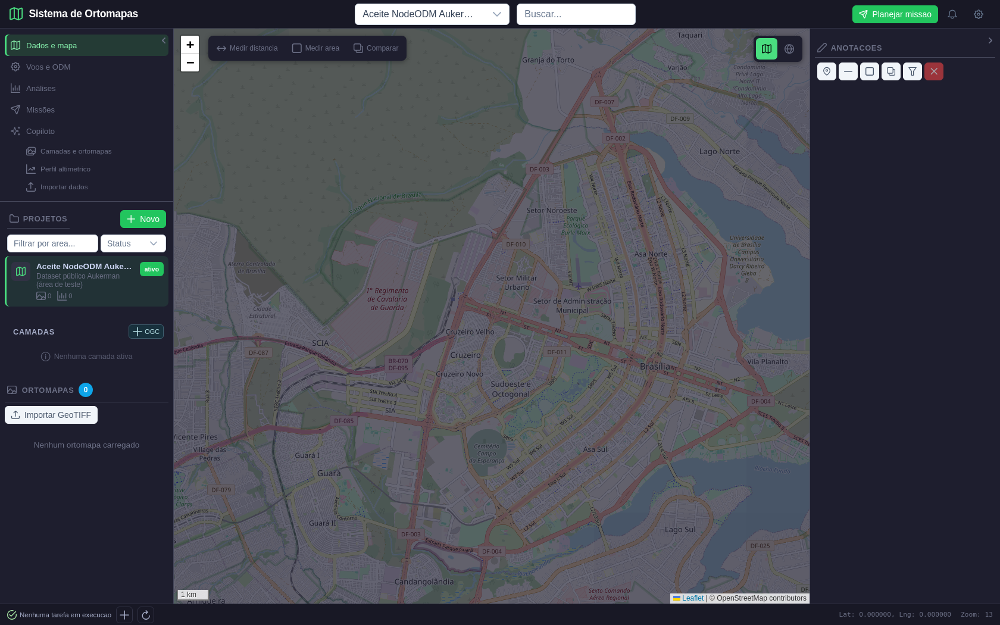

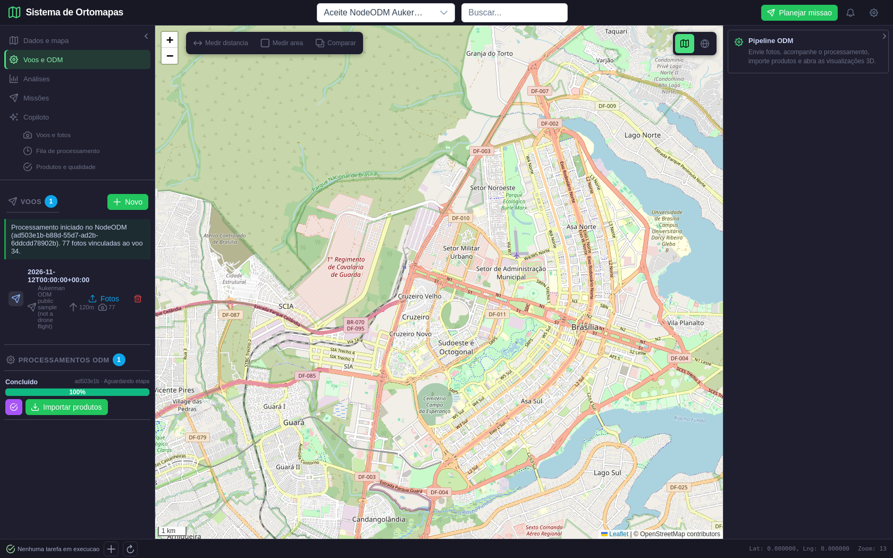

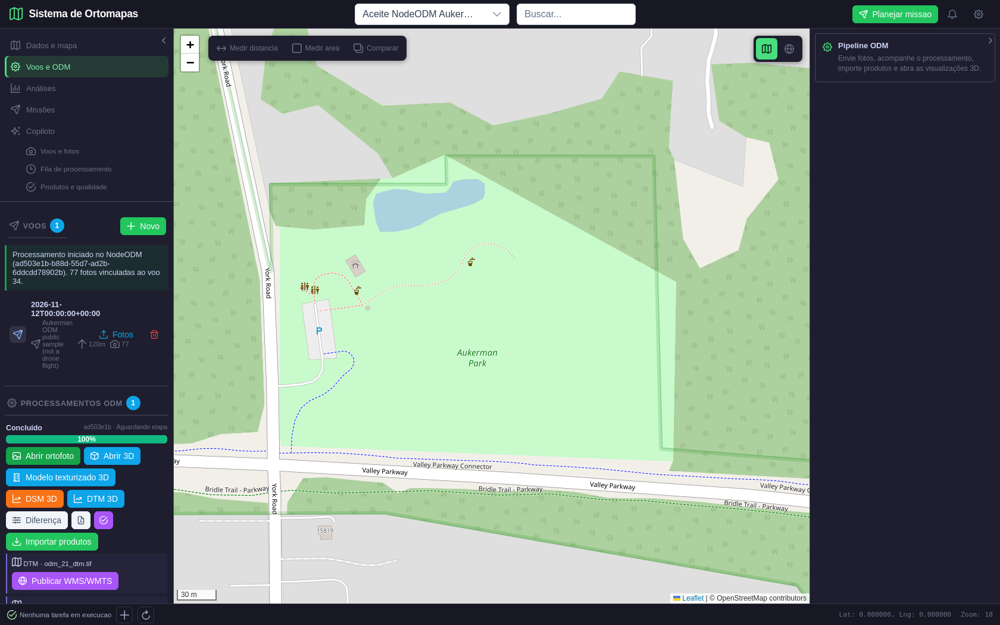

#### Ortofoto, malha, DSM e DTM

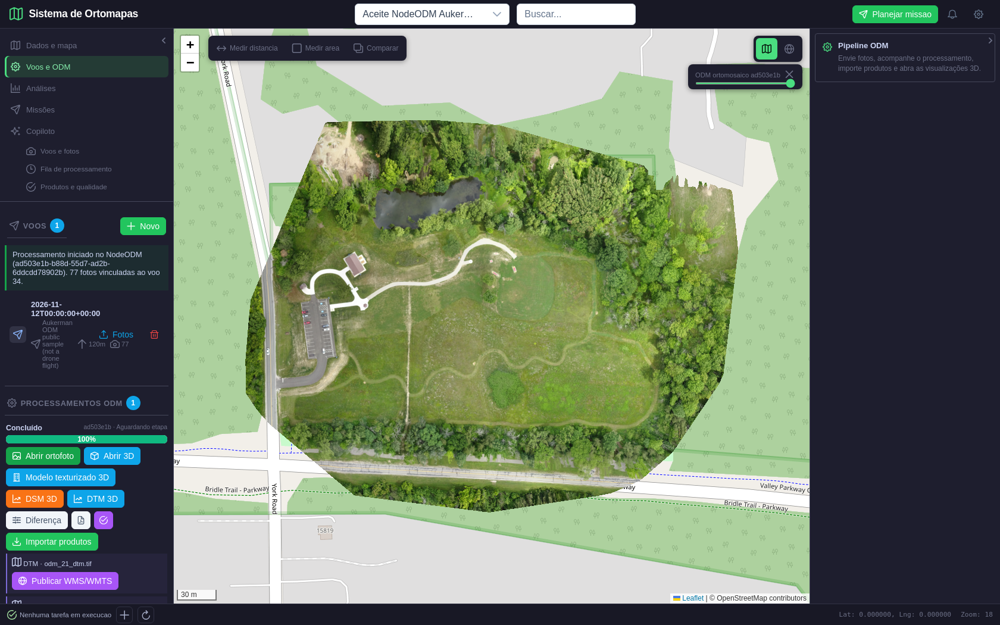

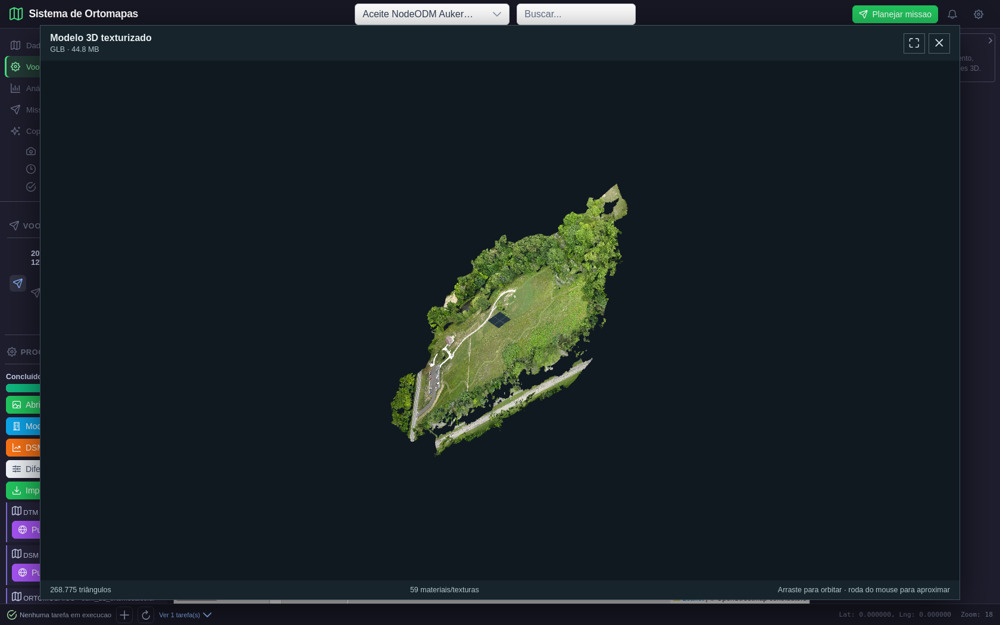

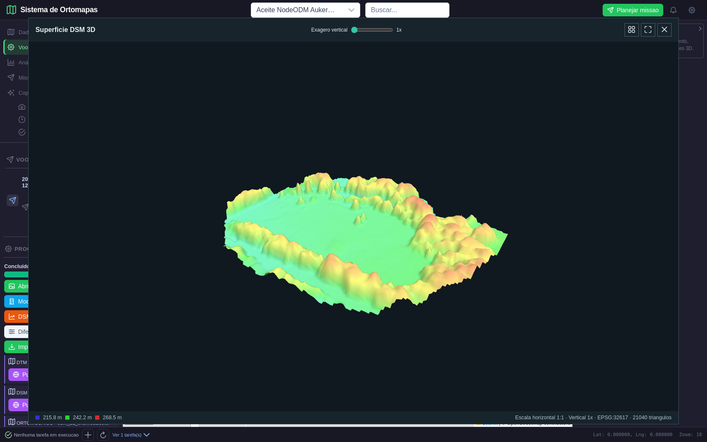

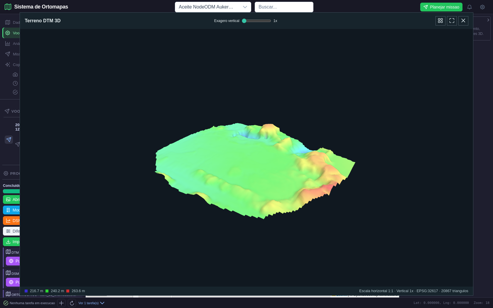

#### Nuvem, diferença e análise

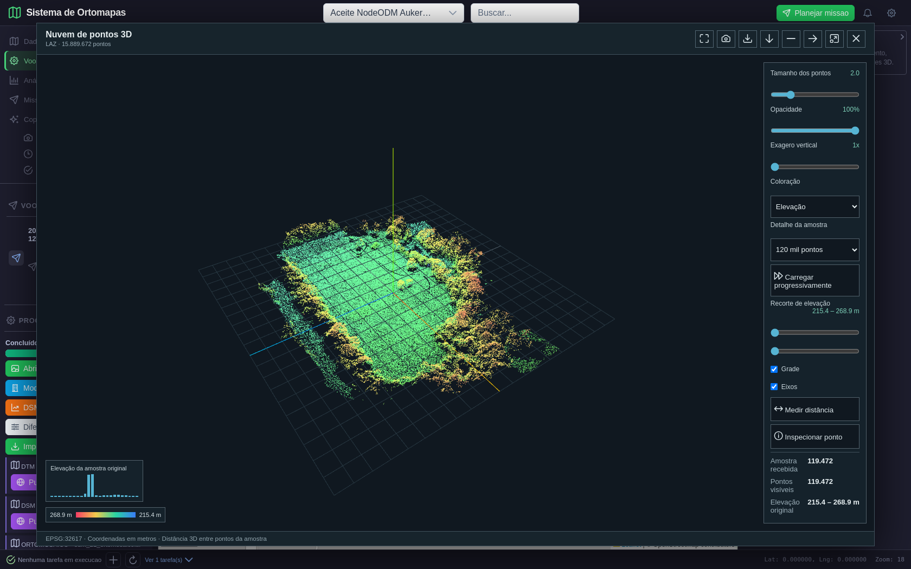

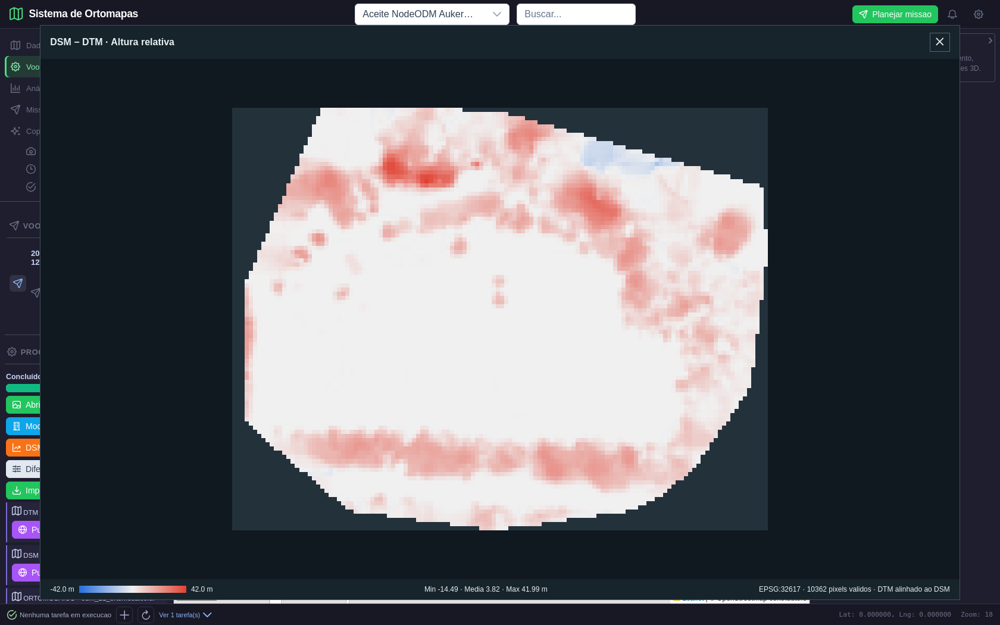

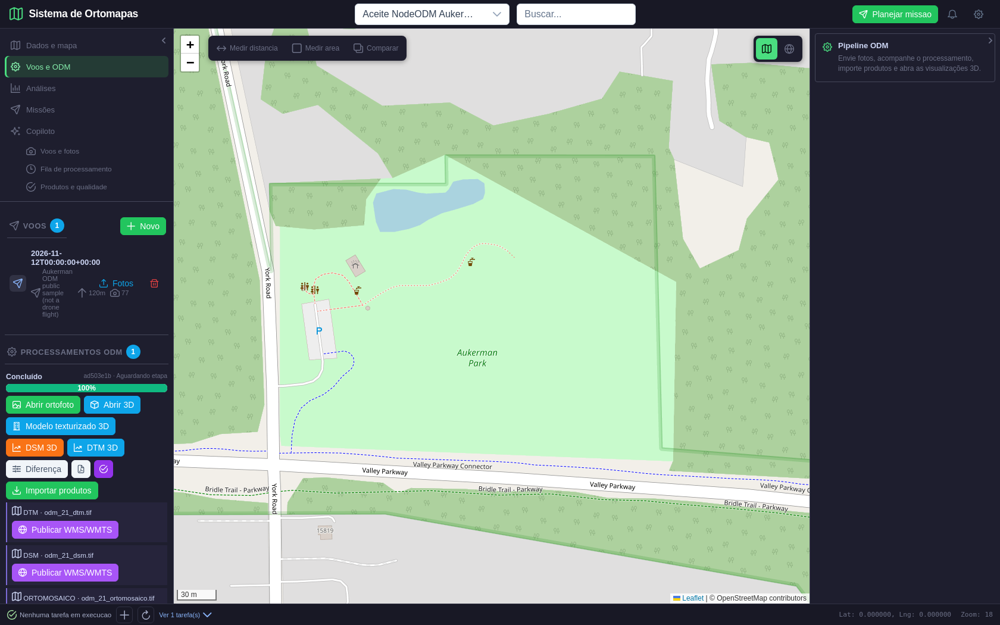

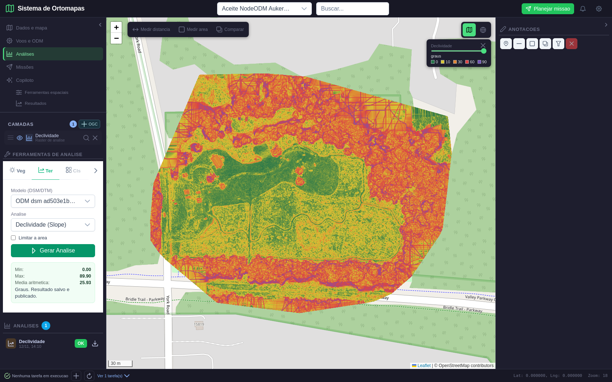

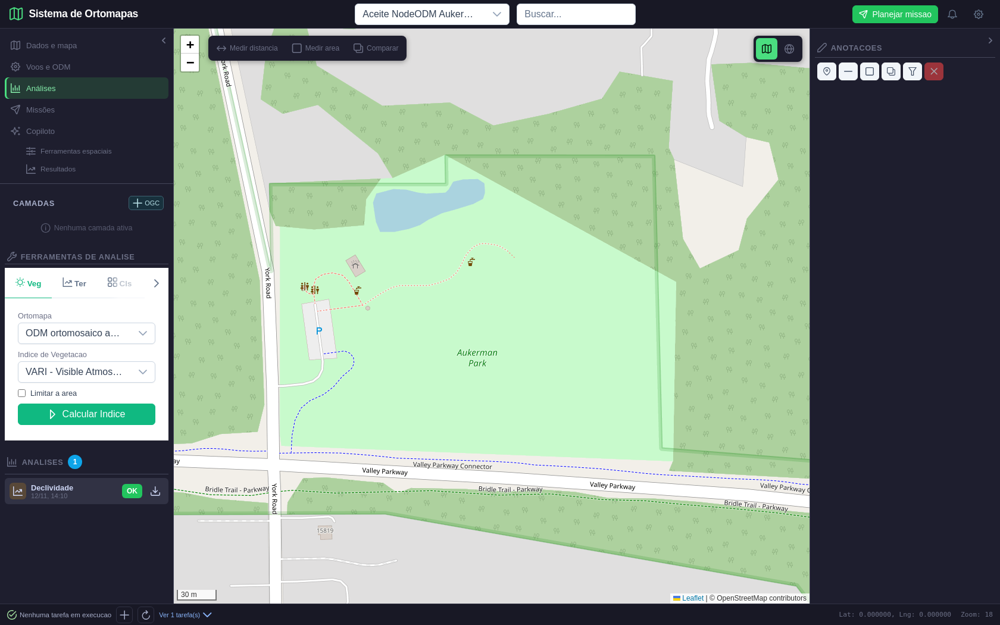

## F8-08 — monitoramento, suíte e reconciliação da matriz

**Execução:** 12/11/2026, após F8-07. **Escopo seguro:** consultas de saúde e métricas, reinício somente do Prometheus, leitura do dashboard e execução dos testes unitários. Não reiniciei a API nem o PostgreSQL. Nenhuma chamada ao LLM foi feita.

### Monitoramento: esperado versus obtido

| Verificação | Esperado | Obtido | Resultado/evidência |
|---|---|---|---|
| Stack observável | Prometheus, Alertmanager, Grafana e OTel disponíveis sem colisões de portas | Prometheus `:9090`, Alertmanager `:9093`, OTel `:4317/:4318`, Grafana `:3011`; a porta 3010 já era usada e foi preservada | Aprovado; configuração em `observability/docker-compose.yml` |
| Alvos de métricas | Exporter alcançável e scrape sem erro | `127.0.0.1:8888/metrics` com target `up=1`, sem `lastError`; consulta Prometheus `up=1` | Aprovado |
| Dashboard | Dados reais e sem erro de navegador | “Ortomapas - Operacional”, contadores de requisições/status e latência; Grafana 11.2.0, health `database=ok`, `page_errors=[]` | Aprovado; [captura](monitoramento/01_dashboard_prometheus.png), [manifesto](monitoramento/manifest.json) |
| Retenção TSDB | Séries sobrevivem a reinício controlado do Prometheus | Antes: contador 3317 e 5 amostras/5 min. Depois: contador 3318 e 6 amostras/5 min; volume persistiu | Aprovado para persistência do Prometheus. Não demonstra preservação dos contadores em memória da API após reiniciar a API |
| Health da aplicação | Dependências reportam prontidão | `/health/ready`: `database=true`, `language_model=true` | Aprovado como fotografia no momento da checagem |
| Segredo local | Credencial do Grafana fora do Git | Senha gerada apenas em `observability/.env`, arquivo ignorado pelo Git e permissão local 600; valor não foi impresso nem versionado | Aprovado |

O Compose usa a porta 3011 para Grafana porque 3010 estava ocupada por outro processo. O stack de observabilidade foi deixado ativo. O coletor OTel está em execução com exporter `debug`; a ingestão efetiva e retenção de traces não foram testadas. Métricas persistentes estão comprovadas; traces persistentes não.

### Suíte automatizada

Comando executado no `.conda-env`, sem integração com o banco ativo:

```text
ORTOMAPAS_DB_INTEGRATION=0 ./.conda-env/bin/python -m pytest -q -o faulthandler_timeout=60 tests/test_*.py
144 passed, 1 skipped, 1883 warnings in 3.59s
```

O teste ignorado foi `tests/test_clip_export_http.py::test_real_project_crop_reopen_and_export`, que exige integração com projeto/banco real e estava desativado intencionalmente para não alterar o banco. Os avisos são principalmente de APIs FastAPI, Rasterio/Affine e Shapely depreciadas; não causaram falhas. `pytest>=8.3,<9` foi declarado em `environment.yml` e instalado no ambiente de automação `.conda-env`; nenhuma dependência do runtime foi atualizada.

### Reconciliação dos casos de uso

Esta tabela distingue evidência funcional de demonstração de aceite científico/operacional. “Aderente no escopo” significa que existe evidência de interface e execução citada; não certifica precisão de campo.

| Caso de uso | Estado após F8-08 | Evidência/limite que permanece |
|---|---|---|
| UC-001 Criar projeto | Aderente no escopo | Matriz v2 e criação de projeto #88 no F8-07 |
| UC-002 Buscar/filtrar projetos | Aderente no escopo | Playwright com projetos existentes, evidência 06/11 |
| UC-003 Selecionar projeto/ortomapas | Aderente no escopo | Mapa 2D e catálogo de produtos, F8-07 |
| UC-004 Upload GeoTIFF | Aderente no escopo | Upload inválido rejeitado sem resíduo (F8-03); fluxo de importação validado nas fases anteriores |
| UC-005 VARI | Aderente matematicamente no escopo | Recálculo independente RGB; falta validação agronômica/verdade de campo |
| UC-006 Declividade | Aderente matematicamente no escopo | Exportação #144 comparada pixel a pixel, erro 0°; não é validação topográfica com GCP |
| UC-007 Curvas de nível | Aderente no escopo demonstrativo | Geometria, equidistância e cotas persistidas auditadas; sem referência topográfica de campo |
| UC-008 Hillshade | Aderente no escopo funcional | Execução e visualização documentadas na Fase 6; sem critério de acurácia de campo |
| UC-009 Mudanças entre datas | Parcial | Fixture controlada valida cálculo; ainda faltam duas campanhas reais independentes e avaliação de registro/erro |
| UC-010 Classificação K-Means | Parcial | Rótulos/pixels verificados; falta verdade de campo e métricas semânticas |
| UC-011 Hidrologia/rede D8 | Parcial | Fila/visualização funcionam; bacia depende da escala e não foi comparada a rede/referência hidrográfica local |
| UC-012 Volume | Aderente matematicamente no escopo | Comparação raster independente, erro 0 m, cota declarada; sem validação de levantamento de campo |
| UC-013 Anotação poligonal | Aderente no escopo | Caso descrito e implementado na matriz v2; não reexecutado em F8-08 |
| UC-014 Anotação pontual | Aderente no escopo | Caso descrito e implementado na matriz v2; não reexecutado em F8-08 |
| UC-015 Medir distância | Aderente no escopo | Playwright dedicado, segmentos, desfazer/limpar (06/11) |
| UC-016 Medir área | Aderente no escopo | Playwright dedicado, área/perímetro, limpar/fechar (06/11) |
| UC-017 Comparar ortomapas | Aderente no escopo | Swipe/lado a lado, duas fontes reais e tiles verificados (06/11) |
| UC-018 Exportar ortomapa | Aderente no escopo | Exportação raster com dimensões/CRS/bounds verificados; F8-07 também conferiu produto de análise |
| UC-019 Registrar voo | Aderente no escopo | Voo #34 criado e associado ao projeto #88, F8-07 |
| UC-020 Disparar análises por agente/fila | Parcial | Fila validada para operações existentes; direção D8, acumulação D8 e TWI agora estão conectadas ao worker e executadas no DTM real #21 (etapa 9.1), mas aguardam teste visual via API/DB. Mudança, volume, segmentação e classificadores supervisionados seguem fora da fila. RAG permanece explicitamente adiado |
| UC-021 Importar fotos de voo | Aderente no escopo | 77 fotos públicas georreferenciadas aceitas no voo #34; arquivo `.txt` recebeu HTTP 400 |
| UC-022 Criar processamento ODM | Aderente no escopo | NodeODM task UUID registrada no F8-07 |
| UC-023 Acompanhar processamento | Aderente no escopo | Tarefa chegou a concluída; tela e produtos documentados no F8-07 |
| UC-024 Cancelar/repetir | Parcial | Contrato de cancelamento/retry com fixture NodeODM na Fase 3; não repetido contra tarefa real nesta etapa |
| UC-025 Importar produtos ODM | Aderente no escopo | Seis produtos importados no projeto #88 |
| UC-026 Validar qualidade | Parcial | UI exibiu 100%/“BOM”, mas essa pontuação mede completude e recomenda revisão do relatório; falta validar GSD/alinhamento/acurácia com referências independentes |
| UC-027 Visualizar produtos derivados | Aderente na visualização testada | Ortofoto, DSM, DTM, GLB e exportação mostrados no projeto #88; aceite de CRS incompatível e precisão geográfica do GLB não foi ampliado |
| UC-028 Visualizar nuvem 3D | Aderente na pré-visualização | LAZ real carregado e amostrado no visualizador; densidade mostrada, sem auditoria de todas as classes/pontos |
| UC-029 Reprocessar com parâmetros diferentes | Parcial/não aceito | Interface de confirmação observada, mas diálogo foi cancelado para evitar processamento de ~25 min; não há prova de nova tarefa real e comparação versionada |

A matriz de requisitos existente marca alguns itens como “Aderente” por interface/execução. As ressalvas acima refinam essa classificação para aceite operacional: UC-009/010/011/026 não têm referência externa suficiente, UC-020 permanece parcialmente integrado (as novas análises hidrológicas aguardam Playwright via API/DB; outras operações continuam ausentes) e UC-029 não teve reprocessamento real. Não declaro o sistema integralmente aceito enquanto os critérios obrigatórios desses casos não forem resolvidos ou formalmente excluídos do escopo.

### Conclusão e próxima etapa

**F8-08 aprovada para o escopo executado:** dashboard com métricas reais, target Prometheus ativo, persistência TSDB após reinício controlado, health observado e suíte Python com 144 aprovações e 1 integração intencionalmente ignorada. Os avisos de depreciação estão registrados.

**A Fase 8 de robustez foi concluída; o aceite global do Ortomapas continua parcial pelos gaps da matriz.** Não há base para chamar o produto inteiro de operacionalmente aceito ainda. Naquele ponto, definiu-se a **Etapa 9 de 9 — fechamento dos UCs parciais UC-009, UC-010, UC-011, UC-020, UC-024, UC-026 e UC-029**. A atualização 9.1 aparece adiante neste relatório. Para cada caso, deve-se definir dado de referência e critério quantitativo antes de alegar precisão. RAG segue fora do escopo conforme decisão anterior. Depois dessa etapa, reavaliar a matriz e decidir aceite ou registrar exclusões formais.


## Etapa 9 de 9 — andamento 9.1: ampliar fila hidrológica

**Objetivo desta entrega:** conectar ao UC-020 três resultados que já apareciam como operações hidrológicas, mas estavam sem execução enfileirada: direção de fluxo D8, acumulação D8 e TWI. A seleção da interface anteriormente desabilitava a fila para os três; o backend também os recusava.

### Mudanças implementadas

- Incluídas direção D8, acumulação D8 e TWI como operações da fila do endpoint de análises e do worker hidrológico.
- Incluído TWI no seletor da interface; as três operações podem permanecer na opção de execução enfileirada.
- Publicação gera GeoTIFF com CRS, estatísticas, proveniência e estilo de mapa. Direção usa legenda categórica D8; acumulação usa faixa contínua; TWI usa legenda de umidade.
- Acrescentados testes do worker com adaptador de persistência isolado e testes de direção/acumulação, paleta e TWI.

### Validação obtida

| Critério | Esperado | Obtido | Resultado/evidência |
|---|---|---|---|
| Algoritmo/worker | As três operações produzem rasters válidos, preservam CRS e terminam sem erro | Teste parametrizado executou o worker para direção, acumulação e TWI; 23 testes focados passaram | Aprovado em execução isolada; [testes do worker](../../../../tests/test_hydrology_queue_agent.py), [manifesto DTM real](../etapa-09/uc020_dtm_real.json) |
| Dados representativos | Executar sobre um produto ODM real, sem declarar referência hidrológica de campo | DTM #21, 7.449 × 5.906, EPSG:32617; worker gerou três GeoTIFFs em grade comum 256 × 203, célula aproximada 1,455 m | Aprovado como demonstração algorítmica; saídas/checksums no manifesto |
| Direção D8 | Códigos de direção válidos e legenda inteligível | 41.861 células válidas; códigos entre 1 e 128; raster int16 | Aprovado no processamento; ainda falta confirmar tiles e legenda pela interface autenticada |
| Acumulação D8 | Contagem positiva de células contribuintes e variação espacial | 51.968 células válidas; mínimo 1, máximo 13.358; raster int32 | Aprovado no processamento; resultado ainda precisa de verificação visual no aplicativo |
| TWI | Raster float finito e georreferenciado | 41.637 células válidas; min −0,653, máx 16,705, média 4,555; float32 | Aprovado como cálculo demonstrativo. Valores dependem de resolução, condicionamento, declividade e convenção de área contribuinte; sem interpretação de campo |
| Interface/build | Formulário compila e mostra as novas opções | Build Vite passou (427 módulos); bundle principal 1.622,63 kB gera aviso de chunk acima de 500 kB | Aprovado no build, não equivale a validação visual |
| Regressão | Suíte completa permanece estável | 148 passed, 1 skipped, 1.890 warnings em 3,82 s (`ORTOMAPAS_DB_INTEGRATION=0`) | Aprovado. Um teste de exportação requer integração com banco real; avisos deprecation não causaram falhas |

O manifesto do DTM real documenta que o `publish_hydrology` foi substituído por um capturador local e a conexão foi simulada; portanto, esse ensaio executou o algoritmo/worker e criou produtos reais a partir do DTM, mas **não gravou no PostgreSQL e não validou a transação do endpoint**. Não houve alteração de dados persistidos.

### Limite da validação visual

Não foi possível executar Playwright contra a aplicação neste momento: `pg_isready` informou que não há resposta em `localhost:5432`; as rotas locais `:8888` (API) e `:5176` (frontend) não responderam; `docker ps` não listou containers ativos. Por isso, não há captura de tela nova para essa subetapa, e o teste não é apresentado como percurso completo de usuário. A captura do dashboard da etapa 8 é evidência de observabilidade, não de análise hidrológica.

A grade hidrológica generaliza o raster ODM original de aproximadamente 5 cm para cerca de 1,455 m por célula. Isso reduz custo e torna a execução demonstrável, mas perde detalhe e, junto à sensibilidade D8 já medida, impede aceitar esses resultados como hidrologia operacional. Não foram comparados a rede oficial, pontos de controle ou medições de campo.

**Estado da etapa 9:** subetapa 9.1 concluída para integração do código e execução do worker; UC-020 segue parcial. **Próxima subetapa 9.2:** disponibilizar PostgreSQL, API, frontend e worker nesta cópia; então usar Playwright para selecionar o DTM, enfileirar cada uma das três operações, acompanhar estado, abrir cada camada e conferir CRS, legenda, tiles e estatísticas contra os GeoTIFFs. Em seguida continuar os casos UC-009/010/011/024/026/029 e as funções de UC-020 ainda ausentes.

## Etapa 9 de 9 — subetapa 9.2: validação visual da fila hidrológica

**Data:** 12/11/2026. **UC:** UC-020 (fila de análises espaciais) e interface de visualização do UC-003. **Objetivo:** provar o fluxo autenticado de seleção do projeto/DTM, submissão pela interface, conclusão da tarefa, persistência do resultado e exibição do mapa/estatísticas para as três operações adicionadas na 9.1.

### Ambiente e dados usados

- Projeto #88, “Aceite NodeODM Aukerman 20261112-163150”, acessado pela conta proprietária de teste; DTM #72 (“ODM dtm ad503e1b”), criado pelo processamento fotogramétrico NodeODM do conjunto público Aukerman.
- Raster de origem real do processamento: 7.449 × 5.906 pixels, EPSG:32617. Não é captura de Guarajuba nem validação de campo.
- PostgreSQL/PostGIS, API e frontend locais ativos; a API foi reiniciada isoladamente para carregar a versão em validação. PostgreSQL, NodeODM e demais contêineres não foram reiniciados.
- Execução visual via Chrome headless/Playwright, com sessão autenticada. Nenhuma chamada ao Copiloto/LLM foi feita (`llm_calls=0`). O teste não registra senha, token ou segredo no manifesto.

### Roteiro executado e esperado versus obtido

| Passo | Esperado | Obtido | Resultado |
|---|---|---|---|
| Login e contexto | Autenticar e abrir o projeto correto | Login HTTP/UI concluído; projeto #88 e produto DTM #72 selecionados | Aprovado |
| Preenchimento | Formulário indica DTM, análise hidrológica, tipo e opção de fila | Repetido para direção D8, acumulação D8 e TWI; o texto foi corrigido para “Enviar para fila de processamento”, sem sugerir uso de IA | Aprovado |
| Submissão | UI recebe HTTP 202 com IDs de análise/tarefa | Direção: análise #148/tarefa #30; acumulação: #149/#31; TWI: #150/#32 | Aprovado |
| Execução/persistência | Tarefa termina e produto persiste com referência à fonte | As três análises ficaram `concluida`, com caminho de resultado persistido | Aprovado para as três tarefas |
| Tiles e mapa | Camada selecionada solicita tiles HTTP 200 e aparece com legenda própria | 25/25 tiles HTTP 200 por produto; camada e painel de estatísticas visíveis nas três telas | Aprovado no percurso visual executado |
| Integridade da página | Sem exceções de JavaScript | `page_errors=[]`; nenhum erro de console fatal capturado | Aprovado |

O worker generalizou cada DTM para grade de 256 × 203 células (passo aproximado de 1,455 m, a partir da fonte de cerca de 5 cm). Resultados registrados: direção D8 com 41.861 células válidas e códigos 1–128; acumulação com 51.968 células válidas, mínimo 1 e máximo 13.358 células contribuintes; TWI com 41.637 células válidas, mínimo −0,653, máximo 16,705 e média 4,555. O mapa mostra a camada escolhida e a respectiva legenda. A escala reduzida e a ausência de referência hidrográfica/controle de campo limitam os resultados a demonstração funcional e algorítmica, sem aceite hidrológico operacional.

As três análises permaneceram no projeto #88 para permitir inspeção posterior pela aplicação. O manifesto compactado registra IDs, estados, CRS, dimensões, estatísticas essenciais, contagem/status dos tiles e escopo, sem histogramas extensos nem caminhos locais. O teste criou registros de demonstração no PostgreSQL e arquivos derivados; não houve limpeza desses resultados.

### Capturas da execução real

As capturas abaixo são imagens produzidas pelo Playwright nesta execução, não ilustrações sintéticas. Os formulários mostram a entrada selecionada; as telas de resultado mostram a camada renderizada, a legenda, o projeto e o painel estatístico.

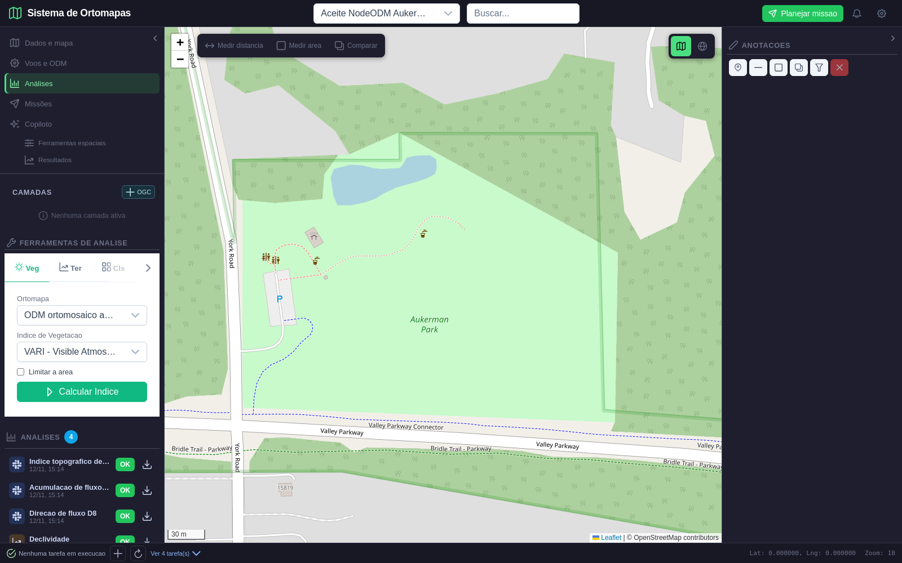

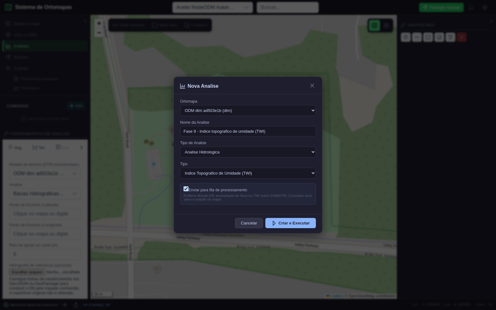

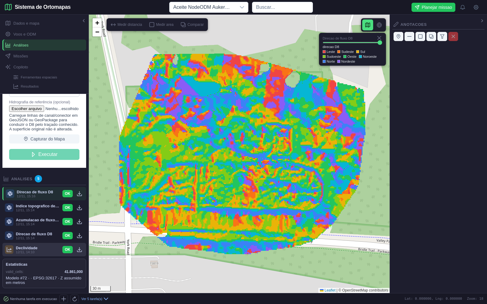

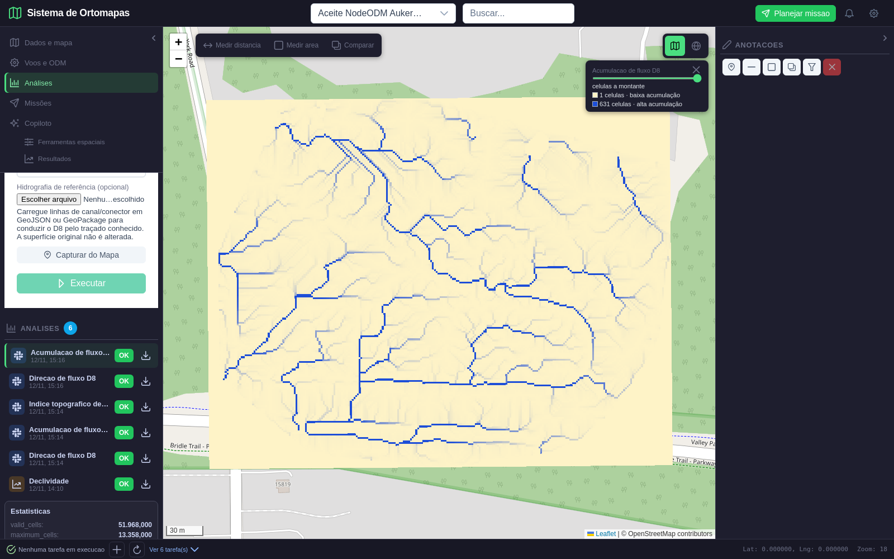

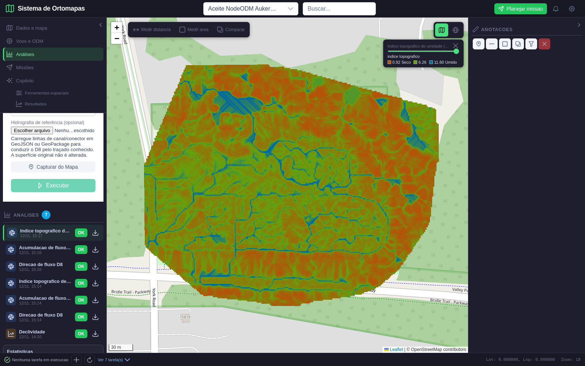

Capturas adicionais de cada formulário e login, mais o [manifesto Playwright](../etapa-09/playwright/manifest.json) e o [script reproduzível](../../../../tests/e2e/playwright/validate_hydro_queue_phase9.py), ficam junto das evidências. As imagens `tiles/` são tiles de resultado gerados pela aplicação e não capturas de tela.

### Avaliação e limite de aceite

| Critério | Resultado | Conclusão |
|---|---|---|
| Seleção do projeto/produto e envio pela interface autenticada | 3 operações executadas com HTTP 202 | Aprovado |
| Worker, persistência e reabertura do mapa | 3 tarefas concluídas; produto consultado pela UI; 25 tiles HTTP 200 cada | Aprovado funcionalmente |
| Legenda/estatísticas próprias por resultado | Direção categórica, acumulação contínua e TWI contínuo visíveis; métricas compatíveis com o manifesto | Aprovado para demonstração |
| Acurácia hidrológica | Sem rede de drenagem independente, pontos de controle ou validação de campo; grade generalizada | **Não avaliada; UC-011/UC-020 continuam parciais** |
| UX sem ambiguidade de camadas anteriores | A camada ativa e a legenda mudam por seleção; a lista mantém histórico das análises | Aceito para esta execução; revisão de UX da lista pode ser feita separadamente |

Portanto, 9.2 fecha a lacuna anterior de “sem teste visual/sem persistência do endpoint” para estas três operações. Isso não aprova o algoritmo hidrológico para decisão de engenharia, nem fecha UC-020: drenagem/bacia, outras ferramentas enfileiradas e referências independentes ainda precisam de tratamento documentado.

**Estado:** subetapas 9.1 e 9.2 concluídas para direção D8, acumulação D8 e TWI; UC-020 continua parcial. **Próxima subetapa 9.3 de 9:** validar e corrigir o fluxo enfileirado de rede de drenagem e delimitação de bacia (com exutório), usando o mesmo DTM real, conferir parâmetros/unidades, GeoJSON/GeoTIFF, tiles/forma resultante e interação do mapa; para alegação de qualidade hidrológica, antes estabelecer uma referência independente apropriada.

## Etapa 9 de 9 — subetapa 9.3: rede de drenagem e bacia por exutório

**Data:** 12/11/2026. **UC:** UC-020 (fila de análise hidrológica) e UC-011 (análise de bacia/rede D8). **Entrada:** projeto ODM #88, DTM #72, conjunto público Aukerman/Westerville, Ohio, EPSG:32617, 7.449 × 5.906 pixels. A entrada é produto fotogramétrico real do NodeODM, mas a área foi generalizada pelo worker; não existe referência de campo nesta execução.

### Percurso e resultado observado

| Critério | Esperado | Obtido | Resultado |
|---|---|---|---|
| Rede D8 — submissão | Formulário DTM/hidrologia, área mínima e Strahler; API aceita fila | DTM #72, limiar 1.000 m², Strahler mínimo 1; HTTP 202, análise #155/tarefa #37 | Aprovado |
| Rede D8 — processamento | Saída vetorial persistida com segmentos LineString | Concluída como `.geojson`: 21 feições LineString, 1.198 células de canal, 1,975 km acumulados; ordem máxima 3 | Aprovado funcionalmente |
| Rede D8 — visual/exportação | Rede visível no mapa e exportável em formatos previstos | 21 caminhos SVG do Leaflet; download GeoJSON 95.762 bytes e KML 38.813 bytes, ambos lidos e validados pelo roteiro | Aprovado para apresentação/exportação |
| Bacia — validação de entrada | Fila não deve aceitar bacia sem exutório | Formulário bloqueou a ação e exibiu mensagem; não ocorreu POST de análise | Aprovado |
| Bacia — ponto e ajuste | Clique marca ponto; célula de canal fica dentro do raio configurado | Ponto solicitado `41.304187, -81.752164`; raio configurado 100 m; ajuste D8 a `41.303474, -81.752567`, distância 85,999 m e acumulação 21.685 células | Aprovado para o raio informado |
| Bacia — produto/mapa | GeoTIFF persistido, área positiva, tiles acessíveis e feição visual | HTTP 202, análise #156/tarefa #38 concluída; 21.693 células, 11.477,705 m² (1,14777 ha), 25 tiles HTTP 200; raster azul e marcador visíveis | Aprovado funcionalmente |
| Integridade do navegador | Sem exceções JS e sem chamadas ao Copiloto/LLM | `page_errors=[]`, `llm_calls=0` | Aprovado |

O processamento de drenagem usou grade de 256 × 203, pixel de 2,116 m²; por isso 1.000 m² correspondeu ao limiar de 473 células. As 21 feições totalizaram 1.312,953 m de ordem 1, 503,479 m de ordem 2 e 158,591 m de ordem 3. A bacia usou grade 512 × 406, célula de 0,5291 m². Como o ponto clicado ficou longe de uma célula de maior acumulação, o raio de 100 m moveu o exutório em 86 m; o default do formulário é 5 m. Essa distância aparece no resultado e no marcador. Não deve ser confundida com erro de posicionamento medido em campo.

### Correção visual feita durante a etapa

A captura inicial mostrou que o botão “Escolher exutório no mapa” aparecia como botão HTML sem estilo. Foi aplicado estilo visual consistente com o modal e ícone de localização. A captura atualizada mostra o controle legível e com foco visual. Também foi verificado o estado sem ponto: a interface informa que o exutório precisa ser escolhido antes da fila e não envia a análise.

A primeira versão do roteiro tentou abrir o resultado recém-concluído antes de atualizar a lista e não encontrou as feições no mapa. A leitura da análise persistida confirmou 21 feições; ao usar o botão de atualização já disponível e esperar o SVG do Leaflet, a tela montou todas as 21 linhas. Não houve alteração no endpoint nem no algoritmo por causa dessa falha do roteiro.

### Capturas e arquivos reproduzíveis

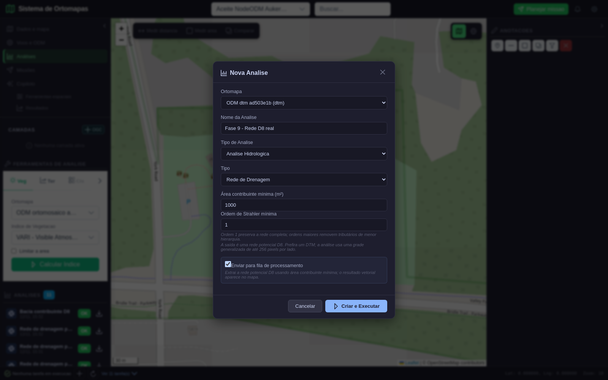

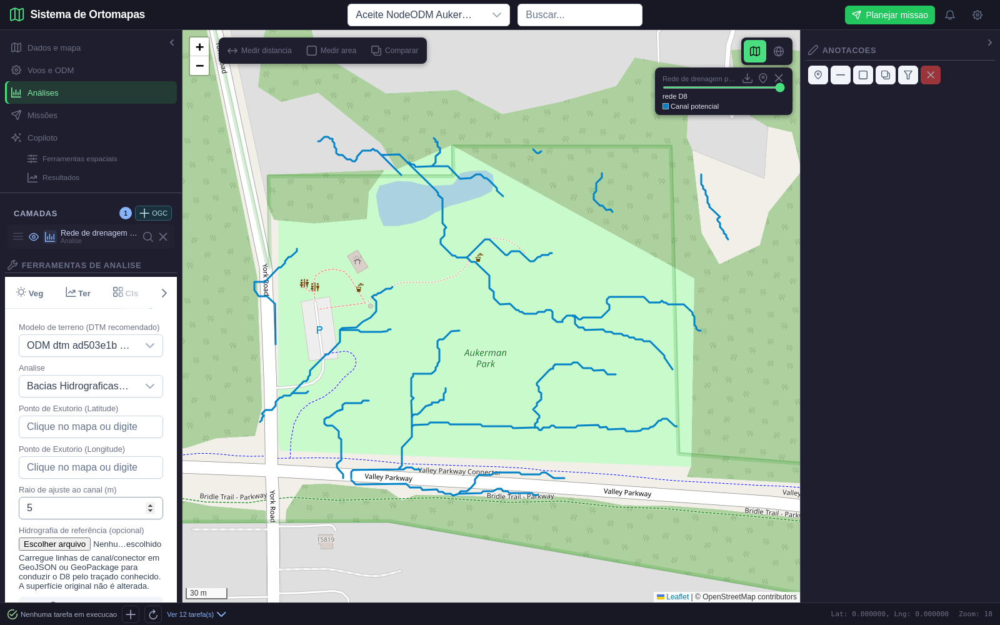

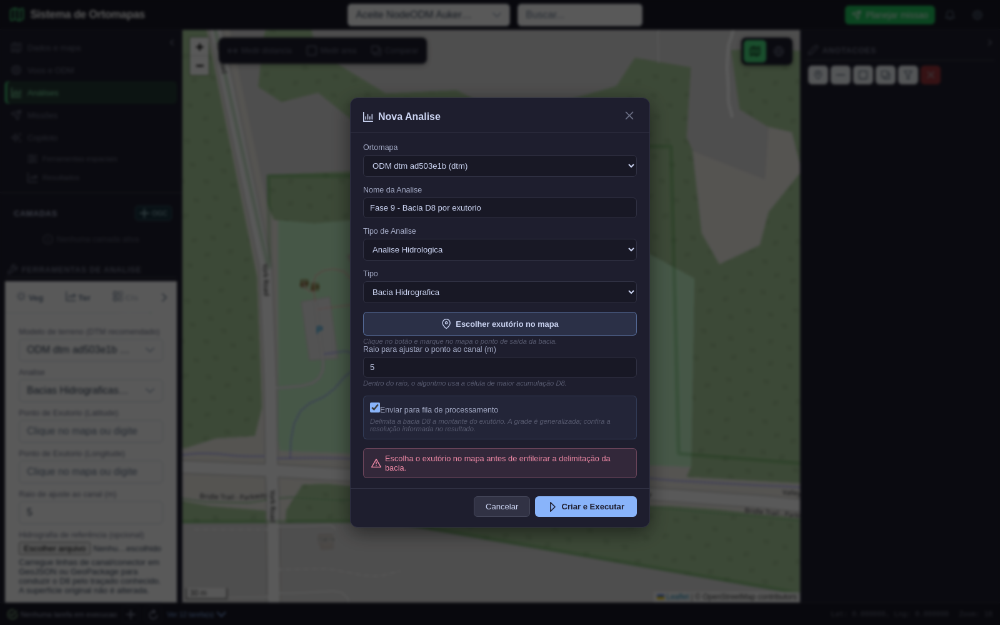

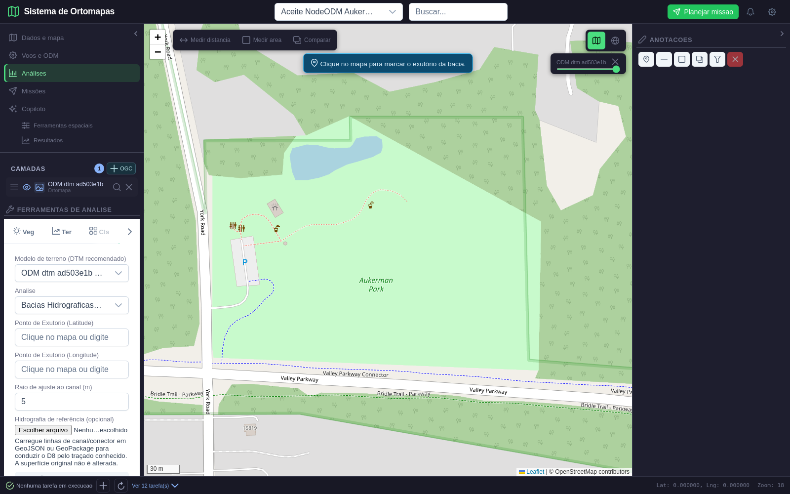

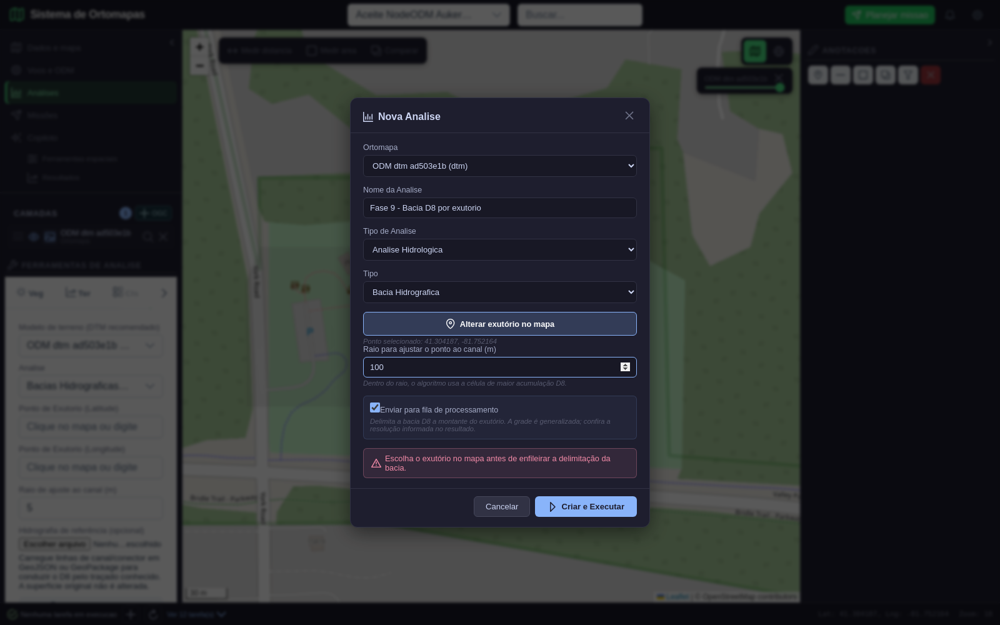

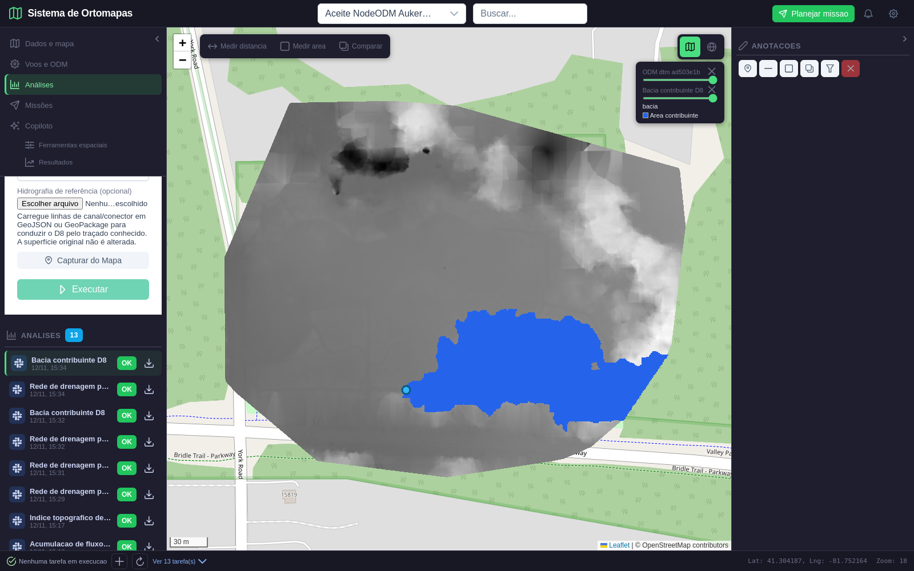

O [manifesto completo](../etapa-09/playwright/hydrology_network_manifest.json) registra parâmetros, IDs, estatísticas, resposta da validação de entrada, exports e captura sem credenciais. Os arquivos [GeoJSON exportado](../etapa-09/playwright/04_drenagem_exportada.geojson) e [KML exportado](../etapa-09/playwright/04_drenagem_exportada.kml), junto do [roteiro Playwright](../../../../tests/e2e/playwright/validate_hydro_network_phase9.py), acompanham as telas. Nesta subetapa, um JWT efêmero foi assinado pelo módulo local para o usuário de validação id 60 e fornecido somente via ambiente ao Playwright; o login por e-mail/senha foi demonstrado na subetapa 9.2, mas não foi repetido aqui.

### Conclusão e limite operacional

**Aprovado funcionalmente:** DTM → fila → rede vetorial e bacia raster → persistência → mapa → exportação da rede. A saída D8 não foi confrontada com uma rede hidrográfica oficial, levantamento de campo ou outro DTM independente. A escala do processamento e a escolha do raio influenciam a geometria; portanto, UC-011 e o aceite hidrológico de UC-020 continuam **parciais**, sem recomendação para decisões de drenagem/engenharia.

**Próxima subetapa 9.4 de 9:** montar uma comparação independente para hidrologia na área do DTM: obter uma referência hidrográfica pública, reprojetar e recortar com critério registrado, parear redes por ordem/tipo de feição e quantificar coincidência, distância e divergências. A comparação deve tratar a resolução de 0,727 m do watershed e a grade mais grossa da drenagem, sem equiparar pixels generalizados a observações de campo. Se não houver referência pública de escala/licença adequadas, registrar a limitação e não aprovar acurácia por consistência interna.

## Etapa 9 de 9 — subetapa 9.4: tentativa de comparação independente com 3DHP

**Data:** 12/11/2026. **Vínculo:** UC-011 (rede de drenagem) e UC-020 (fila hidrológica). **Objetivo:** comparar a rede potencial derivada pelo Ortomapas com uma fonte hidrográfica pública, recortando ambas ao mesmo DTM e pareando por ordem Strahler e tipo.

### Dados, origem e método

- Rede prevista: export GeoJSON real da análise D8 #155, feita no projeto #88 a partir do DTM ODM #72. São 21 LineStrings, com ordens 1–3, limiar de área contribuinte 1.000 m². O DTM está em EPSG:32617, 7.449 × 5.906 pixels, extensão projetada `436847.28, 4572650.85, 437219.73, 4572946.15`.
- Referência: USGS 3D Hydrography Program (3DHP), serviço público Flowline, camada 50. A consulta espacial em WGS84 cobriu `[-81.760, 41.300, -81.748, 41.308]` e retornou quatro linhas `featuretype=1` (“Channel Line”), ordens Strahler 1 ou 2, com data de feição 2023-09-14. O [manifesto da consulta](../etapa-09/referencias/3dhp_source_metadata.json) registra URL, parâmetros, data e ressalvas; o GeoJSON baixado e seu SHA-256 acompanham o relatório.
- Método reproduzível: reprojetar as linhas para EPSG:32617, recortar pela extensão do DTM, contar feições por ordem/tipo e calcular métricas somente para classes presentes nos dois lados. Se houvesse pares, o script calcularia distâncias entre linhas amostradas a cada 1 m e cobertura em tolerâncias de 2, 5 e 10 m. Não converte essas métricas em certificado de acurácia.

Fontes oficiais consultadas: [catálogo e acesso aos produtos 3DHP](https://www.usgs.gov/3d-hydrography-program/access-3dhp-data-products), [esquema da camada Flowline](https://www.usgs.gov/ngp-standards-and-specifications/3d-hydrography-program-3dhpall-flowline) e [derivados da rede e ordem de fluxo](https://www.usgs.gov/3d-hydrography-program/3dhp-flow-network-derivatives). A ordem de fluxo existe no esquema 3DHP; o rótulo observado no retorno para `featuretype=1` foi “Channel Line”.

### Esperado versus obtido

| Critério | Esperado | Obtido | Resultado |
|---|---|---|---|
| Referência independente | Feições hidrográficas da mesma área do DTM | Quatro candidatas na janela de consulta; zero intersectam a extensão do DTM | **Não atendido** |
| Pareamento por classe | Comparar somente tipo/ordem existentes em ambos os conjuntos | Zero pares válidos; ordens disponíveis na rede D8: 1, 2, 3; ordens de referência dentro do DTM: nenhuma | **Não comparável** |
| Recorte e transparência | Mostrar as duas redes sobre a mesma extensão | O mapa exibe D8 azul/rosa/verde dentro do retângulo DTM e candidatas USGS tracejadas fora dele | Aprovado como diagnóstico espacial |
| Distâncias | Reportar similaridade apenas com sobreposição/extensão comum | Candidata 3DHP mais próxima está 34,130 m da borda do DTM; distância mínima até a rede D8 é 75,088 m | Apenas distância a feições próximas; não é métrica de erro |
| Reprodutibilidade | Script, fontes, entradas e resultado registráveis | Script executado, GeoJSON bruto/recortado, JSON de métricas e figura salvos | Aprovado para reprodução da tentativa |

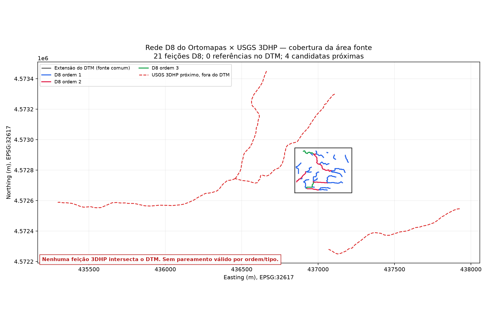

O [resultado JSON](../etapa-09/referencias/comparacao_3dhp_d8.json) marca `not_comparable_reference_does_not_intersect_dtm`, com `orders_compared=[]`, `valid_pairs=0` e `by_order={}`. A versão inicial da figura omitia as linhas D8 porque o laço de desenho estava limitado às ordens comparáveis; corrigi isso e inspecionei a figura regenerada: as 21 linhas D8 aparecem agora dentro do retângulo do DTM, enquanto as quatro candidatas 3DHP ficam fora. Essa correção foi exclusivamente de visualização; não alterou as entradas ou os números espaciais.

### Conclusão

A etapa **não valida nem reprova a acurácia** da rede D8. Ela demonstra que a fonte pública próxima não serve como referência comum para esse DTM. O dado oficial consultado é cartografia hidrográfica com data/linhagem diferentes, não verdade de campo; a generalização do worker (célula de aproximadamente 1,455 m na drenagem) também limita interpretação de detalhe. A alegação de qualidade hidrológica e o aceite UC-011/UC-020 permanecem parciais. Para concluir esta comparação é necessário um DTM com hidrografia oficial intersectante adequada, dados de campo compatíveis, ou declarar explicitamente a ausência de validação externa.

**Artefatos:** [roteiro reproduzível](../../../../scripts/compare_hydrology_reference_9_4.py), [resposta USGS](../etapa-09/referencias/3dhp_flowlines_aukerman.geojson), [recorte ao DTM (vazio por não interseção)](../etapa-09/referencias/3dhp_flowlines_dtm_clip.geojson), [metadados da consulta](../etapa-09/referencias/3dhp_source_metadata.json), [resultado quantitativo](../etapa-09/referencias/comparacao_3dhp_d8.json) e [mapa comparativo](../etapa-09/referencias/comparacao_rede_d8_3dhp.png).

**Próxima subetapa 9.5 de 9:** localizar um conjunto público em que DTM/DEM e hidrografia oficial cubram a mesma área, ou formalizar uma validação interna sem alegar acurácia externa. Registrar licenças, resolução, CRS e limitações; executar comparação pareada apenas quando existir interseção espacial real. Em paralelo, continuar a matriz dos UCs parciais UC-009, UC-010, UC-024, UC-026 e UC-029. O aceite operacional global continua retido.
