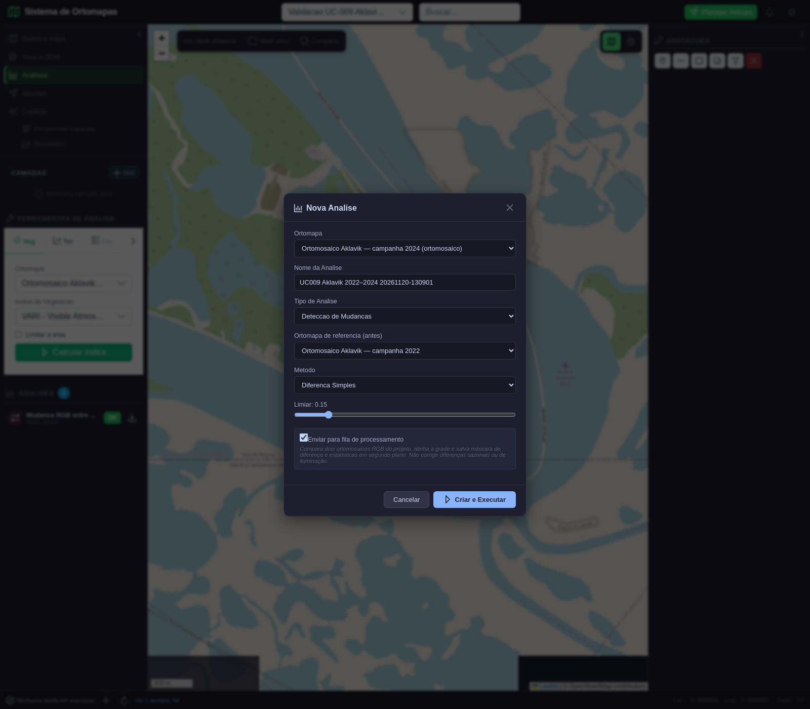
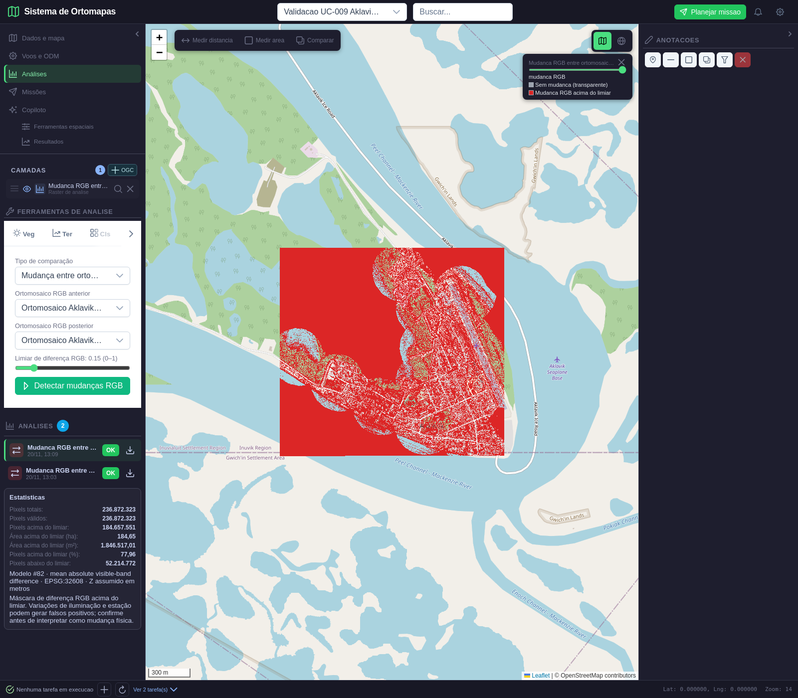

# Etapa 10.3 — Comparação entre campanhas independentes (UC-009)

**Execução:** 20/11/2026
**Resultado:** fluxo funcional aprovado; qualidade de mudança física não aprovada.
**Projeto de validação:** #90 — Validacao UC-009 Aklavik 2022-2024.

## Pergunta e critério da etapa

Esta etapa verifica se o Ortomapas recebe duas campanhas UAV distintas, compara seus ortomosaicos pelo fluxo enfileirado, persiste a análise e mostra a máscara real no mapa. Para passar funcionalmente, o par precisa ter origem documentada, CRS/resolução compatíveis, sobreposição suficiente, tarefa concluída, estatísticas e camada visíveis, tiles autenticados carregados e nenhum erro de navegador.

A validação funcional **não equivale** a validar a classificação de cada pixel como mudança física. O conjunto publicado não traz polígonos de verdade de campo ou amostras rotuladas para calcular precisão/recall.

## Dados usados

Foi usado o dataset público [Aklavik UAV Orthomosaic and DSM — campanhas 2022/2024](https://zenodo.org/records/14608566), coletado com DJI Mini 2. A publicação identifica duas janelas de aquisição independentes — 19–21/09/2022 e 22–24/03/2024 — na mesma área de aproximadamente 2,37 km². A própria publicação informa que os dados de 2024 foram alinhados aos de 2022. Foram baixados **somente os dois ortomosaicos RGB**; DSMs e fotos originais não foram baixados. Os dois GeoTIFFs têm 710.706.206 bytes cada e seus MD5 foram conferidos contra o registro Zenodo.

Arquivos locais: `data/validacao/uc009_aklavik/2022_ortomosaico.tif` e `2024_ortomosaico.tif`. Para baixar e conferir novamente, execute `python scripts/download_uc009_aklavik.py`. Os arquivos grandes permanecem fora do commit; o repositório guarda o DOI, script e checksums.

O seed reproduzível `scripts/seed_uc009_aklavik_validation.py` criou o projeto #90, voos #35/#36 e ortomosaicos #81/#82. A imagem de origem foi associada a cada campanha no projeto para o usuário de validação #60.

## Verificação das entradas

| Verificação | Esperado | Obtido | Resultado |
|---|---|---|---|
| Independência temporal | Datas e campanhas distintas, não duas resoluções do mesmo voo | Campanhas publicadas em setembro/2022 e março/2024; arquivos ortomosaicos distintos, com MD5 conferido | Aprovado |
| CRS e bandas | RGB em CRS projetado compatível | 3 bandas `uint8`, EPSG:32608 em ambas | Aprovado |
| Grade | Resolução próxima de 10 cm e alinhamento conhecido | 15.993 × 14.811 pixels em cada; 0,0999976 × 0,0999993 m; transformações afins iguais | Aprovado para este par |
| Cobertura comum | Pelo menos 90% da menor área | 100%; nenhuma reprojeção de grade foi necessária | Aprovado |
| Registro geométrico | Não confundir reprojeção de CRS com registro de imagem | A publicação afirma alinhamento prévio; a aplicação compara a grade existente e **não estima registro por feições** | Limite registrado |

Uma auditoria do banco também encontrou ortomosaicos no projeto #62 que pareciam ser de datas diferentes. A comparação dos hashes revelou que os voos #22, #24 e #25 reutilizam as mesmas 77 fotos. Eles são reprocessamentos, não campanhas independentes. Esse conjunto não foi usado como prova temporal.

## Execução no aplicativo

No projeto #90, foi selecionado o ortomosaico de 2024 como produto posterior, o de 2022 como referência, método “Diferença Simples”, limiar RGB 0,15 e “Enviar para fila de processamento”. A API respondeu HTTP 202. O worker `agente_mudanca_fila` concluiu a análise #171 pela tarefa #48, persistiu uma comparação temporal e gerou um GeoTIFF de máscara.

| Verificação | Esperado | Obtido | Resultado |
|---|---|---|---|
| API/fila | HTTP 202 e término sem erro | Análise #171 `concluida`; tarefa #48 `concluido`, agente `agente_mudanca_fila` | Aprovado |
| Registro temporal | Um par associado ao resultado | Uma linha em `comparacoes_temporais` | Aprovado |
| Tile independente | GeoTIFF renderizado para tile XYZ autenticado | HTTP 200, PNG 256×256, 9.134 pixels opacos no tile de amostra | Aprovado |
| Mapa da interface | Tiles do resultado realmente carregados sobre o mapa | 24 tiles de análise carregados na UI, todos HTTP 200; sobreposição vermelha visível em Aklavik | Aprovado |
| Estatísticas e interface | Métricas visíveis, sem erro de JavaScript | Painel com sete métricas, aviso sazonal visível; erros de página/console vazios | Aprovado |

### Resultado numérico e interpretação

Com o limiar simples de 0,15 (38,25 DN na escala RGB de 0–255), a máscara marcou 184.657.551 de 236.872.323 pixels válidos, ou **77,96%**. O aplicativo calcula corretamente a área acima do limiar: 1.846.517,01 m² (184,65 ha). Isso significa “pixels acima do limiar RGB”, e não área comprovadamente construída, desmatada ou fisicamente alterada.

A amostra RGB reamostrada das campanhas também mostra diferença radiométrica pronunciada. As medianas R/G/B foram 153/142/136 em 2022 e 81/86/91 em 2024. As campanhas ocorreram em estações diferentes. Sem correção de iluminação/estação e sem polígonos de referência, os 77,96% **não demonstram a taxa real de mudança física**. A diferença simples executa o que foi especificado matematicamente, mas não separa mudança de cobertura, sazonalidade, neve, sombras e diferenças radiométricas.

Por isso, corrigi a apresentação do resultado: agora as estatísticas usam “pixels/área acima do limiar” e a tela alerta que iluminação e estação podem gerar falsos positivos. Não alterei o algoritmo para normalizar os valores porque este conjunto não possui verdade de campo para medir se uma normalização preservaria as mudanças reais ou apagaria sinais verdadeiros.

## Capturas Playwright

### Escolha das campanhas e parâmetros

### Camada resultante e números interpretados corretamente

O tile XYZ também foi salvo separadamente em [tile_uc009_mudancas.png](tile_uc009_mudancas.png). A sequência técnica, IDs, métricas e status HTTP sem tokens está em [manifest.json](manifest.json); os metadados/checksums do dataset e produtos cadastrados estão em [seed_manifest.json](seed_manifest.json).

## Decisão UC-009

**Etapa 10.3 concluída para o escopo funcional.** O aplicativo compara duas campanhas reais e independentes no worker, salva a comparação e exibe a máscara no mapa com tiles autenticados. A tela não afirma que toda área acima do limiar seja mudança física.

**UC-009 permanece parcial para aceite operacional/científico.** Faltam referência independente rotulada, avaliação de precisão/recall, tolerâncias acordadas e teste da sensibilidade a iluminação/estação. O app não estima registro por feições nem faz normalização radiométrica automática. O dataset demonstra essa limitação, não resolve esses critérios.

O escopo de análise permanece RGB; isso não equivale a índice multiespectral. O resultado tampouco mede precisão posicional do ortomosaico.

## Reprodução e evidências

- Baixar/verificar dados: `python scripts/download_uc009_aklavik.py`.
- Registrar fixture no PostgreSQL: `python scripts/seed_uc009_aklavik_validation.py`.
- Reexecutar UI, API, worker, banco, tiles e Playwright: `python tests/e2e/playwright/validate_uc009_independent_campaigns_phase10.py`.
- Build frontend: `npm run build` — aprovado; permanece aviso já conhecido de bundle principal acima de 500 kB.
- `py_compile` dos scripts de download, seed e Playwright — aprovado; `git diff --check` — aprovado.

**Próxima etapa: 10.4 de 7 — qualidade semântica de classificação (UC-010). Restam quatro etapas propostas, 10.4–10.7.**
