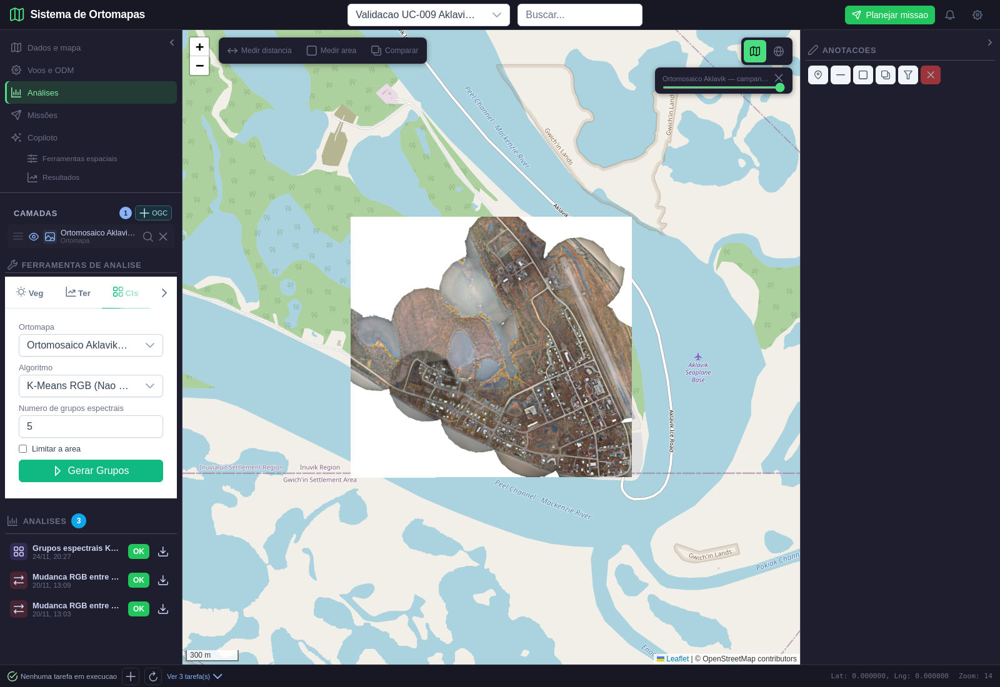
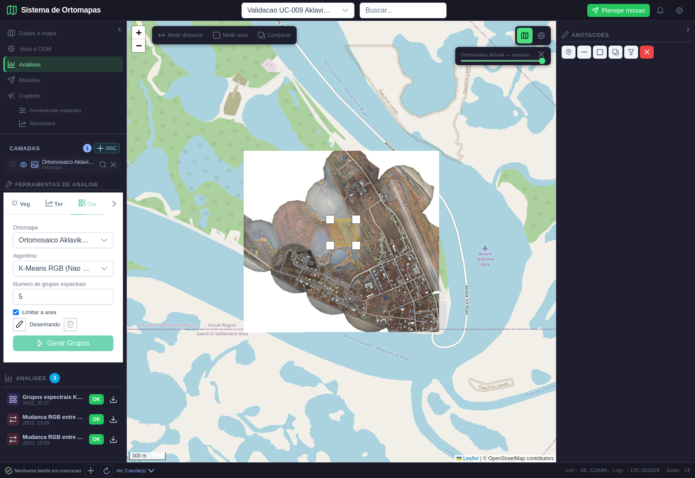
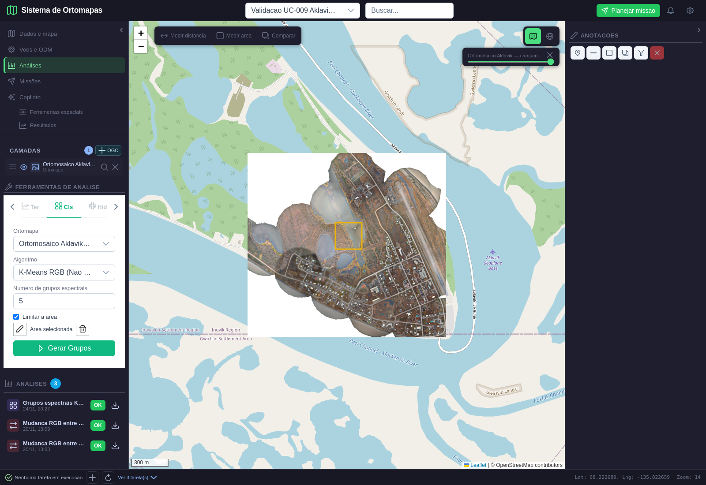
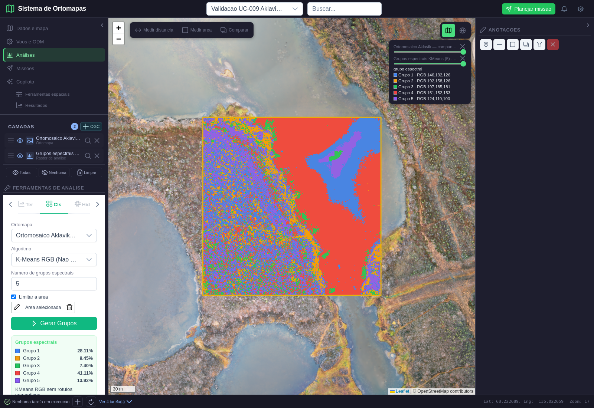
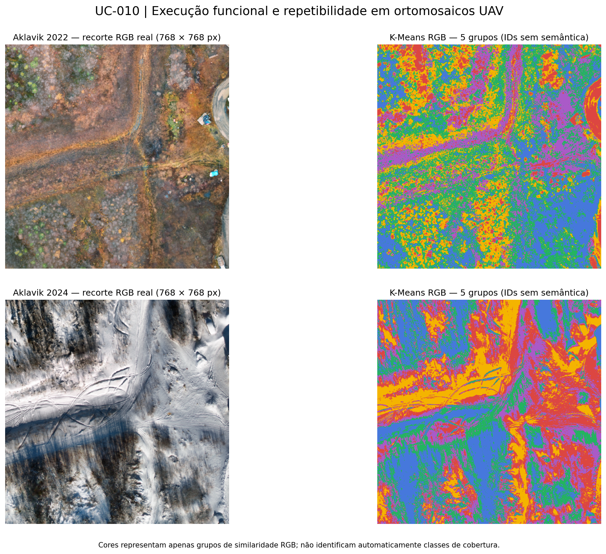

# UC-010 — auditoria de K-Means RGB e qualidade semântica

**Etapa:** 10.4 de 7 propostas pós-Fase 9
**Execução:** 24/11/2026
**Decisão:** validação funcional e repetibilidade aprovadas para os cenários executados; aceite semântico segue parcial.

## Objetivo e escopo

UC-010 na especificação v2 oferece agrupamento não supervisionado de pixels RGB em 2–12 grupos. O produto é um raster de IDs de grupo, com centro RGB e estatísticas de área. O sistema não atribui automaticamente nomes como vegetação, água ou construções. Para avaliar tais significados são necessárias máscaras de referência independentes e compatíveis com as imagens.

Esta execução verificou a implementação de produção em dados UAV reais, a repetibilidade determinística, a grade geográfica, o fluxo visual real até o mapa de resultado e o comportamento quando a imagem não tem diversidade espectral suficiente para preencher a quantidade solicitada. Na inspeção de arquivos de validação e documentação locais não encontrei rótulos independentes correspondentes às cenas Aklavik.

## Procedimento reproduzível

O script [`validar_uc010_kmeans_real.py`](../../../../../scripts/validar_uc010_kmeans_real.py) leu dois GeoTIFF RGB locais das campanhas UAV Aklavik 2022 e 2024. Em cada fonte recortou a mesma janela de pixels (768 × 768, posição horizontal 65% e centro vertical), preservando o EPSG:32608. Executou a função de produção `backend.tools.segmentation.segment_ortomapa` duas vezes com cinco grupos. As amostras, os parâmetros, os hashes SHA-256 das fontes, os centros RGB e as contagens ficam no [manifesto](manifest.json).

O conjunto público LandCover.ai foi localizado, mas o download HTTPS direto falhou com erro de resolução DNS (`Could not resolve host: landcover.ai`). O conjunto oficial ISPRS Potsdam também requer uma transferência grande (13,3 GB, segundo o próprio portal). Nenhuma dessas referências foi tratada como se estivesse instalada ou medida. A falta de máscara independente impede calcular matriz de confusão, IoU, precisão, recall ou F1 semânticos.

Referências de conjuntos rotulados: [LandCover.ai — página de download](https://landcover.ai/download/landcover.ai.v1.zip), [benchmark semântico ISPRS Potsdam](https://www.isprs.org/resources/datasets/benchmarks/UrbanSemLab/2d-sem-label-potsdam.aspx) e [UAVid — imagens UAV e rótulos por pixel](https://uavid.nl/). A existência dessas fontes não significa que tenham sido baixadas nesta etapa.

## Esperado versus obtido

| Verificação | Esperado | Obtido | Resultado |
|---|---|---|---|
| Execução em raster UAV real | Raster de grupos gerado pela função de produção | Duas campanhas, cada uma com janela de 768 × 768 e cinco grupos ocupados | Aprovado |
| Amostragem | Até 100.000 pixels válidos, conforme especificação | 100.000 amostras de 589.824 pixels por campanha | Aprovado |
| Repetibilidade | Execuções iguais na mesma fonte devem gerar pixels iguais | Concordância exata de 100% nas duas campanhas | Aprovado |
| Georreferenciamento | CRS e transformação preservados | EPSG:32608 e affine preservados nas quatro saídas | Aprovado |
| Áreas e contagens | Grupos cobrem todos os pixels e percentuais somam aproximadamente 100% | Cinco grupos ocupados em cada cena; contagens cobrem 589.824 pixels e percentuais somam 100% | Aprovado |
| Interpretação semântica | Medir contra referência independente antes de alegar classe | Máscara de referência não disponível; métricas semânticas não calculáveis | **Pendente / aceite parcial** |
| Pouca diversidade | Não publicar quantidade de grupos vazios como resultado válido | Caso homogêneo revelou centros duplicados; backend agora rejeita com erro claro antes de gravar o raster | Corrigido e testado |

## Erro encontrado e correção

Um recorte totalmente preto da ortofoto 2024 não continha diversidade espectral, mas o scikit-learn mantinha a solicitação de cinco centros, embora só um grupo estivesse ocupado. O endpoint poderia responder sucesso e listar grupos vazios. O backend agora compara o número de grupos ocupados com o solicitado e falha com mensagem de diversidade insuficiente antes de criar a saída. A rota já converte esse `ValueError` em HTTP 422. Foi adicionada regressão em `tests/test_vegetation_classification.py` para garantir que imagem uniforme seja rejeitada sem arquivo de saída. O teste anterior confirma que pixels pretos válidos continuam sendo tratados como pixels; a nova checagem não converte preto em NoData.

## Execução visual com Playwright

O roteiro [`validate_uc010_semantic_quality_phase10.py`](../../../../../tests/e2e/playwright/validate_uc010_semantic_quality_phase10.py) percorreu a interface real usando o projeto #90 e o ortomosaico UAV #81. O operador escolheu K-Means RGB, manteve cinco grupos, marcou “Limitar a área”, desenhou e concluiu um polígono no mapa, acionou “Gerar Grupos” e abriu o raster resultante. O resultado foi a análise #173 no PostgreSQL, com estado `concluida` e GeoTIFF de 649.326 bytes.

| Verificação na UI/API/banco | Esperado | Obtido |
|---|---|---|
| Entrada | Orto #81 do projeto #90 | Confirmada; tiles do ortomosaico responderam HTTP 200 |
| Solicitação | `algorithm=kmeans`, 5 grupos, AOI Polygon | Corpo real da chamada UI conferido, 5 vértices incluindo fechamento |
| Raster | IDs 1–5, nenhum grupo vazio | 4.540.423 pixels válidos; cinco grupos ocupados |
| Área | Contagens, percentuais e área por grupo | 45.402,79 m²; áreas/percentuais listados no manifesto |
| Persistência | Análise concluída e arquivo acessível | Análise #173 `concluida`; arquivo no caminho persistido |
| Mapa | Tiles de classificação renderizados | 25 tiles do mapa carregados; amostra XYZ `[17,16376,31148]` respondeu HTTP 200, 256×256, 65.536 pixels opacos; 6 de 24 tiles amostrados tinham conteúdo, os demais eram margens transparentes |
| Erros de navegador | Nenhum erro de página/console | Zero page errors e zero console errors |

As quatro capturas Playwright mostram estados diferentes do fluxo e foram inspecionadas individualmente:

### 1. Projeto, ortomosaico e formulário K-Means

### 2. Desenho da AOI no mapa

### 3. AOI concluída e selecionada

### 4. Resultado no mapa e estatísticas dos grupos

O tile XYZ real que o mapa usa está disponível como [PNG de classificação](07_tile_kmeans_classificacao.png). O [manifesto Playwright](playwright_manifest.json) registra chamada, parâmetros, IDs, métricas, status HTTP, amostras de tiles e capturas. O roteiro testa a tela e a integração; ele não avalia a correção semântica dos cinco IDs.

Na primeira execução visual, a análise #172 terminou corretamente, mas a asserção do roteiro escolheu o primeiro tile da extensão do mapa, que era uma margem transparente fora do raster. Corrigi o roteiro para amostrar vários tiles e exigir conteúdo opaco em pelo menos um; a repetição final passou como #173. O raster #172 também ficou concluído e foi preservado no projeto, então a lista da tela contém dois resultados de execução de validação.

## Evidência técnica dos dois ortomosaicos UAV

A imagem acima é uma visualização técnica dos rasters de entrada e das saídas reais; não é uma captura da interface Web. Os IDs e cores são arbitrários e representam semelhança RGB, não uma classificação semântica. Por exemplo, o grupo azul não significa água e o verde não significa vegetação.

## Validação executada

- `PYTHONPATH=. /home/pasteurjr/miniforge3/bin/pytest -q tests/test_vegetation_classification.py` — **10 passed**.
- `PYTHONPATH=. MPLCONFIGDIR=/tmp/ortomapas-mpl /home/pasteurjr/miniforge3/bin/python scripts/validar_uc010_kmeans_real.py` — duas campanhas, cinco grupos ocupados, 100% de repetibilidade em ambas.
- `PYTHONPATH=. /home/pasteurjr/miniforge3/bin/python tests/e2e/playwright/validate_uc010_semantic_quality_phase10.py` — **PASS_FUNCTIONAL_UI_AND_REAL_DATA**, análise #173, 25 tiles carregados, 6/24 tiles de classificação com pixels opacos, sem erros do navegador.
- Validação de qualidade semântica independente — **não executada**, por ausência de máscaras locais e falha de DNS no download público nesta sessão.

## Conclusão e estado do requisito

O código produz agrupamento RGB reproduzível nos recortes reais testados e agora não publica cinco grupos aparentes quando só existe um grupo ocupado. Isso comprova funcionamento do K-Means, não acurácia de uso do solo. O UC-010 permanece **parcial** para interpretação semântica, e não está aprovado como classificador automático de vegetação/água/solo/construções. Para concluir essa parte, a próxima rodada precisa de um conjunto rotulado transferível ou de amostras anotadas e revisadas por um responsável; então deve ajustar a correspondência de IDs de cluster às classes apenas no conjunto de calibração e computar métricas em cenas separadas.

**Etapa 10.4 encerrada como auditoria funcional/robustez, com aceite semântico explicitamente retido. Próxima etapa: 10.5 de 7 — validação hidrológica (UC-011). Restam três etapas propostas: 10.5–10.7.**
