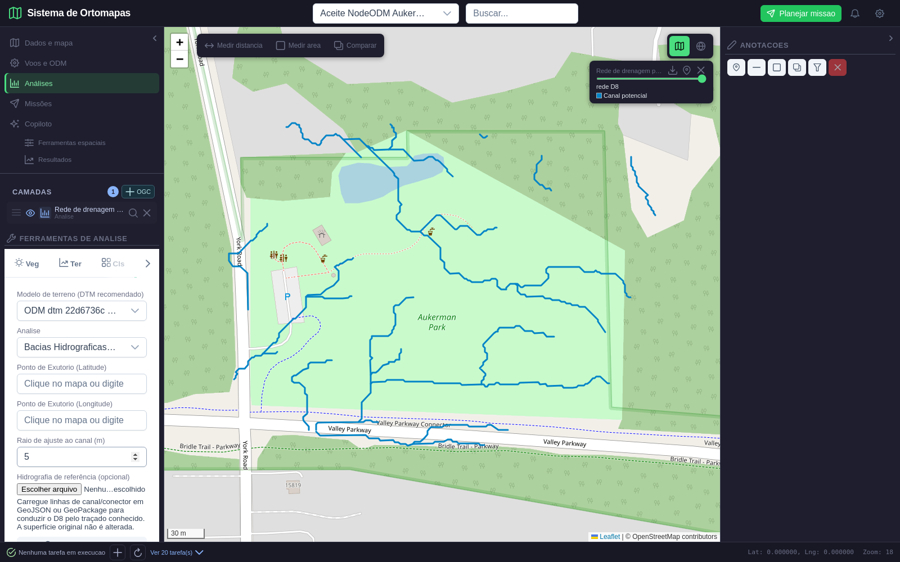
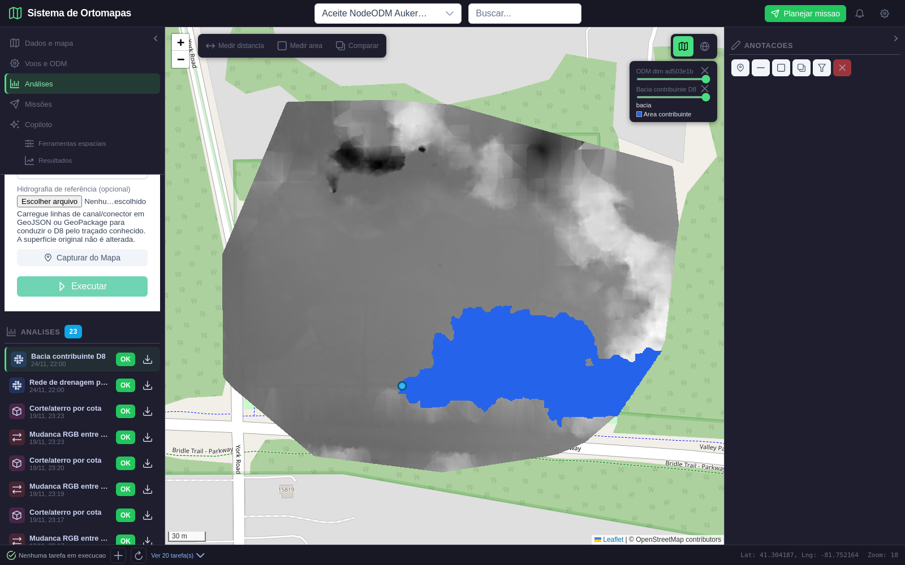
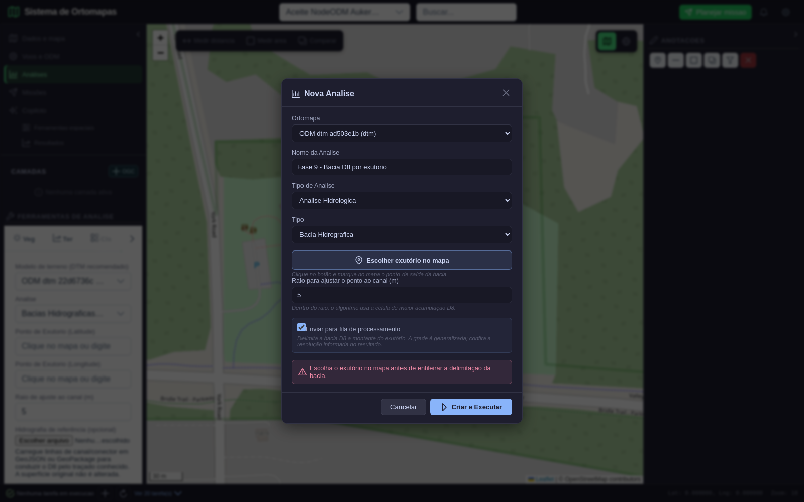

# Etapa 10.5 — Validação hidrológica (UC-011)

**Data:** 24/11/2026  
**Parecer:** fluxo funcional demonstrado; **aceite hidrológico operacional não concedido**.  
**Projeto:** `Aceite NodeODM Aukerman 20261112-163150` (#88).  
**Fonte de elevação na interface:** DTM ODM #72 (`ODM dtm ad503e1b`).  
**Usuário:** conta de validação #60; token criado apenas em memória. **Chamadas ao LLM: zero.**

## O que foi verificado

Foram avaliadas duas coisas diferentes: (1) se a aplicação consegue executar, persistir, exibir e exportar análises hidrológicas sobre um DTM real; e (2) se os resultados têm concordância suficiente com referências hidrológicas independentes para uso operacional. Passar a primeira parte não implica passar a segunda.

## Procedimento e esperado versus obtido

O Playwright abriu a aplicação, selecionou o projeto #88 e o DTM #72, enviou as análises pela fila autenticada e conferiu estado final, arquivos persistidos e renderização no mapa.

| Verificação | Esperado | Obtido | Resultado |
|---|---|---|---|
| Rede de drenagem D8 | Execução assíncrona concluída e feições lineares no resultado | POST HTTP 202; tarefa #49; análise #174 `concluida`; 21 feições LineString e 21 caminhos vetoriais renderizados | Passou funcionalmente |
| Parâmetros da rede | Limiar de área 1.000 m² e ordem Strahler mínima 1 aplicados | Extensão de rede 1.975,02 m; ordens 1/2/3 com 1.312,95/503,48/158,59 m | Passou funcionalmente; sem referência independente neste DTM |
| Exportação | GeoJSON e KML válidos e não vazios | GeoJSON 95.762 bytes; KML 38.813 bytes; ambos analisados como coleções/geometrias válidas | Passou |
| Bacia sem exutório | Impedir envio e não criar análise | Formulário exibiu “Escolha o exutório no mapa…”; nenhum POST foi enviado | Passou |
| Escolha de exutório | Modo de mapa e coordenada selecionada antes do envio | Clique no mapa definiu o ponto solicitado | Passou |
| Bacia D8 | Raster não vazio, área positiva, resultado visível e tile acessível | POST HTTP 202; tarefa #50; análise #175 `concluida`; 21.693 células, 11.477,70 m² (1,1478 ha); 25 tiles HTTP 200 | Passou funcionalmente |
| Ajuste ao canal | Ajuste dentro do limite indicado | Distância de 86,00 m para raio máximo configurado de 100 m | Passa o limite do formulário; **alerta operacional**: o ajuste é distante demais para tratar o ponto como exutório preciso |
| Erros do browser | Nenhum erro JS durante o roteiro | `page_errors=[]`; chamadas ao LLM = 0 | Passou |

### Evidência visual — etapas realmente percorridas

**1. Resultado da rede:** o mapa mostra os canais vetoriais azuis sobre o DTM e a área de referência do projeto. O resultado exibido é extração potencial por limiar de acumulação, não uma rede hidrográfica oficial.

**2. Resultado da bacia:** a área azul representa o raster de contribuição delimitado para o ponto selecionado; o círculo indica o ponto marcado. A visualização comprova a camada e o resultado na interface, não a validade hidrológica da bacia.

**3. Proteção de entrada:** sem indicar exutório, a interface impede a execução e explica a ação necessária.

O manifesto completo de execução, ids, resultados, exports e estados do navegador está em [manifest.json](manifest.json). As capturas são desta execução de 24/11/2026; não foram recicladas de uma execução anterior.

## Comparação independente do algoritmo

O benchmark reproduzível de Holston, Tennessee, usa outro recorte de relevo (USGS 3DEP de 1 m, EPSG:26917), hidrografia oficial USGS 3DHP e GRASS como implementação independente. Não é o DTM ODM #72 acima; as duas evidências não devem ser confundidas.

| Comparação no benchmark Holston | Resultado | Interpretação |
|---|---:|---|
| D8 Ortomapas versus GRASS, mesma superfície preparada e mesmo snap de 5 m | IoU da bacia 98,66%; concordância das direções 98,35% no raster e 99,12% dentro da bacia | Forte concordância entre implementações para esse caso |
| Bacia D8 sem condicionamento versus catchment USGS 3DHP | IoU 0,256%; recall 0,282%; precisão 2,74% | Falha clara contra a referência oficial no cenário sem condicionamento |
| Bacia condicionada por connector 3DHP | IoU 71,34%; recall 98,90%; precisão 71,91% | Melhora grande, mas ainda não equivale a aceite geral |
| Rede pareada, mesma área/tipo/ordem, ordem 1 | F1 71,61% a tolerância espacial de 5 m | Resultado parcial em uma bacia; faltam outras áreas e critérios acordados |

O relatório completo do benchmark, incluindo origem/licença, parâmetros, análises de sensibilidade, correções e limitações, está em [Validação D8 Holston/3DHP](../../../../uc020_benchmark_holston_2026-11-06/relatorio.md) e em [PDF](../../../../uc020_benchmark_holston_2026-11-06/relatorio.pdf).

## Conclusão da etapa

**Aprovado:** seleção de DTM, validação de entrada, enfileiramento, execução, persistência, mapa, tile e exportação da rede.

**Ainda parcial/reprovado para aceite hidrológico operacional:** os resultados visuais desta missão não foram confrontados com levantamento hidrográfico de campo co-localizado. O benchmark externo mostra alta concordância com GRASS, mas baixa concordância D8 sem condicionamento com o catchment oficial; o condicionamento elevou as métricas, mas só foi testado em uma bacia. O snap de 86 m no fluxo visual precisa ser tratado com cautela.

Critério necessário para mudar o parecer: referência independente na mesma extensão do DTM, método de condicionamento documentado quando usado, pares por tipo/ordem de feição, tolerância espacial definida antes do ensaio e repetição em múltiplas bacias. Até isso existir, UC-011 é **implementado com evidência funcional, mas não aprovado para decisão hidrológica/engenharia**.
