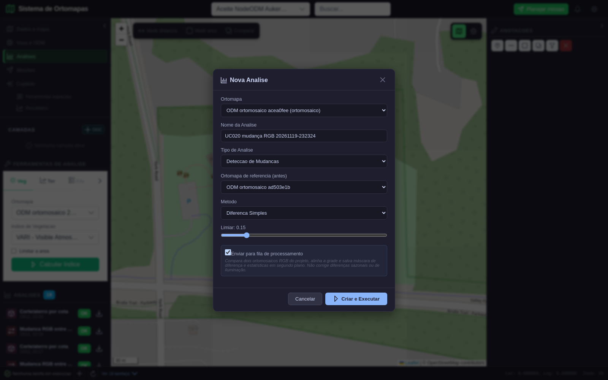
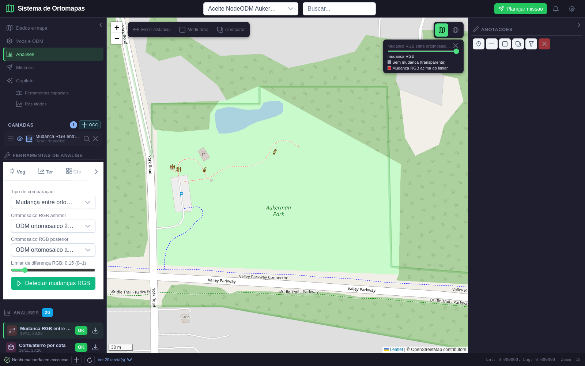
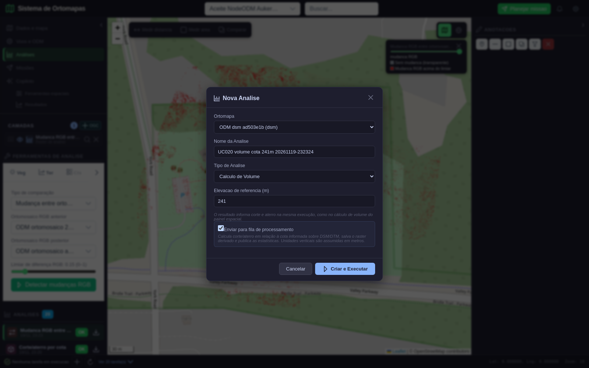
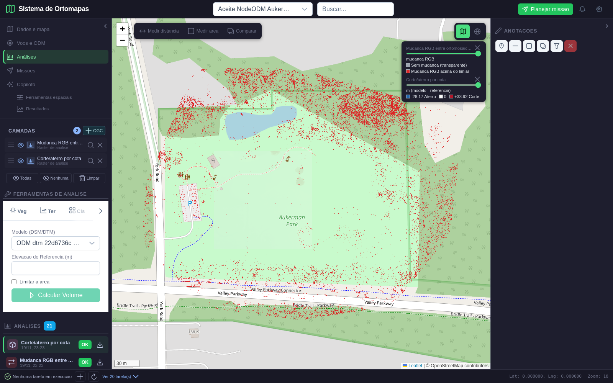

# Etapa 10.2 — Cobertura da fila espacial (UC-020)

**Data:** 19/11/2026
**Estado:** aprovada para o escopo funcional validado.
**Agente de processamento:** worker espacial do Ortomapas; nenhuma chamada ao Copiloto/LLM.

## Escopo e decisão de requisitos

UC-020 valida submissão de uma análise espacial assíncrona, acompanhamento da tarefa e apresentação do resultado. A revisão confirmou que K-Means RGB, índices, terreno e hidrologia já tinham workers; mudança RGB (UC-009) e volume por cota (UC-012) eram executados apenas no painel síncrono.

O UC-010 v2 especifica K-Means RGB não supervisionado. Segmentação e classificação supervisionada não aparecem como critérios obrigatórios aprovados para UC-020. Removi essas opções antigas do formulário de enfileiramento, que indicavam caminhos sem execução suportada. Se forem desejadas depois, devem receber casos de uso e critérios próprios. A fila espacial não é o Copiloto conversacional.

## Dados e limites

O teste integrado usou o conjunto público CC0 **Aukerman**, já processado no projeto #88. Orto #70 e orto #75 são duas resoluções de processamento das **mesmas 77 fotos**; não são duas campanhas independentes. O DSM #71 tem 7.448 × 5.905 pixels, uma banda, EPSG:32617 e resolução de 0,05 m. A cota de comparação foi 241 m.

Assim, a execução demonstra o contrato de fila, persistência, visualização e cálculo com dados fotogramétricos. Ela não valida detecção temporal em campanhas reais, não certifica corte/aterro contra levantamento de campo e não substitui os critérios científicos de UC-009, UC-011 e UC-026.

## Resultado esperado versus obtido

| Verificação | Esperado | Obtido | Resultado |
|---|---|---|---|
| Enfileirar mudança RGB | API retorna 202 e vincula a tarefa ao worker de mudança | Análise #168 / tarefa #45; POST 202; agente `agente_mudanca_fila` | Aprovado |
| Concluir e persistir mudança | Worker conclui, salva raster, atualiza análise e registra comparação temporal única | Tarefa `concluido`; análise `concluida`; arquivo presente; uma comparação registrada | Aprovado |
| Exibir mudança | Seleção busca metadados atuais, adiciona camada/legenda e abre estatísticas | Camada e painel de estatísticas visíveis; tile autenticado HTTP 200, PNG 256×256, 1.585 pixels opacos | Aprovado após correção visual |
| Estatística de mudança | Aplicar limiar escolhido e contabilizar os pixels alterados válidos | 2.056.078 de 43.993.794 pixels válidos (4,674%); limiar normalizado 0,15 | Aprovado funcionalmente |
| Enfileirar volume | API retorna 202 para DSM/DTM e cota finita | Análise #169 / tarefa #46; DSM #71, cota 241 m; agente `agente_mudanca_fila` | Aprovado |
| Concluir e persistir volume | Raster de diferença e estatísticas de corte/aterro persistidos | Tarefa `concluido`; análise `concluida`, tipo final `volume`; arquivo presente | Aprovado |
| Exibir volume | Camada raster, legenda, estatísticas e tile válidos | Camada e estatísticas visíveis; tile autenticado HTTP 200, PNG 256×256, 27.586 pixels opacos | Aprovado |
| Números de volume | Valores finitos, pixels e área válidos; corte, aterro e saldo calculados | 35.481.781 pixels; 88.704,45 m² válidos; corte 456.241,11 m³; aterro 109.387,50 m³; saldo 346.853,62 m³ | Aprovado matematicamente para os dados e cota usados; sem validação de campo |
| Navegador | Fluxo visual sem erro JS | `browser_errors=[]`; camadas e painéis conferidos por Playwright | Aprovado |

Teste determinístico separado usou rasters sintéticos 8×8/3×3 para aferir os contratos dos algoritmos: eram esperados e foram obtidos 4 pixels de mudança, 12,00 m³ de corte, 12,00 m³ de aterro e saldo 0 m³. O teste não representa levantamento real.

## Defeito visual encontrado e corrigido

Na primeira execução, o item recém-concluído aparecia como “OK”, mas o objeto ainda carregado na lista podia estar desatualizado; ao selecioná-lo, faltavam `resultado_path` e metadados para inserir a camada. A seleção em [AnalysisResults.vue](../../../../../frontend/src/components/AnalysisResults.vue) agora consulta o detalhe autenticado antes de atualizar o catálogo local e carregar a camada. A reexecução final exigiu e confirmou painel de camada e estatísticas para ambos os produtos.

O formulário também mostrava a dica de fila hidrológica para mudança/volume devido à ausência de chaves no bloco condicional. Corrigi o bloco e a dica capturada agora descreve a operação correta. As opções antigas de razão/NDVI-diferença não eram aceitas pelo algoritmo enfileirado e foram retiradas; a ferramenta oferece a diferença RGB simples especificada. O volume retorna corte e aterro na mesma execução, alinhado com o cálculo do painel espacial.

## Capturas Playwright

### Mudança RGB — parâmetros e envio à fila

### Mudança RGB — camada no mapa, legenda e catálogo

Tile de resultado independente: [PNG RGB](tile_mudanca_rgb.png).

### Volume — superfície, cota e envio à fila

### Volume — resultado no mapa

Tile de resultado independente: [PNG de volume](tile_volume.png).

## Reprodução e artefatos

- Roteiro visual: [`validate_uc020_change_volume_phase10.py`](../../../../../tests/e2e/playwright/validate_uc020_change_volume_phase10.py)
- Checagem determinística: [`validate_uc020_change_volume_algorithms.py`](../../../../../tests/validation/validate_uc020_change_volume_algorithms.py)
- Valores retornados, IDs de tarefas/análises, capturas, tiles e limites do teste: [manifest.json](manifest.json)
- Build frontend: `npm run build` — aprovado (427 módulos transformados; permanece aviso conhecido de bundle >500 kB).
- Backend e roteiros: `py_compile` aprovado; `git diff --check` aprovado.

## Conclusão

**UC-020 está implementado com evidência funcional para as análises assíncronas do escopo v2.** A etapa 10.2 encerra sem pendência funcional para mudança RGB e volume na fila. Essa conclusão não altera os estados de validação científica de outros UCs. Próxima etapa: **10.3 de 7 — comparação entre campanhas independentes**; restam cinco etapas propostas.
