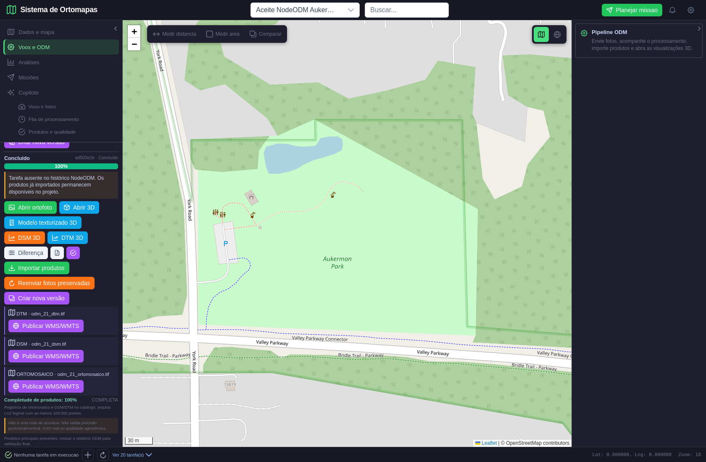

# Etapa 10.6 — Acurácia posicional e vertical (UC-026)

**Data:** 24/11/2026  
**Parecer:** auditoria do indicador e metadados aprovada; **acurácia externa permanece não comprovada**.  
**Projeto/processamento:** projeto #88, processamento NodeODM #21.  
**Produtos:** ortomosaico, DSM, DTM, LAZ e relatório ODM.  
**Usuário:** conta de validação #60; token não persistido. **Chamadas ao LLM: zero.**

## Objetivo

Verificar se a aplicação descreve corretamente o escore de qualidade, se seus metadados correspondem aos arquivos reais e se existe base para declarar acurácia horizontal/vertical. A nota operacional de completude não deve ser confundida com precisão topográfica.

## Método

1. A API autenticada de qualidade foi consultada pelo Playwright na tela do processamento #21.
2. Rasterio abriu independentemente cada GeoTIFF e comparou CRS, dimensão, bandas e resolução com os campos da API.
3. Laspy leu o cabeçalho LAZ; `pdftotext` verificou os valores do relatório ODM.
4. A tela foi conferida quanto ao nome do indicador e ao aviso explícito sobre acurácia.

## Esperado versus obtido

| Verificação | Esperado | Obtido | Resultado |
|---|---|---|---|
| Significado do escore | Identificar completude de catálogo, sem chamá-la de acurácia | 100%, tipo `completude_de_catalogo_e_volume_de_nuvem`; tela informa que não mede precisão posicional/vertical | Passou |
| Produtos principais | Orto, elevação e nuvem válidos | As três verificações passaram; LAZ legível com 15.889.672 pontos | Passou |
| Ortomosaico | API consistente com o arquivo | 7.449 × 5.906, 4 bandas, EPSG:32617, pixel ~0,05 m; dimensões/contagem coerentes | Passou |
| DSM | API consistente com o arquivo | 7.448 × 5.905, 1 banda, EPSG:32617, pixel ~0,05 m | Passou |
| DTM | API consistente com o arquivo | 7.449 × 5.906, 1 banda, EPSG:32617, pixel ~0,05 m | Passou |
| Relatório ODM | Extrair corretamente suas estimativas | 77/77 imagens; GSD médio reportado 2,8 cm; erro GPS 0,85 m; CE90 0,717 m; LE90 1,220 m | Leitura confirmada; não é checkpoint independente |
| Checkpoints/GCP independentes | Comparar erros com tolerância definida previamente | Nenhum conjunto independente ou limite de aceitação foi encontrado neste projeto | **Não comprovado; aceite de acurácia retido** |
| Browser | Sem exceção JS ou erro no console | Nenhum erro de página/console; token não gravado no manifesto | Passou |

O GSD de 2,8 cm é uma estimativa no relatório ODM; o pixel exportado dos produtos é aproximadamente 5 cm. São grandezas distintas e foram mantidas separadas. A diferença, por si só, não prova defeito nem precisão: deve ser interpretada conforme configuração de saída, voo, escala e uso pretendido.

## Tela verificada

A tela apresenta a completude de produtos e o aviso de limite. A nota 100% atesta apenas as verificações operacionais listadas; não é selo de acurácia.

O resultado estruturado e as medidas independentes estão em [manifest.json](manifest.json). A imagem foi capturada novamente nesta execução de 24/11/2026.

## Decisão

UC-026 está **implementado com evidência para completude de catálogo e inspeção de metadados**. Está **parcial para validação de qualidade posicional/vertical**. Os campos CE90/LE90 do ODM vêm do próprio ajuste fotogramétrico e não substituem pontos de checagem independentes.

Para aceitar acurácia, o levantamento deve fornecer pontos independentes do ajuste, suas coordenadas em datum/CRS identificados, método de levantamento e incertezas, separação explícita de GCPs usados no processamento e checkpoints, tolerâncias numéricas por tipo de uso, e cálculo reprodutível de vieses, RMSE horizontal/vertical e percentis aplicáveis. Sem essas entradas, não existe aprovação técnica responsável a registrar.
