# Fase 3: resultados de terreno publicados no mapa

Data: 11/10/2026. Aplicacao: Ortomapas. Checkpoint anterior: `674dc48`, enviado antes das alteracoes deste lote.

## 1. Conclusao e abrangencia

**Aprovado neste lote:** executar aspecto, sombreamento e declividade sobre DSM real; salvar os tres resultados no PostgreSQL; visualizar seus arquivos derivados com tiles e legendas; reabrir um resultado apos recarregar a pagina; ajustar opacidade; baixar o GeoTIFF; impedir acesso de outro usuario sem vinculo ao projeto. Nenhuma imagem de saida foi substituida pela ortofoto de origem.

Este relatorio nao aprova toda a aplicacao nem encerra a fase 3 inteira. Recorte por poligono, publicacao dos demais motores, vegetacao, hidrologia e execucao completa pelo Copiloto ainda precisam dos respectivos lotes e provas. Nao houve novo processamento WebODM nesta execucao.

Foram inspecionadas as seis capturas finais abaixo, com entradas e resultados reais. A regressao adicional retomou perfil, DSM/DTM, visualizacao 3D e tablet. Os manifestos de ambas as execucoes registram `accepted: true` e nenhum erro JavaScript.

## 2. Dados e ambiente utilizados

| Item | Valor verificado |
|---|---|
| Frontend | http://localhost:5302 |
| API local | http://127.0.0.1:5018/api |
| Banco da aplicacao | PostgreSQL/PostGIS; tabela existente `analises` |
| Projeto de publicacao | #62, Validacao Fase 1 - Ortofoto real Aukerman |
| Produto de entrada | #34, Aukerman - DSM real para derivadas |
| Arquivo DSM | `data/ortomapas/odm_2_dsm.tif` |
| Ortofoto de contexto | #30, `data/ortomapas/odm_2_ortomosaico.tif` |
| Grade das saidas | 7.448 x 5.907 pixels; 43.995.336 pixels totais |
| Referencia espacial | EPSG:32617, coordenadas horizontais metricas |
| Elevacao | Unidade vertical assumida em metros; nao certificada pelo lote |
| Resultados finais | #37 aspecto; #38 sombreamento; #39 declividade |
| Captura principal | Chromium/Playwright, 1.440 x 900 |

Aukerman e um conjunto fotogrametrico real, nao uma superficie sintetica de Guarajuba. O DSM representa superficie, incluindo copas e objetos. Nao interpretar suas derivadas como declividade exclusivamente do solo. Os arquivos gerados ficam em `data/analises/projetos/62/`; caminhos completos, parametros, estatisticas e IDs constam do manifesto. Arquivos raster de execucao nao foram adicionados ao Git.

## 3. Roteiro executado e criterio de aceite

1. Autenticar pela tela de login e selecionar o projeto #62.
2. Exibir a ortofoto real, entrar em Analises e selecionar a aba de terreno.
3. Selecionar o DSM #34, gerar cada operacao e aguardar a resposta HTTP e os tiles carregados.
4. Conferir ID, projeto, origem, legenda, estatisticas, enquadramento e pixels de um tile de borda.
5. Remover as camadas derivadas da sessao, recarregar a pagina e reabrir a declividade pelo catalogo.
6. Confirmar ausencia de tiles da ortofoto, ajustar opacidade para 35% e restaurar 100%.
7. Baixar o arquivo pelo icone e comparar seu SHA-256 ao arquivo gerado.
8. Testar acessos anonimos, projeto alheio, tickets restritos, coordenadas XYZ invalidas e origem RGB indevida.
9. Repetir a regressao de perfil e visualizacao DSM/DTM, incluindo tablet.

O navegador usa a interface e as respostas reais. Nao foram interceptadas requisicoes para substituir respostas nem injetados resultados no estado Vue. A verificacao de pixels faz reprojecao independente do arquivo derivado e aplica a paleta de referencia; nao chama o colorizador de producao. Isso testa a publicacao cartografica, nao substitui a verificacao matematica do motor com referencias conhecidas nos testes Python.

## 4. Demonstracao com esperado e obtido

### Cena 1 - Orientacao da superficie

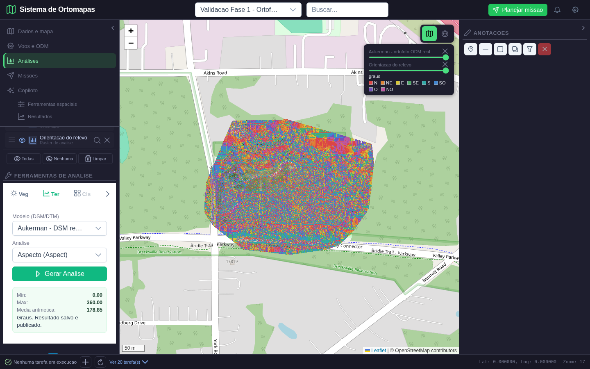

**Acao:** escolher Aspecto e clicar em Gerar Analise. **Entrada:** DSM #34, raster completo. **Esperado:** resultado proprio, oito setores direcionais, dados sem orientacao valida transparentes, sem alteracao de paleta entre tiles.

**Obtido:** analise #37 persistida; camada Orientacao do relevo visivel; legenda N, NE, E, SE, S, SO, O e NO no canto superior direito. Sao 32.678.891 pixels validos, valores de 0 a 359,9997 graus. A interface arredonda o maximo para 360,00; o arquivo nao foi truncado para esse valor.

**Inspecao:** as cores numerosas acompanham a variacao local da superficie e das copas. Nao e um gradiente decorativo nem um desenho aleatorio: o tile comparado coincidiu integralmente com o raster calculado. A media aritmetica de 178,85 graus nao indica uma direcao predominante; para isso seria necessaria estatistica circular. Norte aqui e o norte da grade projetada, sem correcao de convergencia para norte verdadeiro.

**Resultado:** aprovado para a operacao e a publicacao descritas, com os limites de interpretacao acima.

### Cena 2 - Relevo sombreado

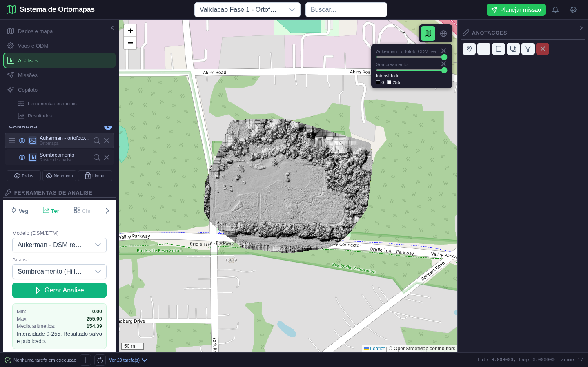

**Acao:** escolher Sombreamento e gerar. **Entrada:** mesmo DSM; azimute 315 graus e altitude solar 45 graus, parametros registrados na analise. Nesta tela esses valores usam os padroes do motor; nao ha campos para edita-los.

**Esperado:** iluminacao numerica em escala fixa de 0 a 255, mostrando a superficie e mantendo nodata transparente. **Obtido:** analise #38, 35.587.230 pixels validos; minimo 0, maximo 255 e media 154,39. A legenda identifica intensidade, nao altitude.

**Inspecao:** o campo aberto aparece mais continuo, as bordas arborizadas mostram textura e as transicoes de iluminacao tornam a forma da superficie legivel. Ha marcas retangulares e linhas na parte superior e direita: sao estruturas do resultado derivado do DSM de entrada, presentes na referencia independente, nao limites artificiais de tiles. A publicacao correta nao certifica a qualidade fotogrametrica dessas regioes; elas merecem revisao do dado de origem.

**Resultado:** aprovado como mapa de iluminacao da superficie, nao como modelo de terreno sem vegetacao.

### Cena 3 - Declividade

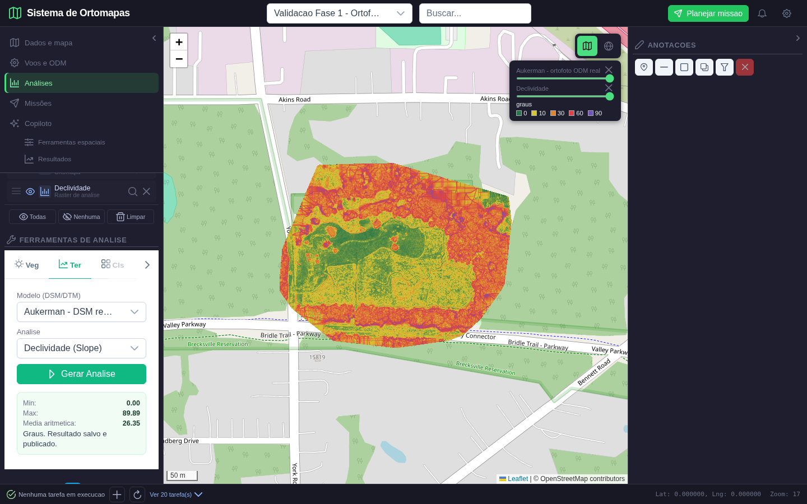

**Acao:** escolher Declividade e gerar. **Esperado:** raster angular verdadeiro, paleta fixa 0, 10, 30, 60 e 90 graus; registro vinculado ao projeto e a origem.

**Obtido:** analise #39; minimo 0, maximo 89,8856, media 26,3543 e mediana 15,7964 graus. Pixels validos: 35.587.230. Verde representa menores inclinacoes; amarelo, laranja, vermelho e roxo correspondem a valores crescentes. A legenda e a exibicao usam graus, nao porcentagem.

**Inspecao:** o centro possui mais pixels de baixa declividade; regioes de copas e descontinuidades do DSM possuem valores elevados. O vermelho nao prova risco geotecnico nem inclinacao do solo sob as arvores. O mapa foi conferido contra os pixels do arquivo derivado e a paleta fixa.

**Resultado:** aprovado; nao houve uso da ortofoto como resultado de declividade.

### Cena 4 - Reabertura independente da origem

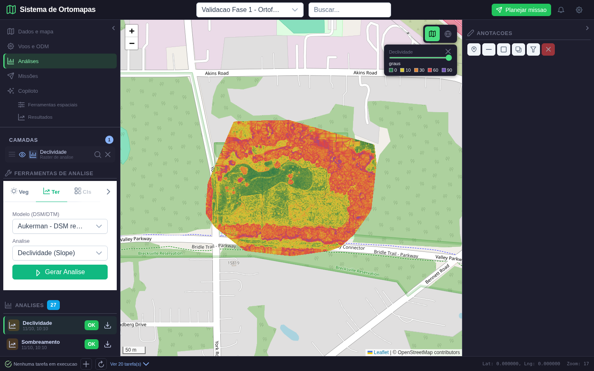

**Acao:** recarregar a aplicacao, selecionar novamente o projeto e clicar no registro #39. **Esperado:** o catalogo consulta o banco e abre o arquivo da analise sem precisar ligar a ortofoto.

**Obtido:** apenas uma camada, Declividade, ativa. Nenhuma imagem da rota de tiles de ortomapas estava presente no mapa. As imagens carregadas pertencem a `/api/analises/39/tile/`. O registro persistido preserva origem, parametros, CRS, estatisticas e estilo.

**Inspecao:** a selecao no catalogo e o mapa correspondem ao mesmo resultado. A pagina nao gerou novamente a analise. Camadas visiveis e opacidade ainda sao estado da sessao; a reabertura comprovada e manual pelo catalogo, nao restauracao automatica de todo o workspace.

**Resultado:** aprovado para persistencia e reabertura do resultado.

### Cena 5 - Opacidade e localizacao

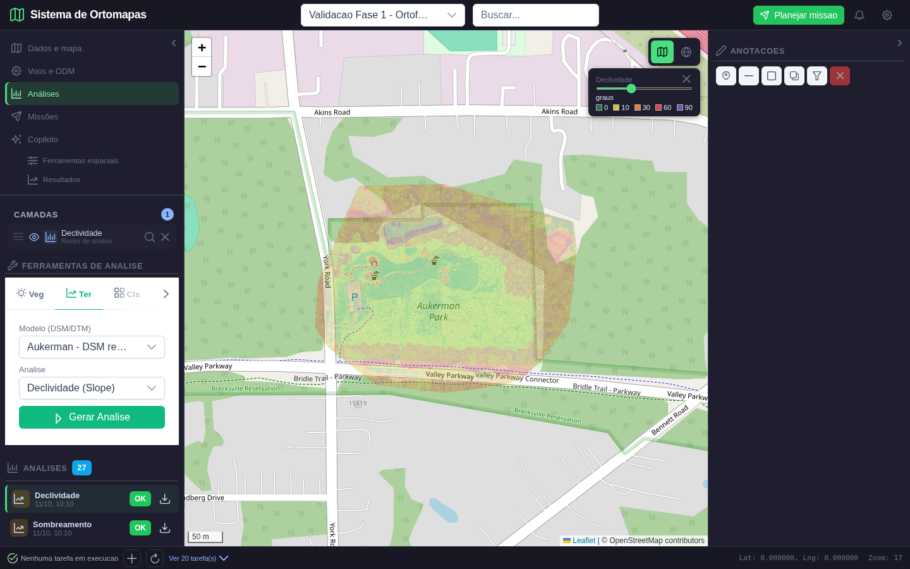

**Acao:** mover o controle de opacidade para 35%. **Esperado:** a mesma camada derivada fica translúcida, sem mudar valores, posicao ou legenda.

**Obtido:** OpenStreetMap aparece atraves da declividade; o parque Aukerman e as vias podem ser lidos. O teste conferiu opacidade 0,35 no elemento Leaflet que contem os tiles da analise #39. Depois restaurou 100%.

**Inspecao:** a extensao geografica permaneceu alinhada. Nao foi acrescentada ortofoto nesta cena. A opacidade altera somente a composicao visual, nao recalcula o raster.

**Resultado:** aprovado.

### Cena 6 - Estatisticas, origem e download

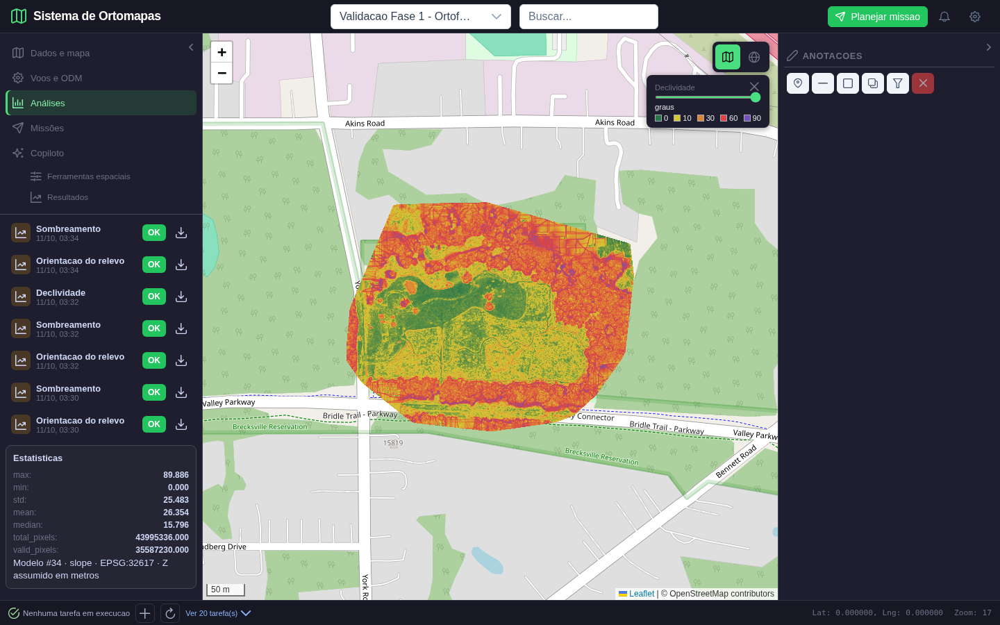

**Acao:** clicar no icone de download do registro #39 e rolar o painel ate suas estatisticas. **Esperado:** GeoTIFF original da analise, nao imagem de tela; CRS, operacao e origem identificados no painel.

**Obtido:** download de 118.191.032 bytes, SHA-256 identico ao arquivo gerado. A tela mostra Modelo #34, operacao slope, EPSG:32617 e aviso de unidade Z assumida em metros, alem dos 43.995.336 pixels totais e 35.587.230 validos.

**Inspecao:** a lista acima apresenta registros de outras rodadas de teste; o painel estatistico corresponde ao registro selecionado #39. Os rotulos tecnicos ainda estao em ingles e contagens aparecem com casas decimais: legibilidade e formatacao do catalogo seguem como melhorias, nao falhas de calculo ocultadas.

SHA-256 verificado: `4ab745f6b0ff08f9b4e6d0097038f81e75b34e08585528993c0d9fa93426b331`.

**Resultado:** aprovado para download e rastreabilidade. Foi usado ticket temporario restrito ao arquivo, sem copiar o raster inteiro para um Blob JavaScript.

## 5. Prova cartografica independente

Tile de borda: zoom 17, X 35770, Y 48995; imagem RGBA de 256 x 256. A mascara inclui dados e exterior transparente, evitando aprovar uma imagem completamente preenchida ou vazia.

| Operacao | Pixels RGBA identicos | Mascara identica | Erro medio de canal | Pixels opacos |
|---|---|---|---|---|
| Aspecto | 100% | 100% | 0 | 35.352 |
| Sombreamento | 100% | 100% | 0 | 42.167 |
| Declividade | 100% | 100% | 0 | 42.167 |

Critério automatico: pelo menos 97% dos pixels RGBA identicos, 99,5% da mascara identica e erro medio inferior a 1,5. Nesta execucao os tres resultados atingiram igualdade integral. A prova abrange esse tile selecionado, nao todos os tiles em todos os zooms. Testes unitarios adicionais verificam paleta fixa e areas constantes.

Aspecto: esperado e obtido, respectivamente:


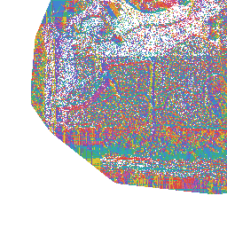

Sombreamento: esperado e obtido:

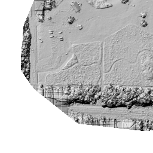


Declividade: esperado e obtido:


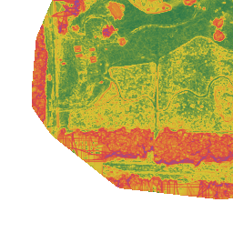

## 6. Permissoes e falhas verificadas

| Tentativa real | Esperado | Obtido |
|---|---|---|
| Catalogo sem autenticacao | 401 | 401 |
| Catalogo do projeto #62 com usuario sem acesso | 403 | 403 |
| Registro, arquivo e tile de #39 por usuario alheio | 403 em cada rota | 403 em cada rota |
| Emitir ticket de tile ou download por usuario alheio | 403 em cada rota | 403 em cada rota |
| Ticket valido do tile da propria analise | 200 | 200 |
| Reusar ticket de tile em outra analise | 401 | 401 |
| Reusar ticket de download em outra analise | 401 | 401 |
| Tile com zoom 23, fora do intervalo aceito | 422 | 422 |
| Usar produto RGB #30 como modelo DSM | 422 | 422 |

Tambem se conferiu que o catalogo sem filtro do usuario externo nao retorna analises do projeto #62. Tickets duram cinco minutos e estao restritos ao recurso; autorizacao de projeto continua sendo conferida. Isso nao representa uma auditoria global de seguranca da aplicacao.

## 7. Defeitos encontrados e corrigidos

1. O catalogo antigo abria a origem como se fosse o resultado. Esse fallback foi removido. A camada publicada usa ID e arquivo da analise; resultados sem conteudo renderizavel nao recebem uma ortofoto substituta.
2. CRUD legado usava `lastrowid` e campo de arquivo incompativel com o esquema PostgreSQL. Foram aplicados `RETURNING`, campos existentes e autorizacao por projeto. Nenhum segundo banco foi criado.
3. A reprojecao inicial do tile sombreado divergia da referencia. O renderer passou a usar reprojecao direta GDAL/Rasterio; a rodada final teve erro zero no tile comparado.
4. Downloads grandes nao devem exigir um Blob inteiro em memoria do frontend. O fluxo usa ticket restrito e download nativo do navegador.
5. O download intermitentemente recebia HTTP 429 porque o carregamento de tiles consumia o limite geral. Tiles agora possuem limite separado de 600 por minuto por IP; API de controle continua limitada a 120. Os dois permanecem ativos. Testes conferem excesso de tiles sem bloquear controle e mantem emissao de tickets no limite de controle.
6. Sidebar flexivel comprimida, rodape com historico fora da viewport e glifos pintados fora das linhas prejudicavam as capturas. Foram corrigidas dimensoes, rolagem, popover e contencao de pintura. Os campos e resultados foram reenquadrados antes da captura final.

Limite de compatibilidade explicito: `POST /analises` registra pedidos pendentes, nao executa uma fila. `queue_task=true` agora e recusado com 422, em vez de aparentar um enfileiramento que o contrato legado nao comprovava. A execucao deste lote ocorre pelas ferramentas de terreno. Excluir uma analise remove o registro, mas preserva o arquivo; retencao e limpeza segura continuam pendentes.

## 8. Regressao de perfil, 3D e tablet

O roteiro de usabilidade da fase 2 foi repetido nos mesmos servicos, com evidencias em subpasta separada. Passou sem erros JavaScript. Nao substitui o roteiro completo de toda a aplicacao.

### Cena 7 - Perfil e ortofoto em tablet

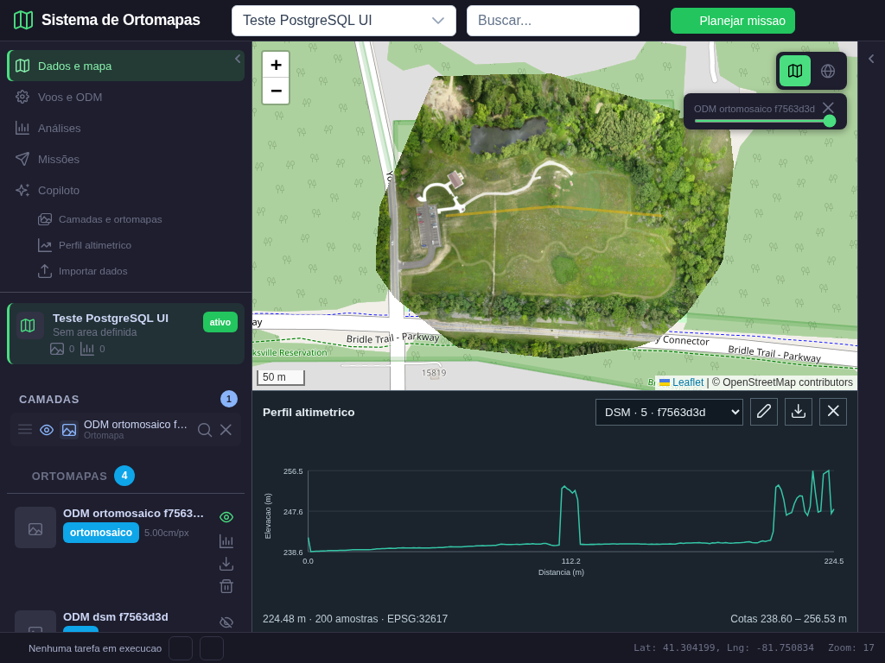

**Acao:** desenhar uma linha sobre a ortofoto, obter perfil DSM, inspecionar grafico e exportar CSV; repetir a mesma linha no DTM. **Esperado:** geometria e amostras correspondentes aos arquivos, sem colapsar a area do mapa no tablet.

**Obtido:** linha de 224,4815 m, 200 amostras validas; cotas DSM 238,6000 a 256,5300 m, DTM 238,5585 a 243,2469 m. As amostras independentes coincidiram; CSV com 200 linhas. A captura 1.024 x 768 mostra ortofoto, linha e grafico juntos, com painel direito recolhido.

**Resultado:** regressao aprovada. O teste de contexto visual do Copiloto confirmou preservacao da ortofoto ao abrir o painel; nao executou nova conversa com o modelo de linguagem.

### Cena 8 - Superficie DSM 3D real

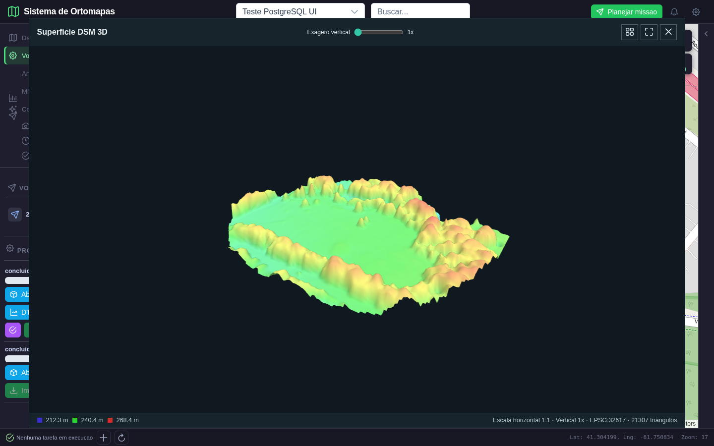

**Acao:** abrir o DSM 3D e comparar exagero vertical 1x/3x. **Esperado:** malha com area positiva e superficie visivel, com parametro de exagero explicito.

**Obtido:** superficie real com 21.307 triangulos, EPSG:32617 e escala horizontal 1:1, nao um canvas preto. A cena seguinte registra a alteracao vertical, mantendo a mesma fonte.

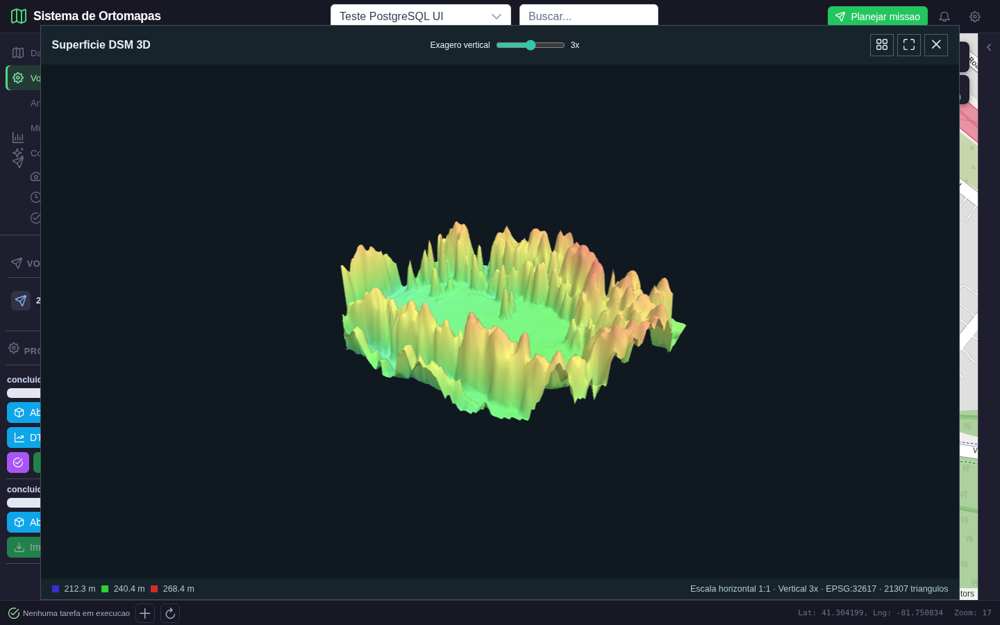

**Inspecao:** copas e objetos se destacam mais em 3x; o visualizador nao transforma o DSM em DTM ao exagerar Z. A mudanca e visual, nao uma nova medicao ou um novo produto fotogrametrico.

**Resultado:** regressao aprovada para superficie e mudanca de exagero. A comparacao DSM-DTM tambem passou com alinhamento do DTM a grade DSM e mascara; valores negativos permanecem visiveis para revisao da qualidade, nao sao apagados.

## 9. Testes e reproducao

- Python: 52 testes aprovados; tres avisos preexistentes de deprecacao.
- Node: suites de produtos de analise, geometria de terreno e geometria de nuvem aprovadas; aviso preexistente sobre tipo de modulo.
- Build frontend: aprovado, 418 modulos; bundle principal de aproximadamente 1,44 MB, com aviso de tamanho ainda pendente.
- Playwright principal: seis cenas, tres publicacoes, reabertura, opacidade, download, 12 verificacoes HTTP e nenhum erro JavaScript.
- Playwright de regressao: dez capturas, perfil, CSV, DTM, tablet, contexto visual, recolhimento da navegacao, 3D e diferenca alinhada; nenhum erro JavaScript.

Roteiro principal: `scripts/validar_publicacao_terreno_fase3.py`. Exige servicos locais ativos, arquivos e contas de teste existentes, projeto #62 e modelo #34. Cada execucao cria tres resultados reais; nao e um seed para banco vazio. IDs mudam e as capturas/manifesto sao atualizados. Executar os roteiros de forma sequencial para evitar disputa por estado e limites de requisicao.

```bash
python scripts/validar_publicacao_terreno_fase3.py
python -m pytest tests/test_analysis_products.py tests/test_gis_rate_limit.py tests/test_terrain_tools.py tests/test_elevation_analysis.py tests/test_metric_analysis.py tests/test_surface_grid.py tests/test_resource_access.py tests/test_raster_tiles.py tests/test_ortomapas_postgres.py -q
node frontend/tests/analysisProducts.test.js
node frontend/tests/terrainGeometry.test.js
node frontend/tests/cloudGeometry.test.js
```

Manifesto principal: [resultado.json](publicacao_terreno_fase3_2026-10-11/resultado.json). Manifesto de regressao: [resultado.json](publicacao_terreno_fase3_2026-10-11/regressao_perfil/resultado.json). Screenshots de diagnostico de rodadas rejeitadas nao integram as cenas aprovadas.

## 10. Pendencias e proximo lote

1. Aplicar AOI aos calculos e estatisticas; este lote processa o raster inteiro. Nao afirmar que o desenho de um poligono ja limita esses tres motores.
2. Publicar resultados dos demais motores com contrato de origem, unidade, arquivo, legenda e acesso, sem retornar a substituicao pela ortofoto.
3. Melhorar catalogo: agrupamento/paginacao, nomes de estatisticas em portugues, contagens inteiras, detalhes de parametros e estado selecionado acessivel com listas longas.
4. Planejar retencao, limpeza de arquivos orfaos e memoria para rasters grandes. Operacoes atuais sao sincronas; falha de persistencia pode deixar arquivo gerado fora do catalogo.
5. Consolidar fila de execucao, estados e erros em lote proprio, alem da validacao integrada do chat e das demais fases.
6. Validar mobile e carga multiusuario. O limitador atual e local ao processo e por IP; nao e solucao distribuida para varios workers ou usuarios atras de NAT.

**Proxima implementacao proposta:** recorte AOI com conservacao de CRS, nodata e unidades; prova com area conhecida e DSM real, incluindo comparacao das estatisticas dentro/fora do poligono. O primeiro lote de publicacao da fase 3 esta aprovado; os demais itens continuam abertos.
