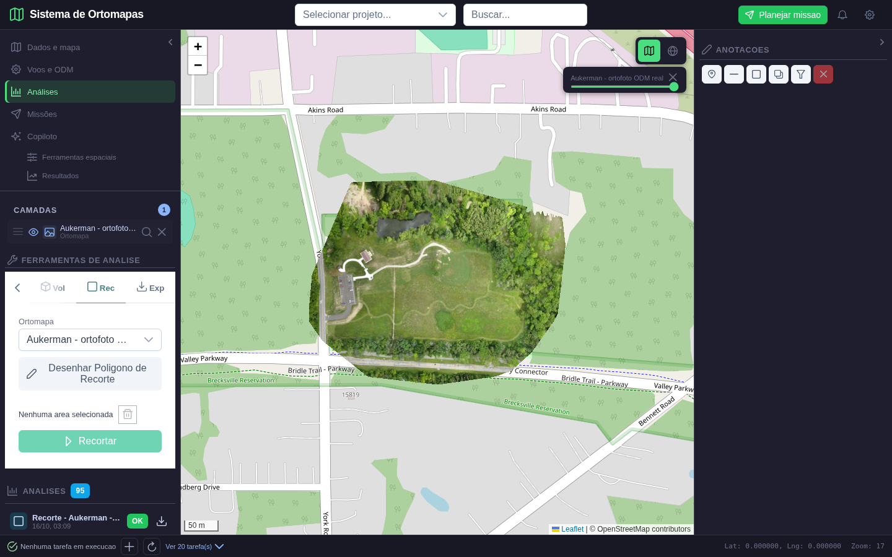
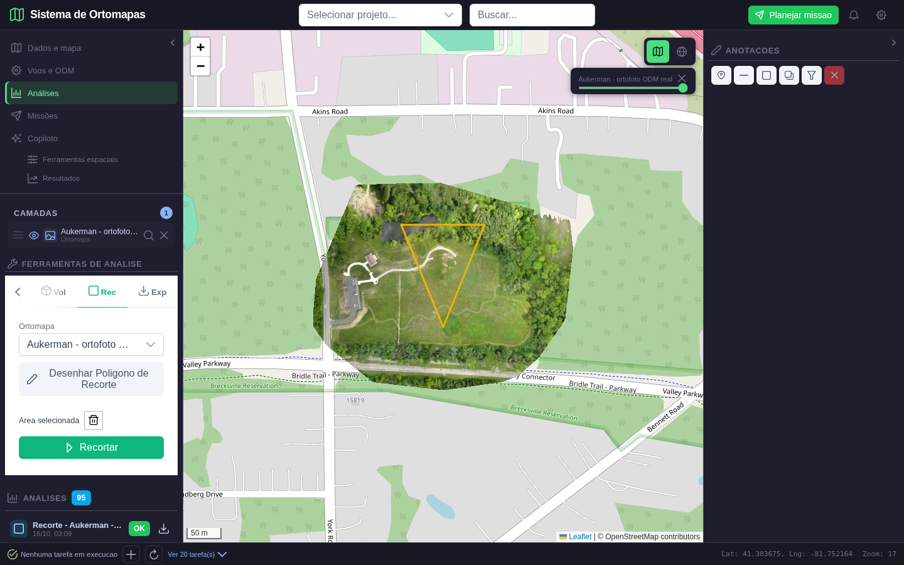
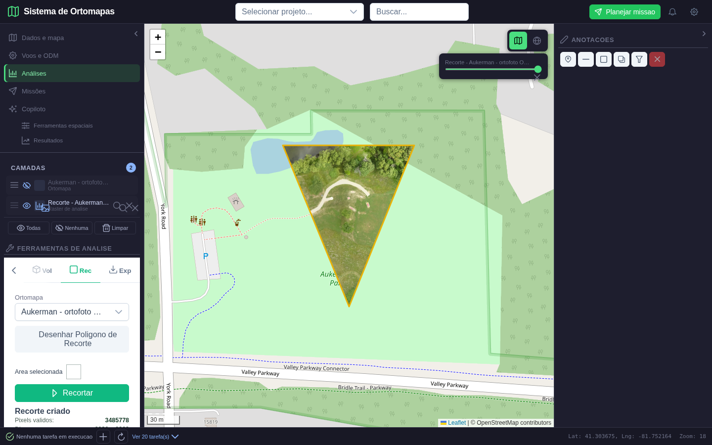
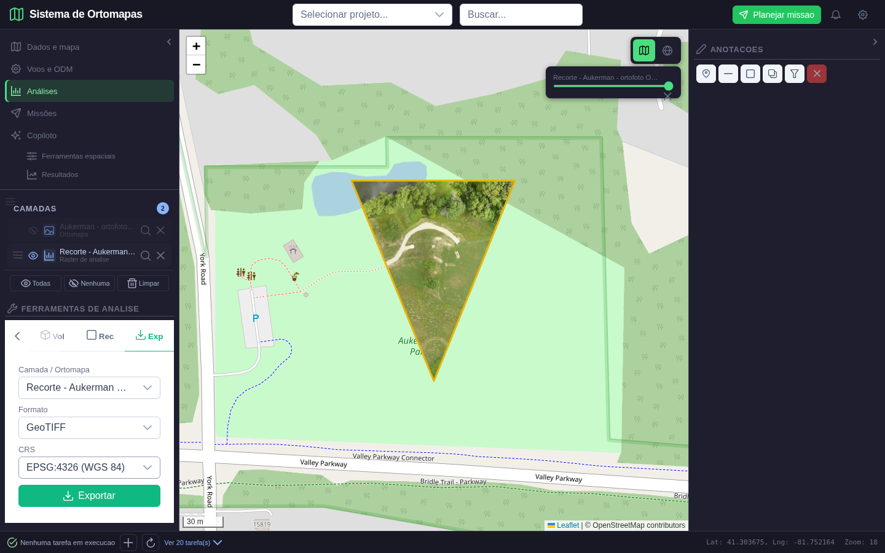
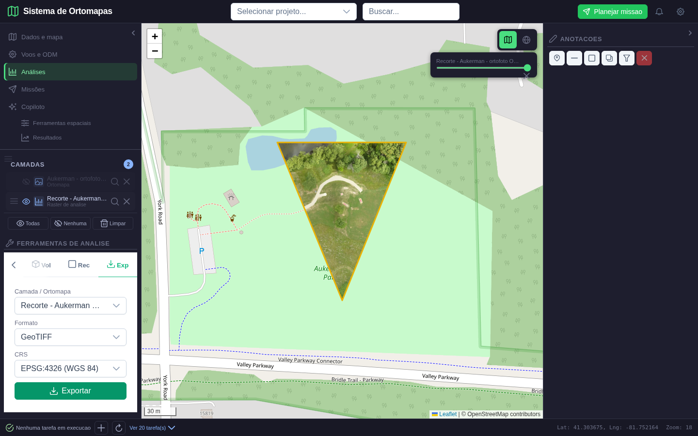

# Validacao: recorte e exportacao

- **Data:** 16/10/2026 (aceitacao visual integrada)
- **Projeto de teste:** Validacao Fase 1 - Ortofoto real Aukerman (ID 62)
- **Entrada:** Aukerman - ortofoto ODM real (ID 30), RGB real, 4 bandas, EPSG:32617
- **Resultado persistido da demonstracao:** analise de recorte ID 113 (projeto 62)
- **Status:** aprovado para recorte poligonal e exportacao GeoTIFF; formatos adicionais cobertos por testes de conversao.

## Fluxo demonstrado

1. Selecionada a ortofoto real e aberta a ferramenta Recorte.
2. Desenhado um poligono sobre a imagem. A interface agora oferece **Concluir poligono**, que encerra o desenho explicitamente.
3. Executado o recorte. O resultado e gravado como nova analise do projeto, mantendo a origem, a geometria WGS84, CRS, dimensoes e contagem de pixels validos. A ortofoto original e ocultada para verificar visualmente que so os pixels dentro da AOI permanecem.
4. Selecionado o resultado e exportado para GeoTIFF em EPSG:4326.
5. O arquivo baixado foi reaberto com Rasterio: EPSG:4326, 4 bandas, `uint8`, dimensoes 2799 x 2578 e mascara com pixels validos.

O recorte final tem 3.485.778 pixels validos e permanece ligado a ortofoto original. O download foi conferido no browser e no Rasterio; o banco PostgreSQL confirmou o registro de analise ID 113. A exportacao tem EPSG:4326, quatro bandas `uint8`, 2799 x 2578 pixels e mascara nao vazia.

## Telas

**1. Ferramenta antes do desenho**

**2. Poligono desenhado sobre a ortofoto**

**3. Recorte criado e publicado no projeto**

**4. Camada de saida e parametros de exportacao**

**5. Download concluido**

Arquivo baixado durante a validacao: [recorte_exportado.tif](recorte_exportacao_fase5_2026-10-15/recorte_exportado.tif).

## Ajustes feitos

- A UI chamava `/tools/recorte`, sem rota correspondente; adicionada rota autenticada com verificacao do projeto e da origem.
- O poligono era desenhado sem acao clara para termina-lo. Adicionado o botao **Concluir poligono**, reutilizavel pelas ferramentas que desenham AOI.
- O resultado do recorte agora e persistido no catalogo de analises, com origem, area, geometria e dimensoes. Erros de geometria e pixels ausentes retornam mensagem de validacao.
- A exportacao agora verifica acesso ao arquivo de origem e suporta GeoTIFF, PNG/JPEG para raster de 8 bits, GeoJSON/KML e Shapefile ZIP para vetores. GeoJSON e KML ficam em EPSG:4326. A UI filtra formatos pelo tipo de dado; PNG/JPEG avisam que nao preservam georreferenciamento.
- Removidos da janela de exportacao os controles de resolucao e qualidade que nao eram enviados para a API.

## Evidencias automatizadas

- `python -m pytest -q tests/test_clip_export.py`: **4 passaram**. Inclui recorte de raster, preservacao do CRS/mascara, ortofoto real, reprojecao GeoTIFF, KML, Shapefile ZIP e rejeicao de formatos/CRS incompatíveis.
- `ORTOMAPAS_DB_INTEGRATION=1 python -m pytest -q tests/test_clip_export_http.py`: **1 passou**. Requisição HTTP autenticada no TestClient, recorte real persistido no PostgreSQL, reabertura do registro, download e leitura do GeoTIFF; registro e raster temporarios foram removidos ao final.
- `python -m pytest -q tests/e2e/playwright/test_recorte_exportacao_fase5.py`: **1 passou**. Desenho no mapa, processamento, selecao do produto, download pelo navegador e cinco capturas.
- `cd frontend && npm run build`: **passou**. Vite reporta somente o aviso ja existente de bundle principal acima de 500 kB.
- `python -m compileall -q backend/utils/clip_export.py backend/routers/tools.py backend/utils/resource_access.py backend/utils/raster_tiles.py`: **passou**.
- `git diff --check`: **passou**.

## Aceitacao visual integrada

- A revisao Playwright identificou tiles incompletos na primeira captura e zoom excessivo para AOIs pequenas.
- O enquadramento agora limita o zoom a 18 e usa margem de 64 px. A captura aguarda os tiles visiveis da camada alvo carregarem; na tela do resultado, a camada de origem e ocultada para mostrar claramente a mascara do recorte.
- A captura 03 confirma visualmente o raster somente dentro do poligono, transparencia fora da AOI e geometria centralizada com margem util.
- `python -m pytest -q tests/test_clip_export.py`: **4 passaram**; `ORTOMAPAS_DB_INTEGRATION=1 python -m pytest -q tests/test_clip_export_http.py`: **1 passou**; `python -m pytest -q tests/e2e/playwright/test_recorte_exportacao_fase5.py`: **1 passou**.
- Build do frontend passou. Permanece o aviso existente de bundle acima de 500 kB. A ressalva de interpretacao hidrologica segue fora do escopo desta etapa.
