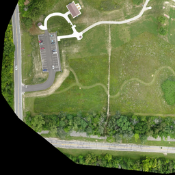
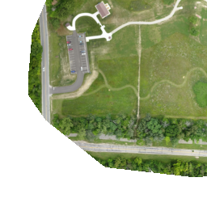
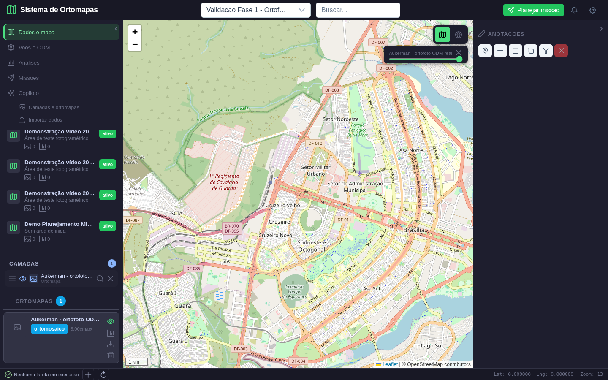
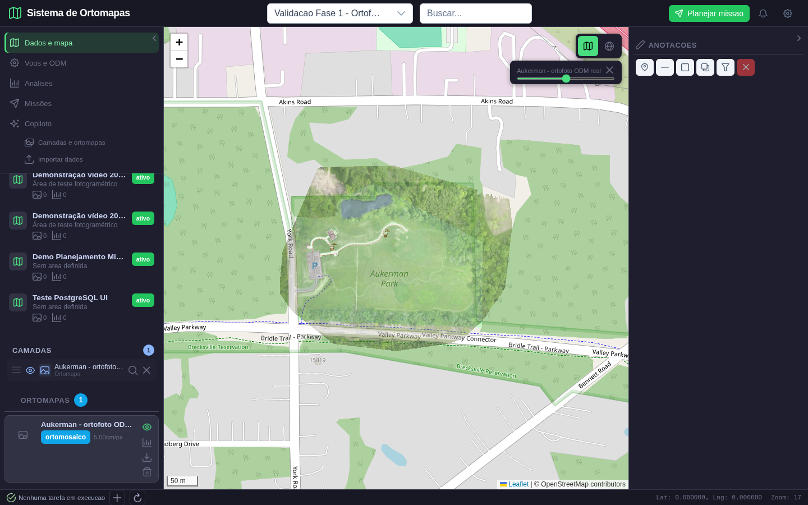
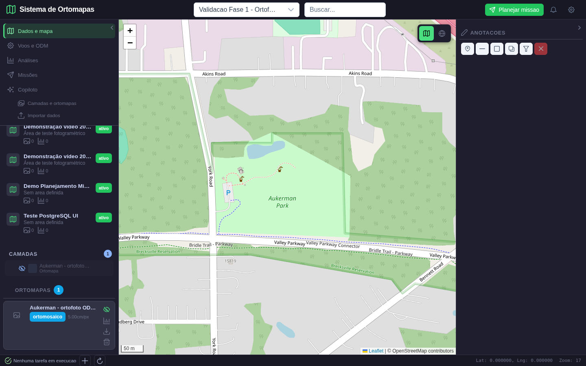
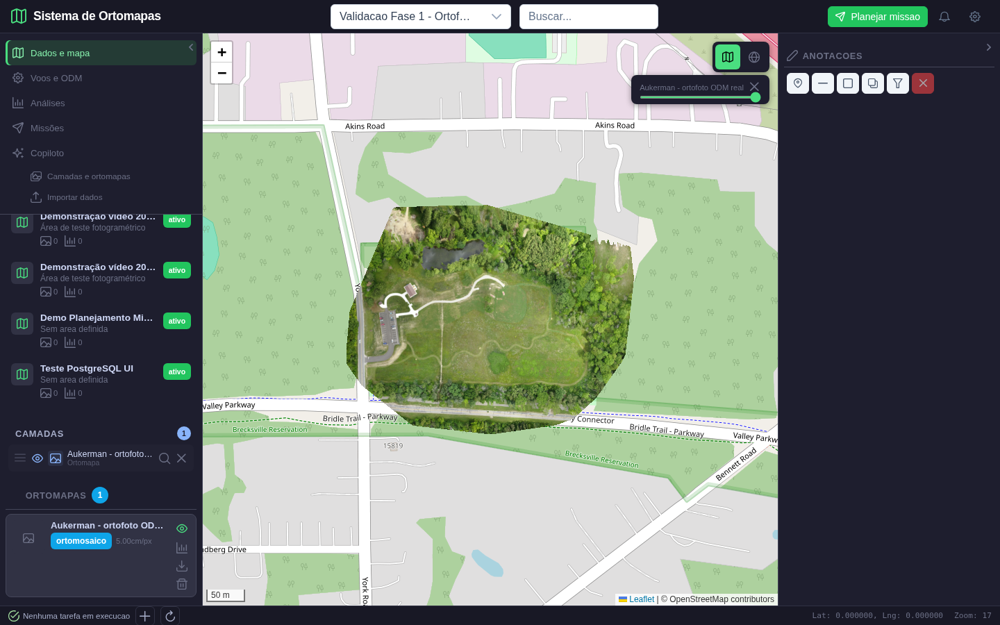
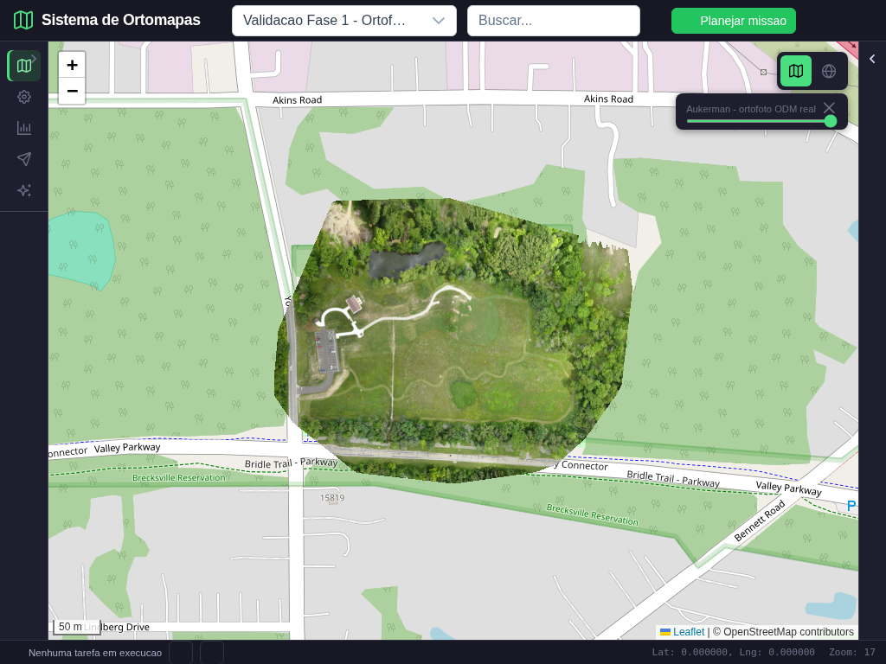

# Ortomapas: correcoes do mapa 2D e verificacao visual

Data: 10/10/2026. Primeiro lote da fase 1 do plano de melhorias.

**Situacao: renderizacao e enquadramento corrigidos e validados neste conjunto de dados. A fase 1 ainda nao esta encerrada: falta corrigir e testar o isolamento de acesso aos arquivos e ferramentas por projeto.** Este documento nao aprova o visualizador 3D, as analises, as missoes ou o copiloto.

**Atualizacao posterior:** este e o registro historico do primeiro lote. A revisao das pendencias de acesso/upload e o inicio do terreno 3D estao no [novo relatorio de revisao das fases 1 e 2](revisao_fase1_inicio_fase2_2026-10-10.md). As pendencias citadas abaixo descrevem o estado anterior a essa revisao, nao devem ser lidas como um novo resultado de teste.

## 1. Etapas acordadas

1. Produtos e mapa 2D: identificar arquivos reais, corrigir tiles, enquadramento e acesso por projeto. Comparar pixels esperados, localizacao e telas obtidas.
2. Precisao espacial e 3D: corrigir malha DSM, escalas e unidades. Comparar com superficies e geometrias de dimensoes conhecidas; capturar terreno e orbitas, nao apenas um canvas colorido.
3. Resultados das analises: publicar e reabrir a camada realmente calculada. Comparar entrada e saida, legenda, valores e arquivo exportado.
4. Navegacao: organizar menus, subitens e projetos; corrigir troca de contexto e responsividade. Percorrer cada acao, nao apenas selecionar sua aba.
5. Analises completas: executar vegetacao, terreno, hidrologia, mudancas e operacoes espaciais com dados adequados. Validar formulas, unidades, localizacao e limitacoes de cada resultado.
6. ODM real: criar projeto, carregar fotos, processar, acompanhar, importar e visualizar produtos. Registrar IDs reais da tarefa, produtos e qualidade, sem simular processamento concluido.
7. Missoes: criar AOI, rota, exclusoes, editar, salvar, reabrir e exportar. Conferir cobertura, GSD, sobreposicao, autonomia, coordenadas e compatibilidade do arquivo.
8. Copiloto: executar pedidos com contexto e memoria por usuario/projeto. Comparar ferramentas chamadas, argumentos, resultados, resposta e persistencia da conversa.
9. Aceitacao final: matriz requisito/caso de uso/teste, falhas negativas, seguranca e demonstracao completa. Somente depois disso produzir storyboard final com cenas efetivas de cada funcao.

Em cada etapa: definir o esperado antes do teste, registrar dados e parametros, executar, capturar, inspecionar visualmente, comparar com o resultado de referencia e repetir depois de qualquer correcao. Uma tela aberta, uma resposta HTTP 200 ou um build concluido nao bastam para aprovar a funcao.

## 2. Dados e ambiente efetivamente usados

| Item | Valor verificado |
| --- | --- |
| Banco | PostgreSQL local, porta 5433, banco ortomapas |
| Backend isolado | http://127.0.0.1:5018 |
| Interface isolada | http://localhost:5302 |
| Projeto de validacao | Validacao Fase 1 - Ortofoto real Aukerman, ID 62 |
| Produto | Aukerman - ortofoto ODM real, ID 30 |
| Arquivo | data/ortomapas/odm_2_ortomosaico.tif |
| Dimensoes | 7449 x 5906 pixels, quatro bandas |
| Coordenadas | EPSG:32617; extensao WGS84 aproximada: longitude -81,7544 a -81,7499; latitude 41,3029 a 41,3055 |
| Resolucao medida | Aproximadamente 0,05 m/pixel, ou 5 cm/pixel |
| Origem | Produto ODM ja existente do conjunto Aukerman; nao e imagem de Guarajuba |

Manifesto com SHA-256 e valores completos: [dados.json](mapa_fase1_2026-10-10/dados.json).

Tambem existem DSM e DTM reais em `data/ortomapas/odm_2_dsm.tif` e `data/ortomapas/odm_2_dtm.tif`. Eles ficam para a verificacao especifica da fase 2. Os arquivos de `data/demo_guarajuba/` sao sinteticos e nao foram utilizados para aprovar esta ortofoto. As fotos originais Aukerman estao em `data/odm_test/odm_data_aukerman-master/images/`.

O script criou um projeto separado, um registro de voo de validacao e uma referencia ao arquivo existente. Nao fez novo voo nem novo processamento ODM nesta execucao; nao substituiu nem apagou os projetos anteriores.

## 3. Erros encontrados e correcoes

| Defeito comprovado | Correcao realizada | Prova utilizada |
| --- | --- | --- |
| Recorte parcial do raster ampliado para preencher o tile inteiro | Reprojecao na grade completa de 256 x 256 pixels do tile XYZ, com margens transparentes | Mesmo tile comparado antes/depois com reprojecao independente |
| Alpha da ortofoto ignorado | Leitura da banda alpha; preservacao de nodata e pixels externos | Testes de bordas, transparencia e buracos; captura real |
| Escala radiometrica calculada separadamente em cada tile | Faixa de visualizacao compartilhada por arquivo para dados nao uint8 | Teste com gradiente float atravessando dois tiles |
| Projeto selecionado, mas mapa permanecia em Brasilia | Enquadramento pelos limites geograficos do produto ativado; sem zoom fixo | Antes: Brasilia sem ortofoto. Depois: Aukerman Park com imagem |
| Redimensionamento/recolhimento das barras deslocava o enquadramento | ResizeObserver e atualizacao das dimensoes Leaflet preservando o centro | Captura de tablet com as duas barras recolhidas |
| Criacao do ortomapa no PostgreSQL devolvia null | INSERT RETURNING id no endpoint de criacao de metadados | Teste de regressao do retorno PostgreSQL |

A preparacao tambem expôs que o banco exige `voo_id`, embora a API de metadados nao valide antecipadamente esse campo: sem ele a operacao retorna 500. O teste passou a fornecer um registro de voo. **A validacao de entrada deste contrato ainda precisa de correcao; nao foi escondida nem considerada aprovada.**

## 4. Comparacao esperada versus obtida

Referencia independente: `rasterio.warp.reproject`, aplicada ao GeoTIFF original diretamente na grade Web Mercator do tile. O endpoint usa `WarpedVRT`; a referencia nao chama o renderizador de producao. Os dois usam GDAL, portanto esta verificacao detecta erro de montagem da grade/margens, mas nao representa uma segunda implementacao independente de GDAL.

Tile diagnosticado: zoom 17, X 35770, Y 48995, cruzando a borda oeste. Criterios: sobreposicao das mascaras de cobertura de pelo menos 99%; erro RGB medio de no maximo 1 nivel em 255 nos pixels validos comuns; ausencia de erros JavaScript e falhas HTTP de tiles; presenca de pixels nao transparentes no navegador. A verificacao complementar do posicionamento e feita pela inspecao da ortofoto sobre o contexto OSM.

| Medida | Esperado/referencia | Antes | Depois |
| --- | --- | --- | --- |
| Fracao do tile coberta por imagem | 64,859% | 100% | 64,366% |
| Intersecao/uniao da mascara | Pelo menos 99% | 64,859% | 99,240% |
| Erro RGB medio nos pixels comuns | No maximo 1 | 33,821 | 0 |
| Conteudo raster no navegador | Maior que 1000 pixels nao transparentes carregados | Captura visual sem produto enquadrado | 110542 pixels carregados |
| Falhas HTTP de tile no fluxo | Nenhuma | Nenhuma; isso nao detectou o defeito espacial | Nenhuma |
| Erros JavaScript no fluxo | Nenhum | Nenhum; isso nao detectou o defeito espacial | Nenhum |

A pequena diferenca de cobertura depois da correcao concentra-se na borda alpha: a referencia reprojeta a banda alpha como imagem por interpolacao bilinear, enquanto o caminho VRT trata alpha como cobertura. O RGB dos pixels validos comuns coincide. A tolerancia e documentada; nao se declara igualdade pixel a pixel da borda.

### 4.1 Imagem esperada do tile de borda


**O que verificar:** estrada e estacionamento na esquerda, caminhos no campo, vegetacao no limite inferior e margens fora da cobertura transparentes. Trata-se de uma referencia diagnostica do arquivo real, nao de uma captura da interface nem de um resultado ficticio do aplicativo.

### 4.2 Tile obtido antes da correcao



**Analise:** a mesma parte da fotografia aparece ampliada/deslocada. A transparencia nao delimita a cobertura correta. A comparacao numerica reprova este resultado, mesmo com HTTP 200.

### 4.3 Tile obtido depois da correcao



**Analise:** estacionamento, caminhos e vegetacao recuperam a posicao da referencia. As margens externas sao transparentes. O teste passa nos limites explicitados acima.

## 5. Telas reais e acoes executadas

### Cena 1: problema anterior de enquadramento



**Acao:** entrar com a conta de teste, selecionar o projeto de validacao e ativar a visibilidade do produto.

**Esperado:** visualizar a fotografia no seu local geografico. **Obtido antes:** mapa de Brasilia, zoom 13, apesar de o produto estar selecionado na lista. O indicador de camada e os tiles carregados nao comprovavam que a ortofoto estava sendo demonstrada. **Conclusao: reprovado.**

### Cena 2: ortofoto ativada e enquadrada


**Acao:** repetir a mesma selecao de projeto e clicar no olho do produto. A automacao usa os controles da interface, sem inserir uma imagem substituta na pagina.

**Esperado:** ortofoto no Aukerman Park, no lugar indicado pelo arquivo, sem quadrados ampliados nas bordas. **Obtido:** fotografia real de campo, caminhos, estacionamento, arvores e estrada, sobre o contexto OSM. Os limites irregulares da fotografia representam a cobertura disponivel. **Conclusao: aprovado neste produto.** O alinhamento visual com OSM e uma verificacao de plausibilidade; sem pontos de controle de campo, nao certifica acuracia absoluta do levantamento.

### Cena 3: transparencia de 50%



**Acao:** preencher o slider de opacidade com 0,5. **Esperado:** fotografia e mapa-base simultaneamente visiveis, sem mudar localizacao. **Obtido:** caminhos e cobertura fotografica permanecem no mesmo lugar; o nome Aukerman Park e a cartografia aparecem por baixo. O teste tambem confere o valor da opacidade na camada Leaflet. **Conclusao: aprovado.**

### Cena 4: ocultar a fotografia



**Acao:** clicar novamente no olho do produto. **Esperado:** remover somente a ortofoto, mantendo mapa-base e localizacao. **Obtido:** OSM visivel, olho desativado e nenhuma imagem de tile desse produto no DOM do mapa. **Conclusao: aprovado.** Esta tela nao e apresentada como resultado de analise; demonstra exclusivamente ocultacao de camada.

### Cena 5: reativar a fotografia



**Acao:** reativar o olho e restaurar opacidade 1. **Esperado:** mesmo produto e mesmos detalhes retornam. **Obtido:** fotografia novamente carregada e opaca. **Conclusao: aprovado.** A semelhanca com a cena 2 e intencional: comprova restauracao, nao representa outra funcionalidade.

### Cena 6: mapa em tablet com barras recolhidas



**Acao:** mudar viewport para 1024 x 768 e recolher as barras esquerda e direita pelos controles da interface. Esperar a largura final das barras e o carregamento/transicao dos tiles.

**Esperado:** icones do menu lateral visiveis, espaco central expandido e ortofoto preservada no enquadramento. **Obtido:** barras de aproximadamente 56 e 32 pixels, mapa expandido, fotografia centralizada e controles acessiveis. **Conclusao: aprovado neste viewport.** Nao foi executada validacao de telefone neste lote.

## 6. Testes de regressao e reproducao

Foram executados 13 testes automatizados: raster parcial mantendo a metade vazia; preto valido sem nodata; buraco alpha; nodata float; tile totalmente externo; faixa radiometrica comum entre tiles float; cinco coordenadas XYZ invalidas; retorno de ID PostgreSQL; rejeicao HTTP de XYZ invalido antes de consultar o banco. Resultado: **13 passaram**, com um aviso preexistente de uso de `datetime.utcnow()`.

O frontend foi compilado com `npm run build`. Resultado: sucesso, com aviso de bundle acima de 500 kB. Este build nao substitui as provas funcionais.

```bash
python -m pytest tests/test_raster_tiles.py tests/test_ortomapas_postgres.py -q
python scripts/validar_mapa_fase1.py depois
cd frontend
npm run build
```

O script usa `VALIDATION_API`, `VALIDATION_UI`, `E2E_EMAIL` e `E2E_PASSWORD` quando definidos. Credenciais e tokens nao sao gravados no manifesto. A conta de teste deve existir e ter acesso ao projeto; o navegador realiza login normal.

Resultados detalhados: [antes](mapa_fase1_2026-10-10/resultado_antes.json) e [depois](mapa_fase1_2026-10-10/resultado_depois.json). A evidencia anterior e protegida contra sobrescrita pelo modo `antes`; ela corresponde ao codigo antes da correcao. Uma nova execucao escreve primeiro um estado nao aprovado, evitando reutilizar um resultado antigo aprovado se o processo falhar.

Foram examinadas visualmente as capturas de ortofoto ativa, transparencia, ocultacao, restauracao e tablet. Capturas intermediarias com fade-in ou barras em transicao foram substituidas pelas capturas finais estaveis; nao foram usadas para concluir aprovacao.

## 7. Limites e proximo trabalho

- O isolamento por usuario/projeto das rotas de ortomapas, `/tools` e `/data` continua pendente. A disponibilizacao publica/operacional nao esta aprovada. O frontend de validacao deve ser acessado somente em ambiente controlado.
- A criacao de metadados precisa validar `voo_id` e sua vinculacao ao projeto antes de gravar; o fluxo sem esse campo ainda nao e aprovado.
- A correcao de ID PostgreSQL cobre o endpoint de criacao de metadados alterado neste lote. Upload e outras rotas que ainda usem `lastrowid` precisam de auditoria propria.
- O teste visual 2D cobre uma ortofoto RGB real e dois viewports, nao todos os rasters, projetos, estados de erro ou resolucoes de tela.
- A lista de projetos ainda mostra muitos projetos de demonstracao e nomes truncados. Menus/subitens incompletos e miniaturas faltantes continuam no trabalho de navegacao; nao se declara a interface inteira corrigida.
- O visualizador DSM 3D e as unidades das analises ainda precisam das correcoes da fase 2. Nenhuma tela 3D foi aprovada por este relatorio.

**Proximo lote:** concluir o acesso autorizado e o contrato de criacao/importacao do produto, com duas contas e dois projetos; depois iniciar malha DSM e medidas espaciais. A fase 1 so recebe status concluido quando essas pendencias forem corrigidas e testadas.
