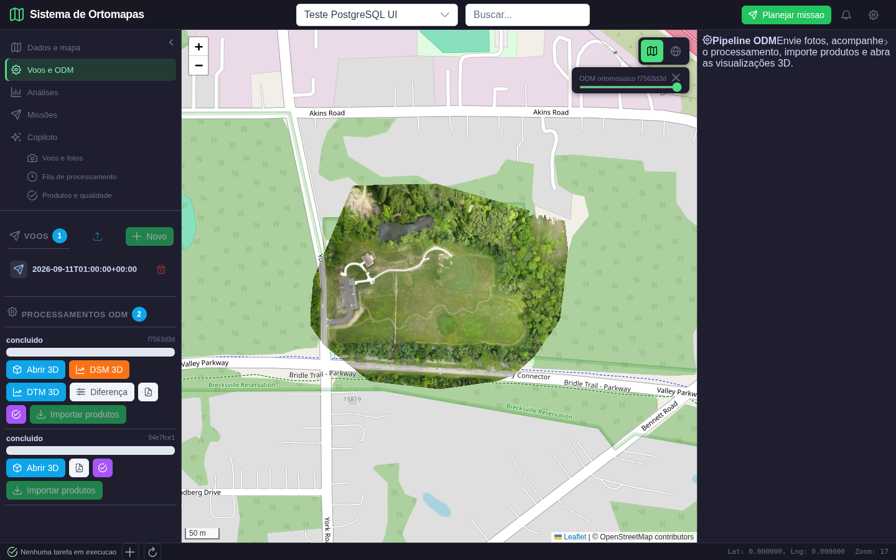
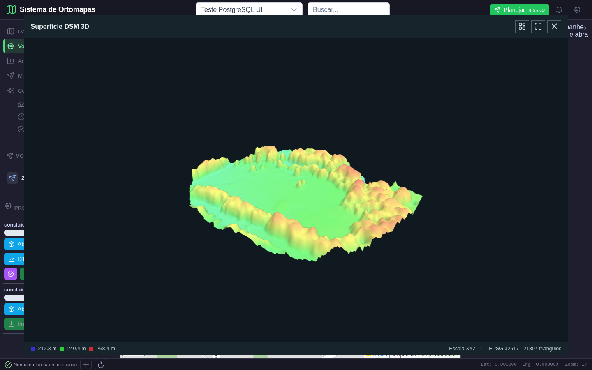
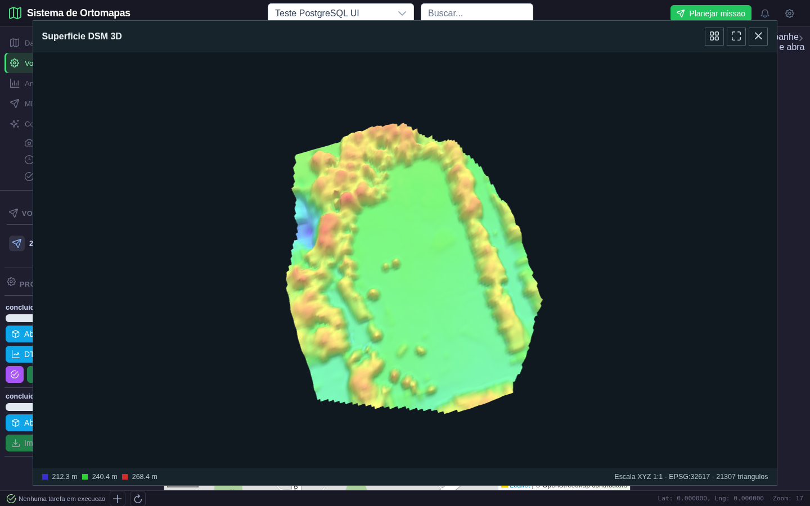
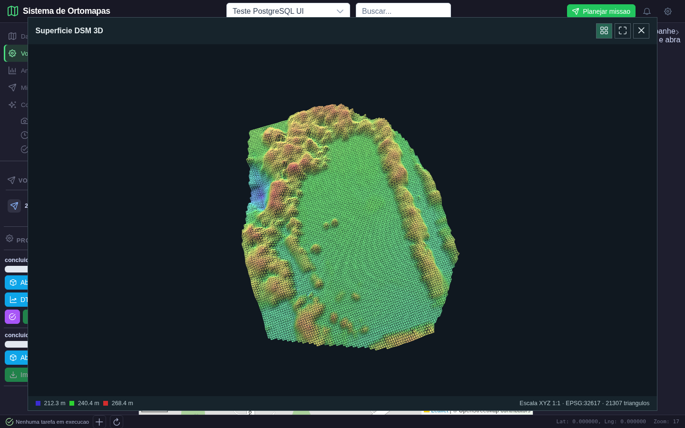
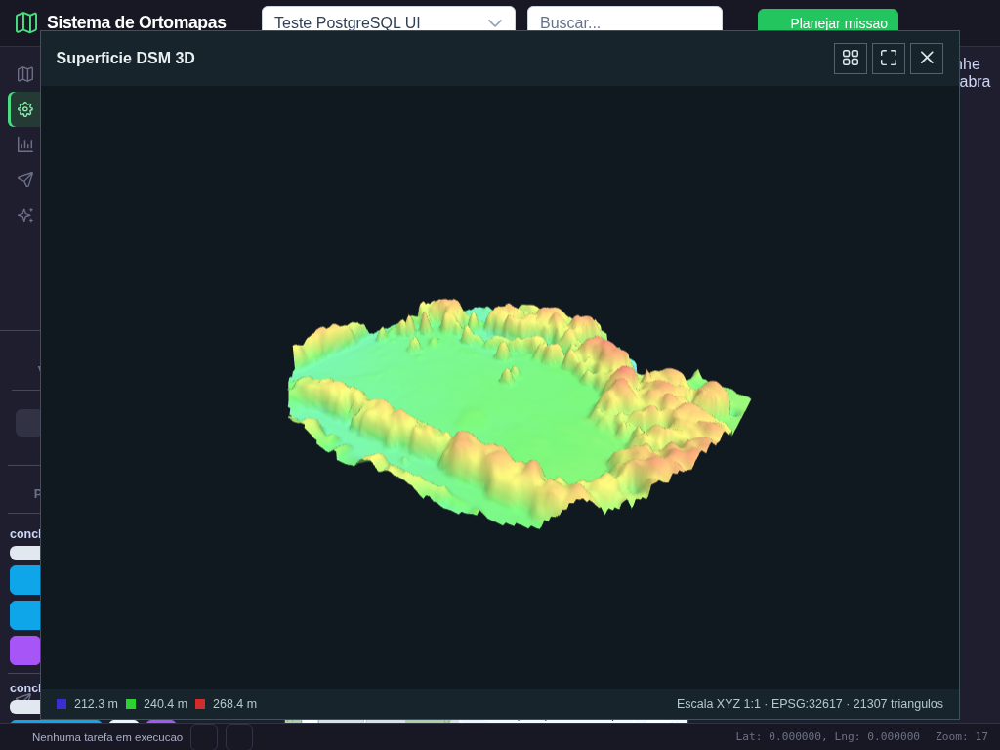
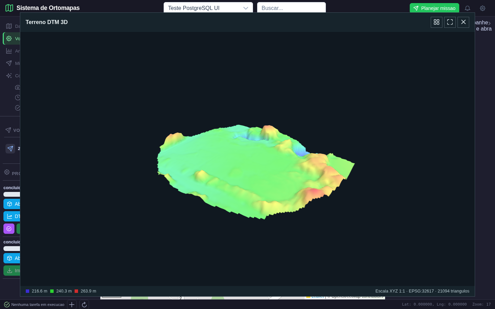

# Ortomapas: revisao da fase 1 e inicio da fase 2

Registro da execucao iniciada em 10/10/2026. Evidencias reais da interface e testes no PostgreSQL local.

**Conclusao:** o mapa 2D e os acessos a produtos/arquivos/ferramentas incluidos no escopo da fase 1 passaram na revisao. A fase 2 foi iniciada e o primeiro lote de DSM/DTM 3D foi corrigido e validado. Isso nao significa que todas as analises espaciais, a interface inteira ou a seguranca global do aplicativo estejam aprovadas.

## 1. Revisao da fase 1

### 1.1 O que foi fechado

| Verificacao | Resultado esperado | Resultado obtido |
| --- | --- | --- |
| Tile RGB real e limites de cobertura | Posicao correta, margem transparente e fotografia nao esticada | Mascara coincide em 99,240%; erro RGB medio zero nos pixels validos comuns |
| Enquadrar o produto | Fotografia no Aukerman Park, nao em Brasilia | Projeto ID 62 e produto ID 30 corretamente enquadrados |
| Projeto sem bbox | Usar limites dos produtos sem mostrar o local padrao indefinidamente | Fallback para o bbox de um produto do proprio projeto |
| Trocar projeto | Remover camadas antigas e impedir resposta atrasada de substituir dados novos | Limpeza de camadas e verificacao do ID antes de aceitar listas assincronas |
| Transparencia, ocultacao e retorno | Alterar somente a camada selecionada | Slider 50%, ocultacao e restauracao confirmados em navegador |
| Tablet e barras | Mapa dimensionado e centro preservado | Captura 1024 x 768 com barras recolhidas |
| Metadados e tiles sem login | HTTP 401 | HTTP 401 |
| Metadados, tiles e arquivos de outro projeto | HTTP 403 | HTTP 403 com duas contas distintas |
| Link temporario de tile | Abrir somente tiles do produto autorizado | Abre o produto correto; reuso em outro produto ou como token geral retorna 401 |
| Link vencido/alterado | HTTP 401 | Teste automatizado confirma ambos |
| Arquivos em /data | Nao haver acesso estatico publico | Rota autenticada, vinculacao ao projeto e caminho dentro de data |
| Ferramentas | Exigir login, entradas autorizadas e projeto comum | Estatisticas autorizadas; entradas de outro projeto ou /etc/passwd recusadas |
| Arquivos gerados | Nao misturar saidas entre projetos | Diretorios analises/projetos/ID, nomes unicos, download autorizado e acesso cruzado recusado |
| Upload GeoTIFF | Exigir projeto e voo compativeis; retornar ID PostgreSQL e resolucao correta | HTTP 201, ID existente e 5 cm/pixel no arquivo de contrato |
| Falta de voo/vinculo errado | HTTP 400, nao erro 500 do banco | Ambos retornam 400 antes da gravacao |
| Visualizador somente leitura | Nao alterar produto nem gerar arquivo no projeto de leitura | HTTP 403; API publica pode_editar=false; botoes de importacao desabilitados |
| Cadastro publico | Nao criar administrador | Pedido de perfil admin retorna 403 |

Os acessos de imagem usam links assinados com validade de cinco minutos, limitados a um produto ou arquivo. Eles nao levam o JWT geral de login na URL. O acesso confere novamente usuario ativo e permissao do projeto; a assinatura nao substitui a verificacao de acesso. Links temporarios devem continuar protegidos de exposicao desnecessaria em logs.

O upload passa a usar `RETURNING id`, rejeita raster sem CRS e limpa o novo arquivo quando falha. A exclusao de metadados nao apaga a fotografia de origem: ha arquivos referenciados por mais de um produto/projeto, e apagamento direto poderia destruir outro registro valido.

### 1.2 Dados reais e dados de contrato

O teste visual continua usando `data/ortomapas/odm_2_ortomosaico.tif`, 7449 x 5906 pixels, EPSG:32617, aproximadamente 5 cm/pixel. Origem: processamento ODM Aukerman existente, nao Guarajuba.

O teste de upload usa um GeoTIFF sintetico de 64 x 64 pixels, tres bandas, 0,05 m/pixel. Esse arquivo verifica contrato HTTP, persistencia, resolucao, miniatura e isolamento; ele nao e apresentado como um levantamento de drone. Foi criado no projeto de teste separado **Validacao isolamento - projeto B**, ID 63.

A conta de teste principal, ID 42, recebeu papel **visualizador** no projeto real **Teste PostgreSQL UI**, ID 2, para demonstrar seus produtos sem executar importacoes nem modificar o levantamento. A segunda conta permanece sem acesso aos projetos 2 e 62. Nenhum segredo de login e gravado neste relatorio.

### 1.3 Prova visual final do mapa 2D


**Executado:** login, escolha do projeto, visibilidade do produto. **Esperado:** imagem real georreferenciada. **Obtido:** fotografia de estacionamento, caminhos, campo e arvores no Aukerman Park, sobre o mapa-base. O navegador carregou 110542 pixels raster nao transparentes. Nenhum erro JavaScript ou falha HTTP de tile foi registrado no fluxo.


**Executado:** alterar viewport e recolher ambas as barras. **Esperado:** mapa continua enquadrado e controles permanecem acessiveis. **Obtido:** fotografia centralizada e barras em modo de icones. A comparacao completa anterior/esperado/depois, incluindo transparencia e ocultacao, continua no [relatorio do mapa](relatorio_correcao_mapa_fase1_2026-10-10.md).

Evidencias verificaveis: [seguranca HTTP](mapa_fase1_2026-10-10/seguranca_http.json), [teste visual 2D](mapa_fase1_2026-10-10/resultado_depois.json), [manifesto do raster](mapa_fase1_2026-10-10/dados.json).

## 2. Fase 2: terreno 3D

### 2.1 Defeitos encontrados

O renderizador anterior calculava X e Y usando a celula corrente para todos os vertices de seus triangulos. Consequencia: faces degeneradas, sem area horizontal, em vez de uma superficie. Tambem normalizava a altura independentemente da extensao horizontal, distorcendo a escala do relevo, e preenchia nodata com uma cota minima ficticia. O clique de wireframe nao chamava a funcao de atualizacao do material.

A navegacao revelou outro erro: `OdmTasks.vue` usava `Button` sem importar o componente. O navegador recebia botoes sem os rotulos profissionais esperados. O roteiro que busca o botao **DSM 3D** falhou; a importacao foi corrigida e o teste foi repetido com os rotulos visiveis. Os botoes agora quebram linha dentro da barra em vez de ultrapassar sua largura.

### 2.2 Correcoes implementadas

- Grade DSM/DTM preserva a proporcao do raster e a espacagem apos reamostragem; coordenadas horizontais em metros, com transformacao para UTM quando a origem e geografica.
- Malha indexada com coordenadas por vertice e triangulos nao degenerados; faces que dependem de nodata sao omitidas. Nodata nao se transforma em um piso artificial.
- Mesma escala para X, Y e Z, sem exagero vertical oculto; legenda de cotas, CRS metrico e contagem de triangulos no visualizador.
- Camera enquadra os limites geometricos; orbita, wireframe, reenquadramento e redimensionamento funcionam. Erros aparecem explicitamente, em vez de apenas no console.
- Botao separado **DTM 3D**, para acessar o terreno mesmo quando existe um DSM. Antes, o DTM ficava escondido atras da preferencia por DSM.

Os produtos reais demonstrados sao **DSM ID 5** e **DTM ID 6**, ambos do processamento ODM ID 2 e do projeto ID 2. Arquivos: `data/ortomapas/odm_2_dsm.tif` e `data/ortomapas/odm_2_dtm.tif`. Nao foram substituidos por superficies geradas para as capturas.

### Cena 1: acesso aos produtos reais



**Executado:** login, selecionar Teste PostgreSQL UI, ativar a ortofoto real e abrir Voos e ODM. **Esperado:** produtos catalogados e comandos legiveis para DSM e DTM. **Obtido:** dois processamentos existentes, botoes Abrir 3D, DSM 3D, DTM 3D e demais comandos. Esta cena demonstra acesso, nao prova a qualidade de todos os demais comandos.

### Cena 2: superficie DSM real



**Executado:** clicar DSM 3D e esperar a resposta real do produto ID 5 e o quadro renderizado. **Esperado:** superficie continua com estruturas elevadas e triangulos validos, nao linhas ou um canvas preto. **Obtido:** campo relativamente baixo e estruturas elevadas na periferia; cotas amostradas de aproximadamente 212,3 a 268,4 m; 21307 triangulos. As cores representam elevacao relativa dentro deste produto, nao classificacao de vegetacao.

### Cena 3: orbita



**Executado:** arrastar no canvas. **Esperado:** mudar a orientacao da mesma superficie. **Obtido:** vista rotacionada, com o mesmo campo e estruturas, e diferenca media de aproximadamente 18,86 niveis RGB entre capturas do canvas. Uma imagem estatica no lugar da cena 3D nao passaria nesse teste.

### Cena 4: wireframe



**Executado:** clicar Alternar wireframe. **Esperado:** arestas da malha visiveis, botao ativo e pixels diferentes da superficie preenchida. **Obtido:** triangulacao visivel, `aria-pressed=true` e mudanca dos pixels. O teste numerico tambem confere triangulos com area diferente de zero e dimensoes metricas conhecidas.

### Cena 5: tablet



**Executado:** redimensionar para 1024 x 768. **Esperado:** canvas redimensionado, produto enquadrado e rodape/controles sem sobreposicao. **Obtido:** superficie e controles visiveis. Nenhum teste de telefone foi executado neste lote.

### Cena 6: terreno DTM real



**Executado:** fechar DSM e abrir DTM 3D. **Esperado:** produto ID 6, representando estimativa de terreno, nao reutilizacao da imagem DSM. **Obtido:** superficie mais suave, sem varias elevacoes presentes no DSM; cotas amostradas de aproximadamente 216,6 a 263,9 m e 21094 triangulos. Os extremos sao da grade amostrada, nao os extremos garantidos de todos os pixels do arquivo. O DTM continua sendo resultado do processamento ODM; sua acuracia de terreno sob vegetacao nao foi certificada com pontos de campo.

### 2.3 Provas numericas e visuais

| Teste | Esperado | Obtido |
| --- | --- | --- |
| Malha 2 x 2 de 100 x 200 m | Dois triangulos nao degenerados e dimensoes 100 x 200 m | Teste JavaScript aprovado |
| Vertice nodata | Nao criar face apoiada em dado inexistente | Face correspondente omitida |
| Raster 100 x 20, resolucao 2 m, reduzido a largura 50 | Grade 50 x 10 e espacamento 4 m | Teste Python aprovado |
| Grade WGS84 | Converter graus para coordenadas metricas locais | EPSG:32617 e espacamento horizontal aproximadamente 0,84 m |
| Raster sem CRS | Recusar unidade desconhecida | ValueError tratado como HTTP 400 na superficie |
| Canvas DSM | Mais de 2% dos pixels distintos do fundo | Aproximadamente 10,63% |
| Canvas wireframe | Mudanca real de pixels | Aproximadamente 17,05% distintos do fundo |
| Canvas tablet | Nao vazio e enquadrado | Aproximadamente 12,53% |
| Canvas DTM | Nao vazio, produto proprio | Aproximadamente 10,76% |

O percentual de pixels e apenas uma verificacao de canvas nao vazio. A aprovacao tambem depende de geometria, origem do arquivo, produto distinto, interacao e inspecao visual. Todas as seis capturas finais foram inspecionadas; quadros transitorios de carregamento nao sao apresentados como resultados aprovados.

Resultados do navegador: [resultado.json](terreno_fase2_2026-10-10/resultado.json).

## 3. Reproducao e limites

```bash
python -m pytest tests/test_raster_tiles.py tests/test_ortomapas_postgres.py tests/test_resource_access.py tests/test_surface_grid.py -q
python scripts/validar_acesso_fase1.py
python scripts/validar_mapa_fase1.py depois
node frontend/tests/terrainGeometry.test.js
python scripts/validar_terreno_fase2.py
```

Os roteiros HTTP/visuais usam o backend em `127.0.0.1:5018` e a interface em `localhost:5302`. Foram obtidos **19 testes Python aprovados**, o teste de geometria JavaScript aprovado, as verificacoes HTTP com duas contas aprovadas e os fluxos visuais 2D/3D aprovados. O build frontend tambem passou, com aviso de tamanho de bundle. Esses resultados se referem ao escopo descrito, nao a uma validacao completa do aplicativo.

### Pendencias da fase 2

- A nuvem de pontos recebeu correcao inicial de escala uniforme e conversao da distancia de cena para metros; falta demonstrar e validar a medicao interativa com pontos de coordenadas conhecidas, exportacao e recortes. Nuvem sem CRS projetado e recusada em vez de exibir unidades falsas.
- Area/perimetro/buffer das ferramentas do agente, declividade apos reamostragem e volumetria ainda precisam de verificacao e correcao metrica. Nao foram aprovados por este lote.
- A visualizacao usa uma grade amostrada; nao e modelo texturizado nem representa todos os pixels do DSM. Textura ortofotografica, eixo norte, escolha de datum vertical e analises aprofundadas continuam fora desta aprovacao.
- Rotas legadas de analises e outros fluxos do aplicativo ainda precisam da revisao funcional/de seguranca das fases correspondentes. O fechamento dos acessos de ortomapas, ferramentas e `/data` nao certifica seguranca global.
- Nao foi iniciada nova tarefa de fotogrametria nesta revisao. O processamento de fotos desde o inicio pertence a fase 6; aqui foram utilizados produtos reais ja existentes.

**Proximo trabalho:** continuar a fase 2 com medidas conhecidas na nuvem e ferramentas espaciais/altimetricas; somente depois de fechar esses testes passar aos resultados derivados da fase 3.
