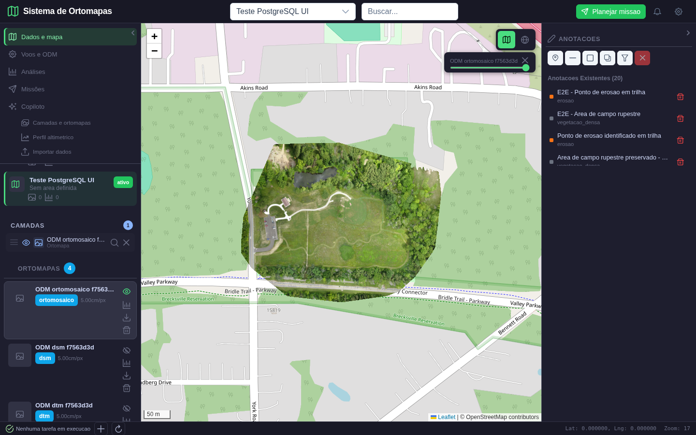
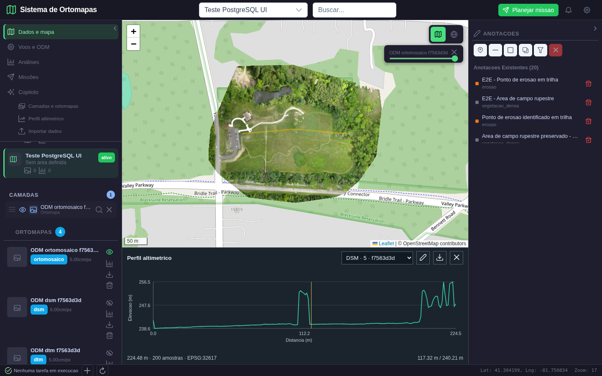
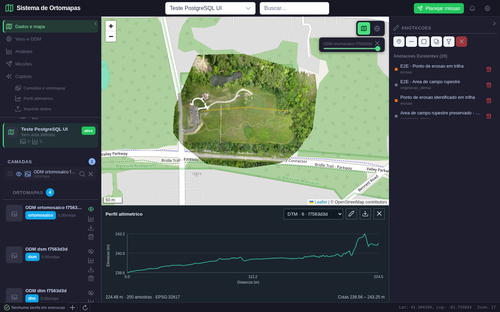
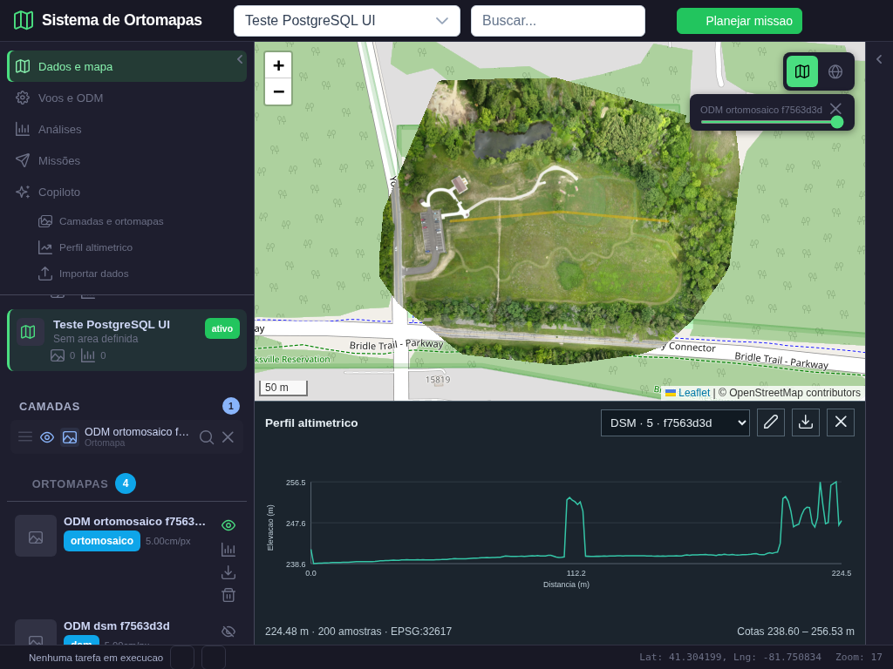
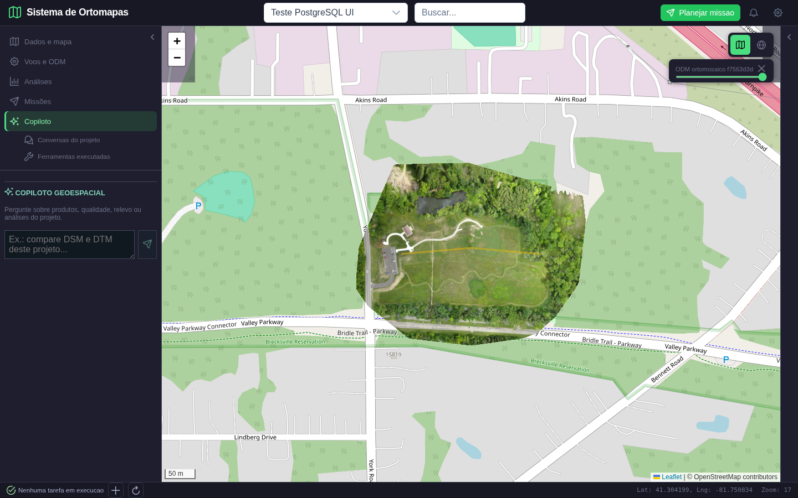
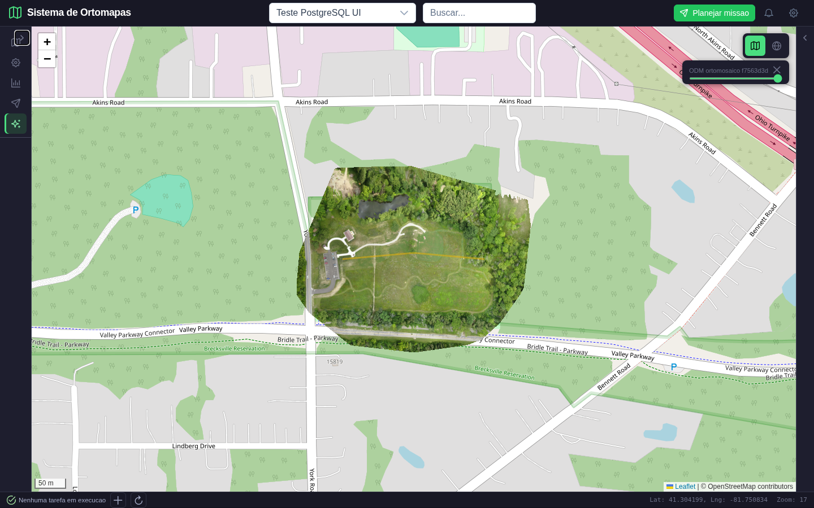
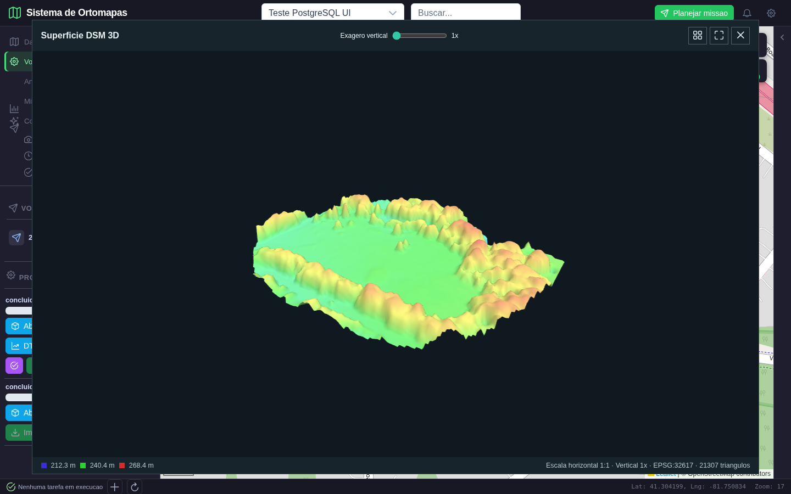
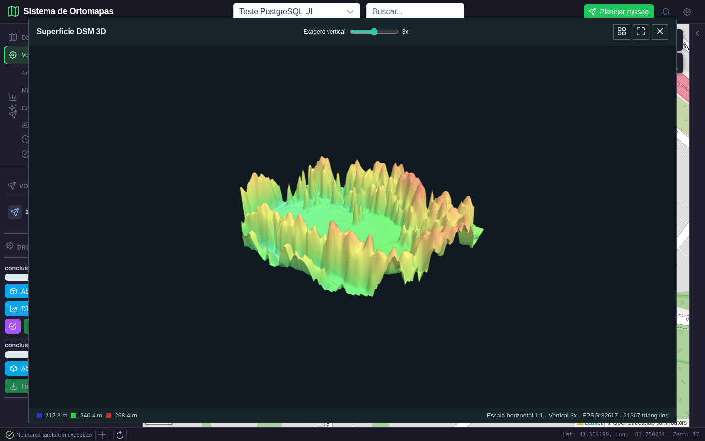
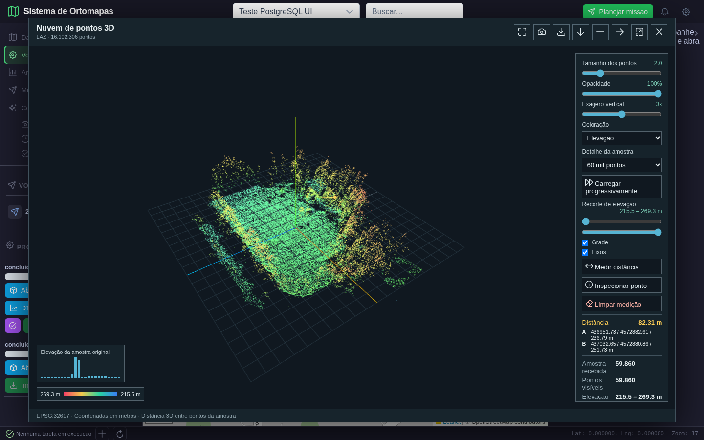
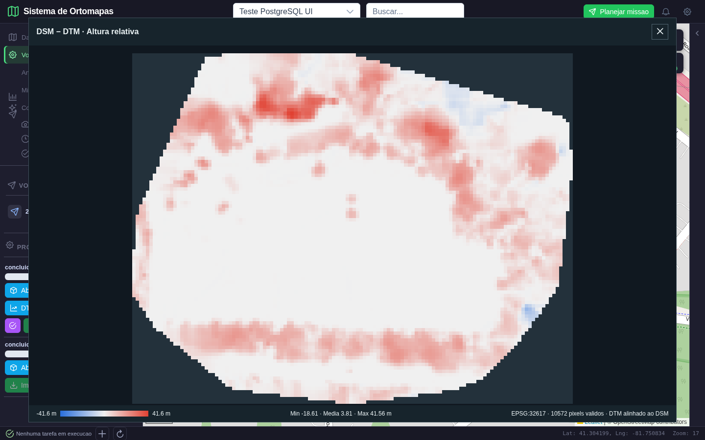

# Usabilidade GIS e terceiro lote da fase 2

**Data:** 11/10/2026. **Checkpoint anterior:** `662437d`, enviado a `origin/main` antes de modificar arquivos neste lote. O carimbo auditavel do Git e 11/10/2026 01:28:25 -03; a hora escrita manualmente no assunto do checkpoint difere desse carimbo. Nao foi reescrita a historia publicada.

## 1. Parecer de usabilidade

O Ortomapas deve ter o mapa como area principal, camadas e produtos como contexto e comandos com resultados observaveis. A referencia e a organizacao de trabalho GIS, nao uma copia visual integral do QGIS. Neste lote foram tratados os fluxos de perfil e visualizacao de elevacao; nao foi redesenhada toda a aplicacao.

Referencias oficiais consultadas: [QGIS: perfil altimetrico](https://docs.qgis.org/3.44/en/docs/user_manual/map_views/elevation_profile.html) e [QGIS: visualizacao 3D](https://doc.qgis.org/3.44/en/docs/user_manual/map_views/3d_map_view.html). A documentacao descreve perfil ao longo de uma linha, tabelas de distancia/elevacao exportaveis e ajustes de escala vertical na cena 3D. O nosso fluxo passa a seguir essas ideias, mantendo os componentes e motores existentes do repositorio.

| Aspecto | Diagnostico | Acao e situacao |
|---|---|---|
| Contexto do mapa | Entrar no Copiloto ocultava todas as camadas | Corrigido: mantem ortofoto/linha e recolhe painel direito sem conteudo do chat |
| Ferramenta de perfil | O agente chamava media de colunas de perfil; nao havia linha operavel | Corrigido: linha desenhada sobre a ortofoto, DSM/DTM selecionavel e painel inferior |
| Conclusao do desenho | Encerramento implicito por clique no vertice final pouco evidente | Acrescentados concluir e cancelar por icones com tooltip |
| Espaco de trabalho | Dois paineis laterais deixavam o grafico estreito em tablet | Painel direito recolhido automaticamente ao entrar no modo compacto, com expansao manual disponivel |
| Acessibilidade de navegacao | Alternadores de painel eram divs clicaveis | Agora sao botoes com nome e estado; recolhimento da navegacao testado por teclado |
| Legenda/unidades | Exagero vertical nao era um controle explicito | Slider 1x a 5x; factor indicado na cena; cotas e medidas permanecem fisicas |
| Erro de desenho | Duas instancias de Leaflet e observador de mapa antigo | Instancia compartilhada com Leaflet Draw, limpeza ao trocar mapa e teste sem erros JavaScript |
| Comparacao DSM/DTM | Grades eram redimensionadas sem alinhamento; nodata virava zero; canvas deformava proporcoes | DTM reprojetado para grade DSM, mascara explicita e aspecto preservado |
| Catalogo e menus | Lista de projetos/produtos ainda extensa; ha subitens antigos sem acao | Pendente da fase 4; nao declarar aderencia integral ao QGIS nem navegacao totalmente concluida |
| Resultados de analises | Contrato antigo ainda pode confundir entrada e resultado | Pendente da fase 3; nao resolvido por este painel de perfil |

**QGIS Server:** confirmado o executavel `/usr/lib/cgi-bin/qgis_mapserv.fcgi`. Nao foi iniciado: os calculos deste lote usam Rasterio/GDAL e PyProj existentes. Uma integracao WMS/WCS exigira um projeto QGIS publicado e politica de acesso aos dados; nao ha necessidade de ligar um servidor adicional para desenhar e amostrar este perfil.

## 2. Implementacao e alcance

- Perfil sobre LineString fornecida/desenhada, com distancias acumuladas metricas, 200 amostras na UI, cotas e exportacao CSV com longitude/latitude.
- Amostragem por vizinho mais proximo no raster original: nao usa a media das colunas nem uma superficie inventada.
- Nodata interrompe a curva; linha sem amostras validas retorna erro. A interface exibe falha, em vez de um grafico vazio aprovado.
- Linha continua visivel no mapa enquanto o painel inferior mostra o perfil. O cursor no grafico apresenta distancia/cota; ainda nao destaca a amostra correspondente no mapa.
- Escalas do grafico sao ajustadas independentemente para ocupar a area: o angulo visual da curva nao certifica declividade. O modo grafico com eixos travados 1:1, disponivel como referencia no QGIS, nao foi implementado.
- Exagero vertical dos visualizadores de terreno e nuvem e explicito. Medidas da nuvem usam coordenadas de origem, nao a geometria exagerada.
- Comparacao DSM/DTM amostra a grade DSM respeitando proporcao e reprojeta o DTM para essa mesma grade. Pixels sem area comum ficam transparentes; ausencia de sobreposicao e rejeitada.
- Agente e visualizador de diferenca usam o mesmo motor de alinhamento. A resposta do modelo de linguagem nao foi testada neste lote.

O perfil nao e salvo no banco como entidade propria: pode ser exportado em CSV e permanece no contexto atual da interface. A mudanca de projeto limpa selecao, perfil e recorte. A persistencia de resultados e a integracao completa do chat pertencem aos proximos lotes.

## 3. Dados e comparacao esperado/obtido

Foi utilizado o projeto **Teste PostgreSQL UI**, processamento real **f7563d3d** do conjunto Aukerman, com ortofoto, DSM, DTM e LAZ existentes. Nao houve geracao de novas fotos nem novo processamento ODM. O sistema permanece usando PostgreSQL/PostGIS.

| Verificacao | Esperado | Obtido |
|---|---|---|
| Desenhar/encerrar linha | Tres vertices reais via mouse e comando concluir | LineString com tres vertices sobre ortofoto; sem injecao de geometria no store |
| Distancia do perfil | Comprimento em CRS metrico | 224,481529 m, EPSG:32617 |
| Perfil DSM | Valores correspondentes a cada ponto da linha | 200/200 validos; 238,60 a 256,53 m; conferidos por leitura independente do raster |
| Perfil DTM | Mesma linha, outro produto, novas cotas | 200/200 validos; 238,56 a 243,25 m |
| Exportacao | Cabecalho e 200 amostras reais | 200 linhas de distancia, elevacao e coordenadas |
| Cancelamento | Sair do desenho sem substituir resultado anterior | Comando cancelado e grafico anterior mantido |
| Tablet | Mapa e grafico em areas distintas | 1024 x 768, painel direito recolhido, ferramentas e curva legiveis |
| Navegacao por teclado | Enter recolhe barra; icones conservam tooltip | Recolhimento, titulo Voos e ODM e expansao verificados |
| Exagero da nuvem | Medida da mesma dupla nao muda de 1x para 3x | 82,31 m nos dois fatores; mesmos extremos preservados |
| DSM − DTM real | Grade alinhada, mascara e resultado rotulado | 128 x 102, 10.572 pixels validos, media 3,814819 m |
| Grades artificiais deslocadas | Diferenca 2 m apenas na intersecao | 24 pixels de 2 m; demais sem dados |
| CRS distintos e unidades em pes | Reprojecao e comprimento fisico corretos | Testes numericos aprovados |

**Alerta cientifico:** a diferenca real variou de -18,61 a +41,56 m. Ha regioes em que o DTM fica acima do DSM. Isso requer revisao de qualidade/classificacao/interpolacao dos produtos e do datum antes de usar a diferenca como altura de vegetacao ou construcoes. Nao mascaramos os valores negativos nem afirmamos que a origem e cientificamente perfeita. O calculo e a exibição passaram; a precisao de campo nao foi certificada.

Elevacoes sao assumidas em metros. CRS horizontal e alinhamento de pixels nao garantem compatibilidade de datum vertical, precisao absoluta ou condicao de solo real. DSM inclui objetos; para perfil de terreno deve-se escolher DTM e verificar sua qualidade.

## 4. Cenas verificadas

### Cena 1. Ortofoto real e contexto lateral



**Acao:** selecionar projeto e ativar ortofoto. **Esperado:** fotografia georreferenciada, nao apenas mapa base. **Obtido:** imagem do campo e vegetacao de Aukerman, com contorno irregular, transparencia externa e camada identificada. O roteiro aguardou os tiles carregarem antes de capturar.

### Cena 2. Linha desenhada e perfil DSM calculado


**Acao:** abrir Perfil altimetrico no menu Dados e mapa, escolher DSM, clicar em tres vertices e concluir pelo icone de confirmacao. **Esperado:** linha no mapa e cotas daquela linha. **Obtido:** linha amarela, grafico, eixos em metros, 224,48 m e 200 amostras. As elevacoes foram conferidas uma a uma contra o DSM original. Os picos sao valores da superficie DSM; nao devem ser confundidos com terreno nu.

### Cena 3. Inspecao da curva



**Acao:** mover o mouse sobre a curva. **Esperado:** indicador e valores da amostra correspondente. **Obtido:** linha vertical de selecao e distancia/cota no rodape. A inspecao ainda nao desenha um marcador de amostra no mapa, limitacao explicitamente preservada.

### Cena 4. DTM na mesma linha



**Acao:** trocar DSM por DTM no seletor do painel. **Esperado:** preservar trajeto e comprimento, recalculando as altitudes. **Obtido:** curva DTM, com cotas 238,56 a 243,25 m, em vez da curva DSM anterior. Isso demonstra o efeito de selecionar o produto correto, nao apenas trocar uma aba.

### Cena 5. Painel em tablet



**Acao:** mudar a tela para 1024 x 768. **Esperado:** manter mapa e resultado utilizaveis. **Obtido:** o painel de propriedades recolhe, aumentando a area do mapa e do grafico. Foi verificado numericamente que a area do mapa termina acima do painel de perfil; ambos permanecem legiveis.

### Cena 6. Copiloto sem perder a camada



**Acao:** fechar perfil e abrir Copiloto. **Esperado:** conservar produtos e contexto espacial. **Obtido:** ortofoto e linha continuam presentes, enquanto o chat ocupa o painel esquerdo. Esta captura comprova preservacao de contexto visual, nao uma resposta do LLM.

### Cena 7. Navegacao recolhida com icones



**Acao:** focar o botao Recolher navegacao e pressionar Enter. **Esperado:** barra compacta com icones e nomes acessiveis. **Obtido:** navegacao recolhida e tooltip de Voos e ODM disponivel; expansao posterior tambem testada. Isso nao torna funcionais os subitens antigos ainda sem comando.

### Cena 8. Superficie 3D na escala normal



**Acao:** abrir DSM 3D do mesmo processamento. **Esperado:** superficie continua, escala uniforme e cotas originais. **Obtido:** 21.307 triangulos, EPSG:32617 e fator vertical 1x. A superficie inclui vegetacao e outros objetos por ser DSM; nao e uma ortofoto texturizada nem uma maquete de edificios.

### Cena 9. Exagero vertical explicito



**Acao:** mudar o slider para 3x. **Esperado:** ampliar relevo visual sem alterar cotas de origem. **Obtido:** cena reenquadrada, alturas visuais aumentadas e fator 3x claramente identificado. A legenda continua apresentando as elevacoes originais, nao valores multiplicados por tres.

### Cena 10. Medida fisica preservada na nuvem exagerada



**Acao:** medir dois pontos LAZ e alterar o fator de 1x para 3x. **Esperado:** os mesmos extremos e a mesma distancia fisica. **Obtido:** 82,31 m antes/depois. As coordenadas A/B foram comparadas na UI; a cena mudou, mas a medida usa pontos de origem. O teste tambem repetiu PNG, CSV, recorte e tablet.

### Cena 11. Diferenca DSM − DTM alinhada



**Acao:** abrir Diferenca da tarefa f7563d3d. **Esperado:** comparar os mesmos locais e distinguir positivos, negativos e nodata. **Obtido:** grade alinhada, escala azul/neutra/vermelha simetrica e area valida irregular. A soma dos pixels opacos do canvas coincide com os 10.572 pixels validos da API. O fundo escuro e ausencia de dados, nao diferenca zero. Os valores negativos permanecem visiveis e exigem a revisao de origem descrita acima.

## 5. Validacao e reproducao

**34 testes Python aprovados**, incluindo perfil conhecido, nodata, unidades em pes, alinhamento deslocado, CRS diferentes e ausencia de area comum. Testes Node de nuvem e terreno e build de producao aprovados. O build ainda informa bundle grande; isso nao foi corrigido neste lote.

Os dois roteiros Playwright executam requisicoes reais e interacoes no aplicativo. As evidencias aprovadas contem zero erros JavaScript. O primeiro roteiro gera dez capturas; o roteiro da nuvem gera seis, incluindo comparacao do fator vertical.

```bash
python -m pytest tests/test_elevation_analysis.py tests/test_metric_analysis.py tests/test_surface_grid.py tests/test_resource_access.py tests/test_raster_tiles.py tests/test_ortomapas_postgres.py -q
node frontend/tests/terrainGeometry.test.js
node frontend/tests/cloudGeometry.test.js
python scripts/validar_usabilidade_gis_fase2.py
python scripts/validar_medidas_fase2.py docs/validacao/usabilidade_gis_fase2_2026-10-11/nuvem
```

Backend: porta 5018. Frontend: http://localhost:5302. Banco e produtos existentes devem estar disponiveis; o roteiro usa a conta de demonstracao autorizada para leitura do projeto. Nao precisa criar projetos, alterar produtos ou conceder acesso a novos usuarios.

Resultados estruturados: [UI/perfil](usabilidade_gis_fase2_2026-10-11/resultado.json) e [nuvem](usabilidade_gis_fase2_2026-10-11/nuvem/resultado.json).

As rodadas falhas foram usadas para diagnosticar: observador ligado ao mapa removido, tipos de renderer provenientes de instancias Leaflet diferentes, altura inline do mapa sobrepondo o painel, entradas de desenho rapidas demais e falta de area em tablet. Foram corrigidas antes das capturas finais. `diagnostico_linha.png` e uma captura tecnica intermediaria, nao uma cena aprovada deste documento.

## 6. O que ainda falta

Este lote fecha os tres itens anunciados: perfil por linha, exagero vertical explicito e alinhamento DSM/DTM. **Nao aprova todo o GIS nem encerra a revisao numerica global da fase 2.**

1. Revisar motores restantes de aspecto/hillshade e corte/aterro, que ainda possuem calculos antigos de unidades/alinhamento fora do caminho corrigido aqui.
2. Integrar recorte por AOI para declividade/volume; as ferramentas atuais desses comandos abrangem todo o raster e nao devem afirmar analise restrita ao poligono.
3. Avancar na fase 3 com resultados persistidos, IDs de produto e apresentacao de saidas de analise no mapa, sem substituir resultado por entrada.
4. Na fase 4, transformar catalogo em organizacao de camadas/propriedades mais compacta, dar acao a todos os menus e completar ergonomia de telas menores.
5. Revisar qualidade dos DSM/DTM reais antes de interpretar a diferenca como medida certificada de altura. MapServer nao corrige problemas de classificacao ou datum dos dados.

A diferenciacao entre correcoes de interface, exatidao de calculo e qualidade dos dados e deliberada: uma imagem legivel nao comprova que o levantamento seja topograficamente correto.
