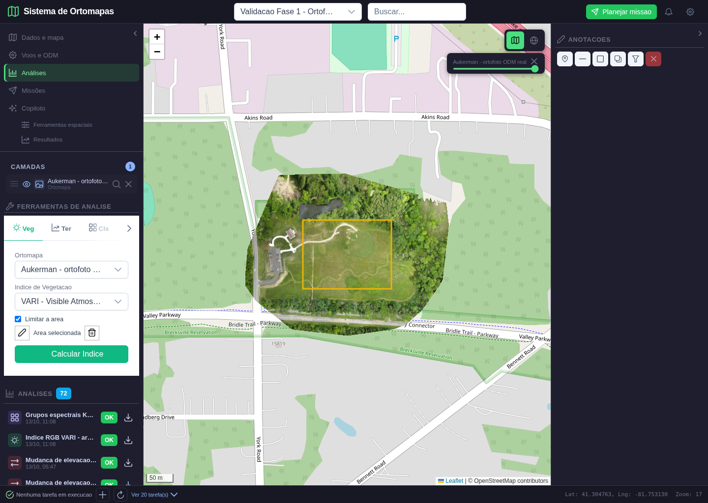
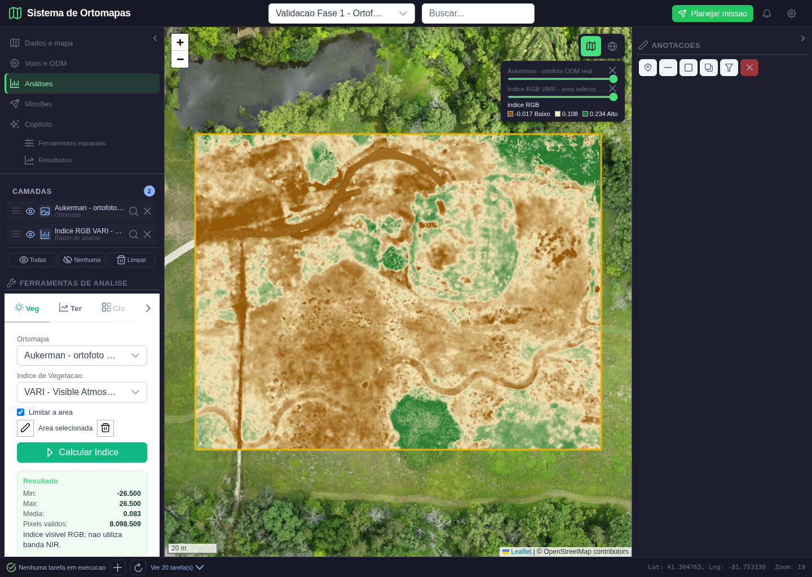
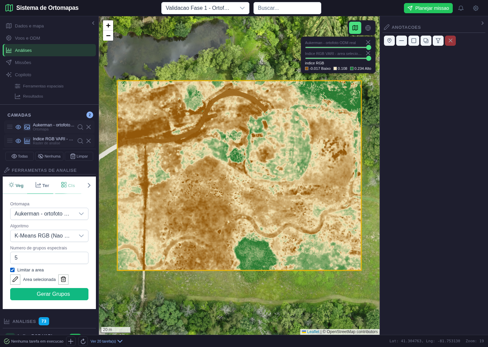
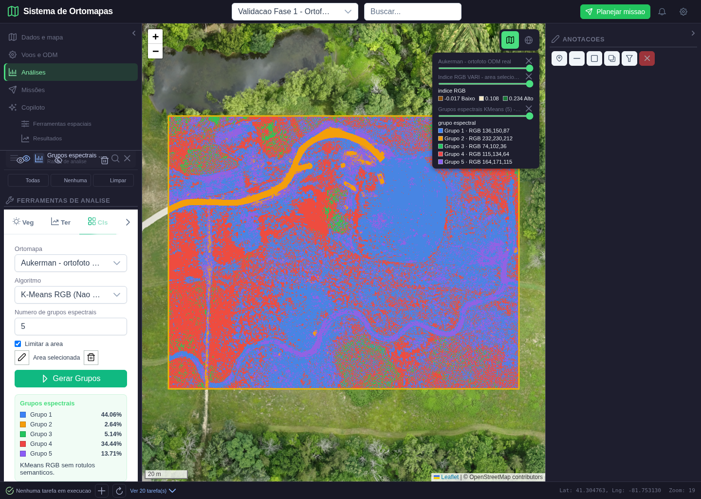
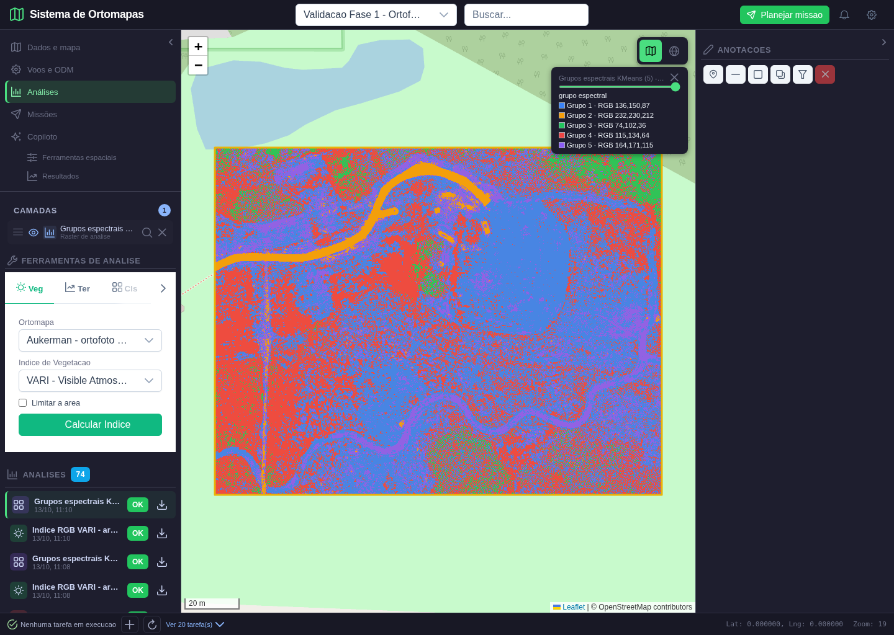

# Validacao operacional: vegetacao RGB e agrupamento espectral

**Data:** 13/10/2026

**Projeto:** Validacao Fase 1 - Ortofoto real Aukerman

**Fonte real:** `Aukerman - ortofoto ODM real` (GeoTIFF RGB, resolucao aproximada de 5 cm)

**Casos de uso:** UC-005 e UC-010

**Resultado:** **APROVADO no escopo descrito**

## 1. O que foi validado

Este lote corrigiu o contrato entre interface e backend, executou as ferramentas sobre uma ortofoto fotogrametrica real, publicou os produtos no PostgreSQL, reabriu o resultado pelo catalogo e comparou os tiles exibidos com uma colorizacao calculada de forma independente.

O termo correto para o segundo produto e **agrupamento espectral RGB nao supervisionado**. KMeans separa cores semelhantes; ele nao prova que um grupo seja agua, vegetacao ou solo. Classificacao semantica supervisionada permanece fora deste aceite ate existir conjunto de treino rotulado e avaliacao de acuracia.

## 2. Criterios e resultados

| Verificacao | Resultado |
|---|---:|
| Pixels reais processados na AOI | 8.098.509 |
| Erro maximo entre VARI gravado e formula recalculada | 0,000000102 |
| Grupos KMeans | 5 |
| Soma dos percentuais (arredondada) | 100,0001% |
| Rotulos presentes no raster | 1, 2, 3, 4 e 5 |
| Tile VARI versus RGBA esperado | identidade pixel a pixel |
| Tile KMeans versus RGBA esperado | identidade pixel a pixel |
| Pedido de NDVI sem NIR | HTTP 422 |
| DSM usado como fonte RGB | HTTP 422 |
| Usuario externo ao projeto | HTTP 403 |
| Erros JavaScript durante o fluxo | nenhum |

Os valores brutos extremos do VARI foram -26,5 e 26,5 em pixels cujo denominador se aproxima de zero. Para a visualizacao, a legenda usa percentis 2-98 (-0,017 a 0,234), evitando que poucos extremos eliminem o contraste do mapa. O GeoTIFF preserva os valores cientificos, enquanto o estilo controla somente a apresentacao.

## 3. Execucao visual

### 3.1 Fonte e area de interesse

A ortofoto real foi aberta e uma AOI retangular foi desenhada sobre uma area que inclui gramado, arvores, trilhas e superficies claras. Enquanto o desenho nao e concluido, o comando permanece bloqueado. Apenas ortomosaicos RGB/multiespectrais aparecem no seletor.

### 3.2 VARI calculado e publicado

O raster derivado ocupa somente a AOI. A paleta marrom-claro-verde usa limites robustos e a legenda informa valores numericos. O painel apresenta min, max, media e pixels validos com contraste corrigido. A mensagem informa explicitamente que o indice e visivel RGB e nao usa NIR.

A verificacao abriu o GeoTIFF produzido, reprojetou separadamente as bandas R, G e B da fonte para a grade de saida e recalculou `(G-R)/(G+R-B)`. A maior divergencia observada foi `1,0218e-7`, compatível com armazenamento float32.

### 3.3 Parametros do agrupamento

A mesma AOI foi reutilizada. A interface expoe cinco grupos, aceita de 2 a 12 e apresenta apenas o algoritmo operacional honesto: K-Means RGB nao supervisionado. Random Forest e SVM nao sao exibidos sem um fluxo real de amostras e avaliacao.

### 3.4 Resultado KMeans

O painel mostra os percentuais: 44,06%, 2,64%, 5,14%, 34,44% e 13,71%. A legenda associa cada cor ao centro RGB do grupo. O teste abriu o raster, contou todos os rotulos e recalculou areas e percentuais; os cinco grupos cobrem todos os 8.098.509 pixels validos.

O treinamento usa amostra deterministica de ate 100 mil pixels e a predicao ocorre em blocos, evitando construir uma matriz de dezenas de milhoes de linhas em memoria. Pixels pretos validos sao mantidos; somente a mascara real/nodata e excluida.

### 3.5 Persistencia e reabertura

Depois do reload, a analise `Grupos espectrais KMeans` permaneceu no catalogo e foi reaberta por seu ID. Bounds, estilo, centros RGB, contagens, areas, AOI, fonte e autor ficam armazenados em `analises.resultado_json`; o arquivo derivado tem caminho proprio e nao substitui a ortofoto.

## 4. Testes automatizados

O arquivo `tests/test_vegetation_classification.py` cobre:

- formulas VARI, TGI, ExG e GLI;
- propagacao de nodata e recorte/marcara por AOI;
- preservacao de pixel RGB preto valido;
- KMeans deterministico sobre tres cores conhecidas;
- exclusao de cores fora da AOI;
- limites de 2 a 12 grupos e falta de pixels;
- correspondencia exata das paletas de vegetacao e classificacao.

O roteiro reproduzivel esta em `scripts/validar_vegetacao_classificacao_fase3.py`. O resultado estruturado esta em `vegetacao_classificacao_fase3_2026-10-13/resultado.json`.

## 5. Limites tecnicos declarados

- VARI/TGI/ExG/GLI sao indices de bandas visiveis, nao substitutos de NDVI.
- O significado agronomico ou ambiental depende de calibracao, iluminacao, sensor e verificacao de campo.
- Os numeros dos grupos KMeans sao identificadores espectrais; nao sao classes tematicas.
- RF/SVM da API legada nao fazem parte do fluxo aprovado nesta etapa.

## 6. Parecer

UC-005 e o escopo nao supervisionado do UC-010 estao aderentes a interface atual e aprovados com dados reais. A execucao gerou produtos derivados persistentes, apresentou resultados distintos no mapa, resistiu a reload e satisfez verificacoes numericas, visuais, de tipo de fonte e de isolamento entre projetos.
