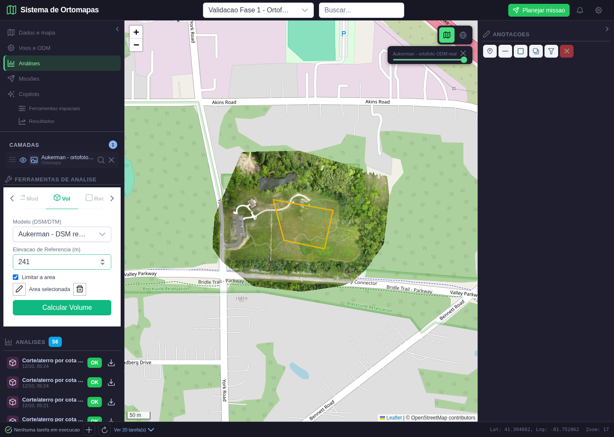
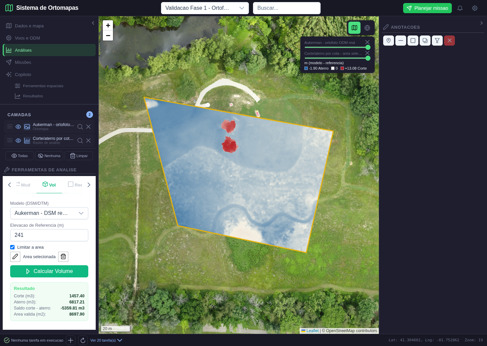
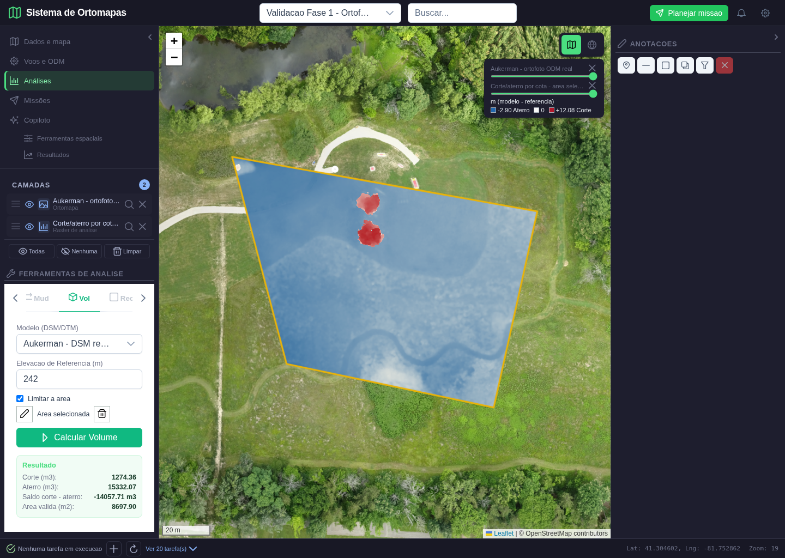
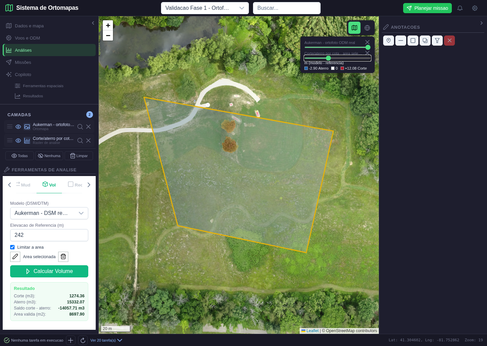
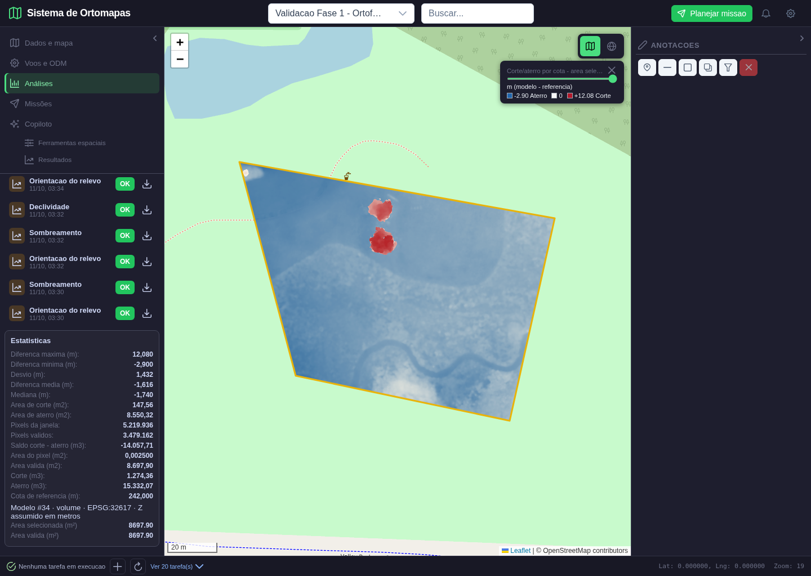
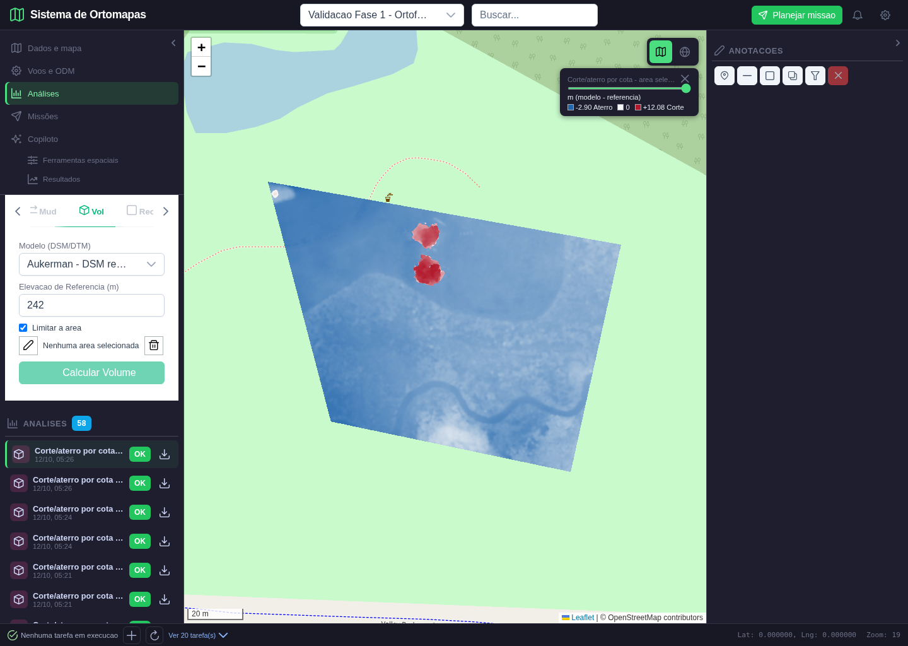

# Volume e corte/aterro por area: validacao funcional

**Data:** 12/10/2026. **Escopo:** quarto lote da fase 3, comparacao de um DSM/DTM com um plano de cota constante. Nao e comparacao entre duas campanhas nem aprovacao do sistema inteiro.

## 1. Funcionalidade e interpretacao

Em **Analises > ferramentas > Vol**, o usuario escolhe o modelo DSM/DTM, informa a cota de referencia e pode desenhar uma area. O calculo publica uma analise PostgreSQL vinculada ao projeto e ao modelo, com GeoTIFF proprio, estatisticas, proveniencia, tiles autenticados e reabertura pelo catalogo.

A diferenca e **modelo - referencia**, em metros. Positivo indica material acima do plano, denominado corte; negativo indica deficit abaixo do plano, denominado aterro. Os totais sao em metros cubicos. O saldo e **corte - aterro**; saldo negativo indica predominio de aterro. Esse contrato e diferente do endpoint legado entre duas superficies, que calcula posterior - anterior.

O mapa representa espessura/diferenca vertical, nao um volume em m3 por cor. A legenda e divergente: azul negativo, branco zero e vermelho positivo. Os extremos sao calculados por analise, incluindo zero e amplitude minima de 0,01 m; permanecem fixos para todos os tiles daquele resultado, sem ajuste por tile. Cores de duas analises diferentes devem ser interpretadas com suas respectivas legendas numericas.

**Limite de interpretacao:** o exemplo usa DSM fotogrametrico, com copas e objetos. As manchas vermelhas sobre duas arvores nao sao demonstracao de solo a escavar: sao superficies acima do plano. Para estimativa de terraplenagem e necessario DTM adequado e validacao topografica. Unidades verticais foram assumidas em metros; o datum vertical nao foi certificado. A cota de referencia nao e altura de voo.

## 2. Dados e referencias

| Item | Dado utilizado |
|---|---|
| Projeto | #62, Validacao Fase 1 - Ortofoto real Aukerman |
| Ortofoto de contexto | #30, `data/ortomapas/odm_2_ortomosaico.tif` |
| Modelo calculado | #34, `data/ortomapas/odm_2_dsm.tif` |
| Grade | 7448 x 5907, EPSG:32617, aproximadamente 0,05 m/pixel |
| Area geometrica desenhada | 8.697,902943 m2 |
| Area dos pixels incluidos | 8.697,905000 m2, 3.479.162 pixels validos |
| Pixel metrico | 0,002500 m2 |
| Referencias reais testadas | Planos de 241 m e 242 m |
| Analises finais | #69 (241 m) e #70 (242 m) |
| Referencia matematica | Prisma de 2 m em area de 100 x 200 m: 40.000 m3 |
| Interface e backend | `http://localhost:5302`, backend na porta 5018 |
| Capturas | Chromium/Playwright, 1440 x 1024 |

O prisma e um arquivo sintetico de teste com resposta conhecida, executado pelo mesmo motor real. As cenas abaixo usam o DSM real Aukerman, nao uma superficie sintetica de Guarajuba. Nao foi realizado novo processamento WebODM nesta rodada.

## 3. Demonstracao cena por cena

### Cena 1. Escolher a cota e desenhar a area



**Acao:** login, selecao do projeto e abertura da ortofoto. Navegar para Analises/Vol, preencher 241 m, habilitar Limitar a area e desenhar quatro vertices sobre o mapa. Clicar no primeiro vertice para concluir.

**Esperado:** modelo correto, cota explicita, estado Area selecionada e comando de calculo liberado somente apos concluir o desenho. **Obtido:** poligono amarelo sobre a ortofoto, controles operacionais e area concluida. Sem cota, o comando fica bloqueado; com cota valida e limitacao ativada, permanece bloqueado enquanto nao ha poligono.

O contorno amarelo e a AOI, nao uma imagem artificial. Fora dele os pixels nao participam do volume. Inclusao e feita pelo centro do pixel, preservando nodata e furos.

### Cena 2. Calcular com referencia de 241 m



**Acao:** acionar Calcular Volume e aguardar o calculo, a publicacao da analise, os tiles e o fim do carregamento do formulario.

**Esperado:** mapa de diferenca dentro do poligono, volumes com unidades e origem explicita. **Obtido:** corte 1.457,40 m3; aterro 6.817,21 m3; saldo -5.359,81 m3. A faixa do mapa e de aproximadamente -1,90 a +13,08 m. Regioes azuis ficam abaixo do plano; vermelhas, acima.

**Conferencia:** os 3.479.162 pixels validos foram comparados com a banda original do DSM, menos 241. Mascaras e valores coincidiram integralmente. Os volumes foram recalculados independentemente em float64, multiplicando a soma das diferencas positivas/negativas pela area metrica do pixel.

### Cena 3. Alterar a referencia para 242 m



**Acao:** remover a camada anterior, alterar a cota para 242 m e gerar outra analise. A alteracao invalida o resumo do pedido anterior.

**Esperado:** corte menor, aterro maior, novo arquivo e nova analise. **Obtido:** corte 1.274,36 m3; aterro 15.332,07 m3; saldo -14.057,71 m3. Extremos do mapa aproximados: -2,90 a +12,08 m. Nao houve duplicacao visual da camada anterior.

**Analise:** elevar o plano em 1 m reduz o saldo em aproximadamente 8.697,905 m3, correspondente a 1 m vezes a area dos pixels incluidos. A diferenca e consistente com a identidade volumetrica, e nao uma mudanca apenas no texto do painel.

### Cena 4. Reduzir opacidade para inspecionar o contexto



**Acao:** usar o slider da camada via teclado, Home e sete incrementos de 0,05, chegando a 0,35. A verificacao confere a opacidade efetiva do container Leaflet, nao apenas o valor do campo.

**Esperado:** mesma analise, com ortofoto visivel por baixo e estatisticas inalteradas. **Obtido:** camada translucida sobre o gramado e as arvores; os totais nao se alteram. A opacidade modifica apresentacao, nao recalcula nem modifica o GeoTIFF.

### Cena 5. Reabrir do PostgreSQL e baixar o resultado



**Acao:** recarregar a pagina, selecionar o projeto, clicar no resultado por ID e abrir suas estatisticas. Usar o icone de download do catalogo para baixar o GeoTIFF.

**Esperado:** mesmo raster de diferenca, area, cota, volumes e proveniencia. **Obtido:** mapa e estatisticas restaurados sem carregar nenhum tile da ortofoto #30. O fundo desta cena e OpenStreetMap; a saida vem da analise persistida, nao de uma substituicao pelo arquivo de origem.

**Download:** 3.191.146 bytes; SHA-256 identico ao arquivo publicado. O hash da rodada esta registrado no manifesto. O raster preserva CRS, resolucao e transformacao; a janela e menor que o DSM completo, com pixels externos transparentes/nodata. O nodata da saida e NaN, evitando confundir uma diferenca legitima de -9999 m com ausencia de dado.

### Cena 6. Limpar a area impede uma nova execucao



**Acao:** voltar para Vol, preencher uma cota valida de 242 m, habilitar limitacao, confirmar que o comando esta liberado com a area restaurada e entao limpar a area.

**Esperado:** ausencia do contorno e resumo antigo; calculo bloqueado especificamente por falta de area, mesmo com cota valida. **Obtido:** Nenhuma area selecionada e comando desabilitado. A camada previamente publicada continua no mapa; ela nao representa um novo calculo apos a limpeza.

## 4. Provas independentes: esperado versus obtido

| Verificacao | Esperado | Obtido |
|---|---|---|
| Prisma conhecido | 2 m x 20.000 m2 = 40.000 m3 | Igualdade; valores muito altos fora da AOI nao participam |
| Poligono com furo/nodata | Excluir furo e pixel nodata | 14 pixels validos, 14 m3 de corte e 14 m3 de aterro |
| Pixels rotacionados e CRS em pes | Area pelo determinante e conversao de unidade | Motor conferido com referencia conhecida |
| DSM real e AOI | Modelo - cota, somente pixels incluidos | Mascara integralmente igual; erro maximo de banda 0 m |
| Total volumetrico real | Soma independente em float64 | Erro inferior a 0,011 m3, incluindo arredondamento a centesimos |
| Tile tematico | Cores por sinal e escala persistida, alpha fora da AOI | Igualdade integral dos 65.536 pixels RGBA em cada tile testado |
| Tile de borda | Conteudo e transparencia | 24.293 pixels validos e 41.243 transparentes |
| Troca de cota | Menos corte e mais aterro ao subir o plano | Confirmado para 241/242 m |
| Resultado proprio | GeoTIFF calculado, nao DSM exibido como saida | Banda de diferenca, origem e ID persistidos |
| Reabertura | Mesmo arquivo e estatisticas | Restaurados sem ortofoto de origem |
| Download | Igualdade de bytes | SHA-256 identico |
| AOI fora do raster | Recusa, sem falso sucesso | HTTP 422 |
| Usuario fora do projeto | Acesso ao arquivo recusado | HTTP 403 |
| Visualizador publicando sem output_name | Nao poder escrever analise | HTTP 403 no projeto #2, DSM #3 |
| Referencia NaN/infinita | Recusa explicita | Validacao Pydantic e teste do motor |
| Execucao visual | Sem excecoes JavaScript | Nenhum pageerror na rodada aprovada |

Os volumes independentes antes do arredondamento foram 1.457,400258/6.817,206875 m3 em 241 m e 1.274,357553/15.332,069170 m3 em 242 m. Isso valida o algoritmo e sua aplicacao aos pixels; nao certifica acuracia fisica das elevacoes fotogrametricas.

## 5. Correcoes feitas e revisao GIS

1. O formulario enviava `ref_elevation` e nao enviava o caminho exigido pela API: agora envia `dsm_path`, `reference_elevation`, projeto, modelo, AOI e nome de saida.
2. O painel lia `cut/fill/net`, inexistentes nessa resposta: passou a mostrar os totais reais e unidades.
3. O volume nao publicava mapa/catalogo: adicionados arquivo derivado, estilo, proveniencia e persistencia PostgreSQL.
4. Limitacao por area nao existia: adicionado desenho Leaflet e recorte pela geometria real antes de somar.
5. Referencia inicial de zero podia induzir um calculo inadvertido: a cota agora inicia vazia, exigindo entrada explicita.
6. Dados e resumo antigos podiam persistir apos alterar parametros: alteracoes agora limpam o resultado do formulario.
7. Capturas em carregamento e texto de baixo contraste foram rejeitados: aguarda-se campo habilitado e numeros recebem cor legivel.
8. Escala simetrica escondia visualmente os deficits menores: escala divergente passou a indicar os extremos reais, com zero preservado e legenda numerica.
9. Publicacao com modelo explicito mas sem nome de saida precisava exigir editor: permissao corrigida e validada por HTTP e teste automatizado.
10. Teste usava ID antigo do DSM de um projeto somente leitura: passou a consultar o catalogo atual sem alterar suas permissoes.

O fluxo segue selecionar fonte, parametros, desenho, executar, inspecionar resultado, ajustar visibilidade e exportar, comum em ferramentas GIS. O catalogo ainda e longo, depende de rolagem e nao possui neste lote organizacao completa por operacao/data. Comparar cores exige consultar a escala de cada resultado. Tablet/mobile nao foram validados nesta rodada.

## 6. Limites e proxima implementacao

- Este lote e contra um plano horizontal, nao comparacao entre duas campanhas. O endpoint legado de diferenca entre modelos ainda precisa AOI, interface dedicada, persistencia e provas visuais proprias.
- Area de integracao usa centro do pixel; pequena diferenca entre area vetorial e area dos pixels e esperada. Furos/nodata sao excluidos. Nao e integracao continua exata de uma malha 3D.
- DTM e aceito pelo contrato, mas a demonstracao real e de DSM. Para uso de terraplenagem, validar DTM, datum vertical, qualidade e unidade do levantamento.
- Processamento permanece sincrono, sem fila/cancelamento. Com AOI, le apenas a janela necessaria; sem AOI, percorre o raster completo. O fluxo completo sem recorte recebeu testes matematicos, mas nao demonstracao visual real neste lote.
- GeoTIFF usa float32 e totais sao somados em float64/arredondados a 0,01 m3. Para amplitudes muito maiores, quantizacao e limites operacionais precisam avaliacao especifica.
- Retencao/exclusao de arquivos, demais motores, menus completos e validacao integrada continuam pendentes. Nao declarar fase 3 ou todo o sistema concluidos.

## 7. Reproducao e rastreabilidade

Roteiro: `scripts/validar_volume_aoi_fase3.py`. Exige servicos locais, contas de teste, projeto #62/produtos #30/#34 e projeto #2 com acesso somente leitura. Cada rodada cria duas analises reais; nao e seed de banco vazio. IDs, parametros, geometria da AOI, medidas e hash ficam no [manifesto](volume_aoi_fase3_2026-10-12/resultado.json). Os GeoTIFFs grandes permanecem no ambiente, fora do Git.

```bash
python -m scripts.validar_volume_aoi_fase3
python -m pytest tests/test_volume_aoi.py tests/test_contour_products.py tests/test_terrain_aoi.py tests/test_analysis_products.py tests/test_gis_rate_limit.py tests/test_terrain_tools.py tests/test_elevation_analysis.py tests/test_metric_analysis.py tests/test_surface_grid.py tests/test_resource_access.py tests/test_raster_tiles.py tests/test_ortomapas_postgres.py -q
node --test frontend/tests/analysisProducts.test.js frontend/tests/cloudGeometry.test.js frontend/tests/terrainGeometry.test.js
```

**80 testes Python**, tres arquivos de testes Node e build de producao aprovados. Avisos preexistentes de depreciacao e bundle grande permanecem. A suite e focada, nao certifica todo o repositorio.

A regressao visual/API das camadas raster anteriores foi repetida apos esta integracao. As analises #74/#75/#76 de declividade, aspecto e hillshade conservaram mascaras integralmente iguais a referencia independente, com erros maximos respectivos de 0,000003814, 0,000015259 e 0,000007630. Reabertura, download com hash identico, limpeza da AOI e recusa de area fora do raster passaram novamente, sem erros JavaScript. Manifesto: [regressao de terreno](volume_aoi_fase3_2026-10-12/regressao_terreno/resultado.json).

O lote atende ao prisma T-06 do plano nesse contrato por cota/AOI e amplia T-09 (resultado persistido), T-10 (permissoes) e T-15 (entradas invalidas). Nao encerra todos os casos de volume ou as analises entre campanhas.

**Proximo lote:** comparacao entre dois modelos/campanhas por area, com contrato de sinal explicito, alinhamento, mapa persistido, unidades e dados de referencia.
